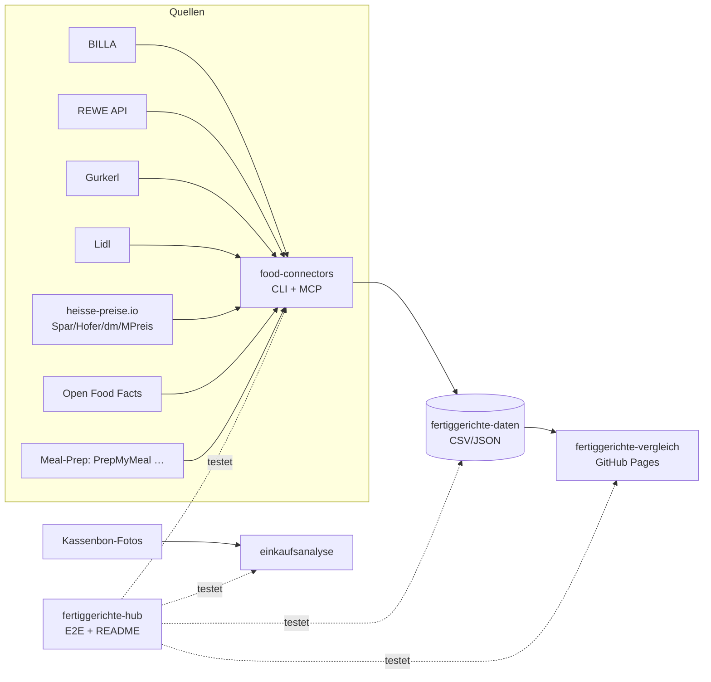

# 🥘 Fertiggerichte-Hub

Zentraler Index & Live-Status aller Fertiggerichte-Projekte (servas-ai). **Automatisch generiert:** 2026-10-13 21:12 UTC via `./run_all.sh` (stündlich).

**Connectors:** 15 ✅ / 4 ❌ / 8 📇 catalog-only · **Apps:** 3/3 live · **Produkte im Datensatz:** 2957

## Apps

| App | URL | Live | Tabs getestet | Konsolen-Fehler | Kaputte Bilder |
|---|---|---|---|---|---|
| Fertiggerichte-Vergleich | https://martin-hausleitner.github.io/fertiggerichte-vergleich/ | ✅ | 30 | 0 | 0 |
| Fertiggerichte-Vergleich (servas-ai Pages) | https://servas-ai.github.io/fertiggerichte-vergleich/ | ✅ | 30 | 0 | 0 |
| Einkaufsanalyse | https://servas-ai.github.io/einkaufsanalyse/ | ✅ | 8 | 0 | 0 |

## Repositories

| Repo | Zweck |
|---|---|
| [servas-ai/fertiggerichte-vergleich](https://github.com/servas-ai/fertiggerichte-vergleich) | Web-App (Vergleich, Netz 3D, Gesundheit, Hersteller …) |
| [servas-ai/food-connectors](https://github.com/servas-ai/food-connectors) | Connectors + CLI + MCP-Server |
| [servas-ai/fertiggerichte-daten](https://github.com/servas-ai/fertiggerichte-daten) | Offener Datensatz CSV/JSON |
| [servas-ai/einkaufsanalyse](https://github.com/servas-ai/einkaufsanalyse) | Einkaufsanalyse-Dashboard (Kassenbons) |

## Architektur



## Connector-Status (Live-Smoke-Test)

| | Connector | Store | Items | Latenz | Beispielprodukt (Beweis) | Zeitpunkt |
|---|---|---|---|---|---|---|
| ✅ | `billa` | BILLA | 3 | 0.44 s | [MAGGI Fix für Gulasch](https://shop.billa.at/produkte/maggi-fix-fuer-gulasch-0056152) · 1.49 € | 2026-10-13T21:07:29Z |
| ✅ | `denns` | denn's BioMarkt | 1 | 4.19 s | [MyDeli Bio-Fleischsuppe](https://www.denns-biomarkt.at/angebote/) · 3.49 € | 2026-10-13T21:07:29Z |
| ✅ | `dm` | dm | 3 | 3.88 s | [babylove Menü Kartoffeltopf mit Rindergulasch ab d](https://www.dm.at/p/d/1602887/babylove-menue-kartoffeltopf-mit-rindergulasch-ab-dem-8-monat) · 1.15 € | 2026-10-13T21:07:33Z |
| ✅ | `gourmetfein` | Online: Gourmetfein | 3 | 3.19 s | [Weißwurst 1,8kg](https://shop.gourmetfein.com/products/weisswurst-1-8kg) · 24.9 € | 2026-10-13T21:07:44Z |
| ✅ | `gurkerl` | Gurkerl.at | 3 | 0.31 s | [AMA Kalb Rosé Austria Gulasch geschnitten](https://www.gurkerl.at/22932-ama-kalb-rose-austria-gulasch-geschnitten) · 16.1 € | 2026-10-13T21:07:48Z |
| ✅ | `heisse-preise` | heisse-preise.io | 3 | 2.86 s | [Ager Hirschgulasch geschnitten](ager-hirschgulasch-geschnitten-00730647) · 11.99 € | 2026-10-13T21:07:48Z |
| ✅ | `livefresh` | Online: LiveFresh | 3 | 0.81 s | [Pasta Cheesy Spinat – Protein Bowl](https://livefresh.at/products/pasta-cheesy-spinat-400g) · 5.99 € | 2026-10-13T21:08:43Z |
| ✅ | `mpreis-shop` | MPreis | 3 | 6.97 s | [Basis Gulasch](https://www.mpreis.at/shop/p/knorr-basis-gulasch-282001) · 1.39 € | 2026-10-13T21:09:15Z |
| ✅ | `nah-frisch` | Nah&Frisch | 2 | 171.78 s | [Inzersdorfer Fertiggerichte oder Suppen](https://www.nahundfrisch.at/de/aktuelles/angebote-der-woche) | 2026-10-13T21:09:22Z |
| ✅ | `off` | Open Food Facts | 3 | 1.32 s | [Gulasch (Rind)](https://world.openfoodfacts.org/product/4099200121543) | 2026-10-13T21:12:14Z |
| ✅ | `penny` | PENNY | 2 | 4.03 s | [Schweinefleisch für Reisfleisch/Gulasch](https://www.penny.at/produkte/schweinefleisch-fuer-reisfleischgulasch-78544771) · 3.99 € | 2026-10-13T21:12:16Z |
| ✅ | `prepmymeal` | Online: PrepMyMeal | 3 | 4.5 s | [CH: Gemüse Lasagne](https://prepmymeal.at/products/ch-gemuse-lasagne-3) · 14.5 € | 2026-10-13T21:12:20Z |
| ✅ | `spar` | SPAR/INTERSPAR | 3 | 2.7 s | Baron de Sel Gourmet Gulasch Bio 55g · 4.99 € | 2026-10-13T21:12:24Z |
| ✅ | `spar-shop` | SPAR/INTERSPAR | 3 | 0.99 s | [TANN Rinds-Bratengulasch](https://www.interspar.at/shop/lebensmittel/tann-rinds-bratengulasch/p/835817) · 21.99 € | 2026-10-13T21:12:28Z |
| ✅ | `unimarkt` | Unimarkt | 3 | 2.6 s | [Felix Erdäpfelgulasch](/Felix-Erdaepfelgulasch-3692) · 5.39 € | 2026-10-13T21:12:30Z |
| 📇 | `adeg` | ADEG | 0 | 0.0 s |  | 2026-10-13T21:07:28Z |
| 📇 | `bio-kistl` | Biohof Achleitner / Bio-Kistl OÖ | 0 | 0.0 s |  | 2026-10-13T21:07:29Z |
| ❌ | `dm-heisse` |  | 0 |  s | ` scheduled for removal in a future version. Use timezone-aware objects to represent dateti` |  |
| 📇 | `fittogo` | Fit to Go | 0 | 0.0 s |  | 2026-10-13T21:07:44Z |
| 📇 | `foodora-market` | foodora market (Dmart) | 0 | 0.0 s |  | 2026-10-13T21:07:44Z |
| ❌ | `hofer` |  | 0 |  s | ` scheduled for removal in a future version. Use timezone-aware objects to represent dateti` |  |
| ❌ | `lidl` | Lidl | 0 | 11.4 s | `HTTPError: HTTP Error 401: Unauthorized` | 2026-10-13T21:08:32Z |
| 📇 | `lieferando-shops` | Lieferando Shops | 0 | 0.0 s |  | 2026-10-13T21:08:43Z |
| 📇 | `mjam` | mjam (now foodora) | 0 | 0.0 s |  | 2026-10-13T21:08:44Z |
| ❌ | `mpreis` |  | 0 |  s | ` scheduled for removal in a future version. Use timezone-aware objects to represent dateti` |  |
| 📇 | `unimarkt-shop` | Unimarkt (UNIONLINE Shop) | 0 | 0.0 s |  | 2026-10-13T21:12:34Z |
| 📇 | `wokostswas` | wokostswas.at | 0 | 0.0 s |  | 2026-10-13T21:12:34Z |

## Datensatz

**2957 Produkte** · Tabellen: brand_tree 8, companies 133, establishments 4706, logos 250, nutrition 2122, online_mealprep 96, online_providers 3, prices 2603, producer_quality 4, producers 22, products 2957, stores 498

| Abdeckung | % |
|---|---|
| nutrition | 71.7 |
| price | 88.0 |
| photo | 91.8 |
| producer | 37.9 |
| brand | 88.9 |
| logos_total | 250 |

<details><summary>Produkte nach Kette</summary>

| Kette | Anzahl |
|---|---|
| Billa | 780 |
| Spar | 660 |
| Gurkerl | 506 |
| MPreis | 296 |
| Hofer | 224 |
| unbekannt (OFF) | 112 |
| PrepMyMeal | 90 |
| Subway | 59 |
| NORDSEE | 39 |
| Lidl | 37 |
| dm | 34 |
| Fit to Go | 29 |
| Unimarkt | 29 |
| Penny | 22 |
| FitTaste | 18 |
| LiveFresh | 10 |
| Nah&Frisch | 7 |
| Denn's | 5 |

</details>

<details><summary>Produkte nach Fertigstufe/Lagerung</summary>

| Lagerung | Anzahl |
|---|---|
| Unklar (keine Lagerangabe) | 1014 |
| Tiefkühl (TK) | 635 |
| Kühlregal (Menüschale/frisch) | 527 |
| Dose/Konserve | 397 |
| Trocken/Instant | 325 |
| Glas | 34 |
| Sous-vide (vakuum) | 14 |
| Beutel ungekühlt (Retort-Pouch) | 11 |

</details>

## Screenshots

### Fertiggerichte-Vergleich

| Tab | Desktop 1920 | Mobil 390 |
|---|---|---|
| home |  |  |
| Feed |  |  |
| Galerie |  |  |
| Vergleichs-Board |  |  |
| Gericht vergleichen |  |  |
| Top-Listen |  |  |
| Kategorien |  |  |
| Marken-Profil |  |  |
| Laden-Profil |  |  |
| Marken |  |  |
| Markenfamilien |  |  |
| Dashboard |  |  |
| Gesundheit & Qualität |  |  |
| Analyse |  |  |
| Preis vs. Protein |  |  |
| Verpackungen |  |  |
| Marken-Matrix |  |  |
| Hersteller |  |  |
| Wer steckt dahinter? |  |  |
| Firmenvergleich |  |  |
| Hersteller-Qualität |  |  |
| Logos |  |  |
| Netz 3D |  |  |
| Läden & Werke |  |  |
| Filialen in der Nähe |  |  |
| Online-Anbieter |  |  |
| Wochenplaner |  |  |
| Kombi-Ideen |  |  |
| Fit to Go vs. Supermarkt |  |  |
| Multipot-Pro Garzeiten |  |  |

### Fertiggerichte-Vergleich (servas-ai Pages)

| Tab | Desktop 1920 | Mobil 390 |
|---|---|---|
| home |  |  |
| Feed |  |  |
| Galerie |  |  |
| Vergleichs-Board |  |  |
| Gericht vergleichen |  |  |
| Top-Listen |  |  |
| Kategorien |  |  |
| Marken-Profil |  |  |
| Laden-Profil |  |  |
| Marken |  |  |
| Markenfamilien |  |  |
| Dashboard |  |  |
| Gesundheit & Qualität |  |  |
| Analyse |  |  |
| Preis vs. Protein |  |  |
| Verpackungen |  |  |
| Marken-Matrix |  |  |
| Hersteller |  |  |
| Wer steckt dahinter? |  |  |
| Firmenvergleich |  |  |
| Hersteller-Qualität |  |  |
| Logos |  |  |
| Netz 3D |  |  |
| Läden & Werke |  |  |
| Filialen in der Nähe |  |  |
| Online-Anbieter |  |  |
| Wochenplaner |  |  |
| Kombi-Ideen |  |  |
| Fit to Go vs. Supermarkt |  |  |
| Multipot-Pro Garzeiten |  |  |

### Einkaufsanalyse

| Tab | Desktop 1920 | Mobil 390 |
|---|---|---|
| home |  |  |
| Übersicht |  |  |
| Verlauf |  |  |
| Läden |  |  |
| Kategorien |  |  |
| Protein & Gesundheit |  |  |
| Kassenbons |  |  |
| Import |  |  |

## Changelog (letzte Commits)

**servas-ai/fertiggerichte-vergleich**

- `43b078f` 2026-10-13 20:48 — squad T20b: Nah&Frisch first 7 products (0→7) via new food-connectors nah-frisch (public Angebote-der-Woche tiles KW41/42, OCR + visual check; iglo Fleischknödel 3.99, Knorr Kaiserteller 1.39 ×2, Inzersdorfer ×4 '-25%' no shelf price); nutrition from identical-product twins
- `cb2ded9` 2026-10-13 20:19 — data: denn's BioMarkt AT rows fixed (per-article URLs; 4 offer rows + OFF soups), Daten-Squad T20
- `ac346e8` 2026-10-13 20:12 — data: +6 denn's BioMarkt AT rows (denn's AT offer feed via food-connectors denns + OFF denn's-tagged soups), Daten-Squad T20
- `7102641` 2026-10-13 19:49 — data: SPAR live prices via spar-shop connector (+121 Spar rows confirmed live 2026, Daten-Squad T19b)
- `93674e5` 2026-10-13 19:22 — hourly T18: +32 verified meals (MPreis 26: Iglo/Therese Mölk/Toni Kaiser TK-Knödel, Pan/Alpenstrudel Strudel, Inzersdorfer Erdäpfelgulasch 800 g + Chili, Felix Gulaschsuppe 400 g, Knorr Rindsuppe, Alnatura Chili sin Carne, Followfood/Fryzza/Dr. Oetker Suprema/Jeden Tag TK-Pizza, Delamaris Njami Bowl, Gazpacho, Dozz Spinatsuppe; BILLA 5: Dr. Oetker Intermezzo x3, Wagner AirFryer Salami, Iglo Milchrahmstrudel; Gurkerl 1: Leitgeb's Italienischer Nudelteller); producers +23, IDK +1; brand tree +Therese Mölk/Toni Kaiser/Pan; Intermezzo + fruit-dumpling stage fix; rows 2824→2856
- `8303988` 2026-10-13 19:02 — data: companies +12 legal entities Impressum/VIES + ANDROS GLEIF (LEI-or-UID 106→118/133; Recheis, REWE Fleischwaren+Genussküche, Graninger, Hochreiter, Landtmann→Querfeld, Inzersdorfer→MARESI, Meica, Deflorian, Strauss Josef, Danone AT, BONNE MAMAN→ANDROS)
- `b720a32` 2026-10-13 18:28 — data: Subway logo (Commons PD 2016 wordmark, 59 products) + Alpenhain logo (CC BY-SA); Subway photos 0/59 (subway.com menu pages bot-blocked, media.subway.com robots Disallow)
- `8abc549` 2026-10-13 18:20 — hourly T17: +49 verified meals (MPreis 31: Felix/Inzersdorfer Gulasch+Chili+Erdäpfelgulasch, Knorr Meister Kessel x3, Alnatura Linseneintopf/Suppen, Schenkel Hummer-/Zwiebelsuppe, Exotic Food Tom Kha/Tom Yum, Wolfensberger & Pomella Knödel x3, Iglo Grammelknödel, Dr. Oetker Bistro x5, Piccolinis x2, Jeden Tag Chili/Frühlingsrollen; BILLA 15: Gustavo Gusto Amore Napoli x3 + Halloween, Wagner Piccolinis x5/Big Sensation x2/Backfrische, Dr. Oetker Ofenfrische, Iglo Ofenbackfisch, Deliciosu Poké Bowl; PENNY 3 via REWE article twins); producers +24 / Identitätskennzeichen +12 (OFF emb_codes); brand tree +WP Fine Food, Exotic Food, Markant/Jeden Tag, Deliciosu; stage fix pizza names w/o 'Pizza'; MPreis placeholder images removed; rows 2775→2824

**servas-ai/food-connectors**

- `91f223b` 2026-10-13 20:53 — feat(nah-frisch): live Nah&Frisch AT connector via the public 'Angebote der Woche' page (robots Allow; tiles from /media, /images+/storage never requested) — KW tabs with validity, official offer tiles, optional tesseract OCR for brand/name/pack/price/badge (extra.ocr, raw text kept); MCP nahfrisch_offers; offline tests with fixtures; ADEG documented as Issuu-flipbook dead end (2026-10-13T20b)
- `c7a16c0` 2026-10-13 20:10 — feat(denns): live denn's BioMarkt AT connector via the public weekly offer feed (Gatsby page-data, robots Allow) — article no., brand, pack, Aktionspreis + Normalpreis, €/kg, validity, vegan flags, official image; MCP denns_offers; live adapters now override catalog-only stubs; offline tests (2026-10-13T20)
- `509f6f6` 2026-10-13 19:48 — fix(spar-shop): code-internal is a SPAR-internal 88… code, not a GTIN → extra.spar_code_internal, ean=None; docs (2026-10-13T19b)
- `1b4bbfc` 2026-10-13 19:47 — feat(spar-shop): live SPAR/INTERSPAR connector via SPAR's public product search API (exact article-number lookup: price, regular price, €/kg, GTIN, stock, image); MCP spar_product; weight products flagged per-100g; tests (2026-10-13T19b)
- `086a6e3` 2026-10-13 18:25 — fix(mpreis): drop shop placeholder image (/assets/noImage_detail-*.webp, site-relative → 404 downstream); only absolute http image URLs kept; tests (2026-10-13T17)
- `3500939` 2026-10-13 17:28 — fix(impressum): VAT regex accepts grouped-digit UIDs ('ATU 43 20 34 03', 'NL 853 640 804 B 01') seen on penny.at/heiploeg.com legal notices; test (2026-10-13T17)
- `aa3d626` 2026-10-13 15:23 — feat(billa/penny): storage class (frozen/chilled from badge, parent category, -18°C statement) + category path in enrich; keep Normalpreis (price.standard) next to promo price; more TK stems (Mohnnudeln, Apfelstrudel, Fischstäbchen, Erdäpfeltascherl); gurkerl fetch adds TK Fischstäbchen/Schlemmerfilet categories; tests (2026-10-13T14)
- `641914b` 2026-10-13 12:36 — feat(billa): more ready-meal search stems (TK pizza, Krautfleckerl, Germknödel, Kaiserschmarrn, noodle cups) (2026-10-13T12)

**servas-ai/fertiggerichte-daten**

- `de8576e` 2026-10-13 20:53 — Nah&Frisch AT: first 7 products (0→7) via new food-connectors nah-frisch (public 'Angebote der Woche' offer tiles KW41/42, tesseract OCR + visual verification): iglo Pikante Knödel Fleischknödel 400 g 3.99 €, Knorr Kaiserteller Grießnockerl-/Knoblauchcremesuppe 1.39 €, Inzersdorfer Rindsgulasch/Gulaschsuppe/Gefüllte Paprika/Weinbeuschel 400 g ('25% billiger', no absolute price); 7/7 official tile photos; nutrition/EAN only from identical-product twins (BILLA/MPreis/Gurkerl); products 2950→2957, prices 2600→2603, nutrition 2115→2122; evidence raw/nahfrisch_2026-10-13T20b.json
- `c84fd75` 2026-10-13 20:22 — denn's BioMarkt AT: first 5 products (0→5) via new food-connectors denns (public AT offer feed: MyDeli Bio-Fleischsuppe, SOTO Fingerfood, followfood Airfryer Fish Nuggets — Normalpreis + Aktionspreis/validity) + 2 OFF denn's-tagged Natur Compagnie soups (nutrition, no price); products 2945→2950; evidence raw/denns_2026-10-13T20.json
- `1403505` 2026-10-13 20:00 — prices: SPAR live 2026 via new food-connectors spar-shop (SPAR public search API, exact article number): Spar live 493→612, 'Preis 2025' 150→31 (122 articles confirmed listed, 1 real price change Iglo Lasagne skipped on pack-size mismatch 350→700 g, 17 article numbers no longer listed, 11 counter/weight products unchanged); re-export products 2915→2945; evidence raw/spar_live_2026-10-13T19.json
- `d4aeeac` 2026-10-13 18:58 — companies: +12 legal entities via Impressum/VIES + ANDROS GLEIF (LEI-or-UID 106→118/133, UID 47→60, LEI 59→60, FN 47→54)
- `59727a1` 2026-10-13 18:34 — logos: Subway (Commons PD 2016 wordmark → all 59 Subway rows, largest logo-less brand) + Alpenhain (Commons CC BY-SA 4.0), vision-gated; strict logo-less 106→104 brands / 366→305 products; Subway photos 0/59 (subway.com menu pages drop non-browser clients, media.subway.com robots Disallow: / — not bypassed); rejected Vifon (producer unverified), Yum Yum (unreachable); data re-export incl. hourly T17 (products 2841→2915, prices 2493→2567, nutrition 2009→2083); evidence raw/subway_2026-10-13T18.json
- `a2074f1` 2026-10-13 17:29 — companies: +26 legal entities via Impressum + live EU VIES (LEI-or-UID 80→106/133, UID 21→47, FN 39→47): Unilever Austria, iglo Austria, Fit2go, YOUCOOK, Stangl, Andros Austria, BS Gastro, Caro Fratello, Ager, Amlacher Nudel, deli gourmet, Lamercantile Scardovi, Cecchin, AIA, Heiploeg, Kikkoman Trading Europe, Planted Foods GmbH, PLANT BASED POWER, Whollees, BioGourmet, Hammermühle, Zum Dorfkrug KG, Every., PENNY, dm, Blasko; 19 ids from own legal notices + 7 directory UIDs accepted only on exact VIES name+address; 16 rejected with reasons; evidence raw/impressum_vies_2026-10-13T17.json
- `fed48a8` 2026-10-13 16:29 — data: re-export from current app build (products 2630→2841, prices 2290→2493, nutrition 1866→2009; replaces stale 14:15 export left uncommitted by the DNS outage) + companies: +9 manually verified GLEIF LEIs (label legal name/address = GLEIF legal address): Alnatura, Molkerei Alois Müller (→ Theo Müller), Pastificio Rana, Ehrmann GmbH, Galana NV, Delamaris, Doppelt, Dairy 4 Fun, La Crêpe de Brocéliande (→ Financière RT); LEI 50→59/133, LEI-or-UID 71→80; 19 candidates rejected with reasons; overlay script enrich_companies_gleif_verified.py hooked into companies_enrich; evidence raw/gleif_verified_2026-10-13T16.json
- `51cab5a` 2026-10-13 15:36 — logos: +6 vision-gated brand logos (Podravka, Heura, Nordsee from Wikimedia Commons PD; Mama red wordmark mama.co.th, Maza maza.at, Englert feinkost-englert.de mono→dark) + aliases Omis→Omis Schmankerl, Danny→Danone, Spar Linguine→Spar; strict logo-less 98→89 brands / 273→262 products; company logos 118/133 unchanged; rejected Yopokki (timeout/TLS), Windisch (icon only), innocent, Findus, Leitinger, Thai Delight; evidence raw/logos_squad_2026-10-13T15.json

**servas-ai/einkaufsanalyse**

- `66934e3` 2026-10-13 01:10 — Einkaufsanalyse v1: shadcn Sidebar-Dashboard, Import, OCR, Beispieldaten

## Ausführen

```bash
pip install pytest playwright && playwright install chromium
./run_all.sh   # Tests + Report + Push (mit Lock, stündlich via cron)
```
