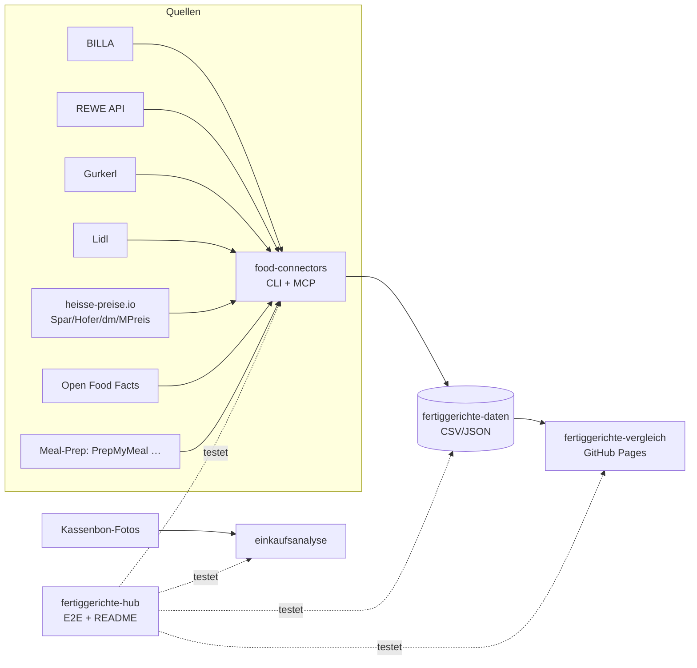

# 🥘 Fertiggerichte-Hub

Zentraler Index & Live-Status aller Fertiggerichte-Projekte (servas-ai). **Automatisch generiert:** 2026-10-13 15:41 UTC via `./run_all.sh` (stündlich).

**Connectors:** 15 ✅ / 1 ❌ / 10 📇 catalog-only · **Apps:** 2/3 live · **Produkte im Datensatz:** 2483

## Apps

| App | URL | Live | Tabs getestet | Konsolen-Fehler | Kaputte Bilder |
|---|---|---|---|---|---|
| Fertiggerichte-Vergleich | https://martin-hausleitner.github.io/fertiggerichte-vergleich/ | ✅ | 30 | 0 | 0 |
| Fertiggerichte-Vergleich (servas-ai Pages) | https://servas-ai.github.io/fertiggerichte-vergleich/ | ❌ | 0 | 0 | 0 |
| Einkaufsanalyse | https://servas-ai.github.io/einkaufsanalyse/ | ✅ | 8 | 0 | 0 |

## Repositories

| Repo | Zweck |
|---|---|
| [servas-ai/fertiggerichte-vergleich](https://github.com/servas-ai/fertiggerichte-vergleich) | Web-App (Vergleich, Netz 3D, Gesundheit, Hersteller …) |
| [servas-ai/food-connectors](https://github.com/servas-ai/food-connectors) | Connectors + CLI + MCP-Server |
| [servas-ai/fertiggerichte-daten](https://github.com/servas-ai/fertiggerichte-daten) | Offener Datensatz CSV/JSON |
| [servas-ai/einkaufsanalyse](https://github.com/servas-ai/einkaufsanalyse) | Einkaufsanalyse-Dashboard (Kassenbons) |

## Architektur



## Connector-Status (Live-Smoke-Test)

| | Connector | Store | Items | Latenz | Beispielprodukt (Beweis) | Zeitpunkt |
|---|---|---|---|---|---|---|
| ✅ | `billa` | BILLA | 3 | 0.43 s | [MAGGI Fix für Gulasch](https://shop.billa.at/produkte/maggi-fix-fuer-gulasch-0056152) · 1.49 € | 2026-10-13T15:40:48Z |
| ✅ | `dm` | dm | 3 | 3.54 s | [babylove Menü Kartoffeltopf mit Rindergulasch ab d](https://www.dm.at/p/d/1602887/babylove-menue-kartoffeltopf-mit-rindergulasch-ab-dem-8-monat) · 1.15 € | 2026-10-13T15:40:49Z |
| ✅ | `dm-heisse` | dm | 3 | 2.65 s | HiPP Menü Spätzle mit Gulasch ab 8 Monaten, 220 g · 1.75 € | 2026-10-13T15:40:52Z |
| ✅ | `gourmetfein` | Online: Gourmetfein | 3 | 2.85 s | [Weißwurst 1,8kg](https://shop.gourmetfein.com/products/weisswurst-1-8kg) · 24.9 € | 2026-10-13T15:40:57Z |
| ✅ | `gurkerl` | Gurkerl.at | 3 | 0.43 s | [AMA Kalb Rosé Austria Gulasch geschnitten](https://www.gurkerl.at/22932-ama-kalb-rose-austria-gulasch-geschnitten) · 16.1 € | 2026-10-13T15:40:59Z |
| ✅ | `heisse-preise` | heisse-preise.io | 3 | 2.64 s | [Ager Hirschgulasch geschnitten](ager-hirschgulasch-geschnitten-00730647) · 11.99 € | 2026-10-13T15:41:00Z |
| ✅ | `hofer` | HOFER | 3 | 2.78 s | [GENUSS 100% AUS ÖSTERREICH Rindsgulasch 1kg](sortiment/GENUSS-100-AUS-OSTERREICH-Rindsgulasch-1kg) · 19.98 € | 2026-10-13T15:41:04Z |
| ✅ | `livefresh` | Online: LiveFresh | 3 | 1.23 s | [Pasta Cheesy Spinat – Protein Bowl](https://livefresh.at/products/pasta-cheesy-spinat-400g) · 5.99 € | 2026-10-13T15:41:20Z |
| ✅ | `mpreis` | MPREIS | 3 | 2.63 s | AIA Puten Gulasch · 6.5 € | 2026-10-13T15:41:22Z |
| ✅ | `mpreis-shop` | MPreis | 3 | 6.94 s | [Basis Gulasch](https://www.mpreis.at/shop/p/knorr-basis-gulasch-282001) · 1.39 € | 2026-10-13T15:41:26Z |
| ✅ | `off` | Open Food Facts | 3 | 1.15 s | [Gulasch (Rind)](https://world.openfoodfacts.org/product/4099200121543) | 2026-10-13T15:41:33Z |
| ✅ | `penny` | PENNY | 2 | 5.11 s | [Schweinefleisch für Reisfleisch/Gulasch](https://www.penny.at/produkte/schweinefleisch-fuer-reisfleischgulasch-78544771) · 3.99 € | 2026-10-13T15:41:34Z |
| ✅ | `prepmymeal` | Online: PrepMyMeal | 3 | 6.27 s | [CH: Gemüse Lasagne](https://prepmymeal.at/products/ch-gemuse-lasagne-3) · 14.5 € | 2026-10-13T15:41:39Z |
| ✅ | `spar` | SPAR/INTERSPAR | 3 | 2.66 s | Baron de Sel Gourmet Gulasch Bio 55g · 4.99 € | 2026-10-13T15:41:45Z |
| ✅ | `unimarkt` | Unimarkt | 3 | 2.69 s | [Felix Erdäpfelgulasch](/Felix-Erdaepfelgulasch-3692) · 5.39 € | 2026-10-13T15:41:50Z |
| 📇 | `adeg` | ADEG | 0 | 0.0 s |  | 2026-10-13T15:40:48Z |
| 📇 | `bio-kistl` | Biohof Achleitner / Bio-Kistl OÖ | 0 | 0.0 s |  | 2026-10-13T15:40:49Z |
| 📇 | `denns` | denn's BioMarkt | 0 | 0.0 s |  | 2026-10-13T15:40:49Z |
| 📇 | `fittogo` | Fit to Go | 0 | 0.0 s |  | 2026-10-13T15:40:56Z |
| 📇 | `foodora-market` | foodora market (Dmart) | 0 | 0.0 s |  | 2026-10-13T15:40:56Z |
| ❌ | `lidl` | Lidl | 0 | 11.65 s | `HTTPError: HTTP Error 401: Unauthorized` | 2026-10-13T15:41:08Z |
| 📇 | `lieferando-shops` | Lieferando Shops | 0 | 0.0 s |  | 2026-10-13T15:41:20Z |
| 📇 | `mjam` | mjam (now foodora) | 0 | 0.0 s |  | 2026-10-13T15:41:21Z |
| 📇 | `nah-frisch` | Nah&Frisch | 0 | 0.0 s |  | 2026-10-13T15:41:33Z |
| 📇 | `unimarkt-shop` | Unimarkt (UNIONLINE Shop) | 0 | 0.0 s |  | 2026-10-13T15:41:54Z |
| 📇 | `wokostswas` | wokostswas.at | 0 | 0.0 s |  | 2026-10-13T15:41:54Z |

## Datensatz

**2483 Produkte** · Tabellen: brand_tree 8, companies 133, establishments 4706, logos 248, nutrition 1731, online_mealprep 96, online_providers 3, prices 2174, producer_quality 4, producers 22, products 2483, stores 498

| Abdeckung | % |
|---|---|
| nutrition | 69.7 |
| price | 87.6 |
| photo | 92.8 |
| producer | 35.1 |
| brand | 86.8 |
| logos_total | 248 |

<details><summary>Produkte nach Kette</summary>

| Kette | Anzahl |
|---|---|
| Billa | 649 |
| Spar | 586 |
| Gurkerl | 453 |
| Hofer | 222 |
| MPreis | 209 |
| unbekannt (OFF) | 122 |
| PrepMyMeal | 90 |
| Lidl | 37 |
| dm | 33 |
| Unimarkt | 29 |
| Fit to Go | 24 |
| Penny | 17 |
| LiveFresh | 10 |
| FitTaste | 2 |

</details>

<details><summary>Produkte nach Fertigstufe/Lagerung</summary>

| Lagerung | Anzahl |
|---|---|
| Unklar (keine Lagerangabe) | 944 |
| Tiefkühl (TK) | 460 |
| Kühlregal (Menüschale/frisch) | 401 |
| Dose/Konserve | 350 |
| Trocken/Instant | 285 |
| Glas | 18 |
| Sous-vide (vakuum) | 14 |
| Beutel ungekühlt (Retort-Pouch) | 11 |

</details>

## Screenshots

### Fertiggerichte-Vergleich

| Tab | Desktop 1920 | Mobil 390 |
|---|---|---|
| home |  |  |
| Feed |  |  |
| Galerie |  |  |
| Vergleichs-Board |  |  |
| Gericht vergleichen |  |  |
| Top-Listen |  |  |
| Kategorien |  |  |
| Marken-Profil |  |  |
| Laden-Profil |  |  |
| Marken |  |  |
| Markenfamilien |  |  |
| Dashboard |  |  |
| Gesundheit & Qualität |  |  |
| Analyse |  |  |
| Preis vs. Protein |  |  |
| Verpackungen |  |  |
| Marken-Matrix |  |  |
| Hersteller |  |  |
| Wer steckt dahinter? |  |  |
| Firmenvergleich |  |  |
| Hersteller-Qualität |  |  |
| Logos |  |  |
| Netz 3D |  | – |
| Läden & Werke |  | – |
| Filialen in der Nähe |  | – |
| Online-Anbieter |  | – |
| Wochenplaner |  | – |
| Kombi-Ideen |  | – |
| Fit to Go vs. Supermarkt |  | – |
| Multipot-Pro Garzeiten |  | – |

### Einkaufsanalyse

| Tab | Desktop 1920 | Mobil 390 |
|---|---|---|
| home |  |  |
| Übersicht |  |  |
| Verlauf |  |  |
| Läden |  |  |
| Kategorien |  |  |
| Protein & Gesundheit |  |  |
| Kassenbons |  |  |
| Import |  |  |

## Changelog (letzte Commits)

**servas-ai/fertiggerichte-vergleich**

- `dc28df2` 2026-10-13 15:40 — logos T15: +6 vision-gated brand logos (Podravka, Heura, Nordsee, Mama, Maza, Englert) + aliases Omis/Danny/Spar Linguine; strict logo-less 98→89 brands / 273→262 products
- `8cf7c1b` 2026-10-13 15:34 — deploy: score v2, gaps overlay, Linz providers, own brands + worker leftovers
- `963b429` 2026-10-13 15:32 — data: Hofer fill (hofer.at crawl 1276 + OFF Hofer + heisse-preise w/ price_date, Altpreis >12 Monate flagged), +39 MPreis ready meals (mpreis-shop), new public/stores_linz_2026-10-13.json (498 OSM stores, distance_km from Gruberstraße 19)
- `9f87a86` 2026-10-13 15:24 — hourly 2026-10-13T14: +58 verified heat-up products (23 complete meals: Wagner Piccolinis, Pietro Pizzi, Iglo/M&S breaded fish, Alpenhain Back-Camembert, Iglo Mohnnudeln, Clever Apfelstrudel, dmBio Gemüsepfanne; 28 protein components: Iglo/followfood/M&S fish fingers, Iglo/Clever/Rebel Kids nuggets, Schulzi's/Berger Knödel) Gurkerl 37 / BILLA 20 / dm 1 · BILLA promo→Normalpreis fix (3 Suprema) + TK packaging fix (6) · brand-tree Schulzi's/Berger/Alpenhain/Rebel Kids · gaps_overlay deadlock fix
- `98b5aa7` 2026-10-13 15:21 — data: merge Linz non-supermarket ready meals into data.json via export_app (+119 rows: Subway 59, NORDSEE 39, FitTaste +16, Fit to Go +5; segment + delivers_4020 kept; grocery rows excluded); top50 gate ok
- `fa2020b` 2026-10-13 15:13 — data: own-brand ready meals BILLA/SPAR/PENNY (+145 rows, segment=ready_meal, availability_level=chain, price_date; score v2) + public/grocery_ownbrands.json (6961 grocery own-brand items, 2.3 MB)
- `8072d8d` 2026-10-13 15:11 — data: Linz non-supermarket providers (fit2go, FITTASTE, NORDSEE, Subway; segment, delivers_4020) + 212 provider stores with distance_km from Gruberstraße 19
- `fc0c91b` 2026-10-13 14:20 — score v2: portion/day-target, dry detection (_ov fix), sugar penalty, ingredient veg bonus, NOVA source, meal check; deploy gate top50 + gaps_overlay step

**servas-ai/food-connectors**

- `aa3d626` 2026-10-13 15:23 — feat(billa/penny): storage class (frozen/chilled from badge, parent category, -18°C statement) + category path in enrich; keep Normalpreis (price.standard) next to promo price; more TK stems (Mohnnudeln, Apfelstrudel, Fischstäbchen, Erdäpfeltascherl); gurkerl fetch adds TK Fischstäbchen/Schlemmerfilet categories; tests (2026-10-13T14)
- `641914b` 2026-10-13 12:36 — feat(billa): more ready-meal search stems (TK pizza, Krautfleckerl, Germknödel, Kaiserschmarrn, noodle cups) (2026-10-13T12)
- `71f01a7` 2026-10-13 11:45 — fix(mpreis): take nutrition only from the 'je 100 g' block (pages listing a portion block first were parsed as per-100 g; portion-only pages now stay empty); add TK pizza categories to mpreis-shop + gurkerl ready-meal fetch; tests (2026-10-13T11)
- `fd204f4` 2026-10-13 11:30 — feat(company): impressum adapter — FN/HRB/UID from public legal notices (robots.txt respected), every UID verified live via EU VIES with name match; CLI --impressum, MCP company_impressum; tests
- `27ed143` 2026-10-13 11:03 — fix(company): stricter + broader GLEIF matching — spelling variants (ASCII/ö→oe/legal-form-stripped), legal-form families (AG≡SpA, GmbH≡m.b.H.≡srl), country must match legal address, min score 0.85; tests
- `8862425` 2026-10-13 10:43 — fix(billa): category listing 404 — fetch falls back to meal search stems (2026-10-13T10)
- `d838413` 2026-10-13 10:01 — feat(dm): live dm.at connector (sitemap + public products.dm.de product JSON: price, GTIN, nutrition, ingredients, origin, non-AI image); heisse dm snapshot moved to dm-heisse
- `3772004` 2026-10-13 04:34 — docs(hofer): note OFF/Aldi CDN photo path; Akamai blocks hofer.at

**servas-ai/fertiggerichte-daten**

- `51cab5a` 2026-10-13 15:36 — logos: +6 vision-gated brand logos (Podravka, Heura, Nordsee from Wikimedia Commons PD; Mama red wordmark mama.co.th, Maza maza.at, Englert feinkost-englert.de mono→dark) + aliases Omis→Omis Schmankerl, Danny→Danone, Spar Linguine→Spar; strict logo-less 98→89 brands / 273→262 products; company logos 118/133 unchanged; rejected Yopokki (timeout/TLS), Windisch (icon only), innocent, Findus, Leitinger, Thai Delight; evidence raw/logos_squad_2026-10-13T15.json
- `ebb207e` 2026-10-13 14:39 — logos: +5 vision-gated brand/company logos (deli dip, Ablinger, Farniente, BioGourmet, Zum Dorfkrug) from official sites (imprint-checked) + aliases Blasko/Hink/Küchenbrüder→TressBrüder/Every; fill file-less ablinger; strict logo-less 112→98 brands / 296→273 products; company logos 114→118/133; evidence raw/logos_squad_2026-10-13T14.json
- `341f6dc` 2026-10-13 13:55 — data: hourly 2026-10-13T13 — +49 verified meals (Gurkerl 34 / BILLA 15), brand-tree Heura/Nordsee/HOMANN/Yopokki/VIFON/Podravka/Windisch/Farniente, score store-aware dedupe
- `6c5b480` 2026-10-13 13:35 — logos: +20 vision-gated brand logos (Wagner, Südtiroler Kochwerk, GAON, Amlacher, Ackerl, Stangl, Volante PIZZZA per casa, frank., Freda, Della Mamma, Coppenrath & Wiese, Rians, Oyakata, Wojnar's, Blue Elephant, Ökoland, Basenbox, Dovgan, Kozy Shack, John West) from official sites or Wikimedia Commons; fill file-less amlacher/ackerl/stangl/blue-elephant/dovgan; producer-logo aliases Feelfood→Alimentastic, Pure→Tops Foods, Casa di Pietro→Heiderbeck, Marinus→Hamker, Jürgen Langbein→Rila, Original Greisinger→Greisinger, Gourmand&Vegetal→Andros; app_companies NO_BRAND_FALLBACK for Plant Based Power; strict logo-less 140→112 brands / 394→296 products; company logos 111→114/133; evidence raw/logos_squad_2026-10-13T13b.json
- `db3096d` 2026-10-13 12:51 — logos: +13 vision-gated company/producer logos (Alimentastic, Bauck Mühle, Cecchin, ehrenwort, Greisinger, Hamker, Heiderbeck, Hiel, Mochi, Rila, Tops Foods, REWE Group, Mars) from official sites (imprint-verified) or Wikimedia Commons; app_companies brand-alias fallback; company logos 88→111/133; evidence raw/logos_companies_2026-10-13T13.json
- `5f1959d` 2026-10-13 12:37 — data: refresh 2026-10-13T12:37Z
- `09e6788` 2026-10-13 12:20 — logos: +16 vision-gated brand logos (YOUCOOK, Andros, deFLORiAN, AIA, Indomie, Arla, Thiriet, Hammermühle, Landtmann's, Ashoka, Strauss, Danke Bauer, Shan'shi, Riso Gallo, Esterhazy, Galbani) from official sites or Wikimedia Commons + Iglo case aliases; fill file-less youcook/indomie rows; strict logo-less 154→139 brands / 430→368 products; evidence raw/logos_squad_2026-10-13T12.json
- `8abca80` 2026-10-13 11:54 — logos: +30 vision-gated brand logos (NÖM, Danone, Bibigo, Zurück zum Ursprung, Meica, Heinz, Hilcona, Hengstenberg, Kotányi, Nongshim, NENI, Golfera, Stadtküche, Jeden Tag, Gü, Greenforce, Wiegert, Berger Schinken, Bürger …) from Wikimedia Commons (licence noted) or official site headers + 14 safe aliases to existing logo files; strict logo-less 208→160 brands / 555→464 products; evidence raw/logos_squad_2026-10-13T11.json

**servas-ai/einkaufsanalyse**

- `66934e3` 2026-10-13 01:10 — Einkaufsanalyse v1: shadcn Sidebar-Dashboard, Import, OCR, Beispieldaten

## Ausführen

```bash
pip install pytest playwright && playwright install chromium
./run_all.sh   # Tests + Report + Push (mit Lock, stündlich via cron)
```
