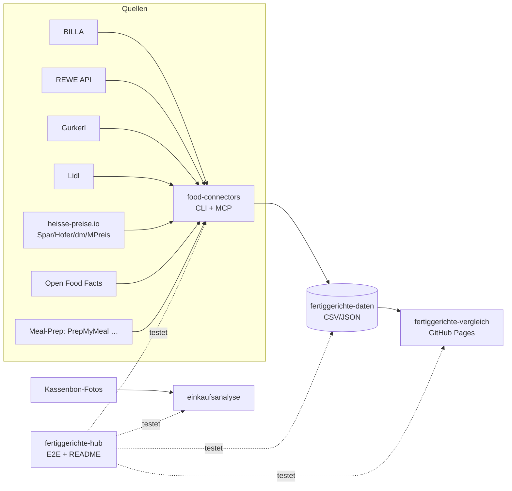

# 🥘 Fertiggerichte-Hub

Zentraler Index & Live-Status aller Fertiggerichte-Projekte (servas-ai). **Automatisch generiert:** 2026-10-13 02:58 UTC via `./run_all.sh` (stündlich).

**Connectors:** 13 ✅ / 2 ❌ / 9 📇 catalog-only · **Apps:** 3/3 live · **Produkte im Datensatz:** 2263

## Apps

| App | URL | Live | Tabs getestet | Konsolen-Fehler | Kaputte Bilder |
|---|---|---|---|---|---|
| Fertiggerichte-Vergleich | https://martin-hausleitner.github.io/fertiggerichte-vergleich/ | ✅ | 1 | 0 | 0 |
| Fertiggerichte-Vergleich (servas-ai Pages) | https://servas-ai.github.io/fertiggerichte-vergleich/ | ✅ | 1 | 0 | 0 |
| Einkaufsanalyse | https://servas-ai.github.io/einkaufsanalyse/ | ✅ | 8 | 0 | 0 |

## Repositories

| Repo | Zweck |
|---|---|
| [servas-ai/fertiggerichte-vergleich](https://github.com/servas-ai/fertiggerichte-vergleich) | Web-App (Vergleich, Netz 3D, Gesundheit, Hersteller …) |
| [servas-ai/food-connectors](https://github.com/servas-ai/food-connectors) | Connectors + CLI + MCP-Server |
| [servas-ai/fertiggerichte-daten](https://github.com/servas-ai/fertiggerichte-daten) | Offener Datensatz CSV/JSON |
| [servas-ai/einkaufsanalyse](https://github.com/servas-ai/einkaufsanalyse) | Einkaufsanalyse-Dashboard (Kassenbons) |

## Architektur



## Connector-Status (Live-Smoke-Test)

| | Connector | Store | Items | Latenz | Beispielprodukt (Beweis) | Zeitpunkt |
|---|---|---|---|---|---|---|
| ✅ | `billa` | BILLA | 3 | 0.92 s | [MAGGI Fix für Gulasch](https://shop.billa.at/produkte/maggi-fix-fuer-gulasch-0056152) · 1.49 € | 2026-10-13T02:56:31Z |
| ✅ | `dm` | dm | 3 | 3.18 s | HiPP Menü Spätzle mit Gulasch ab 8 Monaten, 220 g · 1.75 € | 2026-10-13T02:56:32Z |
| ✅ | `gourmetfein` | Online: Gourmetfein | 3 | 6.46 s | [Weißwurst 1,8kg](https://shop.gourmetfein.com/products/weisswurst-1-8kg) · 24.9 € | 2026-10-13T02:56:37Z |
| ✅ | `gurkerl` | Gurkerl.at | 3 | 0.78 s | [AMA Kalb Rosé Austria Gulasch geschnitten](https://www.gurkerl.at/22932-ama-kalb-rose-austria-gulasch-geschnitten) · 16.1 € | 2026-10-13T02:56:43Z |
| ✅ | `heisse-preise` | heisse-preise.io | 3 | 3.03 s | [Ager Hirschgulasch geschnitten](ager-hirschgulasch-geschnitten-00730647) · 11.99 € | 2026-10-13T02:56:44Z |
| ✅ | `hofer` | HOFER | 3 | 2.76 s | [GENUSS 100% AUS ÖSTERREICH Rindsgulasch 1kg](sortiment/GENUSS-100-AUS-OSTERREICH-Rindsgulasch-1kg) · 19.98 € | 2026-10-13T02:56:49Z |
| ✅ | `mpreis` | MPREIS | 3 | 2.71 s | AIA Puten Gulasch · 6.5 € | 2026-10-13T02:57:14Z |
| ✅ | `mpreis-shop` | MPreis | 3 | 8.05 s | [Basis Gulasch](https://www.mpreis.at/shop/p/knorr-basis-gulasch-282001) · 1.39 € | 2026-10-13T02:57:18Z |
| ✅ | `off` | Open Food Facts | 3 | 8.99 s | [Gulasch (Rind)](https://world.openfoodfacts.org/product/4099200121543) | 2026-10-13T02:57:26Z |
| ✅ | `penny` | PENNY | 2 | 6.49 s | [Schweinefleisch für Reisfleisch/Gulasch](https://www.penny.at/produkte/schweinefleisch-fuer-reisfleischgulasch-78544771) · 3.99 € | 2026-10-13T02:57:35Z |
| ✅ | `prepmymeal` | Online: PrepMyMeal | 3 | 10.3 s | [CH: Gemüse Lasagne](https://prepmymeal.at/products/ch-gemuse-lasagne-3) · 14.5 € | 2026-10-13T02:57:42Z |
| ✅ | `spar` | SPAR/INTERSPAR | 3 | 2.59 s | Baron de Sel Gourmet Gulasch Bio 55g · 4.99 € | 2026-10-13T02:57:52Z |
| ✅ | `unimarkt` | Unimarkt | 3 | 2.59 s | [Felix Erdäpfelgulasch](/Felix-Erdaepfelgulasch-3692) · 5.39 € | 2026-10-13T02:57:56Z |
| 📇 | `adeg` | ADEG | 0 | 0.0 s |  | 2026-10-13T02:56:31Z |
| 📇 | `bio-kistl` | Biohof Achleitner / Bio-Kistl OÖ | 0 | 0.0 s |  | 2026-10-13T02:56:32Z |
| 📇 | `denns` | denn's BioMarkt | 0 | 0.0 s |  | 2026-10-13T02:56:32Z |
| 📇 | `fittogo` | Fit to Go | 0 | 0.0 s |  | 2026-10-13T02:56:37Z |
| 📇 | `foodora-market` | foodora market (Dmart) | 0 | 0.0 s |  | 2026-10-13T02:56:37Z |
| ❌ | `lidl` | Lidl | 0 | 12.63 s | `HTTPError: HTTP Error 401: Unauthorized` | 2026-10-13T02:56:53Z |
| 📇 | `lieferando-shops` | Lieferando Shops | 0 | 0.0 s |  | 2026-10-13T02:57:06Z |
| ❌ | `livefresh` | Online: LiveFresh | 0 | 8.2 s | `0 Treffer` | 2026-10-13T02:57:06Z |
| 📇 | `mjam` | mjam (now foodora) | 0 | 0.0 s |  | 2026-10-13T02:57:14Z |
| 📇 | `nah-frisch` | Nah&Frisch | 0 | 0.0 s |  | 2026-10-13T02:57:26Z |
| 📇 | `wokostswas` | wokostswas.at | 0 | 0.0 s |  | 2026-10-13T02:58:00Z |

## Datensatz

**2263 Produkte** · Tabellen: brand_tree 8, companies 83, establishments 4706, logos 149, nutrition 1515, online_mealprep 96, online_providers 3, prices 1937, producer_quality 4, producers 22, products 2263, stores 498

| Abdeckung | % |
|---|---|
| nutrition | 66.9 |
| price | 85.6 |
| photo | 80.4 |
| producer | 32.6 |
| brand | 85.2 |
| logos_total | 149 |

<details><summary>Produkte nach Kette</summary>

| Kette | Anzahl |
|---|---|
| Billa | 618 |
| Spar | 592 |
| Gurkerl | 356 |
| Hofer | 224 |
| unbekannt (OFF) | 136 |
| MPreis | 101 |
| PrepMyMeal | 90 |
| Lidl | 40 |
| Unimarkt | 29 |
| dm | 24 |
| Fit to Go | 24 |
| Penny | 17 |
| LiveFresh | 10 |
| FitTaste | 2 |

</details>

<details><summary>Produkte nach Fertigstufe/Lagerung</summary>

| Lagerung | Anzahl |
|---|---|
| Unklar (keine Lagerangabe) | 1044 |
| Kühlregal (Menüschale/frisch) | 325 |
| Tiefkühl (TK) | 313 |
| Dose/Konserve | 270 |
| Trocken/Instant | 268 |
| Glas | 16 |
| Sous-vide (vakuum) | 14 |
| Beutel ungekühlt (Retort-Pouch) | 13 |

</details>

## Screenshots

### Fertiggerichte-Vergleich

| Tab | Desktop 1920 | Mobil 390 |
|---|---|---|
| home |  |  |

### Fertiggerichte-Vergleich (servas-ai Pages)

| Tab | Desktop 1920 | Mobil 390 |
|---|---|---|
| home |  |  |

### Einkaufsanalyse

| Tab | Desktop 1920 | Mobil 390 |
|---|---|---|
| home |  |  |
| Übersicht |  |  |
| Verlauf |  |  |
| Läden |  |  |
| Kategorien |  |  |
| Protein & Gesundheit |  |  |
| Kassenbons |  |  |
| Import |  |  |

## Changelog (letzte Commits)

**servas-ai/fertiggerichte-vergleich**

- `18e5d02` 2026-10-13 02:42 — hourly 2026-10-13T02: +63 Gurkerl meals via category API (food-connectors), EAN gap-fill, Datenabdeckung tab (shadcn Chart/Table/ToggleGroup), brand tree M&S/Mars/CJ/MHP/TPF
- `0dff16f` 2026-10-13 02:28 — update
- `2f5314e` 2026-10-13 02:23 — data: hourly sync
- `f6bb06f` 2026-10-13 02:22 — UI: real shadcn/ui (Sidebar, Sheet, ToggleGroup, Chart, Skeleton, Breadcrumb), split App, useAppData hook, calmer table, higher contrast
- `760e6eb` 2026-10-13 02:07 — hourly: +38 meals Gurkerl/PrepMyMeal/Penny, store logos, Gang-Filter
- `912233d` 2026-10-13 02:02 — data: Firmenvergleich mit strenger GLEIF-Zuordnung
- `d62894d` 2026-10-13 01:57 — Verpackungen minimal style
- `d873d2a` 2026-10-13 01:52 — nutri: Nutri-Score/NOVA/additives enrichment refresh

**servas-ai/food-connectors**

- `b3577e9` 2026-10-13 02:53 — feat(mpreis-shop): live MPreis webshop connector (sitemap + category pages + product JSON-LD: price, GTIN, image, pack size, nutrition, ingredients), CLI + MCP mpreis_product, fixture test
- `d5b2327` 2026-10-13 02:29 — feat(gurkerl): walk ready-meal categories via category API, batch prices+stock, EAN/producer from composition; tests
- `0876e1d` 2026-10-13 02:28 — test: remove remaining orphaned gurkerl category live test
- `945daa1` 2026-10-13 02:27 — test: drop orphaned gurkerl WIP tests (depend on uncommitted adapter)
- `2f79d98` 2026-10-13 02:27 — Add osm-stores Overpass connector and catalog denns/nah-frisch findings
- `99c7d3e` 2026-10-13 02:10 — fix(billa,lidl,livefresh) + datasets hub search (HF/Zenodo/data.gv.at/Kaggle) CLI+MCP, live status test, README connector table with credits
- `3e5a982` 2026-10-13 01:29 — feat(company): GLEIF/VIES/NorthData/Firmenbuch-HVD adapters, food company CLI + MCP tools
- `fc9fe93` 2026-10-13 01:19 — nutri: OFF Nutri-Score/NOVA/Eco-Score/additives, USDA FDC, CIQUAL + catalog; local Nutri-Score 2023; CLI food nutri/nutriscore; MCP tools

**servas-ai/fertiggerichte-daten**

- `41997c1` 2026-10-13 02:53 — data: MPreis live webshop (101 meals, 100% photos, live 2026 prices, nutrition), supplemental rows survive refresh, nutrition plausibility gate, store logos
- `9368f09` 2026-10-13 02:28 — Add MPreis/Unimarkt ready meals + Linz OSM store branches
- `b449e49` 2026-10-13 02:11 — move food_company -> servas-ai/food-connectors; import OFF AT ready meals + external dataset catalog
- `6337aec` 2026-10-13 01:50 — data: fit2go provider mapping
- `dc57f21` 2026-10-13 01:34 — companies: stricter GLEIF matching (score>=0.75, country check, dedupe), registry_status per row
- `d2e35b2` 2026-10-13 01:19 — data: online meal-prep products, online providers, producer quality profiles
- `d6e1bf2` 2026-10-13 01:06 — Offener Datensatz Fertiggerichte AT: products, prices, nutrition, producers, companies (GLEIF), establishments (ÖVIS), brand_tree, logos + datapackage, validation, company CLI/MCP

**servas-ai/einkaufsanalyse**

- `66934e3` 2026-10-13 01:10 — Einkaufsanalyse v1: shadcn Sidebar-Dashboard, Import, OCR, Beispieldaten

## Ausführen

```bash
pip install pytest playwright && playwright install chromium
./run_all.sh   # Tests + Report + Push (mit Lock, stündlich via cron)
```
