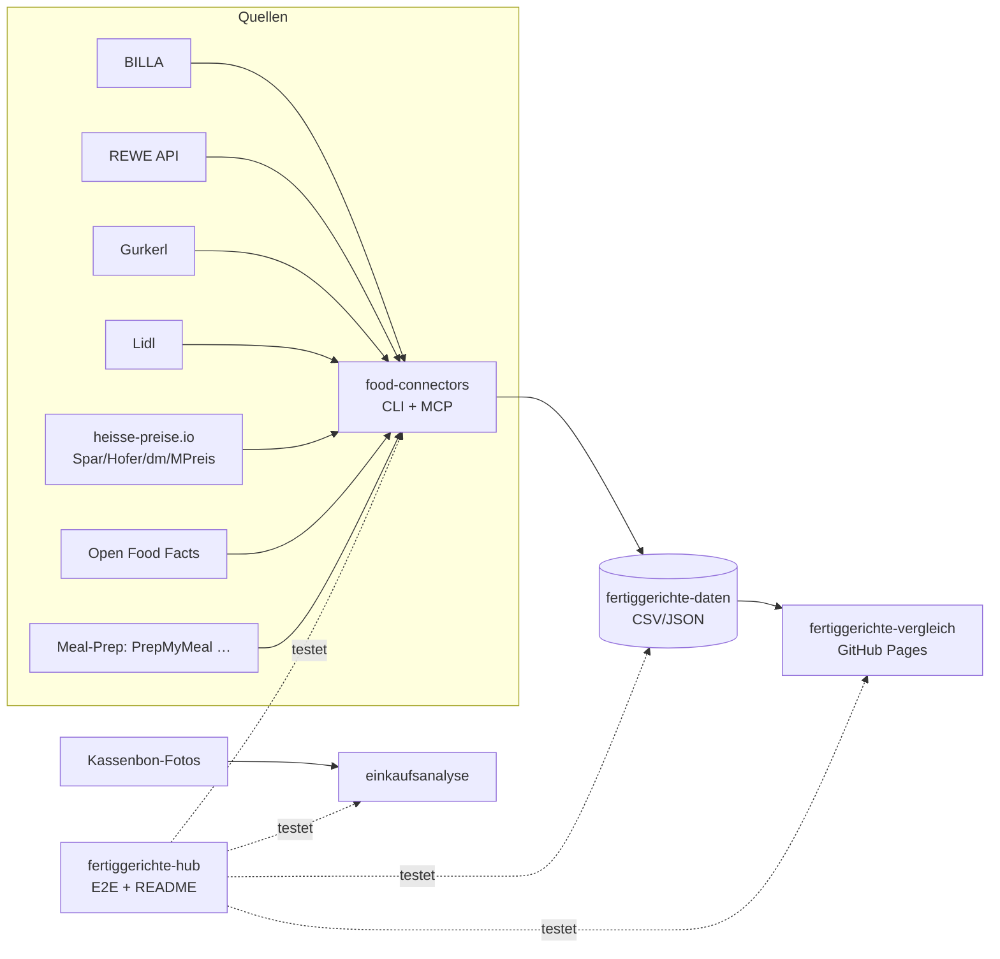

# 🥘 Fertiggerichte-Hub

Zentraler Index & Live-Status aller Fertiggerichte-Projekte (servas-ai). **Automatisch generiert:** 2026-10-16 17:07 UTC via `./run_all.sh` (stündlich).

**Connectors:** 28 ✅ / 1 ❌ / 7 📇 catalog-only · **Apps:** 3/3 live · **Produkte im Datensatz:** 3641

## Apps

| App | URL | Live | Tabs getestet | Konsolen-Fehler | Kaputte Bilder |
|---|---|---|---|---|---|
| Fertiggerichte-Vergleich | https://martin-hausleitner.github.io/fertiggerichte-vergleich/ | ✅ | 9 | 0 | 0 |
| Fertiggerichte-Vergleich (servas-ai Pages) | https://servas-ai.github.io/fertiggerichte-vergleich/ | ✅ | 9 | 0 | 0 |
| Einkaufsanalyse | https://servas-ai.github.io/einkaufsanalyse/ | ✅ | 8 | 0 | 0 |

## Repositories

| Repo | Zweck |
|---|---|
| [servas-ai/fertiggerichte-vergleich](https://github.com/servas-ai/fertiggerichte-vergleich) | Web-App (Vergleich, Netz 3D, Gesundheit, Hersteller …) |
| [servas-ai/food-connectors](https://github.com/servas-ai/food-connectors) | Connectors + CLI + MCP-Server |
| [servas-ai/fertiggerichte-daten](https://github.com/servas-ai/fertiggerichte-daten) | Offener Datensatz CSV/JSON |
| [servas-ai/einkaufsanalyse](https://github.com/servas-ai/einkaufsanalyse) | Einkaufsanalyse-Dashboard (Kassenbons) |

## Architektur



## Connector-Status (Live-Smoke-Test)

| | Connector | Store | Items | Latenz | Beispielprodukt (Beweis) | Zeitpunkt |
|---|---|---|---|---|---|---|
| ✅ | `alfies` | Alfies | 3 | 5.9 s | [Knorr Meisterkessel Gulaschsuppe](https://www.alfies.at/produkt/knorr-meisterkessel-gulaschsuppe-dose-500g) · 4.49 € | 2026-10-16T16:58:04Z |
| ✅ | `billa` | BILLA | 3 | 0.57 s | [MAGGI Fix für Gulasch](https://shop.billa.at/produkte/maggi-fix-fuer-gulasch-0056152) · 1.49 € | 2026-10-16T16:58:10Z |
| ✅ | `bofrost` | Online: bofrost* | 3 | 7.33 s | [Wiener Rindsgulasch](https://www.bofrost.at/shop/fleisch_44196/fleischzubereitungen_34987/wiener-rindsgulasch_03373.html) · 14.99 € | 2026-10-16T16:58:11Z |
| ✅ | `denns` | denn's BioMarkt | 1 | 3.97 s | [MyDeli Bio-Fleischsuppe](https://www.denns-biomarkt.at/angebote/) · 3.49 € | 2026-10-16T16:58:18Z |
| ✅ | `dm` | dm | 3 | 6.43 s | [babylove Menü Kartoffeltopf mit Rindergulasch ab d](https://www.dm.at/p/d/1602887/babylove-menue-kartoffeltopf-mit-rindergulasch-ab-dem-8-monat) · 1.15 € | 2026-10-16T16:58:22Z |
| ✅ | `dm-heisse` | dm | 3 | 19.52 s | HiPP Menü Spätzle mit Gulasch ab 8 Monaten, 220 g · 1.75 € | 2026-10-16T16:58:29Z |
| ✅ | `every` | Online: every. | 3 | 14.74 s | [Pumpkin Zucchini Risotto](https://every-foods.com/products/pumpkin-zucchini-risotto) · 8.99 € | 2026-10-16T16:58:50Z |
| ✅ | `fittogo` | Online: Fit2go | 3 | 27.26 s | [Auberginen-Chili con Carne mit Käse Überbacken](https://fittogo.at/products/auberginen-chili-con-carne-mit-kase-uberbacken) · 9.99 € | 2026-10-16T16:59:05Z |
| ✅ | `goldblatt` | Online: Goldblatt | 2 | 4.53 s | [Erdäpfel Gulasch](https://goldblatt.at/products/bio-erdapfel-gulasch) · 11.99 € | 2026-10-16T16:59:32Z |
| ✅ | `gourmetfein` | Online: Gourmetfein | 3 | 3.97 s | [Weißwurst 1,8kg](https://shop.gourmetfein.com/products/weisswurst-1-8kg) · 24.9 € | 2026-10-16T16:59:37Z |
| ✅ | `gurkerl` | Gurkerl.at | 3 | 0.44 s | [AMA Kalb Rosé Austria Gulasch geschnitten](https://www.gurkerl.at/22932-ama-kalb-rose-austria-gulasch-geschnitten) · 19.22 € | 2026-10-16T16:59:41Z |
| ✅ | `heisse-preise` | heisse-preise.io | 3 | 3.57 s | [Ager Hirschgulasch geschnitten](ager-hirschgulasch-geschnitten-00730647) · 11.99 € | 2026-10-16T16:59:41Z |
| ✅ | `hofer` | HOFER | 3 | 3.38 s | [GENUSS 100% AUS ÖSTERREICH Rindsgulasch 1kg](sortiment/GENUSS-100-AUS-OSTERREICH-Rindsgulasch-1kg) · 19.98 € | 2026-10-16T16:59:47Z |
| ✅ | `issmich` | Online: iss mich! | 3 | 35.95 s | [Bio Rotweingulasch vom Freilandrind](https://www.issmich.at/Bio-Shop/Eintoepfe/Fleisch/15/Bio-Rotweingulasch-vom-Freilandrind) · 11.5 € | 2026-10-16T16:59:52Z |
| ✅ | `juit` | Online: Juit | 1 | 1.5 s | [Rindergulasch mit gegrillter Paprika](https://www.juit.com/de/gerichte/rindergulasch-mit-paprika) | 2026-10-16T17:00:28Z |
| ✅ | `kernbeisser` | Online: Kernbeißer | 3 | 43.53 s | [Maghreb-Hirse mit Artischocken](https://kernbeisser.at/produkt/maghreb-hirse-mit-artischocken/) · 9.0 € | 2026-10-16T17:00:29Z |
| ✅ | `livefresh` | Online: LiveFresh | 3 | 1.13 s | [Pasta Cheesy Spinat – Protein Bowl](https://livefresh.at/products/pasta-cheesy-spinat-400g) · 5.99 € | 2026-10-16T17:01:25Z |
| ✅ | `loewenanteil` | Online: Löwenanteil | 1 | 2.52 s | [Veganes Gulasch](https://www.loewenanteil.com/products/veganes-gulasch) · 9.99 € | 2026-10-16T17:01:26Z |
| ✅ | `mpreis` | MPREIS | 3 | 3.46 s | AIA Puten Gulasch · 6.5 € | 2026-10-16T17:01:29Z |
| ✅ | `mpreis-shop` | MPreis | 3 | 52.93 s | [Basis Gulasch](https://www.mpreis.at/shop/p/knorr-basis-gulasch-282001) · 1.39 € | 2026-10-16T17:01:34Z |
| ✅ | `nah-frisch` | Nah&Frisch | 3 | 266.37 s | [Inzersdorfer Fertiggerichte oder Suppen](https://www.nahundfrisch.at/de/aktuelles/angebote-der-woche) | 2026-10-16T17:02:27Z |
| ✅ | `off` | Open Food Facts | 3 | 1.47 s | [Gulasch (Rind)](https://world.openfoodfacts.org/product/4099200121543) | 2026-10-16T17:06:54Z |
| ✅ | `penny` | PENNY | 3 | 4.45 s | [Rindsgulaschfleisch](https://www.penny.at/produkte/rindsgulaschfleisch-78544603) · 15.99 € | 2026-10-16T17:06:55Z |
| ✅ | `penny-shop` | PENNY | 3 | 7.38 s | [Rindsgulaschfleisch](https://www.penny.at/produkte/rindsgulaschfleisch-78544603) · 15.99 € | 2026-10-16T17:07:00Z |
| ✅ | `prepmymeal` | Online: PrepMyMeal | 3 | 6.54 s | [CH: Gemüse Lasagne](https://prepmymeal.at/products/ch-gemuse-lasagne-3) · 14.5 € | 2026-10-16T17:07:07Z |
| ✅ | `spar` | SPAR/INTERSPAR | 3 | 3.3 s | Baron de Sel Gourmet Gulasch Bio 55g · 4.99 € | 2026-10-16T17:07:14Z |
| ✅ | `spar-shop` | SPAR/INTERSPAR | 3 | 0.94 s | [TANN Rinds-Bratengulasch](https://www.interspar.at/shop/lebensmittel/tann-rinds-bratengulasch/p/835817) · 21.99 € | 2026-10-16T17:07:19Z |
| ✅ | `unimarkt` | Unimarkt | 3 | 2.92 s | [Felix Erdäpfelgulasch](/Felix-Erdaepfelgulasch-3692) · 5.39 € | 2026-10-16T17:07:20Z |
| 📇 | `adeg` | ADEG | 0 | 0.0 s |  | 2026-10-16T16:58:04Z |
| 📇 | `bio-kistl` | Biohof Achleitner / Bio-Kistl OÖ | 0 | 0.0 s |  | 2026-10-16T16:58:11Z |
| 📇 | `foodora-market` | foodora market (Dmart) | 0 | 0.0 s |  | 2026-10-16T16:59:32Z |
| ❌ | `lidl` | Lidl | 0 | 11.74 s | `HTTPError: HTTP Error 401: Unauthorized` | 2026-10-16T17:01:13Z |
| 📇 | `lieferando-shops` | Lieferando Shops | 0 | 0.0 s |  | 2026-10-16T17:01:25Z |
| 📇 | `mjam` | mjam (now foodora) | 0 | 0.0 s |  | 2026-10-16T17:01:29Z |
| 📇 | `unimarkt-shop` | Unimarkt (UNIONLINE Shop) | 0 | 0.0 s |  | 2026-10-16T17:07:24Z |
| 📇 | `wokostswas` | wokostswas.at | 0 | 0.0 s |  | 2026-10-16T17:07:24Z |

## Datensatz

**3641 Produkte** · Tabellen: brand_tree 8, companies 138, establishments 4706, logos 294, nutrition 2811, online_mealprep 406, online_providers 3, prices 3259, producer_quality 4, producers 22, products 3641, stores 498

| Abdeckung | % |
|---|---|
| nutrition | 77.2 |
| price | 89.5 |
| photo | 93.6 |
| producer | 48.4 |
| brand | 90.9 |
| logos_total | 294 |

<details><summary>Produkte nach Kette</summary>

| Kette | Anzahl |
|---|---|
| Billa | 807 |
| Spar | 735 |
| Gurkerl | 536 |
| MPreis | 388 |
| Hofer | 223 |
| Alfies | 182 |
| bofrost | 144 |
| unbekannt (OFF) | 93 |
| HelloFresh | 93 |
| PrepMyMeal | 92 |
| Subway | 59 |
| Juit | 50 |
| NORDSEE | 39 |
| Lidl | 37 |
| dm | 35 |
| Fit to Go | 30 |
| Penny | 29 |
| Unimarkt | 29 |
| FitTaste | 18 |
| LiveFresh | 10 |
| Nah&Frisch | 7 |
| Denn's | 5 |

</details>

<details><summary>Produkte nach Fertigstufe/Lagerung</summary>

| Lagerung | Anzahl |
|---|---|
| Unklar (keine Lagerangabe) | 1222 |
| Tiefkühl (TK) | 1009 |
| Kühlregal (Menüschale/frisch) | 597 |
| Dose/Konserve | 422 |
| Trocken/Instant | 332 |
| Glas | 34 |
| Sous-vide (vakuum) | 14 |
| Beutel ungekühlt (Retort-Pouch) | 11 |

</details>

## Screenshots

### Fertiggerichte-Vergleich

| Tab | Desktop 1920 | Mobil 390 |
|---|---|---|
| home |  |  |
| Was kaufe ich heute? |  |  |
| Ernährungsplan |  |  |
| KI-Ansicht |  |  |
| Hofer Top 30 |  |  |
| Marken-Profil |  |  |
| Laden-Profil |  |  |
| Marken |  |  |
| Filialen in der Nähe |  |  |

### Fertiggerichte-Vergleich (servas-ai Pages)

| Tab | Desktop 1920 | Mobil 390 |
|---|---|---|
| home |  |  |
| Was kaufe ich heute? |  |  |
| Ernährungsplan |  |  |
| KI-Ansicht |  |  |
| Hofer Top 30 |  |  |
| Marken-Profil |  |  |
| Laden-Profil |  |  |
| Marken |  |  |
| Filialen in der Nähe |  |  |

### Einkaufsanalyse

| Tab | Desktop 1920 | Mobil 390 |
|---|---|---|
| home |  |  |
| Übersicht |  |  |
| Verlauf |  |  |
| Läden |  |  |
| Kategorien |  |  |
| Protein & Gesundheit |  |  |
| Kassenbons |  |  |
| Import |  |  |

## Changelog (letzte Commits)

**servas-ai/fertiggerichte-vergleich**

- `70c1f58` 2026-10-14 07:57 — data: sensecheck 12-verify — plain fresh pasta (Alfies Bertagni Tagliatelle frische Pasta #2 topPLI, Rana Tagliatelle) out of ranking; 14 Butter Chicken ready meals no longer 'grocery' (8 now rankable); Frosta/MPreis Tagliatelle Wildlachs + Followfood Wildlachs Spaghetti meals. rows 3766, rankable 342→353. Pipeline fertig 51ae554. Gates: pytest 50/50, top50 ok, build ok. No deploy.
- `e51a05f` 2026-10-14 07:53 — Online store 'Alfies' (Wien/Graz only): ONLINE/Online/Kategorien, palette, STORE_LOGO logos/alfies.svg; KNOWN_DELIVERY fallback marks Alfies not delivering to 4020 (data entry wins); NFC-normalised delivery name match
- `8d02a3d` 2026-10-14 07:45 — data: hourly T07 — +25 verified (Gurkerl 14 / BILLA 8 / MPreis 3) + export iss mich! 35 + Alfies 175 (Daten-Squad staged); rows 3542→3766, rankable 316→342
- `fe347d7` 2026-10-14 07:18 — data: sensecheck 12 — fish fingers + plain Bällchen components; rows 3532→3542, rankable 317→316
- `e43981a` 2026-10-14 07:10 — Online store 'iss mich!' (issmich.at, organic stews/soups in WECK jars): ONLINE/Online/Kategorien lists, palette, STORE_LOGO logos/iss-mich.png; '!' verified through fx hash round-trip
- `7ae923c` 2026-10-14 06:49 — data: hourly T06 — rows 3491→3532: +41 verified Gurkerl rows (Komplettmahlzeit-Ergänzungen: Soy Delish Wrap; heat-up components: 24 fresh filled pasta Rana/Bertagni/Garofalo/La Pasteria/Mamma Emma/Pappudia/Alnatura, 4 sous-vide pre-cooked meat, 4 soup inserts, 5 Knödel/Püree, 3 vegan Cevapcici/Köttbullar/Bällchen); all with source nutrition, price, stock, EAN, photo; plain sous-vide pieces + plain Köttbullar = component (not rankable). Brand tree: Garofalo→Ebro Foods 52 %, Gabelkönig→AgroFresh/Klinger, Steirerhuhn→Lugitsch, GREENFORCE. Gates: pytest 46/46, top50 ok, build ok, Playwright 32 tabs×2 0 errors/blank/overflow, 0/9776 broken img. No deploy.
- `f630930` 2026-10-14 06:36 — data: M&S Breaded Haddock/Cod → component (sensecheck 11 follow-up)
- `d7d7f13` 2026-10-14 06:12 — Merge remote-tracking branch 'origin/main' into feature/online-goldblatt

**servas-ai/food-connectors**

- `8777b7a` 2026-10-14 07:30 — Daten-Squad T0740: new live connector alfies (Alfies Wien/Graz online supermarket, Alfie's GmbH, Wien)
- `9650f94` 2026-10-14 06:57 — Daten-Squad T0636: new live connector issmich (iss mich! Wiener Bio-Eintöpfe & Suppen im WECK-Glas, iss mich! GmbH, Wien)
- `cf54f79` 2026-10-14 06:08 — Daten-Squad T0605: new live connector goldblatt (Goldblatt High Protein Bio glass-jar ready meals, Golden Veggies GmbH, Bad Waltersdorf)
- `6597c0d` 2026-10-14 05:08 — Daten-Squad T0504: new live connector kernbeisser (Kernbeißer vegan Vollkorn-Fertiggerichte im Glas, Wien)
- `241e063` 2026-10-14 04:52 — Daten-Squad T0441: new live connector loewenanteil (Löwenanteil Bio glass-jar ready meals)
- `bab2e1d` 2026-10-14 03:58 — feat(every): live every. (every-foods.com) connector — frozen plant-based ready meals shipped to AT (DPD per shop shipping policy, 5,99 €, free from 8 meals) via public Shopify storefront JSON eat.every-foods.com/products.json (price EUR, SKU, availability, packshots) + product pages (Storyblok product blok: weight, nutrition per 100 g + pack, ingredients, preparation; bilingual DE/EN table parser, pack-column typo flag); ready meals = product_type Meal, price > 0, in DE product sitemap; robots-allowed, no login/cookies, 1 req/s; no GTIN → ean None; MCP every_product + every_search; offline tests with fixture (2026-10-14T0341)
- `402f219` 2026-10-14 03:20 — feat(fittogo): live fit2go.meals connector (frozen ready meals, AT-wide Express 4,99 €) via public product sitemap + product HTML — Hydrogen shop (/products.json 404); pack nutrition + Einwaage → per 100 g; price_eur = published 12er-box 9,99 €/Meal (Einzel-SKU 0,00 €); MCP fittogo_product + fittogo_search; offline tests with fixture; Gourmetfein noted as Wurst-only ready-meal dead end (2026-10-14T0307)
- `c4418a1` 2026-10-14 03:01 — feat(bofrost): live bofrost* Austria connector (frozen ready meals, home delivery across AT) via public sitemap + product pages — schema.org JSON-LD price/availability/images, pack line with €/kg, nutrition per 100 g, ingredients, Nutri-Score badge; robots-allowed paths only, no login/cookies, 1 req/s; no GTIN published → ean None; MCP bofrost_product + bofrost_search; offline tests with fixture (2026-10-14T0238)

**servas-ai/fertiggerichte-daten**

- `83b291a` 2026-10-14 07:32 — Daten-Squad T0740: logo alias 'Every Foods' → every-foods (Alfies lists every. meals as 'Every Foods', 9 rows; existing vision-gated logo) + CRLF fix for the appended Alfie's GmbH companies.csv row
- `f688a37` 2026-10-14 07:30 — Daten-Squad T0740: new retail chain Alfies (Wiener Online-Supermarkt, Wien + Graz) — 178 ready meals with live price, nutrition, photo
- `701ffe6` 2026-10-14 07:04 — Daten-Squad T0636: new online provider iss mich! (35 Wiener Bio-Eintöpfe & Suppen im WECK-Pfandglas, iss mich! GmbH, Wien)
- `8a7c203` 2026-10-14 06:09 — Daten-Squad T0605: new online provider Goldblatt (8 High Protein Bio glass-jar ready meals, Bad Waltersdorf, AT)
- `504f3f6` 2026-10-14 05:11 — Daten-Squad T0504: new online provider Kernbeißer (6 vegan Vollkorn glass-jar ready meals, Wien, AT-only)
- `3196aa7` 2026-10-14 04:52 — Daten-Squad T0441: new online provider Löwenanteil (17 Bio glass-jar ready meals)
- `a48f61f` 2026-10-14 04:16 — Daten-Squad T0404: Little Lunch verified DEAD END as online provider (own littlelunch.com shop closed 30.09.2025, product pages only link to DE retailers Amazon/Flink/Picnic/REWE/Rossmann, no price/GTIN; operator per Impressum Allos Hof-Manufaktur GmbH Bremen HRB 27982 HB) + logo long tail: +5 vision-gated official logos (Yuu'n Mee yuu-n-mee.at SVG, Allgroo allgroo.com, Bedford bedford.de recoloured, COSTA costa.de, Beyond Meat Commons PD); strict logo-less 53→46 brands / 84→64 products
- `b156046` 2026-10-14 03:59 — Daten-Squad T0341: new online provider every. (every-foods.com, Every. GmbH Berlin HRB 221768 B) — 50 frozen plant-based ready meals shipped to AT (DPD per eat.every-foods.com shipping policy; AGB DE-only conflict documented) with single price (median 8,99 €), weight, nutrition/100 g, ingredients, preparation and HEAD-200 packshot from public Shopify products.json + product pages (food-connectors every bab2e1d); 4 candidates without published nutrition dropped; online meal-prep rows 290→340; every-foods logo aliases; Every. GmbH address/management/register court from Impressum; Little Lunch/Dinnerly probe notes

**servas-ai/einkaufsanalyse**

- `66934e3` 2026-10-13 01:10 — Einkaufsanalyse v1: shadcn Sidebar-Dashboard, Import, OCR, Beispieldaten

## Ausführen

```bash
pip install pytest playwright && playwright install chromium
./run_all.sh   # Tests + Report + Push (mit Lock, stündlich via cron)
```
