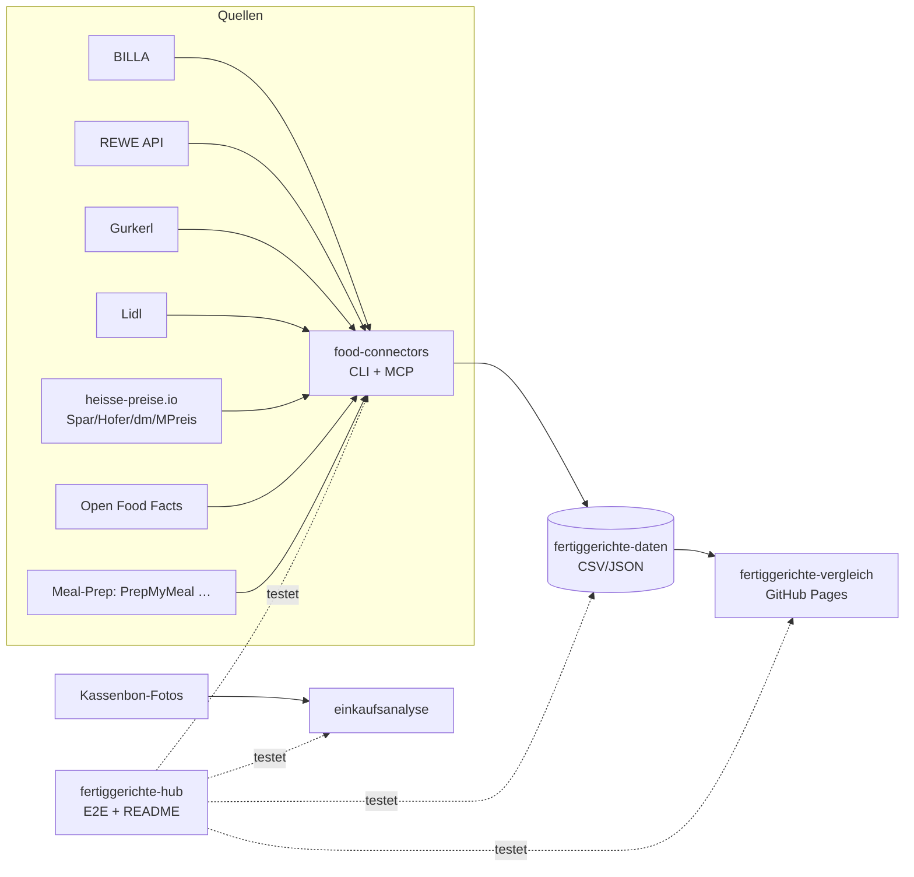

# 🥘 Fertiggerichte-Hub

Zentraler Index & Live-Status aller Fertiggerichte-Projekte (servas-ai). **Automatisch generiert:** 2026-10-17 21:04 UTC via `./run_all.sh` (stündlich).

**Connectors:** 25 ✅ / 8 ❌ / 7 📇 catalog-only · **Apps:** 3/3 live · **Produkte im Datensatz:** 3662

## Apps

| App | URL | Live | Tabs getestet | Konsolen-Fehler | Kaputte Bilder |
|---|---|---|---|---|---|
| Fertiggerichte-Vergleich | https://martin-hausleitner.github.io/fertiggerichte-vergleich/ | ✅ | 10 | 0 | 3 |
| Fertiggerichte-Vergleich (servas-ai Pages) | https://servas-ai.github.io/fertiggerichte-vergleich/ | ✅ | 10 | 0 | 0 |
| Einkaufsanalyse | https://servas-ai.github.io/einkaufsanalyse/ | ✅ | 8 | 0 | 0 |

## Repositories

| Repo | Zweck |
|---|---|
| [servas-ai/fertiggerichte-vergleich](https://github.com/servas-ai/fertiggerichte-vergleich) | Web-App (Vergleich, Netz 3D, Gesundheit, Hersteller …) |
| [servas-ai/food-connectors](https://github.com/servas-ai/food-connectors) | Connectors + CLI + MCP-Server |
| [servas-ai/fertiggerichte-daten](https://github.com/servas-ai/fertiggerichte-daten) | Offener Datensatz CSV/JSON |
| [servas-ai/einkaufsanalyse](https://github.com/servas-ai/einkaufsanalyse) | Einkaufsanalyse-Dashboard (Kassenbons) |

## Architektur



## Connector-Status (Live-Smoke-Test)

| | Connector | Store | Items | Latenz | Beispielprodukt (Beweis) | Zeitpunkt |
|---|---|---|---|---|---|---|
| ✅ | `alfies` | Alfies | 3 | 8.43 s | [Knorr Meisterkessel Gulaschsuppe](https://www.alfies.at/produkt/knorr-meisterkessel-gulaschsuppe-dose-500g) · 4.49 € | 2026-10-17T20:56:07Z |
| ✅ | `billa` | BILLA | 3 | 1.48 s | [MAGGI Fix für Gulasch](https://shop.billa.at/produkte/maggi-fix-fuer-gulasch-0056152) · 1.49 € | 2026-10-17T20:56:15Z |
| ✅ | `biohof-achleitner` | Online: Biohof Achleitner | 3 | 5.45 s | [Hausg'mocht Rindsgulasch](https://www.biohof.at/Hausgmocht-Rindsgulasch-4755) · 8.7 € | 2026-10-17T20:56:17Z |
| ✅ | `bofrost` | Online: bofrost* | 3 | 8.79 s | [Wiener Rindsgulasch](https://www.bofrost.at/shop/fleisch_44196/fleischzubereitungen_34987/wiener-rindsgulasch_03373.html) · 14.99 € | 2026-10-17T20:56:23Z |
| ✅ | `denns` | denn's BioMarkt | 1 | 5.01 s | [MyDeli Bio-Fleischsuppe](https://www.denns-biomarkt.at/angebote/) · 3.49 € | 2026-10-17T20:56:31Z |
| ✅ | `dm` | dm | 3 | 4.46 s | [babylove Menü Kartoffeltopf mit Rindergulasch ab d](https://www.dm.at/p/d/1602887/babylove-menue-kartoffeltopf-mit-rindergulasch-ab-dem-8-monat) · 1.15 € | 2026-10-17T20:56:37Z |
| ✅ | `every` | Online: every. | 3 | 16.73 s | [Pumpkin Zucchini Risotto](https://every-foods.com/products/pumpkin-zucchini-risotto) · 8.99 € | 2026-10-17T20:56:42Z |
| ✅ | `fittogo` | Online: Fit2go | 3 | 8.58 s | [Auberginen-Chili con Carne mit Käse Überbacken](https://fittogo.at/products/auberginen-chili-con-carne-mit-kase-uberbacken) · 9.99 € | 2026-10-17T20:56:59Z |
| ✅ | `goldblatt` | Online: Goldblatt | 2 | 4.32 s | [Erdäpfel Gulasch](https://goldblatt.at/products/bio-erdapfel-gulasch) · 11.99 € | 2026-10-17T20:57:08Z |
| ✅ | `gourmetfein` | Online: Gourmetfein | 3 | 8.16 s | [Weißwurst 1,8kg](https://shop.gourmetfein.com/products/weisswurst-1-8kg) · 24.9 € | 2026-10-17T20:57:12Z |
| ✅ | `gurkerl` | Gurkerl.at | 3 | 1.43 s | [AMA Kalb Rosé Austria Gulasch geschnitten](https://www.gurkerl.at/22932-ama-kalb-rose-austria-gulasch-geschnitten) · 19.22 € | 2026-10-17T20:57:20Z |
| ✅ | `hofer-shop` | HOFER | 2 | 4.26 s | [Sonnhof Rindsgulasch](https://www.hofer.at/produkt/sonnhof-rindsgulasch-000000000000510738) · 6.5 € | 2026-10-17T20:57:24Z |
| ✅ | `issmich` | Online: iss mich! | 3 | 32.06 s | [Bio Rotweingulasch vom Freilandrind](https://www.issmich.at/Bio-Shop/Eintoepfe/Fleisch/15/Bio-Rotweingulasch-vom-Freilandrind) · 11.5 € | 2026-10-17T20:57:28Z |
| ✅ | `juit` | Online: Juit | 1 | 1.69 s | [Rindergulasch mit gegrillter Paprika](https://www.juit.com/de/gerichte/rindergulasch-mit-paprika) | 2026-10-17T20:58:00Z |
| ✅ | `kernbeisser` | Online: Kernbeißer | 3 | 46.34 s | [Maghreb-Hirse mit Artischocken](https://kernbeisser.at/produkt/maghreb-hirse-mit-artischocken/) · 9.0 € | 2026-10-17T20:58:02Z |
| ✅ | `livefresh` | Online: LiveFresh | 3 | 2.28 s | [Pasta Cheesy Spinat – Protein Bowl](https://livefresh.at/products/pasta-cheesy-spinat-400g) · 5.99 € | 2026-10-17T20:59:01Z |
| ✅ | `loewenanteil` | Online: Löwenanteil | 1 | 2.76 s | [Veganes Gulasch](https://www.loewenanteil.com/products/veganes-gulasch) · 9.99 € | 2026-10-17T20:59:03Z |
| ✅ | `mpreis-shop` | MPreis | 3 | 8.59 s | [Basis Gulasch](https://www.mpreis.at/shop/p/knorr-basis-gulasch-282001) · 1.39 € | 2026-10-17T20:59:07Z |
| ✅ | `myproduct` | Online: myProduct | 3 | 26.47 s | [Bio Szegediner Gulasch 460g - Fertiggericht von Ha](https://myproduct.at/bio-szegediner-gulasch-450ml-hartls-kulinarikum) · 12.79 € | 2026-10-17T20:59:16Z |
| ✅ | `nah-frisch` | Nah&Frisch | 3 | 230.59 s | [Inzersdorfer Fertiggerichte oder Suppen](https://www.nahundfrisch.at/de/aktuelles/angebote-der-woche) | 2026-10-17T20:59:42Z |
| ✅ | `penny` | PENNY | 3 | 5.82 s | [Rindsgulaschfleisch](https://www.penny.at/produkte/rindsgulaschfleisch-78544603) · 15.99 € | 2026-10-17T21:03:34Z |
| ✅ | `penny-shop` | PENNY | 3 | 8.53 s | [Rindsgulaschfleisch](https://www.penny.at/produkte/rindsgulaschfleisch-78544603) · 15.99 € | 2026-10-17T21:03:40Z |
| ✅ | `prepmymeal` | Online: PrepMyMeal | 3 | 8.97 s | [CH: Gemüse Lasagne](https://prepmymeal.at/products/ch-gemuse-lasagne-3) · 14.5 € | 2026-10-17T21:03:48Z |
| ✅ | `spar-shop` | SPAR/INTERSPAR | 3 | 1.36 s | [TANN Rinds-Bratengulasch](https://www.interspar.at/shop/lebensmittel/tann-rinds-bratengulasch/p/835817) · 21.99 € | 2026-10-17T21:03:59Z |
| ✅ | `subway-at` | Subway | 3 | 33.27 s | [Italian B.M.T.®](https://www.subway.com/de-AT/MenuNutrition/Menu/Product?ProductId=5257&MenuCategoryId=238) | 2026-10-17T21:04:00Z |
| 📇 | `adeg` | ADEG | 0 | 0.0 s |  | 2026-10-17T20:56:07Z |
| 📇 | `bio-kistl` | Biohof Achleitner / Bio-Kistl OÖ | 0 | 0.0 s |  | 2026-10-17T20:56:17Z |
| ❌ | `dm-heisse` | dm | 0 | 0.69 s | `RobotsDisallowed: https://heisse-preise.io/data/latest-canonical.json` | 2026-10-17T20:56:41Z |
| 📇 | `foodora-market` | foodora market (Dmart) | 0 | 0.0 s |  | 2026-10-17T20:57:08Z |
| ❌ | `heisse-preise` | heisse-preise.io | 0 | 0.71 s | `RobotsDisallowed: https://heisse-preise.io/data/latest-canonical.json` | 2026-10-17T20:57:22Z |
| ❌ | `hofer` | HOFER | 0 | 0.63 s | `RobotsDisallowed: https://heisse-preise.io/data/latest-canonical.json` | 2026-10-17T20:57:23Z |
| ❌ | `lidl` | Lidl | 0 | 12.24 s | `HTTPError: HTTP Error 401: Unauthorized` | 2026-10-17T20:58:48Z |
| 📇 | `lieferando-shops` | Lieferando Shops | 0 | 0.0 s |  | 2026-10-17T20:59:01Z |
| 📇 | `mjam` | mjam (now foodora) | 0 | 0.0 s |  | 2026-10-17T20:59:06Z |
| ❌ | `mpreis` | MPREIS | 0 | 0.64 s | `RobotsDisallowed: https://heisse-preise.io/data/latest-canonical.json` | 2026-10-17T20:59:06Z |
| ❌ | `off` | Open Food Facts | 0 | 0.57 s | `RobotsDisallowed: https://world.openfoodfacts.org/cgi/search.pl?search_terms=gulasch&count` | 2026-10-17T21:03:33Z |
| ❌ | `spar` | SPAR/INTERSPAR | 0 | 0.91 s | `RobotsDisallowed: https://heisse-preise.io/data/latest-canonical.json` | 2026-10-17T21:03:58Z |
| ❌ | `unimarkt` | Unimarkt | 0 | 0.69 s | `RobotsDisallowed: https://heisse-preise.io/data/latest-canonical.json` | 2026-10-17T21:04:34Z |
| 📇 | `unimarkt-shop` | Unimarkt (UNIONLINE Shop) | 0 | 0.0 s |  | 2026-10-17T21:04:35Z |
| 📇 | `wokostswas` | wokostswas.at | 0 | 0.0 s |  | 2026-10-17T21:04:35Z |

### Bekannte Ausfälle (manuell gepflegt)

- `off` (Open Food Facts) ❌ seit 2026-10-16 (Hub-Lauf 22:59 UTC) dauerhaft, nicht mehr nur Upstream-503: OFF `robots.txt` verbietet für `User-agent: *` jetzt `/api`, `/cgi` und `/facets`, und der neue harte robots.txt-Gate in food-connectors (`0eaa455`) blockiert `cgi/search.pl` (Suche) und `api/v2/product` (EAN-Lookup) bewusst vor dem Request. `search.openfoodfacts.org` ist ebenfalls `Disallow: /`. Fix-Pfad (offen, food-connectors `adapters/off.py`): EAN-Lookup über die erlaubte Produktseite `/product/<ean>` (HTML), Suche über Open Prices / Datensatz-Dump statt Live-Suche. Kein Bypass des Gates.
- `lidl` ❌ HTTP 401 (bekannt, Lidl-API verlangt Auth; kein Login erlaubt).
- `heisse-preise`, `dm-heisse`, `hofer`, `mpreis`, `spar`, `unimarkt` ❌ seit Hub-Lauf 2026-10-17 20:07 UTC: Upstream-Ausfall bei heisse-preise.io. `https://heisse-preise.io/robots.txt` liefert HTTP 500 (nginx), und der robots.txt-Gate in food-connectors (`food_connectors/polite.py`) behandelt 5xx gemäß RFC 9309 korrekt als „alles verboten“, darum wird `data/latest-canonical.json` vor dem Request geblockt. Kein Code-Fehler, kein Bypass; erholt sich automatisch, sobald robots.txt wieder 200/4xx liefert.

## Datensatz

**3662 Produkte** · Tabellen: brand_tree 8, companies 149, establishments 4706, logos 305, nutrition 2823, online_mealprep 406, online_providers 3, prices 3268, producer_quality 4, producers 22, products 3662, stores 498

| Abdeckung | % |
|---|---|
| nutrition | 77.1 |
| price | 89.2 |
| photo | 94.5 |
| producer | 48.4 |
| brand | 90.9 |
| logos_total | 305 |

<details><summary>Produkte nach Kette</summary>

| Kette | Anzahl |
|---|---|
| Billa | 807 |
| Spar | 735 |
| Gurkerl | 536 |
| MPreis | 388 |
| Hofer | 231 |
| Alfies | 182 |
| bofrost | 144 |
| unbekannt (OFF) | 93 |
| HelloFresh | 93 |
| PrepMyMeal | 92 |
| Subway | 59 |
| Juit | 50 |
| NORDSEE | 39 |
| Lidl | 37 |
| dm | 35 |
| Fit to Go | 30 |
| Penny | 29 |
| Unimarkt | 29 |
| FitTaste | 18 |
| Denn's | 15 |
| Nah&Frisch | 10 |
| LiveFresh | 10 |

</details>

<details><summary>Produkte nach Fertigstufe/Lagerung</summary>

| Lagerung | Anzahl |
|---|---|
| Unklar (keine Lagerangabe) | 1223 |
| Tiefkühl (TK) | 1018 |
| Kühlregal (Menüschale/frisch) | 603 |
| Dose/Konserve | 422 |
| Trocken/Instant | 337 |
| Glas | 34 |
| Sous-vide (vakuum) | 14 |
| Beutel ungekühlt (Retort-Pouch) | 11 |

</details>

## Screenshots

### Fertiggerichte-Vergleich

| Tab | Desktop 1920 | Mobil 390 |
|---|---|---|
| home |  |  |
| Was kaufe ich heute? |  |  |
| Ernährungsplan |  |  |
| KI-Ansicht |  |  |
| Hofer Top 30 |  |  |
| Marken-Profil |  |  |
| Laden-Profil |  |  |
| Marken |  |  |
| Läden & Werke |  |  |
| Filialen in der Nähe |  |  |

### Fertiggerichte-Vergleich (servas-ai Pages)

| Tab | Desktop 1920 | Mobil 390 |
|---|---|---|
| home |  |  |
| Was kaufe ich heute? |  |  |
| Ernährungsplan |  |  |
| KI-Ansicht |  |  |
| Hofer Top 30 |  |  |
| Marken-Profil |  |  |
| Laden-Profil |  |  |
| Marken |  |  |
| Läden & Werke |  |  |
| Filialen in der Nähe |  |  |

### Einkaufsanalyse

| Tab | Desktop 1920 | Mobil 390 |
|---|---|---|
| home |  |  |
| Übersicht |  |  |
| Verlauf |  |  |
| Läden |  |  |
| Kategorien |  |  |
| Protein & Gesundheit |  |  |
| Kassenbons |  |  |
| Import |  |  |

## Changelog (letzte Commits)

**servas-ai/fertiggerichte-vergleich**

- `16fa4a7` 2026-10-17 20:26 — ui: Sensecheck 35 (1) favourites/links to hidden duplicates: rowref.dupTarget follows dupOf/dupOfUid to the visible main row. Same pack size (±3 %) = same product -> #p=<hidden uid> redirects to the main row with a notice ('Dieser Link bzw. Favorit zeigte auf eine doppelte Zeile (#79 · Iglo Lasagne al Forno 700 g (Spar)) … gezeigt wird die Hauptzeile', data-testid dup-redirect-note), stored favourites (fg-favs-uid) are migrated to the main row and deduplicated (log in fg-favs-dupmoved with dataVersion), #cmp= ids shown as the main row. Hidden other pack size (#57 Felix 800 g, reached via 'auch als 800 g') stays openable with a notice + button to the main row (dup-other-note). Row type gains dupOf. Data: 41 hidden rows redirect, 24 other-size notices, 0 broken chains. Tests: test_rowref dup targets (#79 -> #1114 redirect, #57 -> #58 otherSize, canonIds, cyclic chain), e2e_legacy_favs extended (fav on #79 -> #1114, #p=#79 redirect + notice, #p=#57 notice -> #58). Gates: prepush OK (build, pw_gate 0 errors, brokenRate 0.0001), rowref ok, linkkind ok, sc33-ui ok, e2e legacy favs + dup links ok, top50 0, pytest 253/253. No deploy.
- `782078d` 2026-10-17 20:22 — data: Sensecheck 35 (2)+(3) (pipeline fertig e07fb10, local): #78 SPAR Iglo Lasagne al Forno 350 g dupOf -> #1113 350 g (was #1114 700 g; its URL id 577052 is the 700 g pack per SPAR search index). #444 vs #1153 Tortelloni Ricotta-Spinat 250 g 2,19 €: merged on evidence – SPAR search index 2026-10-16: id 6343811 (#444's URL) = 500 G 3,89 € (= #445), id 6343804 (#1153) = 250 G 2,19 € -> #444 hidden under #1153, #445 500 g now 'auch als 500 g' on #1153. #1471 SPAR Natur*pur Bio-Gulaschsuppe '370 G' size 350 -> 370 (name + spar.json twin #1118 370 g + SPAR live pack 370 G), ppk 8,89, SPAR live price 2026-10-13; #1118 'gleiche Größe/Preis'. Biohof single jar = one portion: #2724 Putenragout 410 ml portion 410, €/Portion 8,70 (was 8,49), #2722 portion_source pack_single; all 13 Biohof rows pPor = jar price. data.dupRepoint. rows 3988, uids unchanged, hidden 64 -> 65, rankable 154 / rankableLight 91 / dry 431 / top lists unchanged, dataVersion 9d94314e438d. Gates: prepush OK (build, pw_gate 0 errors, brokenRate 0.0003), rowref ok (3919/3921, 3951/3953, 3975/3975, 0 wrong), linkkind ok, sc33-ui ok, e2e legacy favs ok, top50 0, pytest 253/253. No deploy.
- `14f33a5` 2026-10-17 19:29 — data+ui: Sensecheck 34 Biohof Achleitner (pipeline fertig 7b7e0b8, local)
- `6490f2a` 2026-10-17 18:31 — data+ui: Sensecheck 33 (1-4) (pipeline fertig 53551a6, local): other pack sizes are shown instead of hidden – rows hidden as same-shop-URL twins with another size now appear on the kept row as alsoPack {sameStore} 'auch als … g' (lib.alsoText, RowNotes.AlsoAt): #58 Felix Chili 400 g 'auch als 800 g (auch bei Billa, Gurkerl)' (#57), #8 BILLA Lasagne 'auch als 700 g' (#7), #25 BILLA Iglo Lasagne 'auch als 350 g' (#24), #405 Inzersdorfer Rindsgulasch 'auch als 800 g' (#404), #444 Tortelloni 'auch als 500 g' (#445), #753 Bio-Spaghetti 'auch als 190 g / 250 g' (#376/#752); visible size variants in one store linked both ways (71 same-store links, links_pack 16 -> 199). SPAR Iglo Lasagne al Forno: one SPAR product id = one row, #79 hidden under #1114 (700 g, 'auch als 350 g' -> #1113), #1113 'auch als 700 g'; 22 more SPAR product-id twin pairs merged (row with nutrition kept, newer same-price date carried, 14 rows). Ristorante Pizza Tonno 2 Stück #2670 'auch einzeln (355 g) (auch bei Alfies, Billa, Gurkerl, MPreis)', SPAR single 'auch als 2er-Pack'. MPreis Frank Juice #2215-2217 price_condition 'NUR MIT APP' (mpreis.at badge, checked 2026-10-17). dm #456: live price date 2026-10-13 (psrc) instead of 2024-04-23 -> no 'Preis veraltet'. UI: '✓ aktuell' only when the price is current (src/app/priceFresh.ts isPriceCurrent = live status + price date 2026 + not marked stale; PriceAge uses the same rule), live-but-stale rows show 'Preis veraltet' (3020 rows '✓ aktuell', 0 next to 'Preis veraltet' / an old year); scripts/test_sc33_ui.mjs added to prepush gate. rows 3988, uids unchanged, hidden +23, rankable 153 -> 154 (#204 SPAR Lasagne Bolognese in topPLI/topPE for Ristorante Vegetale #2667 / bofrost Hühner-Paprika-Pfanne #2986), rankableLight 90 -> 91, dry 431 unchanged, dataVersion 6a3fdd524d91. Gates: prepush OK (build, pw_gate 0 errors, brokenRate 0.0003), rowref ok (3919/3921, 3951/3953, 3975/3975, 0 wrong), linkkind ok, sc33-ui ok, e2e legacy favs ok, top50 0, pytest 243/243. No deploy.
- `73fb16c` 2026-10-17 18:01 — ui: store 'Biohof Achleitner' in Online (ONL) and Kategorien (Meal-Prep sub-filter) store lists, STORE_LOGO (neutral text logo public/logos/biohof-achleitner.svg, labelled 'Textlogo, kein offizielles Markenlogo') and palette colour #2f6f3e. Gates: prepush OK (pw_gate on worktree dist, brokenRate 0, e2e legacy favs OK), tsc ok; browser: Online shows Biohof Achleitner card + 13 rows, Kategorien Meal-Prep > Biohof Achleitner (13) shows 13 cards, 0 page errors.
- `146bc4d` 2026-10-17 17:42 — data: Biohof Achleitner new online store (pipeline fertig 54ee635, local): +13 'Hausg'mocht' Bio ready meals from biohof.at (Achleitner Biohof GmbH, Eferding OÖ, FN 154057f; Biokiste delivery OÖ incl. Linz per biohof.at/registrieren + /versandkosten → delivers_4020 true): Afrikanischer Süßkartoffeleintopf, Grüne Curry-Süßkartoffelsuppe, Indisches Gemüsecurry, Thailändisches Kokos Gemüsecurry, Karotten Kokoscremesuppe, Tomatencremesuppe, Erdäpfel-Pilz-Eintopf, Erdäpfel-Rübengulasch 410 ml, Rindsgulasch, Erdäpfel-Würstelgulasch, Putenragout mit Schwammerl 410 ml (jars ca. 350 ml, Mehrweg), Linsen Moussaka 400 g, Hascheeknödel 400 g (5,90–9,90 € per jar incl. MwSt., zzgl. Versand; prices re-verified live 2026-10-17 17:35 UTC on the biohof.at category tiles, 13/13 identical). biohof.at publishes no nutrition/EAN → price-only (pstat live 2026), not rankable, in no top list, nothing estimated; store logo analysis/logos/biohof-achleitner.png (Daten-Squad T0502, vision-gated). Store not yet in the UI Online/Kategorien store lists (Connector UI). rows 3975 -> 3988, uids unchanged (+13 new), top lists / rankable 153 / rankableLight 90 unchanged, dry 431 unchanged, dataVersion 55f70f1b848b. Gates: prepush OK (build, pw_gate 0 errors, brokenRate 0), rowref ok (3919/3921, 3951/3953, 3975/3975, 0 wrong), linkkind ok, e2e legacy favs ok, top50 0, pytest 230/230. No deploy.
- `3d4dd29` 2026-10-17 16:17 — data+ui: Sensecheck 32 (1-5) (pipeline fertig c888ec7, local): 'auch bei' only for the same product in the same pack; multipacks / other sizes in alsoPack and shown as 'auch als 6er-Pack bei myProduct' / 'auch einzeln (350 g) bei dm, Spar' (lib.alsoText, RowNotes.AlsoAt on ProductCard + Produktdetails). Little Lunch dm #456/#1257/#1259/#1271/#1274, SPAR #1163, Goldblatt #3078-#3081 -> '6er-Pack bei myProduct'; myProduct 6er #3163/#3164/#3166/#3168/#3171 -> 'einzeln (350 g)'. Links mirrored: #456 'auch bei Spar' + 6er, #1163 'auch bei dm' + 6er (was dm only), #3164 'einzeln bei Spar, dm'. Gurkerl followfood Sweet Chili <-> myProduct Hot & Spicy 10er dropped (GTIN conflict). MPreis Frank Juice soups 560 -> 350 g (Bruttogewicht; mpreis.at Nettofüllmenge 350 ml), now 'auch bei Gurkerl, Spar'. #2405 Iglo Goldschatz (same GTIN = OFF Käse-Kräuter 300 g) and #58 Felix Chili 400 g (= MPreis Felix 400 g) verified, kept. SPAR Gemüse/Rindfleisch Suppe 1 kg #199/#246: dry_reason soup powder (interspar.at index 223 kcal / salt 46 g; OFF 9100000050867 260 kcal / 46.2 g) + nutrition with nutrSrc. Gurkerl Namdong Instant Noodle Pot #1894/#1895 dry, Trocken/Instant. 173 SPAR 'Unklar' packs from SPAR shop category (75 TK incl. Blattspinat Minis #346, 98 Kühlregal). rows 3975, uids unchanged, top lists / rankable 153 / rankableLight 90 unchanged, dry 429 -> 431, dataVersion 99eaa4d3a68a. Gates: prepush OK (build, pw_gate 0 errors, brokenRate 0), rowref ok (3919/3921, 3951/3953, 3975/3975, 0 wrong), linkkind ok, e2e legacy favs ok, top50 0, pytest 227/227. No deploy.
- `7450d52` 2026-10-17 15:06 — data: Sensecheck 31 (1-6) (pipeline fertig ab0ad25, local): Fit to Go Thai Red Curry mit Sojageschnetzeltem 440 g TK #1461 no longer dry (dry_rule.soy_dry: TK/chilled dish >= 300 g / dish name < 250 kcal is not dry TVP). Pack label follows the dry decision (dry_rule.pack_label): non-dry 'Trocken/Instant' 27 -> 0 (13 instant noodle cups/snacks 5-129 g are dry goods now: Maggi Magic Asia #899-911/#979-983, MPreis Pasta/Nudel Snack/K-Noodles #3437/#3442/#3447; BILLA Miso Ramen #567 -> Kühlregal per BILLA category; Dean & David #2580-2582, Debreziner #3374, Knorr OFF soups #3333/#3360/#3363/#3372, Feuerwehr #1368, YOUCOOK/Freshery, Hofer Ramen #838 -> Unklar), dry TK 3 -> 0 (Knorr Disney Suppe Frozen #122/#905 -> Trocken/Instant); data.packLabelCheck. OFF image check covers all 123 rows with an OFF image but no own EAN (brands/labels/categories fetched): SPAR Blattspinat Minis #346 lost the SPAR Natur*pur organic image 9100000066189 (it is correct on the Bio row #363), Lidl 'Bio Kokonuss mit Reis' #780 = OFF Vemondo rice-coconut drink 1 l -> meal_class drink. MPreis Auinger Klare Suppe #1379: kcal 174 / salt 50 etc. per 100 g (not prepared) from mpreis.at (nutrSrc). SPAR Gemüse/Rindfleisch Suppe 1 kg #199/#246 stay excluded as soup base (SPAR Fonds & Bouillons, 7,99 €/kg), reason no longer claims powder. alsoAt for every visible row (twin rules of the top lists): Little Lunch Thai Curry dm #456 <-> SPAR #1163; 9 -> 798 rows. rows 3975, uids unchanged, top lists / rankable 153 / rankableLight 90 unchanged, dry 417 -> 429, dataVersion d62c8e116b20. Gates: prepush OK (build, pw_gate 0 errors, brokenRate 0), rowref ok (3919/3921, 3951/3953, 3975/3975, 0 wrong), linkkind ok, e2e legacy favs ok, top50 0, pytest 217/217. No deploy.

**servas-ai/food-connectors**

- `68c3cd4` 2026-10-17 20:53 — subway-at: new live connector for the Subway Österreich menu (subway.com/de-AT server-rendered category tiles: ProductId, name, description, official tile photo, category; robots ok, polite 1 req/s; no prices on AT site; generic group tiles flagged). CLI food fetch|search --store subway-at, MCP subway_menu / subway_search; 3 offline fixture tests
- `98fdafc` 2026-10-17 05:11 — Daten-Squad T0502: new live connector biohof-achleitner — Biohof Achleitner (biohof.at, Achleitner Biohof GmbH Eferding OÖ, FN 154057f) 'Hausg'mocht Speisen': server-rendered category tiles + product pages (robots * Allow: /; polite 1 req/s; registration/PLZ/cart never called): price per jar incl. MwSt., Füllmenge (content, never the jar volume), Zubereitung, Zutaten, labels vegan/glutenfrei/Mehrweg, orderable flag, availability window, official photo; no GTIN/nutrition published (never estimated). Meal filter excludes Fruchtaufstrich, Sirup, Kuchen, Apfelmus, Sugo/Bolognese, Klare Rindssuppe, Pakete: 13 meals 2026-10-17. Biokiste delivery OÖ incl. Linz. CLI food fetch|search --store biohof-achleitner, MCP achleitner_product/achleitner_search; catalog stub bio-kistl points to it; 4 offline fixture tests
- `49a5d0d` 2026-10-17 04:19 — Daten-Squad T0409: new live connector hofer-shop — hofer.at public sitemap_products.xml (1298 URLs) + server-rendered product pages (__NUXT_DATA__ devalue + JSON-LD; robots * disallows only /tools and /*?q= search, never used; polite 1 req/s; 403 raised, not worked around): Regalpreis (random-weight: per piece + €/kg), €/kg, size, 'Verfügbar seit', ingredients, storage/usage, allergens, official Aldi Scene7 packshot; no GTIN/nutrition published (never estimated). Strict meal filter (raw meat 'Rohes Fleisch'/'100% …fleisch', sauces, pasta, legumes, bakery, instant excluded; NFC-normalised names): 18 current heat-up meals 2026-10-17. CLI food fetch|search --store hofer-shop, MCP hofer_product/hofer_search; heisse 'hofer' note updated; 5 offline fixture tests (suite 109 passed / 3 skipped)
- `c2b408b` 2026-10-16 23:50 — Daten-Squad T2336: denns connector extended — (1) dennree brand catalog (own brand of the dennree group / denn's BioMarkt) from www.dennree.de category + product pages (robots '*' allows; /productreload?id= ajax matches Disallow /*?id=* → not used): name, net weight, denomination, ingredients, nutrition/100 g with Atwater check, packshot by denn's article no., 'BILD FOLGT' placeholder detected by md5; no price/GTIN published; (2) 'Neu im Sortiment' page-data (isInAustria, regular shelf price, €/kg, Sanity image); (3) in-store bistro lunch menu (Mittagsgerichte page-data per market, current + next week, price, diet flags; counter dishes, not products). CLI food fetch --store denns --category eigenmarke|neu, MCP denns_brand_catalog / denns_new_products / denns_lunch_menu; 6 offline fixture tests (suite 104 passed / 3 skipped)
- `0eaa455` 2026-10-16 22:02 — polite: hard robots.txt gate + 1 s/host for every HTTP path. RobotsDisallowed raised before the request (cached per host, UA group + '*', RFC 9309: robots 4xx = allow, 5xx/unreachable = disallow); http.get and the 4 direct urlopen sites (alfies, osm_stores, issmich, company/registries) use polite_urlopen; package import installs the gate for urllib/requests/httpx/curl subprocess. tests/test_polite.py (interspar product page blocked without network call, allowed URL, UA group, 4xx/5xx/unreachable, rate limit, install routing). pytest 98 passed, 3 skipped.
- `32c9237` 2026-10-16 21:26 — Daten-Squad T2111: new live connector myproduct (myproduct.at regional-producer marketplace, category Fertiggerichte): category dataLayer + product JSON-LD Offer + Magento attribute table (EAN check digit, Nettofüllmenge, producer address, ingredients, allergens, MHD, nutrition per 100 g when published, Atwater check); exclusion rules for fonds/sauces/spreads/dry mixes/soup powders/meat-substitute raw goods; CLI food fetch|search --store myproduct, MCP myproduct_product/myproduct_search; 5 offline fixture tests
- `a00ce43` 2026-10-16 20:48 — Daten-Squad T2038: new live connector open-prices (Open Food Facts Open Prices REST API, ODbL): food prices EAN [--country AT --since], MCP open_prices_lookup, datasets catalog entry; 2 offline fixture tests (suite 82 passed / 3 skipped)
- `ac16ed7` 2026-10-16 19:53 — bofrost: starters += Pizzettis, Rösti-Baguette, Gemüse-/Broccoli-Laibchen, Schinken-Käse-Röllchen (warm baked snacks; breaded cheese stays out); ready-meals DISH_SLUG += schlemmerfilet; tests

**servas-ai/fertiggerichte-daten**

- `0fb846e` 2026-10-17 20:51 — Daten-Squad T2041: Subway photo gap 0→21/59 — official subway.com/de-AT menu tile photos (server-rendered category pages Sandwiches/SubMelts/Unsere Kreationen; robots ok): 14 Sub 15 cm, 3 Panini (SubMelts; AT 'Smokey Beast' = PDF 'Smoky Beast'), 4 Kreationen; GET 200, vision-gated (7 Sub-des-Tages tiles carry a weekday badge, Kreation tiles show a longer sub — noted). Not taken: 34 Wrap/Salat rows (only generic 'Wraps'/'Salate' tiles), Dölicious Chicken ×2, Smashed Falafel, The BBQ Master (not on AT site). Evidence raw/subway_images_2026-10-17T2041.json. validate.py OK
- `a8cc810` 2026-10-17 20:08 — Daten-Squad T2004: Nah&Frisch weekly re-run (food-connectors nah-frisch, new KW43 tab gültig 2026-10-21–27) — +3 ready meals with official tile photo, variants only where the packshot is legible: iglo Mehlspeistraum 8 Marillenknödel 530 g (EAN 9000143262328), Knorr Bitte zu Tisch Fleischklößchen Suppe 58 g, Grießnockerl Suppe 48 g (EAN 8711200430000); nutrition/EAN/pack from identical Gurkerl/BILLA twins (cited); tiles print only multi-buy prices (ab 2 Pkg. je 4,79 / ab 3 Beutel je 1,09) → no price row (multi-buy guard); Knorr Goldaugen Suppenwürfel excluded (broth). Nah&Frisch 7→10, products 3659→3662. Evidence raw/nahfrisch_2026-10-17T2004.json. validate.py OK
- `ebf1dca` 2026-10-17 05:14 — Daten-Squad T0502: new store Biohof Achleitner (biohof.at, Eferding OÖ; Biokiste delivery OÖ incl. Linz, Salzburg, Steiermark, west NÖ) via new live connector food-connectors biohof-achleitner (98fdafc) — +13 'Hausg'mocht' heat-up meals from the Bio-Kulinarium (Eintöpfe, Gulasch ×3, Currys ×2, Cremesuppen ×4, Linsen-Moussaka, Hascheeknödel, Putenragout) in Mehrweg jars, live price 2026-10-17 (5,90–9,90 €, median 6,80 €), Füllmenge ca. 350 ml (2 rows only jar volume → size empty), ingredients, 13/13 official photos HEAD 200 + vision-gated (shop 'Symbolfoto', 1 weak); no nutrition/GTIN published (not estimated); 15 tiles excluded (Fruchtaufstriche, Sirup, Kuchen, Apfelmus, Sugo/Bolognese, Klare Rindssuppe, Pakete). Operator Achleitner Biohof GmbH: LEI 529900GY1B6OGAMV9D95, FN 154057f LG Wels, ATU41942706 VIES valid name+address, founded 1996-12-23 (GLEIF; FB 15.01.1997), owner 1 natural person, Stammkapital EUR 40 000 → companies 148→149. Store logo (biohof.at header, vision PASS) → logo rows 304→305 (290 with file). online_mealprep 470→483. Evidence raw/biohof_achleitner_2026-10-17T0502.json, raw/companies_achleitner_2026-10-17T0502.json, raw/logos_squad_2026-10-17T0502.json. validate.py OK
- `e568293` 2026-10-17 04:44 — Daten-Squad T0440: companies owners 57→61/148, FN 67→69/148 — evi.gv.at partnership sections ('Unbeschränkt haftende/r Gesellschafter/in', 'Kommanditist/in') missed by the T1907 parser: Mars Austria GmbH & Co OG = Mars Beteiligungs-GmbH (FN 212371k) + Mars Holding GmbH (FN 212370i); Hofer KG = 2 natural persons (1 Komplementär, 1 Kommanditist, counted not named); Kernbeißer OG = 2 natural persons; FN from own legal notices confirmed on evi.gv.at (exact legal name): Recheis FN 47864p (LG Innsbruck; owner Recheis Holding Gesellschaft m.b.H. FN 47854z), Wech-Geflügel FN 118996w (LG Klagenfurt; owners Wech Beteiligungsverwaltung GmbH FN 284145k + Hermine Wech Privatstiftung FN 235135m, replaces informal 'Wech-Gruppe'); 1993/1994 Eintragungsdatum = FBG-1991 bulk window, not taken; Deflorian 'AT70258EG' not an FN; evidence raw/companies_evi_2026-10-17T0440.json
- `dd7c22a` 2026-10-17 04:19 — Daten-Squad T0409: Hofer via new live connector food-connectors hofer-shop (hofer.at sitemap_products.xml 1298 URLs + product pages, robots allow, polite) — +10 current heat-up meals (Arnold Sørensen Thunfisch-Reis ×2, Primana XXL Lasagne 2 kg, Pizz'Ah Air Fryer Pizza ×3, Iglo XXL Fischstäbchen, Knorr Namdong Noodles Cup ×3; same rows/product_ids as the app import fertig 6d33a96), live price 2026-10-17, 10/10 official packshots vision-gated, no nutrition/EAN published (none estimated); 7 existing rows re-confirmed live; removed Sonnhof 'Rindsgulasch (ca. 0,5 kg)' (raw diced beef per page: '100% Rindfleisch', 'Rohes Fleisch') and duplicate 'Hot Dog' (same SKU as Good Choice Hot Dog); 153 Hofer price rows not in the sitemap get note 'nicht mehr auf hofer.at gelistet'. products 3651→3659, photos 3428→3436, Hofer 223→231 (photos 132→140, live prices 27→35). Evidence raw/hofer_shop_2026-10-17T0409.json; app corrections staged fertig/hofer_corrections_T0409_stage.json
- `9b1a42e` 2026-10-17 01:04 — Daten-Squad T0039: DE VIES back (check-status Available) — 5 DE UIDs from legal notices now VIES-valid (ARCHE DE322242442, Ökoland Nord DE116156996, Rapunzel DE129088402, EgeSun DE455151638, Petersilchen DE124612378; DE discloses no name/address); Petersilchen GmbH now identified (HRB 11924 + valid UID) → legal entity 136→137/148; evidence raw/vies_de_2026-10-17T0039.json
- `c0bbc5b` 2026-10-17 00:14 — Daten-Squad T0003: Spar photo tail 729→732/735 via SPAR public search API (spar-shop): Inzersdorfer Rindsgulasch 800 g, Inzersdorfer Speckknödelsuppe, ehrenwort BIO Bangkok rotes Thai Curry 35g; dt_main.jpg GET 200, vision-gated; 3 Knorr rows rejected (SPAR names differ); photos 3425→3428/3651
- `2c7935c` 2026-10-16 23:50 — Daten-Squad T2336: denn's BioMarkt 5→15 products — +9 dennree brand-catalog ready meals (dennree = own brand of the dennree group / denn's BioMarkt; www.dennree.de category+product pages, DE brand site, AT availability per article not stated, marked in source): Al Forno Pizza Käse-Lauch 275 g / Spinat 350 g, Al Forno Flammkuchen Elsässer Art 260 g (TK), Vegane Falafel 200 g, Vegane Burger auf Seitanbasis 180 g, Vegane Gemüsebratlinge Champignon / Rote Bete 150 g, Vegetarische Knuspernuggets 180 g / Schnitzel 200 g — nutrition per 100 g as published (9/9 Atwater ok), ingredients, net weight, packshot by denn's article no. (7 HTTP 200 + vision-gated; 2 'BILD FOLGT' placeholders → no photo); no price/EAN published → none; +1 followfood Piccoli Tomate & Mozzarella 270 g from denns-biomarkt.at 'Neu im Sortiment' (AT, Regalpreis 6,29 €, 1 kg = 23,22 €, official packshot vision-gated; no EAN/nutrition published). Excluded: 8 dennree Tütensuppen (dry mixes), sugo/brühe/canned sides. products 3641→3651, photos 3417→3425, nutrition +9, prices +1; rows also in data/supplemental (kept by export.py); evidence raw/denns_2026-10-16T2336.json (incl. denn's Linz bistro lunch menus, not products); food-connectors c2b408b

**servas-ai/einkaufsanalyse**

- `66934e3` 2026-10-13 01:10 — Einkaufsanalyse v1: shadcn Sidebar-Dashboard, Import, OCR, Beispieldaten

## Ausführen

```bash
pip install pytest playwright && playwright install chromium
./run_all.sh   # Tests + Report + Push (mit Lock, stündlich via cron)
```
