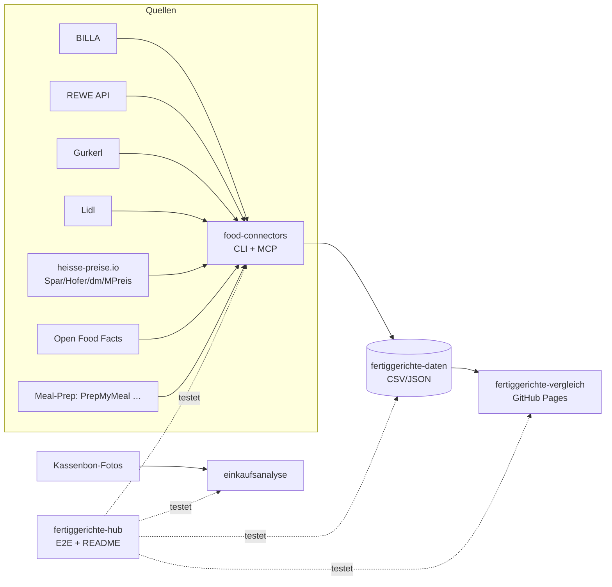

# 🥘 Fertiggerichte-Hub

Zentraler Index & Live-Status aller Fertiggerichte-Projekte (servas-ai). **Automatisch generiert:** 2026-10-13 03:54 UTC via `./run_all.sh` (stündlich).

**Connectors:** 13 ✅ / 2 ❌ / 10 📇 catalog-only · **Apps:** 0/3 live · **Produkte im Datensatz:** 2335

## Apps

| App | URL | Live | Tabs getestet | Konsolen-Fehler | Kaputte Bilder |
|---|---|---|---|---|---|
| Fertiggerichte-Vergleich | https://martin-hausleitner.github.io/fertiggerichte-vergleich/ | ❌ | 0 | 0 | 0 |
| Fertiggerichte-Vergleich (servas-ai Pages) | https://servas-ai.github.io/fertiggerichte-vergleich/ | ❌ | 0 | 0 | 0 |
| Einkaufsanalyse | https://servas-ai.github.io/einkaufsanalyse/ | ❌ | 0 | 0 | 0 |

## Repositories

| Repo | Zweck |
|---|---|
| [servas-ai/fertiggerichte-vergleich](https://github.com/servas-ai/fertiggerichte-vergleich) | Web-App (Vergleich, Netz 3D, Gesundheit, Hersteller …) |
| [servas-ai/food-connectors](https://github.com/servas-ai/food-connectors) | Connectors + CLI + MCP-Server |
| [servas-ai/fertiggerichte-daten](https://github.com/servas-ai/fertiggerichte-daten) | Offener Datensatz CSV/JSON |
| [servas-ai/einkaufsanalyse](https://github.com/servas-ai/einkaufsanalyse) | Einkaufsanalyse-Dashboard (Kassenbons) |

## Architektur



## Connector-Status (Live-Smoke-Test)

| | Connector | Store | Items | Latenz | Beispielprodukt (Beweis) | Zeitpunkt |
|---|---|---|---|---|---|---|
| ✅ | `billa` | BILLA | 3 | 1.1 s | [MAGGI Fix für Gulasch](https://shop.billa.at/produkte/maggi-fix-fuer-gulasch-0056152) · 1.49 € | 2026-10-13T03:53:25Z |
| ✅ | `dm` | dm | 3 | 2.8 s | HiPP Menü Spätzle mit Gulasch ab 8 Monaten, 220 g · 1.75 € | 2026-10-13T03:53:26Z |
| ✅ | `gourmetfein` | Online: Gourmetfein | 3 | 6.55 s | [Weißwurst 1,8kg](https://shop.gourmetfein.com/products/weisswurst-1-8kg) · 24.9 € | 2026-10-13T03:53:31Z |
| ✅ | `gurkerl` | Gurkerl.at | 3 | 0.78 s | [AMA Kalb Rosé Austria Gulasch geschnitten](https://www.gurkerl.at/22932-ama-kalb-rose-austria-gulasch-geschnitten) · 16.1 € | 2026-10-13T03:53:37Z |
| ✅ | `heisse-preise` | heisse-preise.io | 3 | 2.76 s | [Ager Hirschgulasch geschnitten](ager-hirschgulasch-geschnitten-00730647) · 11.99 € | 2026-10-13T03:53:38Z |
| ✅ | `hofer` | HOFER | 3 | 2.84 s | [GENUSS 100% AUS ÖSTERREICH Rindsgulasch 1kg](sortiment/GENUSS-100-AUS-OSTERREICH-Rindsgulasch-1kg) · 19.98 € | 2026-10-13T03:53:43Z |
| ✅ | `mpreis` | MPREIS | 3 | 2.64 s | AIA Puten Gulasch · 6.5 € | 2026-10-13T03:54:07Z |
| ✅ | `mpreis-shop` | MPreis | 3 | 9.4 s | [Basis Gulasch](https://www.mpreis.at/shop/p/knorr-basis-gulasch-282001) · 1.39 € | 2026-10-13T03:54:11Z |
| ✅ | `off` | Open Food Facts | 3 | 1.48 s | [Gulasch (Rind)](https://world.openfoodfacts.org/product/4099200121543) | 2026-10-13T03:54:21Z |
| ✅ | `penny` | PENNY | 2 | 7.17 s | [Schweinefleisch für Reisfleisch/Gulasch](https://www.penny.at/produkte/schweinefleisch-fuer-reisfleischgulasch-78544771) · 3.99 € | 2026-10-13T03:54:22Z |
| ✅ | `prepmymeal` | Online: PrepMyMeal | 3 | 6.43 s | [CH: Gemüse Lasagne](https://prepmymeal.at/products/ch-gemuse-lasagne-3) · 14.5 € | 2026-10-13T03:54:29Z |
| ✅ | `spar` | SPAR/INTERSPAR | 3 | 2.83 s | Baron de Sel Gourmet Gulasch Bio 55g · 4.99 € | 2026-10-13T03:54:36Z |
| ✅ | `unimarkt` | Unimarkt | 3 | 2.71 s | [Felix Erdäpfelgulasch](/Felix-Erdaepfelgulasch-3692) · 5.39 € | 2026-10-13T03:54:40Z |
| 📇 | `adeg` | ADEG | 0 | 0.0 s |  | 2026-10-13T03:53:25Z |
| 📇 | `bio-kistl` | Biohof Achleitner / Bio-Kistl OÖ | 0 | 0.0 s |  | 2026-10-13T03:53:26Z |
| 📇 | `denns` | denn's BioMarkt | 0 | 0.0 s |  | 2026-10-13T03:53:26Z |
| 📇 | `fittogo` | Fit to Go | 0 | 0.0 s |  | 2026-10-13T03:53:31Z |
| 📇 | `foodora-market` | foodora market (Dmart) | 0 | 0.0 s |  | 2026-10-13T03:53:31Z |
| ❌ | `lidl` | Lidl | 0 | 12.66 s | `HTTPError: HTTP Error 401: Unauthorized` | 2026-10-13T03:53:47Z |
| 📇 | `lieferando-shops` | Lieferando Shops | 0 | 0.0 s |  | 2026-10-13T03:54:00Z |
| ❌ | `livefresh` | Online: LiveFresh | 0 | 7.02 s | `0 Treffer` | 2026-10-13T03:54:00Z |
| 📇 | `mjam` | mjam (now foodora) | 0 | 0.0 s |  | 2026-10-13T03:54:07Z |
| 📇 | `nah-frisch` | Nah&Frisch | 0 | 0.0 s |  | 2026-10-13T03:54:20Z |
| 📇 | `unimarkt-shop` | Unimarkt (UNIONLINE Shop) | 0 | 0.0 s |  | 2026-10-13T03:54:44Z |
| 📇 | `wokostswas` | wokostswas.at | 0 | 0.0 s |  | 2026-10-13T03:54:44Z |

## Datensatz

**2335 Produkte** · Tabellen: brand_tree 8, companies 83, establishments 4706, logos 155, nutrition 1571, online_mealprep 96, online_providers 3, prices 2009, producer_quality 4, producers 22, products 2335, stores 498

| Abdeckung | % |
|---|---|
| nutrition | 67.2 |
| price | 86.0 |
| photo | 90.6 |
| producer | 34.7 |
| brand | 85.7 |
| logos_total | 155 |

<details><summary>Produkte nach Kette</summary>

| Kette | Anzahl |
|---|---|
| Billa | 618 |
| Spar | 592 |
| Gurkerl | 356 |
| Hofer | 224 |
| MPreis | 174 |
| unbekannt (OFF) | 135 |
| PrepMyMeal | 90 |
| Lidl | 40 |
| Unimarkt | 29 |
| dm | 24 |
| Fit to Go | 24 |
| Penny | 17 |
| LiveFresh | 10 |
| FitTaste | 2 |

</details>

<details><summary>Produkte nach Fertigstufe/Lagerung</summary>

| Lagerung | Anzahl |
|---|---|
| Unklar (keine Lagerangabe) | 1063 |
| Kühlregal (Menüschale/frisch) | 325 |
| Tiefkühl (TK) | 323 |
| Dose/Konserve | 313 |
| Trocken/Instant | 268 |
| Glas | 16 |
| Sous-vide (vakuum) | 14 |
| Beutel ungekühlt (Retort-Pouch) | 13 |

</details>

## Screenshots

## Changelog (letzte Commits)

**servas-ai/fertiggerichte-vergleich**

- `555e27d` 2026-10-13 03:52 — Spar photos 100% via heisse CDN (228 verified)
- `a09149e` 2026-10-13 03:37 — hourly 2026-10-13T03: +74 MPreis meals via mpreis-shop (food-connectors), OFF EAN nutri×5, brand tree MPreis/AIA/Youcook/Deflorian/…, Abdeckung Lücken-Spotlight + Ident-Kennz. cards (shadcn Progress)
- `df59df5` 2026-10-13 03:25 — logos: +6 verified official logos (PrepMyMeal, Gurkerl, LiveFresh, Gissinger, Suppito, Zátiší) — 47 more products with logo
- `ebe13e3` 2026-10-13 03:08 — data: hourly sync
- `dcfda05` 2026-10-13 03:08 — X-UI: Feed, Galerie, Vergleichs-Board, Dashboard (area/radial/stacked/heatmap/treemap/sparklines), Marken-/Laden-Profil, Kategorien-Explorer, Facetten-Filter mit Slidern und gespeicherten Ansichten
- `18e5d02` 2026-10-13 02:42 — hourly 2026-10-13T02: +63 Gurkerl meals via category API (food-connectors), EAN gap-fill, Datenabdeckung tab (shadcn Chart/Table/ToggleGroup), brand tree M&S/Mars/CJ/MHP/TPF
- `0dff16f` 2026-10-13 02:28 — update
- `2f5314e` 2026-10-13 02:23 — data: hourly sync

**servas-ai/food-connectors**

- `b32e017` 2026-10-13 03:50 — feat(spar): attach CDN image_url from heisse article id
- `32abd1c` 2026-10-13 03:17 — catalog: unimarkt-shop note precision (sampled slugs)
- `cde29e5` 2026-10-13 03:16 — catalog: unimarkt-shop verified CLOSED (shop.unimarkt.at = 'Service eingestellt' splash, all slugs 302 -> /; chain left retail 2026); unimarkt dump notes = history only; test
- `b3577e9` 2026-10-13 02:53 — feat(mpreis-shop): live MPreis webshop connector (sitemap + category pages + product JSON-LD: price, GTIN, image, pack size, nutrition, ingredients), CLI + MCP mpreis_product, fixture test
- `d5b2327` 2026-10-13 02:29 — feat(gurkerl): walk ready-meal categories via category API, batch prices+stock, EAN/producer from composition; tests
- `0876e1d` 2026-10-13 02:28 — test: remove remaining orphaned gurkerl category live test
- `945daa1` 2026-10-13 02:27 — test: drop orphaned gurkerl WIP tests (depend on uncommitted adapter)
- `2f79d98` 2026-10-13 02:27 — Add osm-stores Overpass connector and catalog denns/nah-frisch findings

**servas-ai/fertiggerichte-daten**

- `722cab2` 2026-10-13 03:52 — export: refresh after Spar CDN photo deploy (2335 products, 2115 photos)
- `dba60fd` 2026-10-13 03:50 — data: Spar photos 364→592 (100%) via heisse→cdn1.interspar.at
- `5319516` 2026-10-13 03:23 — logos: Wiesbauer brand alias (4 products resolve to verified official logo)
- `30de9b9` 2026-10-13 03:22 — logos: +6 official logos (PrepMyMeal, Gurkerl, LiveFresh, Gissinger, Suppito, Zátiší) + fit2go.meals brand alias — vision gate pass, source URLs from official sites
- `c8c6939` 2026-10-13 03:16 — data: Unimarkt verified closed (shop.unimarkt.at 'Service eingestellt', chain left retail 2026) — probe evidence in raw/, 29 Unimarkt price rows flagged historic-only, no live source
- `41997c1` 2026-10-13 02:53 — data: MPreis live webshop (101 meals, 100% photos, live 2026 prices, nutrition), supplemental rows survive refresh, nutrition plausibility gate, store logos
- `9368f09` 2026-10-13 02:28 — Add MPreis/Unimarkt ready meals + Linz OSM store branches
- `b449e49` 2026-10-13 02:11 — move food_company -> servas-ai/food-connectors; import OFF AT ready meals + external dataset catalog

**servas-ai/einkaufsanalyse**

- `66934e3` 2026-10-13 01:10 — Einkaufsanalyse v1: shadcn Sidebar-Dashboard, Import, OCR, Beispieldaten

## Ausführen

```bash
pip install pytest playwright && playwright install chromium
./run_all.sh   # Tests + Report + Push (mit Lock, stündlich via cron)
```
