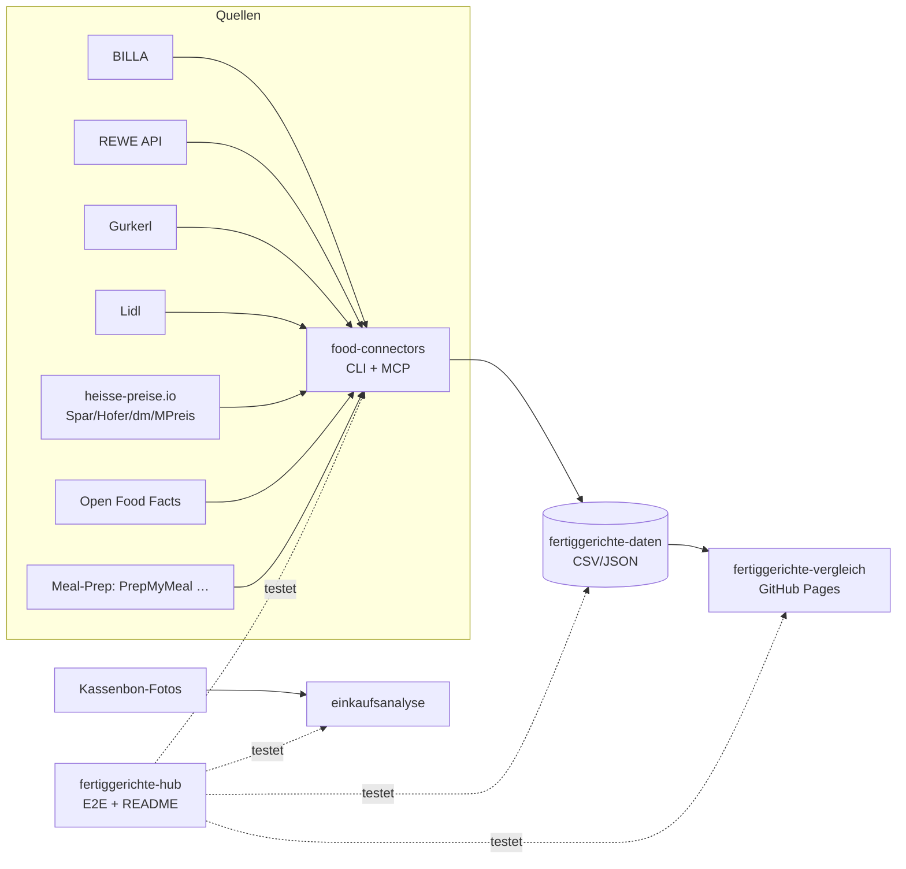

# 🥘 Fertiggerichte-Hub

Zentraler Index & Live-Status aller Fertiggerichte-Projekte (servas-ai). **Automatisch generiert:** 2026-10-14 04:03 UTC via `./run_all.sh` (stündlich).

**Connectors:** 23 ✅ / 1 ❌ / 7 📇 catalog-only · **Apps:** 3/3 live · **Produkte im Datensatz:** 3459

## Apps

| App | URL | Live | Tabs getestet | Konsolen-Fehler | Kaputte Bilder |
|---|---|---|---|---|---|
| Fertiggerichte-Vergleich | https://martin-hausleitner.github.io/fertiggerichte-vergleich/ | ✅ | 9 | 0 | 0 |
| Fertiggerichte-Vergleich (servas-ai Pages) | https://servas-ai.github.io/fertiggerichte-vergleich/ | ✅ | 9 | 0 | 0 |
| Einkaufsanalyse | https://servas-ai.github.io/einkaufsanalyse/ | ✅ | 8 | 0 | 0 |

## Repositories

| Repo | Zweck |
|---|---|
| [servas-ai/fertiggerichte-vergleich](https://github.com/servas-ai/fertiggerichte-vergleich) | Web-App (Vergleich, Netz 3D, Gesundheit, Hersteller …) |
| [servas-ai/food-connectors](https://github.com/servas-ai/food-connectors) | Connectors + CLI + MCP-Server |
| [servas-ai/fertiggerichte-daten](https://github.com/servas-ai/fertiggerichte-daten) | Offener Datensatz CSV/JSON |
| [servas-ai/einkaufsanalyse](https://github.com/servas-ai/einkaufsanalyse) | Einkaufsanalyse-Dashboard (Kassenbons) |

## Architektur



## Connector-Status (Live-Smoke-Test)

| | Connector | Store | Items | Latenz | Beispielprodukt (Beweis) | Zeitpunkt |
|---|---|---|---|---|---|---|
| ✅ | `billa` | BILLA | 3 | 0.45 s | [MAGGI Fix für Gulasch](https://shop.billa.at/produkte/maggi-fix-fuer-gulasch-0056152) · 1.49 € | 2026-10-14T03:57:38Z |
| ✅ | `bofrost` | Online: bofrost* | 3 | 6.87 s | [Wiener Rindsgulasch](https://www.bofrost.at/shop/fleisch_44196/fleischzubereitungen_34987/wiener-rindsgulasch_03373.html) · 14.99 € | 2026-10-14T03:57:39Z |
| ✅ | `denns` | denn's BioMarkt | 1 | 3.66 s | [MyDeli Bio-Fleischsuppe](https://www.denns-biomarkt.at/angebote/) · 3.49 € | 2026-10-14T03:57:46Z |
| ✅ | `dm` | dm | 3 | 4.04 s | [babylove Menü Kartoffeltopf mit Rindergulasch ab d](https://www.dm.at/p/d/1602887/babylove-menue-kartoffeltopf-mit-rindergulasch-ab-dem-8-monat) · 1.15 € | 2026-10-14T03:57:49Z |
| ✅ | `dm-heisse` | dm | 3 | 2.89 s | HiPP Menü Spätzle mit Gulasch ab 8 Monaten, 220 g · 1.75 € | 2026-10-14T03:57:54Z |
| ✅ | `every` | Online: every. | 3 | 12.38 s | [Pumpkin Zucchini Risotto](https://every-foods.com/products/pumpkin-zucchini-risotto) · 8.99 € | 2026-10-14T03:57:58Z |
| ✅ | `fittogo` | Online: Fit2go | 3 | 5.61 s | [Auberginen-Chili con Carne mit Käse Überbacken](https://fittogo.at/products/auberginen-chili-con-carne-mit-kase-uberbacken) · 9.99 € | 2026-10-14T03:58:11Z |
| ✅ | `gourmetfein` | Online: Gourmetfein | 3 | 2.77 s | [Weißwurst 1,8kg](https://shop.gourmetfein.com/products/weisswurst-1-8kg) · 24.9 € | 2026-10-14T03:58:16Z |
| ✅ | `gurkerl` | Gurkerl.at | 3 | 0.44 s | [AMA Kalb Rosé Austria Gulasch geschnitten](https://www.gurkerl.at/22932-ama-kalb-rose-austria-gulasch-geschnitten) · 16.1 € | 2026-10-14T03:58:19Z |
| ✅ | `heisse-preise` | heisse-preise.io | 3 | 2.99 s | [Ager Hirschgulasch geschnitten](ager-hirschgulasch-geschnitten-00730647) · 11.99 € | 2026-10-14T03:58:20Z |
| ✅ | `hofer` | HOFER | 3 | 3.76 s | [GENUSS 100% AUS ÖSTERREICH Rindsgulasch 1kg](sortiment/GENUSS-100-AUS-OSTERREICH-Rindsgulasch-1kg) · 19.98 € | 2026-10-14T03:58:24Z |
| ✅ | `juit` | Online: Juit | 1 | 0.5 s | [Rindergulasch mit gegrillter Paprika](https://www.juit.com/de/gerichte/rindergulasch-mit-paprika) | 2026-10-14T03:58:30Z |
| ✅ | `livefresh` | Online: LiveFresh | 3 | 1.43 s | [Pasta Cheesy Spinat – Protein Bowl](https://livefresh.at/products/pasta-cheesy-spinat-400g) · 5.99 € | 2026-10-14T03:58:42Z |
| ✅ | `mpreis` | MPREIS | 3 | 3.52 s | AIA Puten Gulasch · 6.5 € | 2026-10-14T03:58:44Z |
| ✅ | `mpreis-shop` | MPreis | 3 | 7.59 s | [Basis Gulasch](https://www.mpreis.at/shop/p/knorr-basis-gulasch-282001) · 1.39 € | 2026-10-14T03:58:49Z |
| ✅ | `nah-frisch` | Nah&Frisch | 3 | 236.75 s | [Inzersdorfer Fertiggerichte oder Suppen](https://www.nahundfrisch.at/de/aktuelles/angebote-der-woche) | 2026-10-14T03:58:56Z |
| ✅ | `off` | Open Food Facts | 3 | 0.96 s | [Gulasch (Rind)](https://world.openfoodfacts.org/product/4099200121543) | 2026-10-14T04:02:53Z |
| ✅ | `penny` | PENNY | 2 | 4.25 s | [Schweinefleisch für Reisfleisch/Gulasch](https://www.penny.at/produkte/schweinefleisch-fuer-reisfleischgulasch-78544771) · 3.99 € | 2026-10-14T04:02:54Z |
| ✅ | `penny-shop` | PENNY | 2 | 7.83 s | [Schweinefleisch für Reisfleisch/Gulasch](https://www.penny.at/produkte/schweinefleisch-fuer-reisfleischgulasch-78544771) · 3.99 € | 2026-10-14T04:02:59Z |
| ✅ | `prepmymeal` | Online: PrepMyMeal | 3 | 6.8 s | [CH: Gemüse Lasagne](https://prepmymeal.at/products/ch-gemuse-lasagne-3) · 14.5 € | 2026-10-14T04:03:06Z |
| ✅ | `spar` | SPAR/INTERSPAR | 3 | 3.1 s | Baron de Sel Gourmet Gulasch Bio 55g · 4.99 € | 2026-10-14T04:03:13Z |
| ✅ | `spar-shop` | SPAR/INTERSPAR | 3 | 0.85 s | [TANN Rinds-Bratengulasch](https://www.interspar.at/shop/lebensmittel/tann-rinds-bratengulasch/p/835817) · 21.99 € | 2026-10-14T04:03:18Z |
| ✅ | `unimarkt` | Unimarkt | 3 | 2.89 s | [Felix Erdäpfelgulasch](/Felix-Erdaepfelgulasch-3692) · 5.39 € | 2026-10-14T04:03:19Z |
| 📇 | `adeg` | ADEG | 0 | 0.0 s |  | 2026-10-14T03:57:38Z |
| 📇 | `bio-kistl` | Biohof Achleitner / Bio-Kistl OÖ | 0 | 0.0 s |  | 2026-10-14T03:57:39Z |
| 📇 | `foodora-market` | foodora market (Dmart) | 0 | 0.0 s |  | 2026-10-14T03:58:16Z |
| ❌ | `lidl` | Lidl | 0 | 11.29 s | `HTTPError: HTTP Error 401: Unauthorized` | 2026-10-14T03:58:31Z |
| 📇 | `lieferando-shops` | Lieferando Shops | 0 | 0.0 s |  | 2026-10-14T03:58:42Z |
| 📇 | `mjam` | mjam (now foodora) | 0 | 0.0 s |  | 2026-10-14T03:58:44Z |
| 📇 | `unimarkt-shop` | Unimarkt (UNIONLINE Shop) | 0 | 0.0 s |  | 2026-10-14T04:03:23Z |
| 📇 | `wokostswas` | wokostswas.at | 0 | 0.0 s |  | 2026-10-14T04:03:23Z |

## Datensatz

**3459 Produkte** · Tabellen: brand_tree 8, companies 133, establishments 4706, logos 286, nutrition 2629, online_mealprep 340, online_providers 5, prices 3077, producer_quality 4, producers 22, products 3459, stores 498

| Abdeckung | % |
|---|---|
| nutrition | 76.0 |
| price | 89.0 |
| photo | 93.3 |
| producer | 50.9 |
| brand | 90.5 |
| logos_total | 286 |

<details><summary>Produkte nach Kette</summary>

| Kette | Anzahl |
|---|---|
| Billa | 807 |
| Spar | 735 |
| Gurkerl | 536 |
| MPreis | 388 |
| Hofer | 223 |
| bofrost | 144 |
| unbekannt (OFF) | 93 |
| HelloFresh | 93 |
| PrepMyMeal | 92 |
| Subway | 59 |
| Juit | 50 |
| NORDSEE | 39 |
| Lidl | 37 |
| dm | 35 |
| Fit to Go | 30 |
| Penny | 29 |
| Unimarkt | 29 |
| FitTaste | 18 |
| LiveFresh | 10 |
| Nah&Frisch | 7 |
| Denn's | 5 |

</details>

<details><summary>Produkte nach Fertigstufe/Lagerung</summary>

| Lagerung | Anzahl |
|---|---|
| Unklar (keine Lagerangabe) | 1215 |
| Tiefkühl (TK) | 903 |
| Kühlregal (Menüschale/frisch) | 556 |
| Dose/Konserve | 412 |
| Trocken/Instant | 314 |
| Glas | 34 |
| Sous-vide (vakuum) | 14 |
| Beutel ungekühlt (Retort-Pouch) | 11 |

</details>

## Screenshots

### Fertiggerichte-Vergleich

| Tab | Desktop 1920 | Mobil 390 |
|---|---|---|
| home |  |  |
| Was kaufe ich heute? |  |  |
| Ernährungsplan |  |  |
| KI-Ansicht |  |  |
| Hofer Top 30 |  |  |
| Marken-Profil |  |  |
| Laden-Profil |  |  |
| Marken |  |  |
| Filialen in der Nähe |  |  |

### Fertiggerichte-Vergleich (servas-ai Pages)

| Tab | Desktop 1920 | Mobil 390 |
|---|---|---|
| home |  |  |
| Was kaufe ich heute? |  |  |
| Ernährungsplan |  |  |
| KI-Ansicht |  |  |
| Hofer Top 30 |  |  |
| Marken-Profil |  |  |
| Laden-Profil |  |  |
| Marken |  |  |
| Filialen in der Nähe |  |  |

### Einkaufsanalyse

| Tab | Desktop 1920 | Mobil 390 |
|---|---|---|
| home |  |  |
| Übersicht |  |  |
| Verlauf |  |  |
| Läden |  |  |
| Kategorien |  |  |
| Protein & Gesundheit |  |  |
| Kassenbons |  |  |
| Import |  |  |

## Changelog (letzte Commits)

**servas-ai/fertiggerichte-vergleich**

- `538537d` 2026-10-14 03:40 — data: sensecheck 7 sides cleanup (201→147: −6 desserts, −28 mains/soup inserts e.g. Leber-/Wurst-/Grammelknödel, Kasnudl, Suprema Tonno, Simply Good bowls; −10 dry staples e.g. Püree flakes, Knödelbrot, Backerbsen, dry gnocchi; −10 duplicates) + Kombi variety (veg reuse max 4 instead of 22/24 'Iglo Erbsen'). Rows unchanged 3373 (byte-identical to f240572). fertig 33d5cb9 (local). Gates: pytest 23/23, top50 ok. No deploy.
- `f240572` 2026-10-14 03:37 — hourly T03 data: +22 rows (3351→3373) — 21 verified new heat-up meals visible (SPAR 16 via identical-product twin nutrition from BILLA/Gurkerl/MPreis incl. Iglo Fischstäbchen/Backfisch/Goldschatz/Polar-Dorsch/Scholle/Filegro/Knusper Abenteuer/Crispy Chicken Tempura/Genießer Pfanne Französische Art, Dr. Oetker Ristorante Margherita Pomodori Vegan, Inzersdorfer Hühnerbruststreifen; MPreis 5 incl. Inzersdorfer Rindsgulasch 800 g, Ristorante Salami glutenfrei, Wagner Air Fryer Salami, Intermezzo Schinken). Includes regen for fertig e5f5e63 (Fit2go refresh) + bofrost logo sync. Gates: data PASS, pytest 19/19, top50 ok, regress 0, build ok, Playwright all tabs×2 viewports 0 errors/0 blank/0 overflow, 0/9349 broken images; embeddings 3373 ids match. fertig 8fae9d2 (local). No deploy.
- `c5df479` 2026-10-14 03:14 — data: +144 bofrost* Austria frozen ready meals (store='bofrost'; price, nutrition, photo, Nutri-Score; 25 rankable), all other rows unchanged
- `e2effff` 2026-10-14 03:11 — Online stores Juit (login-only prices: 'Preis nur nach Login', no price rankings) and bofrost: ONLINE/Online/Kategorien lists, palette, STORE_LOGO, logos/juit.svg + logos/bofrost.svg
- `3ac795e` 2026-10-14 02:47 — hourly T02 data: +50 rows (3157→3207) — 46 verified new (SPAR 32: Dr. Oetker Ristorante Salami/Tonno/Spinaci/Mozzarella/Rucola/Prosciutto/Quattro Formaggi/Speciale/Hawaii/Mozzarella glutenfrei, Die Ofenfrische Salami/Pepperoni-Salami/Speciale, La Mia Grande Margherita/Diavola/Salame Piccante/Tonno e Cipolle, Suprema Margherita, Pietro Pizzi Margherita, Bistro Baguette Nizza/Avignon/Korsika/Provence, Wagner Steinofen Salami/Diavolo, Iglo Backhendl-Streifen Kürbiskern, Hühner Nuggets 30, Topfenknödel Mohn, Green Cuisine Veg-/Dino-Nuggets, Zucchini-Käse- & Karfiol-Käse-Laibchen — nutrition/EAN from identical twins at MPreis/Gurkerl/BILLA, product line from interspar URL slug, twin kcal within 3 %; MPreis 14: Iglo Goldschatz Käse 300/600 + Spinat, Fisch'n'Rösti, Fisch'n'Crunch, Knusper Abenteuer, Polardorsch Knusperhülle, Pazifischer Polardorsch paniert 600, Hühner Sticks, Felix + Inzersdorfer Gefüllte Paprika 400/800, Yuu'n Mee Garnelen Knusperpanade, Blasko Backhendlfilet) + 4 Juit meals restored (Joghurt-Kräuter-Huhn, Protein Pesto Chicken…); Juit rows now store 'Juit' (was 'unbekannt (OFF)'), price null with reason 'Preise nur nach Login'. Brand tree +Juit GmbH. Includes regen for fertig c0fa6f4 (Hofer GC Burger Chicken). Gates: data PASS, pytest 19/19, top50 ok, regress 0, build ok, Playwright 64 tab×viewport 0 errors/0 blank/0 overflow, 0/8847 broken images; embeddings 3207 ids match. fertig 1cbc880 (local). No deploy. (rebased on 713a297; data.json is a superset of it)
- `713a297` 2026-10-14 02:39 — data: Hofer GC Burger Chicken 300g nutrition (OFF GTIN 4099200051932, AT label Aibler AT 31353)
- `bd41169` 2026-10-14 02:21 — data: Hofer GOOD CHOICE GTIN fill (fertig 2c1f753) — Wrap Caesar Chicken/Thai Couscous, Pecorelli, Lachs Spaghettini nutrition from OFF by EAN (GTIN-confirmed badge), same-store GTIN twins dupOf; Hofer with nutrition 110→116, rankable stays 3 (Mahlzeit-Check fails). Includes regen for fertig 1a1f5fc (Daten-Squad Juit +50 online meal-prep → 3109→3157 rows), embeddings regenerated (3157, ids match), public/analysis synced from committed fertig/analysis (29 missing logos incl. juit.svg → 0 missing, logos.json, online_providers.json). pytest 19/19 + top50 ok + regress_top50 0, tsc+vite build ok. No deploy.
- `05e3010` 2026-10-14 02:06 — publish_only.sh: build origin/main in a clean worktree, never touch the shared checkout; servas main normal push

**servas-ai/food-connectors**

- `bab2e1d` 2026-10-14 03:58 — feat(every): live every. (every-foods.com) connector — frozen plant-based ready meals shipped to AT (DPD per shop shipping policy, 5,99 €, free from 8 meals) via public Shopify storefront JSON eat.every-foods.com/products.json (price EUR, SKU, availability, packshots) + product pages (Storyblok product blok: weight, nutrition per 100 g + pack, ingredients, preparation; bilingual DE/EN table parser, pack-column typo flag); ready meals = product_type Meal, price > 0, in DE product sitemap; robots-allowed, no login/cookies, 1 req/s; no GTIN → ean None; MCP every_product + every_search; offline tests with fixture (2026-10-14T0341)
- `402f219` 2026-10-14 03:20 — feat(fittogo): live fit2go.meals connector (frozen ready meals, AT-wide Express 4,99 €) via public product sitemap + product HTML — Hydrogen shop (/products.json 404); pack nutrition + Einwaage → per 100 g; price_eur = published 12er-box 9,99 €/Meal (Einzel-SKU 0,00 €); MCP fittogo_product + fittogo_search; offline tests with fixture; Gourmetfein noted as Wurst-only ready-meal dead end (2026-10-14T0307)
- `c4418a1` 2026-10-14 03:01 — feat(bofrost): live bofrost* Austria connector (frozen ready meals, home delivery across AT) via public sitemap + product pages — schema.org JSON-LD price/availability/images, pack line with €/kg, nutrition per 100 g, ingredients, Nutri-Score badge; robots-allowed paths only, no login/cookies, 1 req/s; no GTIN published → ean None; MCP bofrost_product + bofrost_search; offline tests with fixture (2026-10-14T0238)
- `f5654f9` 2026-10-14 02:11 — feat(juit): live Juit connector (frozen ready meals shipped to Austria) via the public storefront content bundle cdn.juit.gmbh/content-de.json — EAN, weight, portions, nutrition/100 g, ingredients, tags, packshot, sellable flag; prices behind login (401) stay null; MCP juit_dishes; offline tests with fixture (2026-10-14T0202)
- `46014e3` 2026-10-13 21:14 — feat(penny-shop): live PENNY AT connector via penny.at's public online-assortment JSON (REWE product-discovery listing + /products/<sku>; robots Sitemap-only, no login/cookies) — regular + standard price, promo text/validity, €/unit, pack, category path, origin, official image; MCP penny_product + penny_search; offline tests with fixtures (2026-10-13T21)
- `91f223b` 2026-10-13 20:53 — feat(nah-frisch): live Nah&Frisch AT connector via the public 'Angebote der Woche' page (robots Allow; tiles from /media, /images+/storage never requested) — KW tabs with validity, official offer tiles, optional tesseract OCR for brand/name/pack/price/badge (extra.ocr, raw text kept); MCP nahfrisch_offers; offline tests with fixtures; ADEG documented as Issuu-flipbook dead end (2026-10-13T20b)
- `c7a16c0` 2026-10-13 20:10 — feat(denns): live denn's BioMarkt AT connector via the public weekly offer feed (Gatsby page-data, robots Allow) — article no., brand, pack, Aktionspreis + Normalpreis, €/kg, validity, vegan flags, official image; MCP denns_offers; live adapters now override catalog-only stubs; offline tests (2026-10-13T20)
- `509f6f6` 2026-10-13 19:48 — fix(spar-shop): code-internal is a SPAR-internal 88… code, not a GTIN → extra.spar_code_internal, ean=None; docs (2026-10-13T19b)

**servas-ai/fertiggerichte-daten**

- `b156046` 2026-10-14 03:59 — Daten-Squad T0341: new online provider every. (every-foods.com, Every. GmbH Berlin HRB 221768 B) — 50 frozen plant-based ready meals shipped to AT (DPD per eat.every-foods.com shipping policy; AGB DE-only conflict documented) with single price (median 8,99 €), weight, nutrition/100 g, ingredients, preparation and HEAD-200 packshot from public Shopify products.json + product pages (food-connectors every bab2e1d); 4 candidates without published nutrition dropped; online meal-prep rows 290→340; every-foods logo aliases; Every. GmbH address/management/register court from Impressum; Little Lunch/Dinnerly probe notes
- `8ada169` 2026-10-14 03:40 — data: refresh from app 538537d (bofrost* 144 + hourly T03 +22 + sensecheck 7)
- `6b24163` 2026-10-14 03:21 — Daten-Squad T0307: live fit2go.meals connector evidence + catalog refresh — 30 finished ready meals from fittogo.at public product sitemap + product HTML (pack nutrition, Einwaage, HEAD-200 packshots; price_eur = 12er-box 9,99 €/Meal); staged in fertig ftg_items/other.json (24→30: +Thai Red Curry, BBQ nutrition filled, URL fixes); verified AT meal-prep dead ends (Foodist→morenutrition, Kochzauber DNS fail, Mealprep.at parked, Gourmetfein = Wurst only, eismann.at→de)
- `d2bc382` 2026-10-14 03:03 — Daten-Squad T0238: new online provider bofrost* Austria (frozen home delivery across AT, Niederlassung Sattledt OÖ) — 144 finished ready meals with price, €/kg, pack size, nutrition/100 g, Nutri-Score and HEAD-verified photo from the public bofrost.at product pages (no GTIN published); online meal-prep rows 146→290; vision-gated bofrost* wordmark; operator FN 185873v / ATU66058936 from Impressum
- `04df4ef` 2026-10-14 03:02 — data: refresh from app 3ac795e (sensecheck 6/6b + hourly T00–T02)
- `f63ffbf` 2026-10-14 02:11 — Daten-Squad T0202: new online provider Juit (50 sellable frozen ready meals with EAN + nutrition + packshot, ships to AT; prices behind login → null), vision-gated Juit wordmark, GLEIF parent/exception evidence for all 57 LEIs
- `ae107eb` 2026-10-14 01:50 — Daten-Squad T0136: +28 vision-gated brand logos (Henglein, Rebel Meat, Just Veg!, Findus, Diamond, Lorado, Schwaben Krone, Harvest Moon, Yopokki, Vitasia, Pan, Flotte Lotte, SPAR BBQ, Thai Delight, Dozz, Hildegard Grünkraft, Deliciosu, Deluxe, Auinger, Alpenstrudel, Sushitime, Ich bin Österreich, Mühlen/Rügenwalder, Big Snack, Ocean Sea, franuí, Arteoliva, Penny Ready); strict logo-less 68→39 brands / 84→55 products
- `f522641` 2026-10-14 01:24 — Daten-Squad T0106: +12 vision-gated brand logos (Therese Mölk, Ager, TANN, Njami, PIZZ'AH, Leibspeis', MCENNEDY, Staudinger, Exotic Food, Taste Of Asia, Fryzza, Schenkel) + 2 aliases

**servas-ai/einkaufsanalyse**

- `66934e3` 2026-10-13 01:10 — Einkaufsanalyse v1: shadcn Sidebar-Dashboard, Import, OCR, Beispieldaten

## Ausführen

```bash
pip install pytest playwright && playwright install chromium
./run_all.sh   # Tests + Report + Push (mit Lock, stündlich via cron)
```
