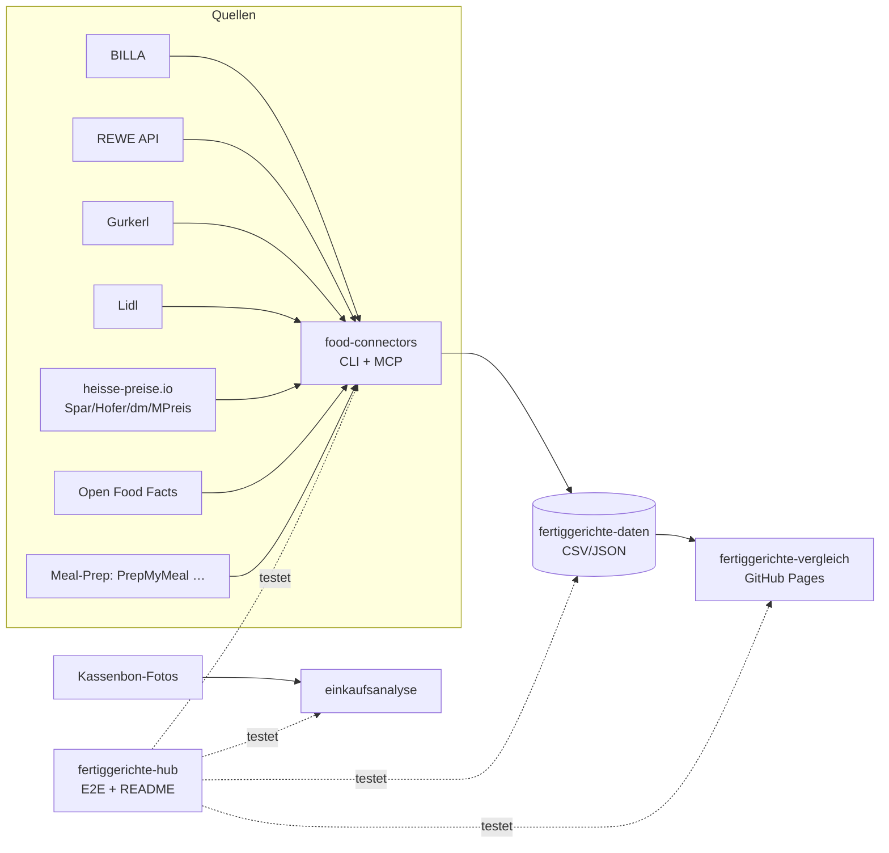

# 🥘 Fertiggerichte-Hub

Zentraler Index & Live-Status aller Fertiggerichte-Projekte (servas-ai). **Automatisch generiert:** 2026-10-31 14:05 UTC via `./run_all.sh` (stündlich).

**Connectors:** 56 ✅ / 11 ❌ / 7 📇 catalog-only · **Apps:** 3/3 live · **Produkte im Datensatz:** 3664

## Apps

| App | URL | Live | Tabs getestet | Konsolen-Fehler | Kaputte Bilder |
|---|---|---|---|---|---|
| Fertiggerichte-Vergleich | https://martin-hausleitner.github.io/fertiggerichte-vergleich/ | ✅ | 26 | 0 | 0 |
| Fertiggerichte-Vergleich (servas-ai Pages) | https://servas-ai.github.io/fertiggerichte-vergleich/ | ✅ | 26 | 0 | 0 |
| Einkaufsanalyse | https://servas-ai.github.io/einkaufsanalyse/ | ✅ | 8 | 0 | 0 |

## Repositories

| Repo | Zweck |
|---|---|
| [servas-ai/fertiggerichte-vergleich](https://github.com/servas-ai/fertiggerichte-vergleich) | Web-App (Vergleich, Netz 3D, Gesundheit, Hersteller …) |
| [servas-ai/food-connectors](https://github.com/servas-ai/food-connectors) | Connectors + CLI + MCP-Server |
| [servas-ai/fertiggerichte-daten](https://github.com/servas-ai/fertiggerichte-daten) | Offener Datensatz CSV/JSON |
| [servas-ai/einkaufsanalyse](https://github.com/servas-ai/einkaufsanalyse) | Einkaufsanalyse-Dashboard (Kassenbons) |

## Architektur



## Connector-Status (Live-Smoke-Test)

| | Connector | Store | Items | Latenz | Beispielprodukt (Beweis) | Zeitpunkt |
|---|---|---|---|---|---|---|
| ✅ | `adamah` | Online: ADAMAH BioHof | 3 | 2.96 s | [Rindsgulasch im Weckglas](https://www.adamah.at/Produktdetailseite/RindsgulaschimWeckglas_42093) · 11.9 € | 2026-10-31T13:52:58Z |
| ✅ | `alfies` | Alfies | 3 | 7.89 s | [Knorr Meisterkessel Gulaschsuppe](https://www.alfies.at/produkt/knorr-meisterkessel-gulaschsuppe-dose-500g-1) · 4.49 € | 2026-10-31T13:53:01Z |
| ✅ | `bauernladen` | Online: Bauernladen.at | 3 | 7.83 s | [Kalbsgulasch](https://bauernladen.at/produkte/fairkocht/kalbsgulasch-27286) · 17.9 € | 2026-10-31T13:53:09Z |
| ✅ | `bernos` | Online: Bernos Tauernwild | 2 | 5.06 s | [Hirschgulasch](https://www.bernos.at/produkt/hirschgulasch/) · 9.0 € | 2026-10-31T13:53:17Z |
| ✅ | `billa` | BILLA | 3 | 1.35 s | [MAGGI Fix für Gulasch](https://shop.billa.at/produkte/maggi-fix-fuer-gulasch-0056152) · 1.49 € | 2026-10-31T13:53:22Z |
| ✅ | `biohof-achleitner` | Online: Biohof Achleitner | 3 | 4.6 s | [Hausg'mocht Rindsgulasch](https://www.biohof.at/Hausgmocht-Rindsgulasch-4755) · 8.7 € | 2026-10-31T13:53:24Z |
| ✅ | `bofrost` | Online: bofrost* | 3 | 9.06 s | [Wiener Rindsgulasch](https://www.bofrost.at/shop/fleisch_44196/fleischzubereitungen_34987/wiener-rindsgulasch_03373.html) · 14.99 € | 2026-10-31T13:53:28Z |
| ✅ | `buchberger` | Online: Fleischerei Buchberger | 2 | 11.72 s | [Hausgemachte Gulasch-Suppe im Glas 450 ml](https://www.buchberger.shop/buchberger-hausgemachte-gulasch-suppe-im-glas-450-ml) · 7.5 € | 2026-10-31T13:53:38Z |
| ✅ | `bullinarium` | Online: Bullinarium (Hallers Bull Beef) | 1 | 10.79 s | [Bull Beef Gulasch 350g](https://www.bullinarium.com/online-shop/produkt/c/fix-fertig/p/bull-beef-gulasch-350g/) · 11.76 € | 2026-10-31T13:53:49Z |
| ✅ | `deflorian` | Online: Deflorian | 2 | 1.41 s | [Rindsgulasch](https://deflorian.tirol/products/rindsgulasch) · 13.1 € | 2026-10-31T13:54:00Z |
| ✅ | `dengg` | Online: Dengg Krapfen- und Knödelmanufaktur | 3 | 26.08 s | [Spinatknödel 4 Stk.](https://www.dengg.info/spinatknoedel-4-stk--62241021-de.html) · 5.7 € | 2026-10-31T13:54:02Z |
| ✅ | `denns` | denn's BioMarkt | 2 | 3.12 s | [BioCool *** Bio-Lasagne](https://www.denns-biomarkt.at/angebote/) · 3.5 € | 2026-10-31T13:54:28Z |
| ✅ | `diechtl` | Online: Fleischerei Diechtl | 1 | 4.68 s | [Rindsgulasch im Glas](https://www.diechtl-shop.at/rindsgulasch-im-glas) · 8.99 € | 2026-10-31T13:54:31Z |
| ✅ | `dm` | dm | 3 | 4.47 s | [babylove Menü Kartoffeltopf mit Rindergulasch ab d](https://www.dm.at/p/d/1602887/babylove-menue-kartoffeltopf-mit-rindergulasch-ab-dem-8-monat) · 1.15 € | 2026-10-31T13:54:36Z |
| ✅ | `draxler` | Online: Draxler Geflügel-Wild | 3 | 3.94 s | [Rehragout](https://www.xn--geflgel-draxler-2vb.at/produkt/rehragout/) · 10.0 € | 2026-10-31T13:54:41Z |
| ✅ | `egle` | Online: Egle | 3 | 9.53 s | [BIO Rinder-Gulasch, 400 g](https://www.egleshop.at/BIO-Rinder-Gulasch-400-g) · 7.49 € | 2026-10-31T13:54:45Z |
| ✅ | `every` | Online: every. | 3 | 16.88 s | [Turkish Lentil Soup](https://every-foods.com/products/turkish-lentil-soup) · 8.99 € | 2026-10-31T13:54:55Z |
| ✅ | `fichtenbauer` | Online: Fleischerei Fichtenbauer | 1 | 35.55 s | [Rindsgulasch essfertig](https://www.fleischerei-fichtenbauer.at/shop/rindsgulasch-essfertig) · 6.9 € | 2026-10-31T13:55:12Z |
| ✅ | `fittogo` | Online: Fit2go | 3 | 9.49 s | [Auberginen-Chili con Carne mit Käse Überbacken](https://fittogo.at/products/auberginen-chili-con-carne-mit-kase-uberbacken) · 9.99 € | 2026-10-31T13:55:48Z |
| ✅ | `flottelotte` | Online: Flotte Lotte | 3 | 7.51 s | [Kartoffel Gulasch](https://flottelottezwettl.at/Kartoffel-Gulasch) · 6.5 € | 2026-10-31T13:55:58Z |
| ✅ | `gerbl` | Online: Gerbl im Glas | 3 | 24.48 s | [Gulaschsuppe](https://shop.gerbl.at/ecommerce/product?product_id=796882&category_id=150129) · 9.0 € | 2026-10-31T13:56:05Z |
| ✅ | `goldblatt` | Online: Goldblatt | 2 | 5.68 s | [Erdäpfel Gulasch](https://goldblatt.at/products/bio-erdapfel-gulasch) · 11.99 € | 2026-10-31T13:56:30Z |
| ✅ | `gourmet-daheim` | Online: GOURMET Daheim (Mahlzeit Linz) | 3 | 13.04 s | [Kartoffelgulasch mit Waldviertler Wurst](https://www.mahlzeit.co.at/wp-content/uploads/2026/03/Preisliste_Bestellschein_GDH_2026_inkl_MwSt_Mahlzeit_web.pdf) · 8.5 € | 2026-10-31T13:56:36Z |
| ✅ | `gourmetfein` | Online: Gourmetfein | 3 | 8.25 s | [Weißwurst 1,8kg](https://shop.gourmetfein.com/products/weisswurst-1-8kg) · 24.9 € | 2026-10-31T13:56:49Z |
| ✅ | `gurkerl` | Gurkerl.at | 3 | 1.5 s | [BIO Weidebeef Gulasch gewürfelt](https://www.gurkerl.at/12385-bio-weidebeef-gulasch-gewuerfelt) · 15.39 € | 2026-10-31T13:56:57Z |
| ✅ | `hofer-shop` | HOFER | 3 | 5.08 s | [Sonnhof Rindsgulasch](https://www.hofer.at/produkt/sonnhof-rindsgulasch-000000000000510738) · 9.49 € | 2026-10-31T13:57:00Z |
| ✅ | `issmich` | Online: iss mich! | 3 | 24.09 s | [Bio Rotweingulasch vom Freilandrind](https://www.issmich.at/Bio-Shop/Eintoepfe/Fleisch/15/Bio-Rotweingulasch-vom-Freilandrind) · 11.5 € | 2026-10-31T13:57:05Z |
| ✅ | `jenichl` | Online: Genussbauernhof Jenichl | 2 | 1.71 s | [Gulasch im Glas](https://www.genussbauernhof-jenichl.at/shop#!/Gulasch-im-Glas/p/241886285) · 5.5 € | 2026-10-31T13:57:29Z |
| ✅ | `juit` | Online: Juit | 1 | 1.87 s | [Rindergulasch mit gegrillter Paprika](https://www.juit.com/de/gerichte/rindergulasch-mit-paprika) | 2026-10-31T13:57:31Z |
| ✅ | `kernbeisser` | Online: Kernbeißer | 3 | 18.92 s | [Maghreb-Hirse mit Artischocken](https://kernbeisser.at/produkt/maghreb-hirse-mit-artischocken/) · 9.0 € | 2026-10-31T13:57:33Z |
| ✅ | `kumitzberg` | Online: Kumitzberg | 3 | 6.81 s | [Tirolerknödel](https://kumitzberg.at/products/tirolerknodel) · 9.8 € | 2026-10-31T13:57:52Z |
| ✅ | `leitgeb` | Online: Leitgeb's Kärntnernudel | 2 | 8.33 s | [Italienischer Nudelteller](https://kaerntnernudel.co.at/produkt/italienischer-nudelteller/) · 11.2 € | 2026-10-31T13:57:59Z |
| ✅ | `livefresh` | Online: LiveFresh | 3 | 2.22 s | [Pasta Cheesy Spinat – Protein Bowl](https://livefresh.at/products/pasta-cheesy-spinat-400g) · 5.99 € | 2026-10-31T13:58:20Z |
| ✅ | `loewenanteil` | Online: Löwenanteil | 1 | 3.2 s | [Veganes Gulasch](https://www.loewenanteil.com/products/veganes-gulasch) · 9.99 € | 2026-10-31T13:58:22Z |
| ✅ | `lomoalto` | Online: Lomo Alto | 1 | 1.65 s | [BIO Rindergulasch im Glas 400g](https://lomoalto.at/products/rindergulasch-im-glas-400g) · 12.4 € | 2026-10-31T13:58:26Z |
| ✅ | `moakt` | Online: Moakt.at (Weiz) | 2 | 36.19 s | [Rinder-Gulaschsuppe essfertig 400g](https://moakt.at/r-gulaschsuppe-essfertig-400g-pro-1glas) · 7.5 € | 2026-10-31T13:58:27Z |
| ✅ | `mpreis-shop` | MPreis | 3 | 6.41 s | [Basis Gulasch](https://www.mpreis.at/shop/p/knorr-basis-gulasch-282001) · 1.39 € | 2026-10-31T13:59:04Z |
| ✅ | `myproduct` | Online: myProduct | 3 | 15.3 s | [Bio Szegediner Gulasch 460g - Fertiggericht von Ha](https://myproduct.at/bio-szegediner-gulasch-450ml-hartls-kulinarikum) · 12.79 € | 2026-10-31T13:59:11Z |
| ✅ | `noglu` | Online: NoGlu (glutenfreie Knödel) | 2 | 4.62 s | [Glutenfreie Speckknödel, 4 Stück (500 g)](https://www.noglu.at/product/glutenfreie-speckknoedel/) · 9.0 € | 2026-10-31T14:02:00Z |
| ✅ | `nudlkudlmudl` | Online: Martina's Nudlkudlmudl | 3 | 4.31 s | [BAERLAUCHNUDELN Frühlingsboten SAISONALES SCHMANKE](https://www.nudlkudlmudl.com/onlineshop/) · 12.9 € | 2026-10-31T14:02:04Z |
| ✅ | `penny` | PENNY | 3 | 5.67 s | [Gulasch- od. Bratensaft](https://www.penny.at/produkte/gulasch-od-bratensaft-7818089) · 1.39 € | 2026-10-31T14:02:09Z |
| ✅ | `penny-shop` | PENNY | 3 | 7.85 s | [Gulasch- od. Bratensaft](https://www.penny.at/produkte/gulasch-od-bratensaft-7818089) · 1.39 € | 2026-10-31T14:02:15Z |
| ✅ | `prepmymeal` | Online: PrepMyMeal | 3 | 11.03 s | [CH: Gemüse Lasagne](https://prepmymeal.at/products/ch-gemuse-lasagne-3) · 14.5 € | 2026-10-31T14:02:23Z |
| ✅ | `purergenuss` | Online: Purer Genuss (Schüsseltrieb) | 1 | 11.63 s | [Wildsuppe mit Fleisch und Gemüse](https://www.purer-genuss.at/product/wildsuppe-mit-fleisch-und-gemuese/) · 6.99 € | 2026-10-31T14:02:34Z |
| ✅ | `regionalles` | Online: RegionAlles Joglland | 2 | 1.79 s | [Holdi's Gulasch im Glas](https://www.regionalles.com/products/gulasch-im-glas) · 8.4 € | 2026-10-31T14:02:46Z |
| ✅ | `ruckzuck` | Online: Ruck Zuck Laden (Dunzinger's) | 3 | 20.4 s | [Gulaschsaft](https://www.ruckzuck-laden.at/shop/Gulaschsaft-p731601508) · 6.4 € | 2026-10-31T14:02:48Z |
| ✅ | `scheffknecht` | Online: Ariane Scheffknecht | 2 | 27.07 s | [Gerstensuppe mit Selchfleisch](https://www.ariane-scheffknecht.at/product-page/gerstensuppe) · 13.5 € | 2026-10-31T14:03:09Z |
| ✅ | `schmankerl` | Online: Schmankerl Österreich | 1 | 1.67 s | [Gulaschsuppe](https://schmankerl-oesterreich.at/products/gulaschsuppe) · 7.9 € | 2026-10-31T14:03:36Z |
| ✅ | `sperchenedergut` | Online: Sperchenedergut | 1 | 18.87 s | [Gulaschsuppe vom Bio-Angusrind](https://sperchenedergut.at/produkt/gulaschsuppe-vom-angusrind/) · 9.5 € | 2026-10-31T14:03:40Z |
| ✅ | `subway-at` | Subway | 3 | 33.64 s | [Italian B.M.T.®](https://www.subway.com/de-AT/MenuNutrition/Menu/Product?ProductId=5257&MenuCategoryId=238) | 2026-10-31T14:04:07Z |
| ✅ | `suppito` | Online: SUPPITO | 1 | 2.59 s | [Rindsgulasch à la Suppito scharf](https://www.suppito.at/produkt/rindsgulasch-a-la-suppito/) · 12.1 € | 2026-10-31T14:04:41Z |
| ✅ | `thaller` | Online: Fleischhauerei Thaller | 1 | 7.79 s | [Rindsgulasch im Glas](https://fleischhauerei-thaller.at/produkt/rindsgulasch-im-glas/) · 7.5 € | 2026-10-31T14:04:44Z |
| ✅ | `voeslauermanufaktur` | Online: voeslauermanufaktur | 2 | 7.53 s | [Erdäpfelgulasch](https://www.voeslauermanufaktur.at/shop/feinkost-im-glas/hauptgerichte/) · 9.9 € | 2026-10-31T14:04:53Z |
| ✅ | `wagyuhof` | Online: Wagyuhof | 1 | 2.57 s | [Wagyu Rindsgulasch im Glas](https://wagyuhof.com/products/wagyu-gulasch) · 13.2 € | 2026-10-31T14:05:00Z |
| ✅ | `wiesbauer_gourmet` | Online: Wiesbauer Gourmet | 2 | 8.42 s | [Feines Hirschgulasch aus Österreich 300 g](https://www.wiesbauer-gourmet.at/produkt/feines-hirschgulasch-300-g) · 9.9 € | 2026-10-31T14:05:03Z |
| ✅ | `zoart` | Online: Sous Vide Fertiggerichte (zoart) | 1 | 2.68 s | [Gulaschglück](https://www.sous-vide-fertiggerichte.at/produkt/gulaschglueck/) · 13.5 € | 2026-10-31T14:05:12Z |
| 📇 | `adeg` | ADEG | 0 | 0.0 s |  | 2026-10-31T13:53:01Z |
| 📇 | `bio-kistl` | Biohof Achleitner / Bio-Kistl OÖ | 0 | 0.0 s |  | 2026-10-31T13:53:23Z |
| ❌ | `dm-heisse` | dm | 0 | 0.38 s | `RobotsDisallowed: https://heisse-preise.io/data/latest-canonical.json` | 2026-10-31T13:54:41Z |
| 📇 | `foodora-market` | foodora market (Dmart) | 0 | 0.0 s |  | 2026-10-31T13:56:05Z |
| ❌ | `heisse-preise` | heisse-preise.io | 0 | 0.4 s | `RobotsDisallowed: https://heisse-preise.io/data/latest-canonical.json` | 2026-10-31T13:56:59Z |
| ❌ | `hofer` | HOFER | 0 | 0.38 s | `RobotsDisallowed: https://heisse-preise.io/data/latest-canonical.json` | 2026-10-31T13:56:59Z |
| ❌ | `lidl` | Lidl | 0 | 11.79 s | `HTTPError: HTTP Error 401: Unauthorized` | 2026-10-31T13:58:08Z |
| 📇 | `lieferando-shops` | Lieferando Shops | 0 | 0.0 s |  | 2026-10-31T13:58:20Z |
| 📇 | `mjam` | mjam (now foodora) | 0 | 0.0 s |  | 2026-10-31T13:58:27Z |
| ❌ | `mpreis` | MPREIS | 0 | 0.36 s | `RobotsDisallowed: https://heisse-preise.io/data/latest-canonical.json` | 2026-10-31T13:59:04Z |
| ❌ | `nah-frisch` | Nah&Frisch | 0 | 153.23 s | `0 Treffer` | 2026-10-31T13:59:26Z |
| ❌ | `off` | Open Food Facts | 0 | 0.36 s | `RobotsDisallowed: https://world.openfoodfacts.org/cgi/search.pl?search_terms=gulasch&count` | 2026-10-31T14:02:09Z |
| ❌ | `spar` | SPAR/INTERSPAR | 0 | 0.37 s | `RobotsDisallowed: https://heisse-preise.io/data/latest-canonical.json` | 2026-10-31T14:03:38Z |
| ❌ | `spar-shop` | SPAR/INTERSPAR | 0 | 1.96 s | `HTTPError: HTTP Error 400: Bad Request` | 2026-10-31T14:03:38Z |
| ❌ | `steiramarkt` | Online: Steira Markt | 0 | 8.02 s | `RobotsDisallowed: https://www.steiramarkt.at/wp-json/wc/store/v1/products?category=491&per` | 2026-10-31T14:03:59Z |
| ❌ | `unimarkt` | Unimarkt | 0 | 0.53 s | `RobotsDisallowed: https://heisse-preise.io/data/latest-canonical.json` | 2026-10-31T14:04:52Z |
| 📇 | `unimarkt-shop` | Unimarkt (UNIONLINE Shop) | 0 | 0.0 s |  | 2026-10-31T14:04:53Z |
| 📇 | `wokostswas` | wokostswas.at | 0 | 0.0 s |  | 2026-10-31T14:05:12Z |

### Bekannte Ausfälle (manuell gepflegt)

- `off` (Open Food Facts) ❌ seit 2026-10-16 (Hub-Lauf 22:59 UTC) dauerhaft, nicht mehr nur Upstream-503: OFF `robots.txt` verbietet für `User-agent: *` jetzt `/api`, `/cgi` und `/facets`, und der neue harte robots.txt-Gate in food-connectors (`0eaa455`) blockiert `cgi/search.pl` (Suche) und `api/v2/product` (EAN-Lookup) bewusst vor dem Request. `search.openfoodfacts.org` ist ebenfalls `Disallow: /`. Fix-Pfad (offen, food-connectors `adapters/off.py`): EAN-Lookup über die erlaubte Produktseite `/product/<ean>` (HTML), Suche über Open Prices / Datensatz-Dump statt Live-Suche. Kein Bypass des Gates.
- `lidl` ❌ HTTP 401 (bekannt, Lidl-API verlangt Auth; kein Login erlaubt).
- `heisse-preise`, `dm-heisse`, `hofer`, `mpreis`, `spar`, `unimarkt` ❌ seit Hub-Lauf 2026-10-17 20:07 UTC: Upstream-Ausfall bei heisse-preise.io. `https://heisse-preise.io/robots.txt` liefert HTTP 500 (nginx), und der robots.txt-Gate in food-connectors (`food_connectors/polite.py`) behandelt 5xx gemäß RFC 9309 korrekt als „alles verboten“, darum wird `data/latest-canonical.json` vor dem Request geblockt. Kein Code-Fehler, kein Bypass; erholt sich automatisch, sobald robots.txt wieder 200/4xx liefert.
- `sperchenedergut` ❌ seit Hub-Lauf 2026-10-24 22:07 UTC: Upstream-Ausfall beim Hoster (Host Europe). `https://sperchenedergut.at/robots.txt` liefert HTTP 502, der robots.txt-Gate behandelt 5xx gemäß RFC 9309 als „alles verboten“ und blockt die WooCommerce Store API vor dem Request. Kein Code-Fehler, kein Bypass; erholt sich automatisch, sobald die Seite wieder erreichbar ist.
- `spar-shop` ❌ seit 2026-10-30 (Hub-Lauf 18:15 UTC): INTERSPAR-Relaunch (Nuxt), der FACT-Finder-Kanal `products_lmos_at` liefert HTTP 400; die neue `/api/search/results` liegt hinter einer Cloudflare-Challenge und wird bewusst nicht umgangen (Details: COVERAGE T1738/T1809, food-connectors `7d4eeec`). Fix braucht den neuen Kanal aus einer normalen Browser-Sitzung.
- `nah-frisch` ❌ seit Hub-Lauf 2026-10-30 18:15 UTC, aber kein Defekt: die Angebotsseite ist erreichbar (robots 200, KW44+KW45 mit 32 Kacheln, `offers()` parst sie korrekt). Diese Woche ist nur kein Fertiggericht im Flugblatt, darum findet der Smoke-Test (gulasch/lasagne/suppe, dann Kategorie ready-meals) 0 Treffer. Erholt sich mit dem nächsten passenden Wochenangebot.
- `fichtenbauer` ⚠️ im Hub-Lauf 2026-10-30 18:15 UTC mit 0 Treffern (86 s Latenz), Einzel-Retest um 18:15 UTC bestanden (3 Treffer). Langsamer Upstream, kein Code-Fehler.
- `zoart` ⚠️ Hub-Lauf 2026-10-30 19:18 UTC: einmaliges HTTP 403 (flaky), Retest direkt danach grün; kein Fix nötig.
- `penny-shop` ⚠️ Hub-Lauf 2026-10-30 20:09 UTC: sporadisches HTTP 403 der REWE product-discovery API auf einzelnen Listing-Seiten (z. B. page=4, wechselnd; vermutlich WAF/Rate-Limit), Retest 20:11 UTC grün (3 Treffer); kein Code-Fehler, kein Bypass. Falls es sich häuft: Retry mit Backoff in `penny_shop.listing()`. `zoart` ist im selben Lauf wieder grün.
- `gourmet-daheim` ⚠️ Hub-Lauf 2026-10-30 20:55 UTC: einmal `RobotsDisallowed` für die Preisliste-PDF auf mahlzeit.co.at (vermutlich robots.txt-Abruf kurz fehlgeschlagen), Einzel-Retest 21:12 UTC grün; kein Code-Fehler. `penny-shop` ist im selben Lauf wieder grün. Erneut im Hub-Lauf 22:48 UTC (gleicher RobotsDisallowed), Einzel-Retest 23:05 UTC wieder grün: robots.txt-Abruf von mahlzeit.co.at ist offenbar flaky. Erneut im Hub-Lauf 2026-10-31 00:57 UTC, Einzel-Retest 01:06 UTC grün.
- `purergenuss` ⚠️ Hub-Lauf 2026-10-31 01:03 UTC: einmal `RobotsDisallowed` für /wp-json/wc/store/v1/products, obwohl robots.txt (200, text/plain) /wp-json nicht sperrt; Einzel-Retest 01:06 UTC grün. Gleiches Muster wie gourmet-daheim: robots.txt-Abruf kurz fehlgeschlagen, kein Code-Fehler.
- `suppito` + `purergenuss` ⚠️ Hub-Lauf 2026-10-31 02:10 UTC: beide fail; Einzel-Retest 02:17 UTC weiterhin fail. Ursache extern: TLS-Handshake zu suppito.at/www.suppito.at und purergenuss.at/www.purergenuss.at bricht vom Box-Netz ab (curl exit 35 / SSL UNEXPECTED_EOF), robots.txt daher nicht abrufbar → RobotsDisallowed (fail-closed, korrekt). Kein Code-Fehler; Host-Ausfall oder WAF-Sperre der Box-IP. Nicht umgehen; nächste Läufe beobachten.
- `bernos` + `gourmet-daheim` + `purergenuss` ⚠️ Hub-Lauf 2026-10-31 07:55–08:05 UTC: alle drei einmal `RobotsDisallowed` (robots.txt-Abruf kurz fehlgeschlagen; bernos.at robots.txt sperrt nichts), Einzel-Retests 08:08–08:09 UTC grün. Flaky robots.txt-Abruf, kein Code-Fehler. `suppito` ist im selben Lauf wieder grün.

## Datensatz

**3664 Produkte** · Tabellen: brand_tree 8, companies 162, establishments 4706, logos 318, nutrition 2825, online_mealprep 406, online_providers 3, prices 3270, producer_quality 4, producers 22, products 3664, stores 498

| Abdeckung | % |
|---|---|
| nutrition | 77.1 |
| price | 89.2 |
| photo | 94.5 |
| producer | 48.4 |
| brand | 90.9 |
| logos_total | 318 |

<details><summary>Produkte nach Kette</summary>

| Kette | Anzahl |
|---|---|
| Billa | 807 |
| Spar | 735 |
| Gurkerl | 536 |
| MPreis | 388 |
| Hofer | 231 |
| Alfies | 182 |
| bofrost | 144 |
| unbekannt (OFF) | 93 |
| HelloFresh | 93 |
| PrepMyMeal | 92 |
| Subway | 59 |
| Juit | 50 |
| NORDSEE | 39 |
| Lidl | 37 |
| dm | 35 |
| Fit to Go | 32 |
| Penny | 29 |
| Unimarkt | 29 |
| FitTaste | 18 |
| Denn's | 15 |
| Nah&Frisch | 10 |
| LiveFresh | 10 |

</details>

<details><summary>Produkte nach Fertigstufe/Lagerung</summary>

| Lagerung | Anzahl |
|---|---|
| Unklar (keine Lagerangabe) | 1223 |
| Tiefkühl (TK) | 1020 |
| Kühlregal (Menüschale/frisch) | 603 |
| Dose/Konserve | 422 |
| Trocken/Instant | 337 |
| Glas | 34 |
| Sous-vide (vakuum) | 14 |
| Beutel ungekühlt (Retort-Pouch) | 11 |

</details>

## Screenshots

### Fertiggerichte-Vergleich

| Tab | Desktop 1920 | Mobil 390 |
|---|---|---|
| home |  |  |
| Was kaufe ich heute? |  |  |
| Fertiggerichte filtern |  |  |
| Meine Shops & Ranking |  |  |
| Ernährungsplan |  |  |
| KI-Ansicht |  |  |
| Hofer Top 30 |  |  |
| Feed |  |  |
| Gericht vergleichen |  |  |
| Top-Listen |  |  |
| Kategorien |  |  |
| Marken-Profil |  |  |
| Laden-Profil |  |  |
| Marken |  |  |
| Markenfamilien |  |  |
| Dashboard |  |  |
| Verpackungen |  |  |
| Wer steckt dahinter? |  |  |
| Hersteller-Qualität |  |  |
| Netz 3D |  |  |
| Läden & Werke |  |  |
| Filialen in der Nähe |  |  |
| Online-Anbieter |  |  |
| Kombi-Ideen |  |  |
| Fit to Go vs. Supermarkt |  |  |
| Multipot-Pro Garzeiten |  |  |

### Fertiggerichte-Vergleich (servas-ai Pages)

| Tab | Desktop 1920 | Mobil 390 |
|---|---|---|
| home |  |  |
| Was kaufe ich heute? |  |  |
| Fertiggerichte filtern |  |  |
| Meine Shops & Ranking |  |  |
| Ernährungsplan |  |  |
| KI-Ansicht |  |  |
| Hofer Top 30 |  |  |
| Feed |  |  |
| Gericht vergleichen |  |  |
| Top-Listen |  |  |
| Kategorien |  |  |
| Marken-Profil |  |  |
| Laden-Profil |  |  |
| Marken |  |  |
| Markenfamilien |  |  |
| Dashboard |  |  |
| Verpackungen |  |  |
| Wer steckt dahinter? |  |  |
| Hersteller-Qualität |  |  |
| Netz 3D |  |  |
| Läden & Werke |  |  |
| Filialen in der Nähe |  |  |
| Online-Anbieter |  |  |
| Kombi-Ideen |  |  |
| Fit to Go vs. Supermarkt |  |  |
| Multipot-Pro Garzeiten |  |  |

### Einkaufsanalyse

| Tab | Desktop 1920 | Mobil 390 |
|---|---|---|
| home |  |  |
| Übersicht |  |  |
| Verlauf |  |  |
| Läden |  |  |
| Kategorien |  |  |
| Protein & Gesundheit |  |  |
| Kassenbons |  |  |
| Import |  |  |

## Changelog (letzte Commits)

**servas-ai/fertiggerichte-vergleich**

- `ddc8d74` 2026-10-31 13:52 — fix(sc88-p3-3): angezeigte score_parts summieren zum Score – Ursache score_v2 rundet jeden Teil einzeln, Score aus ungerundeter Summe (1104 Export-Zeilen ±0,1…0,3, u. a. #1941/#2069/#2669/#2995); App-Pass consistentParts in useAppData verschiebt nur Teile in 0,1-Schritten (größte nicht-ganzzahlige, nie sugar/base/ganzzahlige), Score/Ranking/Schwelle 30 unverändert; test_score_parts: |score − clamp(Σ)| ≤ 0,05 für alle Zeilen, Nicht-Rundungs-Lücke #1212 (29,9 vs 21,5) im Budget 1 bis Datenzweig sc88-p2; Selftest + 3 Mutationen schlagen fehl; prepush_gate grün
- `ddd1d64` 2026-10-31 13:10 — test(sc88-p3-1): alsoPack-Selftest Mutation 3 kein No-op mehr – Fixture #2 hat alsoPack [billa], Mutation entfernt es; Assertion JSON(mut3) !== JSON(fixture), dupOf-Lücke zählt in gapsAll (1) aber nicht als aktive Lücke; viaPackOnly 2; Mutation des Fixtures schlägt fehl; prepush_gate grün
- `1aa11bd` 2026-10-31 04:51 — test(sc87-p3): alsoPack-Pfad in test_alsoat_gaps per synthetischer Fixture abgesichert – Selftest bei jedem Lauf (Store nur via alsoPack = keine Lücke; Mutationen: alsoPack entfernt -> #1 Lücke, 2x gerankt je EAN, dupOf ohne alsoPack keine aktive Lücke), zählt 'Stores nur via alsoPack' (echte Daten 0); kaputter alsoPack-Zweig schlägt fehl; prepush_gate grün
- `166a72c` 2026-10-31 03:36 — test(sc86-p3): dupOf-Invariante prüfbar – test_dupof_invariant: 85 dupOf-Zeilen, 0 harte Verstöße (Ziel existiert, keine Ketten, versteckt nie gerankt), pPor-Lücken 23 gezählt mit Budget (sc83-data 16; im prepush-gate, Mutation + Budget schlagen fehl)
- `15e5e9b` 2026-10-31 03:18 — test(sc86-p3): alsoAt-Lücken gezählt + abgesichert – test_alsoat_gaps: 155 EAN-Gruppen in >1 Shop, aktive Zeilen (nicht dupOf) 0 Lücken in alsoAt/alsoPack, max. 1 gerankte Zeile je EAN (im prepush-gate; grün auf main und sc83-data, Mutation schlägt fehl)
- `969ec11` 2026-10-31 02:13 — fix(sc85b-p3): stores_linz_walk/providers/2026-10-13.json in shops.ts mit ?v=__BUILD__ (waren unversioniert doppelt geladen, nie gebustet); test_build_files verbietet BASE_URL-JSON-Fetches ohne ?v=
- `cb4c3e1` 2026-10-31 01:45 — fix(sc84-p3): logos.json + brand_families.json mit ?v=__BUILD__ statt Date.now() (wurden nie gecacht) und in BUILD_FILES; test_build_files verbietet ?v=Date.now() bei JSON-Fetches
- `e0981d1` 2026-10-30 23:48 — fix(sc84-p2-3): Preisstand je Shop statt „Preise zuletzt aktualisiert“ (Maximum, nur Billa 30.10.) – Label ältester–jüngster Shop-Stand, Tooltip je Shop (+ test_price_span im prepush-gate)

**servas-ai/food-connectors**

- `7d4eeec` 2026-10-30 17:39 — status: spar-shop broken — SPAR fact-finder channel products_lmos_at removed (HTTP 400), shop pages 403 to non-browser clients (not bypassed)
- `5a5615e` 2026-10-25 15:12 — bauernladen: fairkocht_nutrition() — producer-side per-100 g nutrition for fairkocht rows from fairkocht.at Store API (Atwater gate flags inconsistent tables); offline fixture test; reproduces daten 58c57a6 18/19
- `09680ec` 2026-10-25 14:12 — bofrost: off_gtin() — GTIN from Open Food Facts pack barcodes (article no. embedded 0PPPP69AAAAAC, GS1-validated) only when article no. + net weight match and kcal/protein/fat/carbs per 100 g within ±5%; offline fixture test (236 pass, 3 skipped); reproduces daten a1f5420 6/144
- `e786140` 2026-10-25 13:50 — wiesbauer_gourmet: GTIN from product-page JSON-LD (jsonld_gtin/page_gtin, opt-in fetch(with_gtin=True), GS1-validated, 19/20 meals 2026-10-25); offline fixture test (235 pass)
- `c9b24a3` 2026-10-25 13:09 — gourmet-daheim: fallback dish photos (127 arts) from the official Speisekarte 2026 PDF, repo-hosted in fertiggerichte-daten; 234 tests pass
- `4dcd4bf` 2026-10-25 12:44 — every: GTIN via shopify_gtin per-product JSON (50/50 meals, 2026-10-25)
- `4030f6c` 2026-10-25 12:23 — shopify_gtin: read GS1-valid variant barcodes from public /products/<handle>.json (empty in products.json) for deflorian, kumitzberg, goldblatt, loewenanteil; drop barcodes shared by several products (placeholder pattern); fix 'no GTIN published' docstrings; 3 offline tests (233 pass)
- `7f25e3b` 2026-10-25 11:16 — schmankerl: live Schmankerl Österreich connector (Pamela Plüschke – Salzburg Spezialitäten, Feldkirchen; Shopify reseller, chilled shipping AT/DE/IT/EU) — 9 chilled Innviertel Knödel, Kaspressknödel, Fleischstrudel and canned Gulaschsuppe, MCP tools, 4 offline tests

**servas-ai/fertiggerichte-daten**

- `1e7d5ed` 2026-10-25 15:42 — T1540: nutrition backfill 14 Hartl's Kulinarikum rows (8 myProduct + 6 ADAMAH) from the producer's own hartls-kulinarikum.at Nährwert label images (je 100 g, vision-transcribed; matches myProduct's published Bohnentopf/Puten tables exactly; Atwater ±15%); kJ/kcal label mismatches flagged; 9 Hartl's dishes publish no table
- `58c57a6` 2026-10-25 15:11 — T1509: nutrition backfill 18/19 fairkocht rows (via Bauernladen.at) from the producer's own fairkocht.at product pages (Nährwerte je 100 g; same producer, name, price; Atwater ±15%); Paprikahendl skipped (published 19 kcal inconsistent with macros); Kalbsgulasch/Kalbsragout flagged identical tables; Christöphl/Deflorian publish no nutrition
- `ba14ca9` 2026-10-25 14:43 — T1437: nutrition backfill 24 myProduct multipack rows by identical GTIN (5 dm + 1 Gurkerl retail rows, 18 Open Food Facts; Atwater ±15% check; 4 skipped for OFF name/size mismatch) + Leitgeb's GTIN 4/29 from identical Gurkerl articles (name + 450 g + nutrition); Deflorian 21, Hartl's 17, Wiesbauer 7, SUPPITO 7, Kumitzberg 2 GTINs have no OFF nutrition (404)
- `a1f5420` 2026-10-25 14:12 — T1402: GTIN backfill bofrost* 6/144 via Open Food Facts — pack barcode embeds bofrost article no. (0PPPP69AAAAAC) = bofrost.at article no., name + net weight equal, nutrition ±5% (4 identical/within 4%, 2 OFF without nutrition); 29 article-matched candidates skipped (nutrition/weight mismatch or OFF weight missing); GOURMET Daheim 0/141 (OFF has only 36 GMS GOURMET retail codes, no match)
- `aebbe62` 2026-10-25 13:50 — T1339: GTIN backfill 27 rows — Wiesbauer Gourmet 19/20 from product-page JSON-LD gtin, Egle 8/31 via Open Food Facts (own GS1 prefix 4262468; 2 nutrition-identical, 2 photo-confirmed, unique names); WooCommerce Leitgeb/Steira Markt/Draxler publish no GTIN (Store API global_unique_id null)
- `7422341` 2026-10-25 13:08 — T1305: GOURMET Daheim photos 8→127/141 — 119 official dish photos from the Mahlzeit Linz Speisekarte 2026 PDF, matched by order number position (127/127 unique), vision gate passed, stored under images/gourmet_daheim/
- `99cde6b` 2026-10-25 12:44 — T1241: GTIN backfill 57 rows — every. 50/50 from Shopify per-product JSON, SUPPITO 7 via identical Gurkerl product+weight (Kürbis 500/510 g mismatches skipped); Gurkerl publishes no SUPPITO nutrition
- `eaa7126` 2026-10-25 12:21 — T1207: GTIN backfill 76 rows from Shopify per-product JSON (Löwenanteil 17, Deflorian 25, PrepMyMeal 13, Goldblatt 8, LiveFresh 7, Kumitzberg 5, Schmankerl 1) + 7 nutrition fills via identical GTIN (Deflorian 6 via MPreis/OFF, Schmankerl FELIX Gulaschsuppe); Wagyuhof placeholder barcodes + Deflorian shared Erdbeer/Zwetschken barcode skipped

**servas-ai/einkaufsanalyse**

- `66934e3` 2026-10-13 01:10 — Einkaufsanalyse v1: shadcn Sidebar-Dashboard, Import, OCR, Beispieldaten

## Ausführen

```bash
pip install pytest playwright && playwright install chromium
./run_all.sh   # Tests + Report + Push (mit Lock, stündlich via cron)
```
