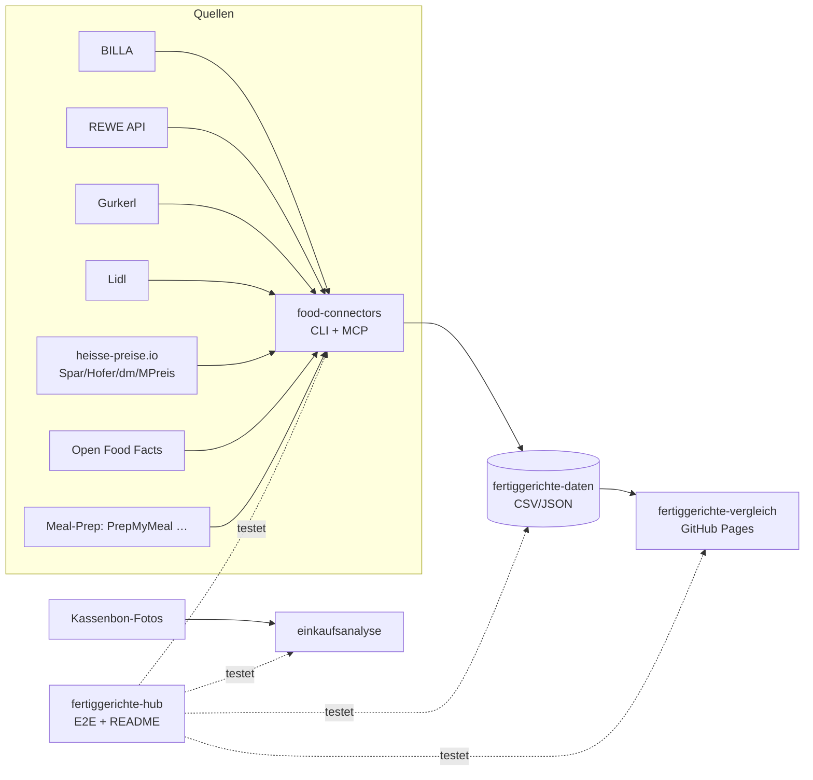

# 🥘 Fertiggerichte-Hub

Zentraler Index & Live-Status aller Fertiggerichte-Projekte (servas-ai). **Automatisch generiert:** 2026-10-24 23:03 UTC via `./run_all.sh` (stündlich).

**Connectors:** 36 ✅ / 9 ❌ / 7 📇 catalog-only · **Apps:** 3/3 live · **Produkte im Datensatz:** 3664

## Apps

| App | URL | Live | Tabs getestet | Konsolen-Fehler | Kaputte Bilder |
|---|---|---|---|---|---|
| Fertiggerichte-Vergleich | https://martin-hausleitner.github.io/fertiggerichte-vergleich/ | ✅ | 17 | 2 | 0 |
| Fertiggerichte-Vergleich (servas-ai Pages) | https://servas-ai.github.io/fertiggerichte-vergleich/ | ✅ | 17 | 0 | 0 |
| Einkaufsanalyse | https://servas-ai.github.io/einkaufsanalyse/ | ✅ | 8 | 0 | 0 |

## Repositories

| Repo | Zweck |
|---|---|
| [servas-ai/fertiggerichte-vergleich](https://github.com/servas-ai/fertiggerichte-vergleich) | Web-App (Vergleich, Netz 3D, Gesundheit, Hersteller …) |
| [servas-ai/food-connectors](https://github.com/servas-ai/food-connectors) | Connectors + CLI + MCP-Server |
| [servas-ai/fertiggerichte-daten](https://github.com/servas-ai/fertiggerichte-daten) | Offener Datensatz CSV/JSON |
| [servas-ai/einkaufsanalyse](https://github.com/servas-ai/einkaufsanalyse) | Einkaufsanalyse-Dashboard (Kassenbons) |

## Architektur



## Connector-Status (Live-Smoke-Test)

| | Connector | Store | Items | Latenz | Beispielprodukt (Beweis) | Zeitpunkt |
|---|---|---|---|---|---|---|
| ✅ | `adamah` | Online: ADAMAH BioHof | 3 | 3.61 s | [Rindsgulasch im Weckglas](https://www.adamah.at/Produktdetailseite/RindsgulaschimWeckglas_42093) · 11.9 € | 2026-10-24T22:54:41Z |
| ✅ | `alfies` | Alfies | 3 | 7.32 s | [Knorr Meisterkessel Gulaschsuppe](https://www.alfies.at/produkt/knorr-meisterkessel-gulaschsuppe-dose-500g-1) · 4.49 € | 2026-10-24T22:54:45Z |
| ✅ | `bauernladen` | Online: Bauernladen.at | 3 | 8.13 s | [Kalbsgulasch](https://bauernladen.at/produkte/fairkocht/kalbsgulasch-27286) · 17.9 € | 2026-10-24T22:54:52Z |
| ✅ | `billa` | BILLA | 3 | 1.28 s | [MAGGI Fix für Gulasch](https://shop.billa.at/produkte/maggi-fix-fuer-gulasch-0056152) · 1.49 € | 2026-10-24T22:55:01Z |
| ✅ | `biohof-achleitner` | Online: Biohof Achleitner | 3 | 4.93 s | [Hausg'mocht Rindsgulasch](https://www.biohof.at/Hausgmocht-Rindsgulasch-4755) · 8.7 € | 2026-10-24T22:55:02Z |
| ✅ | `bofrost` | Online: bofrost* | 3 | 7.79 s | [Wiener Rindsgulasch](https://www.bofrost.at/shop/fleisch_44196/fleischzubereitungen_34987/wiener-rindsgulasch_03373.html) · 14.99 € | 2026-10-24T22:55:07Z |
| ✅ | `denns` | denn's BioMarkt | 1 | 3.81 s | [NaBio Bio-Eintopf oder -Suppe](https://www.denns-biomarkt.at/angebote/) · 2.49 € | 2026-10-24T22:55:15Z |
| ✅ | `dm` | dm | 3 | 4.57 s | [babylove Menü Kartoffeltopf mit Rindergulasch ab d](https://www.dm.at/p/d/1602887/babylove-menue-kartoffeltopf-mit-rindergulasch-ab-dem-8-monat) · 1.15 € | 2026-10-24T22:55:19Z |
| ✅ | `draxler` | Online: Draxler Geflügel-Wild | 3 | 4.9 s | [Rehragout](https://www.xn--geflgel-draxler-2vb.at/produkt/rehragout/) · 10.0 € | 2026-10-24T22:55:24Z |
| ✅ | `every` | Online: every. | 3 | 14.68 s | [Turkish Lentil Soup](https://every-foods.com/products/turkish-lentil-soup) · 8.99 € | 2026-10-24T22:55:29Z |
| ✅ | `fittogo` | Online: Fit2go | 3 | 8.71 s | [Auberginen-Chili con Carne mit Käse Überbacken](https://fittogo.at/products/auberginen-chili-con-carne-mit-kase-uberbacken) · 9.99 € | 2026-10-24T22:55:44Z |
| ✅ | `gerbl` | Online: Gerbl im Glas | 3 | 24.19 s | [Gulaschsuppe](https://shop.gerbl.at/ecommerce/product?product_id=796882&category_id=150129) · 9.0 € | 2026-10-24T22:55:53Z |
| ✅ | `goldblatt` | Online: Goldblatt | 2 | 4.66 s | [Erdäpfel Gulasch](https://goldblatt.at/products/bio-erdapfel-gulasch) · 11.99 € | 2026-10-24T22:56:17Z |
| ✅ | `gourmet-daheim` | Online: GOURMET Daheim (Mahlzeit Linz) | 3 | 12.67 s | [Kartoffelgulasch mit Waldviertler Wurst](https://www.mahlzeit.co.at/wp-content/uploads/2026/03/Preisliste_Bestellschein_GDH_2026_inkl_MwSt_Mahlzeit_web.pdf) · 8.5 € | 2026-10-24T22:56:22Z |
| ✅ | `gourmetfein` | Online: Gourmetfein | 3 | 8.22 s | [Weißwurst 1,8kg](https://shop.gourmetfein.com/products/weisswurst-1-8kg) · 24.9 € | 2026-10-24T22:56:35Z |
| ✅ | `gurkerl` | Gurkerl.at | 3 | 1.32 s | [Gissinger Erdäpfelgulasch](https://www.gurkerl.at/21854-gissinger-erdaepfelgulasch) · 10.02 € | 2026-10-24T22:56:43Z |
| ✅ | `hofer-shop` | HOFER | 2 | 3.83 s | [Sonnhof Rindsgulasch](https://www.hofer.at/produkt/sonnhof-rindsgulasch-000000000000510738) · 9.49 € | 2026-10-24T22:56:46Z |
| ✅ | `issmich` | Online: iss mich! | 3 | 32.3 s | [Bio Rotweingulasch vom Freilandrind](https://www.issmich.at/Bio-Shop/Eintoepfe/Fleisch/15/Bio-Rotweingulasch-vom-Freilandrind) · 11.5 € | 2026-10-24T22:56:50Z |
| ✅ | `juit` | Online: Juit | 1 | 1.59 s | [Rindergulasch mit gegrillter Paprika](https://www.juit.com/de/gerichte/rindergulasch-mit-paprika) | 2026-10-24T22:57:23Z |
| ✅ | `kernbeisser` | Online: Kernbeißer | 3 | 18.9 s | [Maghreb-Hirse mit Artischocken](https://kernbeisser.at/produkt/maghreb-hirse-mit-artischocken/) · 9.0 € | 2026-10-24T22:57:24Z |
| ✅ | `livefresh` | Online: LiveFresh | 3 | 2.47 s | [Pasta Cheesy Spinat – Protein Bowl](https://livefresh.at/products/pasta-cheesy-spinat-400g) · 5.99 € | 2026-10-24T22:57:55Z |
| ✅ | `loewenanteil` | Online: Löwenanteil | 1 | 2.89 s | [Veganes Gulasch](https://www.loewenanteil.com/products/veganes-gulasch) · 9.99 € | 2026-10-24T22:57:58Z |
| ✅ | `mpreis-shop` | MPreis | 3 | 6.77 s | [Basis Gulasch](https://www.mpreis.at/shop/p/knorr-basis-gulasch-282001) · 0.69 € | 2026-10-24T22:58:02Z |
| ✅ | `myproduct` | Online: myProduct | 3 | 16.66 s | [Bio Szegediner Gulasch 460g - Fertiggericht von Ha](https://myproduct.at/bio-szegediner-gulasch-450ml-hartls-kulinarikum) · 12.79 € | 2026-10-24T22:58:09Z |
| ✅ | `nah-frisch` | Nah&Frisch | 2 | 176.9 s | [Knorr . Bitte zu Tisch Suppen](https://www.nahundfrisch.at/de/aktuelles/angebote-der-woche) | 2026-10-24T22:58:25Z |
| ✅ | `penny` | PENNY | 3 | 6.28 s | [Gulasch- od. Bratensaft](https://www.penny.at/produkte/gulasch-od-bratensaft-7818089) · 1.39 € | 2026-10-24T23:01:23Z |
| ✅ | `penny-shop` | PENNY | 3 | 8.14 s | [Gulasch- od. Bratensaft](https://www.penny.at/produkte/gulasch-od-bratensaft-7818089) · 1.39 € | 2026-10-24T23:01:29Z |
| ✅ | `prepmymeal` | Online: PrepMyMeal | 3 | 12.63 s | [CH: Gemüse Lasagne](https://prepmymeal.at/products/ch-gemuse-lasagne-3) · 14.5 € | 2026-10-24T23:01:38Z |
| ✅ | `ruckzuck` | Online: Ruck Zuck Laden (Dunzinger's) | 3 | 20.47 s | [Gulaschsaft](https://www.ruckzuck-laden.at/shop/Gulaschsaft-p731601508) · 6.4 € | 2026-10-24T23:01:51Z |
| ✅ | `spar-shop` | SPAR/INTERSPAR | 3 | 1.84 s | [TANN Rinds-Bratengulasch](https://www.interspar.at/shop/lebensmittel/tann-rinds-bratengulasch/p/835817) · 21.99 € | 2026-10-24T23:02:12Z |
| ✅ | `steiramarkt` | Online: Steira Markt | 2 | 12.08 s | [Gulaschsuppe im Glas 400g](https://www.steiramarkt.at/produkt/gulaschsuppe-im-glas-400g/) · 7.0 € | 2026-10-24T23:02:14Z |
| ✅ | `subway-at` | Subway | 3 | 33.24 s | [Italian B.M.T.®](https://www.subway.com/de-AT/MenuNutrition/Menu/Product?ProductId=5257&MenuCategoryId=238) | 2026-10-24T23:02:27Z |
| ✅ | `suppito` | Online: SUPPITO | 2 | 4.87 s | [Rindsgulasch à la Suppito scharf](https://www.suppito.at/produkt/rindsgulasch-a-la-suppito/) · 12.1 € | 2026-10-24T23:03:00Z |
| ✅ | `voeslauermanufaktur` | Online: voeslauermanufaktur | 2 | 6.6 s | [Erdäpfelgulasch](https://www.voeslauermanufaktur.at/shop/feinkost-im-glas/hauptgerichte/) · 9.9 € | 2026-10-24T23:03:06Z |
| ✅ | `wagyuhof` | Online: Wagyuhof | 1 | 2.68 s | [Wagyu Gulasch](https://wagyuhof.com/products/wagyu-gulasch) · 13.2 € | 2026-10-24T23:03:12Z |
| ✅ | `wiesbauer_gourmet` | Online: Wiesbauer Gourmet | 2 | 7.07 s | [Feines Hirschgulasch aus Österreich 300 g](https://www.wiesbauer-gourmet.at/produkt/feines-hirschgulasch-300-g) · 9.9 € | 2026-10-24T23:03:15Z |
| 📇 | `adeg` | ADEG | 0 | 0.0 s |  | 2026-10-24T22:54:45Z |
| 📇 | `bio-kistl` | Biohof Achleitner / Bio-Kistl OÖ | 0 | 0.0 s |  | 2026-10-24T22:55:02Z |
| ❌ | `dm-heisse` | dm | 0 | 0.37 s | `RobotsDisallowed: https://heisse-preise.io/data/latest-canonical.json` | 2026-10-24T22:55:24Z |
| 📇 | `foodora-market` | foodora market (Dmart) | 0 | 0.0 s |  | 2026-10-24T22:55:53Z |
| ❌ | `heisse-preise` | heisse-preise.io | 0 | 0.59 s | `RobotsDisallowed: https://heisse-preise.io/data/latest-canonical.json` | 2026-10-24T22:56:45Z |
| ❌ | `hofer` | HOFER | 0 | 0.48 s | `RobotsDisallowed: https://heisse-preise.io/data/latest-canonical.json` | 2026-10-24T22:56:46Z |
| ❌ | `lidl` | Lidl | 0 | 11.99 s | `HTTPError: HTTP Error 401: Unauthorized` | 2026-10-24T22:57:43Z |
| 📇 | `lieferando-shops` | Lieferando Shops | 0 | 0.0 s |  | 2026-10-24T22:57:55Z |
| 📇 | `mjam` | mjam (now foodora) | 0 | 0.0 s |  | 2026-10-24T22:58:01Z |
| ❌ | `mpreis` | MPREIS | 0 | 0.37 s | `RobotsDisallowed: https://heisse-preise.io/data/latest-canonical.json` | 2026-10-24T22:58:01Z |
| ❌ | `off` | Open Food Facts | 0 | 0.47 s | `RobotsDisallowed: https://world.openfoodfacts.org/cgi/search.pl?search_terms=gulasch&count` | 2026-10-24T23:01:22Z |
| ❌ | `spar` | SPAR/INTERSPAR | 0 | 0.54 s | `RobotsDisallowed: https://heisse-preise.io/data/latest-canonical.json` | 2026-10-24T23:02:11Z |
| ❌ | `sperchenedergut` | Online: Sperchenedergut | 0 | 0.45 s | `RobotsDisallowed: https://sperchenedergut.at/wp-json/wc/store/v1/products?per_page=100` | 2026-10-24T23:02:14Z |
| ❌ | `unimarkt` | Unimarkt | 0 | 0.37 s | `RobotsDisallowed: https://heisse-preise.io/data/latest-canonical.json` | 2026-10-24T23:03:05Z |
| 📇 | `unimarkt-shop` | Unimarkt (UNIONLINE Shop) | 0 | 0.0 s |  | 2026-10-24T23:03:05Z |
| 📇 | `wokostswas` | wokostswas.at | 0 | 0.0 s |  | 2026-10-24T23:03:22Z |

### Bekannte Ausfälle (manuell gepflegt)

- `off` (Open Food Facts) ❌ seit 2026-10-16 (Hub-Lauf 22:59 UTC) dauerhaft, nicht mehr nur Upstream-503: OFF `robots.txt` verbietet für `User-agent: *` jetzt `/api`, `/cgi` und `/facets`, und der neue harte robots.txt-Gate in food-connectors (`0eaa455`) blockiert `cgi/search.pl` (Suche) und `api/v2/product` (EAN-Lookup) bewusst vor dem Request. `search.openfoodfacts.org` ist ebenfalls `Disallow: /`. Fix-Pfad (offen, food-connectors `adapters/off.py`): EAN-Lookup über die erlaubte Produktseite `/product/<ean>` (HTML), Suche über Open Prices / Datensatz-Dump statt Live-Suche. Kein Bypass des Gates.
- `lidl` ❌ HTTP 401 (bekannt, Lidl-API verlangt Auth; kein Login erlaubt).
- `heisse-preise`, `dm-heisse`, `hofer`, `mpreis`, `spar`, `unimarkt` ❌ seit Hub-Lauf 2026-10-17 20:07 UTC: Upstream-Ausfall bei heisse-preise.io. `https://heisse-preise.io/robots.txt` liefert HTTP 500 (nginx), und der robots.txt-Gate in food-connectors (`food_connectors/polite.py`) behandelt 5xx gemäß RFC 9309 korrekt als „alles verboten“, darum wird `data/latest-canonical.json` vor dem Request geblockt. Kein Code-Fehler, kein Bypass; erholt sich automatisch, sobald robots.txt wieder 200/4xx liefert.
- `sperchenedergut` ❌ seit Hub-Lauf 2026-10-24 22:07 UTC: Upstream-Ausfall beim Hoster (Host Europe). `https://sperchenedergut.at/robots.txt` liefert HTTP 502, der robots.txt-Gate behandelt 5xx gemäß RFC 9309 als „alles verboten“ und blockt die WooCommerce Store API vor dem Request. Kein Code-Fehler, kein Bypass; erholt sich automatisch, sobald die Seite wieder erreichbar ist.

## Datensatz

**3664 Produkte** · Tabellen: brand_tree 8, companies 162, establishments 4706, logos 318, nutrition 2825, online_mealprep 406, online_providers 3, prices 3270, producer_quality 4, producers 22, products 3664, stores 498

| Abdeckung | % |
|---|---|
| nutrition | 77.1 |
| price | 89.2 |
| photo | 94.5 |
| producer | 48.4 |
| brand | 90.9 |
| logos_total | 318 |

<details><summary>Produkte nach Kette</summary>

| Kette | Anzahl |
|---|---|
| Billa | 807 |
| Spar | 735 |
| Gurkerl | 536 |
| MPreis | 388 |
| Hofer | 231 |
| Alfies | 182 |
| bofrost | 144 |
| unbekannt (OFF) | 93 |
| HelloFresh | 93 |
| PrepMyMeal | 92 |
| Subway | 59 |
| Juit | 50 |
| NORDSEE | 39 |
| Lidl | 37 |
| dm | 35 |
| Fit to Go | 32 |
| Penny | 29 |
| Unimarkt | 29 |
| FitTaste | 18 |
| Denn's | 15 |
| Nah&Frisch | 10 |
| LiveFresh | 10 |

</details>

<details><summary>Produkte nach Fertigstufe/Lagerung</summary>

| Lagerung | Anzahl |
|---|---|
| Unklar (keine Lagerangabe) | 1223 |
| Tiefkühl (TK) | 1020 |
| Kühlregal (Menüschale/frisch) | 603 |
| Dose/Konserve | 422 |
| Trocken/Instant | 337 |
| Glas | 34 |
| Sous-vide (vakuum) | 14 |
| Beutel ungekühlt (Retort-Pouch) | 11 |

</details>

## Screenshots

### Fertiggerichte-Vergleich

| Tab | Desktop 1920 | Mobil 390 |
|---|---|---|
| home |  |  |
| Was kaufe ich heute? |  |  |
| Fertiggerichte filtern |  |  |
| Ernährungsplan |  |  |
| KI-Ansicht |  |  |
| Hofer Top 30 |  |  |
| Gericht vergleichen |  |  |
| Kategorien |  |  |
| Marken-Profil |  |  |
| Laden-Profil |  |  |
| Marken |  |  |
| Markenfamilien |  |  |
| Hersteller-Qualität |  |  |
| Läden & Werke |  |  |
| Filialen in der Nähe |  |  |
| Online-Anbieter |  |  |
| Multipot-Pro Garzeiten |  |  |

### Fertiggerichte-Vergleich (servas-ai Pages)

| Tab | Desktop 1920 | Mobil 390 |
|---|---|---|
| home |  |  |
| Was kaufe ich heute? |  |  |
| Fertiggerichte filtern |  |  |
| Ernährungsplan |  |  |
| KI-Ansicht |  |  |
| Hofer Top 30 |  |  |
| Gericht vergleichen |  |  |
| Kategorien |  |  |
| Marken-Profil |  |  |
| Laden-Profil |  |  |
| Marken |  |  |
| Markenfamilien |  |  |
| Hersteller-Qualität |  |  |
| Läden & Werke |  |  |
| Filialen in der Nähe |  |  |
| Online-Anbieter |  |  |
| Multipot-Pro Garzeiten |  |  |

### Einkaufsanalyse

| Tab | Desktop 1920 | Mobil 390 |
|---|---|---|
| home |  |  |
| Übersicht |  |  |
| Verlauf |  |  |
| Läden |  |  |
| Kategorien |  |  |
| Protein & Gesundheit |  |  |
| Kassenbons |  |  |
| Import |  |  |

## Changelog (letzte Commits)

**servas-ai/fertiggerichte-vergleich**

- `ddc809c` 2026-10-24 22:41 — ui: Sensecheck 57 P1.1 - exclude dupOf rows from R, Online, and Gerichte (#2857 -> #2845); use id-lookup for R while keeping D.rows intact for dupTarget redirects
- `58d46ff` 2026-10-24 22:39 — data(sc58): export data.json (dataVersion e85580421d3b, 167 rankable meals)
- `4e7e2fe` 2026-10-24 22:04 — data: Sensecheck 54/55 P1.2/P1.3/P2.2 - PrepMyMeal URL/size/dupOf/ausgelistet reconciliation (pipeline fertig 9f63f49): rows 4049, rankable 158 -> 161, dataVersion ce8d8d111664 -> a9e298c0daba
- `5b167dc` 2026-10-24 21:50 — ui: Sensecheck 55 P2.3 - size-less duplicates (e.g. PrepMyMeal #1534-#1536) redirect to their main row instead of 'otherSize' notice; dup targets 44->58 redirect, 27->13 other size, 0 broken. test_rowref asserts. Data unchanged (dataVersion ce8d8d111664). prepush_gate OK
- `03f1ce5` 2026-10-24 21:32 — ui: Sensecheck 54 P3 - sold_out rows (#2851) get no '✓ aktuell'/pstat badge, Preisstatus 'ausverkauft (geprüft am …)' instead of 'live 2026'; test_sc33_ui asserts. Data unchanged (dataVersion ce8d8d111664)
- `ebc814d` 2026-10-24 20:27 — data+app: Sensecheck 53 P1 - #2851 sold-out fields (no stale PLI 50 badge), isRankable excludes sold_out rows client-side (pipeline fertig c4c1971): rows 4049, rankable 158, dataVersion ddd0a39a9ce1 -> ce8d8d111664
- `27cc458` 2026-10-24 20:10 — data: Sensecheck 52 P2-P4 - topLight rebuilt via _collapse (refills to 30), PrepMyMeal dupOf #2859->#2854, #2822->#2821, legacy #1534/#1535/#1536 -> current rows, MPreis #1770->#1769 Cevapcici (alsoAt Billa) (pipeline fertig 8876a1a): rows 4049, rankable 159 -> 158, top lists unchanged, dataVersion ccb1d68ff387 -> ddd0a39a9ce1
- `3288277` 2026-10-24 19:58 — data: Sensecheck 52 P1 fresh availability snapshot 2026-10-24 - #2851 PrepMyMeal Noodles Asian Style sold out, #2783 Chicken Teriyaki XL into topPLI, #2824 into topPE (pipeline fertig 868490a): rows 4049, rankable 160 -> 159, dataVersion e110ef577376 -> ccb1d68ff387

**servas-ai/food-connectors**

- `405c65c` 2026-10-24 22:41 — voeslauermanufaktur: new live connector — voeslauermanufaktur Jimdo webshop (Inh. Isabella Schnabel, Einzelunternehmen, Bad Vöslau NÖ; no FN/UID published → not VIES-verifiable): server-rendered shop pages Hauptgerichte + Suppen with schema.org microdata (2 requests, Crawl-Delay 5 honoured, /j/ never fetched) → 13 pasteurised heat-up jar meals 6,50–12,90 € (6 mains, 7 soups) with net weight 345–430 g, €/100 g, availability, ingredients, vegan badge, photos (vision gate drops a reused photo); excludes clear Rindssupperl and side/Sugo pages; AT delivery, free from 180 €; no nutrition/GTIN; CLI + MCP voeslauermanufaktur_product/_search; +3 offline tests
- `a246a2c` 2026-10-24 22:13 — suppito: new live connector — SUPPITO webshop (Dr. Andrea Scholdan GmbH, Wien, ATU77606002 VIES valid): public WooCommerce Store API → 18 jar soups and Eintöpfe 9,10–12,10 € with net weight + €/100 g (Germanized), stock, ingredients, vegan/vegetarisch/glutenfrei tags, photos (vision gate drops a reused photo); excludes sauces, Brodo, dressing, porridges; AT chilled Post 10 €/box, min. 70 €; no nutrition/GTIN; CLI + MCP suppito_product/_search; +3 offline tests
- `cfceef5` 2026-10-24 21:45 — steiramarkt: new live connector — Steira Markt webshop (Seiersberg/Graz, operator Christian Haas, ATU67970617 VIES valid): public WooCommerce Store API → 22 ready meals 3,50–9,90 € (8 heat-up jar meals/soups: Rindsgulasch, Paprikahendl, Hühner Curry, Pute süß-sauer, Gulasch-/Flecksuppen, Käferbohnensuppe; 14 fresh Kärntner Nudeln incl. sweet) with stock, ingredients/nutrition only where printed, photos, maker hints (Mosshammer, Amlacher, Sorger); excludes broths, Gulaschsaft, Sugo, soup inserts; AT shipping chilled Post 19 €/DPD 10 €; no GTIN; CLI + MCP steiramarkt_product/_search; +3 offline tests
- `d5f1b52` 2026-10-24 21:16 — wiesbauer_gourmet: new live connector — Wiesbauer Gourmet own webshop (Wiesbauer Gourmet Gastro GmbH, Reidling NÖ, FN 98447a, ATU20162703 VIES valid): public WooCommerce Store API → 20 pre-cooked chilled Easy Kitchen dishes and Sous-Vide mains 9,90–65,90 € with SKU, stock, nutrition per 100 g where printed (13/20; contradictory kJ/kcal dropped), ingredients, photos; excludes sauces, sides, bundles, raw meat, Würstel, breaded frozen schnitzel; AT/DE delivery 19,90 € < 150 €; no GTIN; CLI + MCP wiesbauer_gourmet_product/_search; +3 offline tests
- `187aeb1` 2026-10-24 19:10 — draxler: new live connector — Draxler Geflügel-Wild 'Kulinarik im Glas' (Draxler Geflügel-Wild GmbH, Mooskirchen Stmk, FN 214255g, ATU52668607 VIES valid, LEI 894500FBIXCSSEWGP628 lapsed): public WooCommerce Store API → 9 chilled 360 g heat-up jar meals 6,90–10,00 € (Rehragout, Gulasch vom Wild, Wildfleisch Chili, Maishendl Curry/Gulasch/Suppe/Einmachsuppe, vegetarisches Gulasch, veganes Chili sin Carne) with SKU, stock, ingredients, photos; product-page fallback for a wrong API description; excludes clear broth, Genusspaket bundle, Gutschein; Post NEXT DAY FRESH within AT; no nutrition/GTIN published; CLI + MCP draxler_product/draxler_search; +3 offline tests
- `a4e52eb` 2026-10-24 18:39 — wagyuhof: new live connector — Wagyuhof Frischglas (Wagyuhof GmbH, Haag NÖ, FN 478220s, ATU72584759 VIES valid, LEI 98450053J99E55F43D03): public Shopify storefront collection 'frischglas' + product pages → 4 shelf-stable 300 g Wagyu jar meals (Gulasch, Ragout, Beuschel 13,20 €; Rouladen 14,90 € sold out) with nutrition per 100 g, ingredients, availability, packshots; excludes Sugo/Jus/Rindsuppe, 3+1 packs and boxes; ships AT+DE (14,90/9,90 €, free from 150 €); no GTIN; CLI + MCP wagyuhof_product/wagyuhof_search; +4 offline tests
- `761b841` 2026-10-24 17:38 — sperchenedergut: README CLI usage
- `2f7bb2d` 2026-10-24 17:38 — sperchenedergut: new live connector — Bio-Angus farm Sperchenedergut (Monika und Karl Mayer, Aspach OÖ, ATU76061208 VIES valid): public WooCommerce Store API → 3 heat-up jar meals 330 ml at 9,50 € incl. MwSt. (Gulaschsuppe, Beuschel, Chili con Carne) with stock + jar packshots; excludes Rinderfond/Bolognese sauce/Leberknödel and Geschenkbox duplicates; Post-Kühlversand 9,90 €, free from 150 €; no nutrition/GTIN published; CLI + MCP sperchenedergut_product/sperchenedergut_search; +3 offline tests

**servas-ai/fertiggerichte-daten**

- `4653dde` 2026-10-24 22:43 — T2236: new online store voeslauermanufaktur (Inh. Isabella Schnabel, Einzelunternehmen, Bad Vöslau NÖ; no FN/UID published → VIES n/a) — +13 pasteurised heat-up jar meals 6,50–12,90 € (6 mains, 7 soups; 345–430 g, €/100 g) via food-connectors voeslauermanufaktur; online meal-prep 796→809; no nutrition/GTIN published (not estimated), photos vision 11/13 (mit-Speck dup photo dropped); AT delivery free from 180 €; validate.py OK
- `d1ae548` 2026-10-24 22:13 — T2208: new online store SUPPITO (Dr. Andrea Scholdan GmbH, Wien, ATU77606002 VIES valid) — +18 jar soups/Eintöpfe 9,10–12,10 € (500–520 g, €/100 g) via food-connectors suppito; online meal-prep 778→796; no nutrition/GTIN published (not estimated), photos vision 9/18 (Butterbeans dup photo dropped); logo already in logos.csv
- `0b89746` 2026-10-24 21:46 — T2139: new online store Steira Markt (Seiersberg/Graz, ATU67970617 VIES valid) — +22 ready meals (8 jar meals/soups, 14 Kärntner Nudeln) via food-connectors steiramarkt; online meal-prep 756→778; nutrition only where printed (1/22), photos vision 22/22, no GTIN
- `6ea27f8` 2026-10-24 21:18 — Daten-Squad T2111: new online store Wiesbauer Gourmet own webshop (Wiesbauer Gourmet Gastro GmbH, Reidling NÖ; FN 98447a, ATU20162703 VIES valid 2026-10-24): +20 pre-cooked chilled Easy Kitchen dishes and Sous-Vide mains 9,90–65,90 € (Rindergulasch, Hirschgulasch, Kalbsrahmbeuschel, Rinderbacken, Putengeschnetzeltes, Ente/Gans, Stelzen, Spareribs, Tafelspitz, Shortribs, Knusperbraten); nutrition per 100 g from the shop for 13/20 (Tafelspitz kJ/kcal contradictory → empty), no GTIN; photos vision 20/20; AT/DE delivery 19,90 € < 150 €. Online meal-prep 736→756. validate.py OK
- `af80136` 2026-10-24 19:41 — GOURMET Daheim: Speisekarte 2026 photo map (127/141 dish pages), no per-dish linkable photo -> image_url unchanged (T1936)
- `0275fd5` 2026-10-24 19:11 — Daten-Squad T1904: new online store Draxler Geflügel-Wild 'Kulinarik im Glas' (Draxler Geflügel-Wild GmbH, Mooskirchen Stmk; FN 214255g evi eingetragen, ATU52668607 VIES valid, LEI 894500FBIXCSSEWGP628 lapsed): +9 chilled 360 g heat-up jar meals 6,90–10,00 € (Rehragout, Gulasch vom Wild, Wildfleisch Chili, Maishendl Curry/Gulasch/Suppe/Einmachsuppe, vegetarisches Gulasch, veganes Chili sin Carne) with ingredients and vision-gated packshots 9/9; no nutrition/GTIN published; ships within AT by Post NEXT DAY FRESH (fee only in checkout). Company +1 (162), vision-gated logo +1 (318, staged scripts/logo_work_T1904). Online meal-prep 727→736. validate.py OK
- `a711e18` 2026-10-24 18:40 — Daten-Squad T1833 fix: Wagyuhof fn as 'FN 478220s' (validate.py format); validate.py OK (0 errors)
- `c75731c` 2026-10-24 18:40 — Daten-Squad T1833: new online store Wagyuhof Frischglas (Wagyuhof GmbH, Haag NÖ; FN 478220s evi eingetragen, ATU72584759 VIES valid, LEI 98450053J99E55F43D03): +4 shelf-stable 300 g Wagyu jar meals (Gulasch, Ragout in Steinpilz-Rahmsoße, Beuschel 13,20 €; Rouladen 14,90 € ausverkauft) with full nutrition per 100 g (Atwater ok), vision-gated packshots 4/4, ships AT+DE (14,90 €/<30 €, 9,90 €, free from 150 €); no GTIN. Company +1 (161), vision-gated logo +1 (317, staged scripts/logo_work_T1833). Online meal-prep 723→727. validate.py OK

**servas-ai/einkaufsanalyse**

- `66934e3` 2026-10-13 01:10 — Einkaufsanalyse v1: shadcn Sidebar-Dashboard, Import, OCR, Beispieldaten

## Ausführen

```bash
pip install pytest playwright && playwright install chromium
./run_all.sh   # Tests + Report + Push (mit Lock, stündlich via cron)
```
