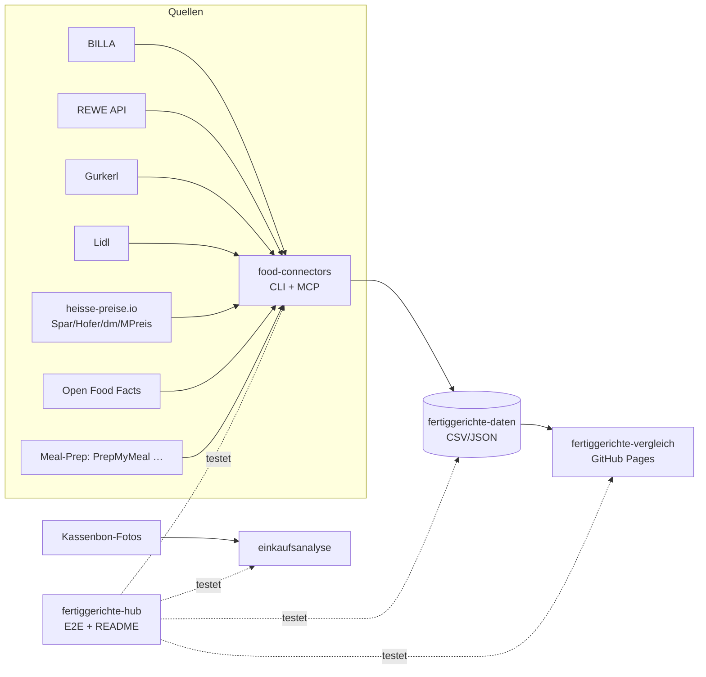

# 🥘 Fertiggerichte-Hub

Zentraler Index & Live-Status aller Fertiggerichte-Projekte (servas-ai). **Automatisch generiert:** 2026-10-14 01:59 UTC via `./run_all.sh` (stündlich).

**Connectors:** 19 ✅ / 1 ❌ / 8 📇 catalog-only · **Apps:** 3/3 live · **Produkte im Datensatz:** 3075

## Apps

| App | URL | Live | Tabs getestet | Konsolen-Fehler | Kaputte Bilder |
|---|---|---|---|---|---|
| Fertiggerichte-Vergleich | https://martin-hausleitner.github.io/fertiggerichte-vergleich/ | ✅ | 9 | 0 | 0 |
| Fertiggerichte-Vergleich (servas-ai Pages) | https://servas-ai.github.io/fertiggerichte-vergleich/ | ✅ | 9 | 4 | 0 |
| Einkaufsanalyse | https://servas-ai.github.io/einkaufsanalyse/ | ✅ | 8 | 0 | 0 |

## Repositories

| Repo | Zweck |
|---|---|
| [servas-ai/fertiggerichte-vergleich](https://github.com/servas-ai/fertiggerichte-vergleich) | Web-App (Vergleich, Netz 3D, Gesundheit, Hersteller …) |
| [servas-ai/food-connectors](https://github.com/servas-ai/food-connectors) | Connectors + CLI + MCP-Server |
| [servas-ai/fertiggerichte-daten](https://github.com/servas-ai/fertiggerichte-daten) | Offener Datensatz CSV/JSON |
| [servas-ai/einkaufsanalyse](https://github.com/servas-ai/einkaufsanalyse) | Einkaufsanalyse-Dashboard (Kassenbons) |

## Architektur



## Connector-Status (Live-Smoke-Test)

| | Connector | Store | Items | Latenz | Beispielprodukt (Beweis) | Zeitpunkt |
|---|---|---|---|---|---|---|
| ✅ | `billa` | BILLA | 3 | 0.68 s | [MAGGI Fix für Gulasch](https://shop.billa.at/produkte/maggi-fix-fuer-gulasch-0056152) · 1.49 € | 2026-10-14T01:53:29Z |
| ✅ | `denns` | denn's BioMarkt | 1 | 3.82 s | [MyDeli Bio-Fleischsuppe](https://www.denns-biomarkt.at/angebote/) · 3.49 € | 2026-10-14T01:53:30Z |
| ✅ | `dm` | dm | 3 | 4.09 s | [babylove Menü Kartoffeltopf mit Rindergulasch ab d](https://www.dm.at/p/d/1602887/babylove-menue-kartoffeltopf-mit-rindergulasch-ab-dem-8-monat) · 1.15 € | 2026-10-14T01:53:34Z |
| ✅ | `dm-heisse` | dm | 3 | 2.58 s | HiPP Menü Spätzle mit Gulasch ab 8 Monaten, 220 g · 1.75 € | 2026-10-14T01:53:38Z |
| ✅ | `gourmetfein` | Online: Gourmetfein | 3 | 2.65 s | [Weißwurst 1,8kg](https://shop.gourmetfein.com/products/weisswurst-1-8kg) · 24.9 € | 2026-10-14T01:53:42Z |
| ✅ | `gurkerl` | Gurkerl.at | 3 | 0.34 s | [AMA Kalb Rosé Austria Gulasch geschnitten](https://www.gurkerl.at/22932-ama-kalb-rose-austria-gulasch-geschnitten) · 16.1 € | 2026-10-14T01:53:45Z |
| ✅ | `heisse-preise` | heisse-preise.io | 3 | 2.61 s | [Ager Hirschgulasch geschnitten](ager-hirschgulasch-geschnitten-00730647) · 11.99 € | 2026-10-14T01:53:45Z |
| ✅ | `hofer` | HOFER | 3 | 2.59 s | [GENUSS 100% AUS ÖSTERREICH Rindsgulasch 1kg](sortiment/GENUSS-100-AUS-OSTERREICH-Rindsgulasch-1kg) · 19.98 € | 2026-10-14T01:53:49Z |
| ✅ | `livefresh` | Online: LiveFresh | 3 | 32.98 s | [Pasta Cheesy Spinat – Protein Bowl](https://livefresh.at/products/pasta-cheesy-spinat-400g) · 5.99 € | 2026-10-14T01:54:05Z |
| ✅ | `mpreis` | MPREIS | 3 | 3.21 s | AIA Puten Gulasch · 6.5 € | 2026-10-14T01:54:38Z |
| ✅ | `mpreis-shop` | MPreis | 3 | 7.94 s | [Basis Gulasch](https://www.mpreis.at/shop/p/knorr-basis-gulasch-282001) · 1.39 € | 2026-10-14T01:54:43Z |
| ✅ | `nah-frisch` | Nah&Frisch | 3 | 230.23 s | [Inzersdorfer Fertiggerichte oder Suppen](https://www.nahundfrisch.at/de/aktuelles/angebote-der-woche) | 2026-10-14T01:54:51Z |
| ✅ | `off` | Open Food Facts | 3 | 3.26 s | [Gulasch (Rind)](https://world.openfoodfacts.org/product/4099200121543) | 2026-10-14T01:58:42Z |
| ✅ | `penny` | PENNY | 2 | 4.48 s | [Schweinefleisch für Reisfleisch/Gulasch](https://www.penny.at/produkte/schweinefleisch-fuer-reisfleischgulasch-78544771) · 3.99 € | 2026-10-14T01:58:45Z |
| ✅ | `penny-shop` | PENNY | 2 | 8.06 s | [Schweinefleisch für Reisfleisch/Gulasch](https://www.penny.at/produkte/schweinefleisch-fuer-reisfleischgulasch-78544771) · 3.99 € | 2026-10-14T01:58:49Z |
| ✅ | `prepmymeal` | Online: PrepMyMeal | 3 | 6.92 s | [CH: Gemüse Lasagne](https://prepmymeal.at/products/ch-gemuse-lasagne-3) · 14.5 € | 2026-10-14T01:58:58Z |
| ✅ | `spar` | SPAR/INTERSPAR | 3 | 3.28 s | Baron de Sel Gourmet Gulasch Bio 55g · 4.99 € | 2026-10-14T01:59:05Z |
| ✅ | `spar-shop` | SPAR/INTERSPAR | 3 | 0.82 s | [TANN Rinds-Bratengulasch](https://www.interspar.at/shop/lebensmittel/tann-rinds-bratengulasch/p/835817) · 21.99 € | 2026-10-14T01:59:09Z |
| ✅ | `unimarkt` | Unimarkt | 3 | 2.84 s | [Felix Erdäpfelgulasch](/Felix-Erdaepfelgulasch-3692) · 5.39 € | 2026-10-14T01:59:10Z |
| 📇 | `adeg` | ADEG | 0 | 0.0 s |  | 2026-10-14T01:53:29Z |
| 📇 | `bio-kistl` | Biohof Achleitner / Bio-Kistl OÖ | 0 | 0.0 s |  | 2026-10-14T01:53:30Z |
| 📇 | `fittogo` | Fit to Go | 0 | 0.0 s |  | 2026-10-14T01:53:42Z |
| 📇 | `foodora-market` | foodora market (Dmart) | 0 | 0.0 s |  | 2026-10-14T01:53:42Z |
| ❌ | `lidl` | Lidl | 0 | 11.82 s | `HTTPError: HTTP Error 401: Unauthorized` | 2026-10-14T01:53:53Z |
| 📇 | `lieferando-shops` | Lieferando Shops | 0 | 0.0 s |  | 2026-10-14T01:54:05Z |
| 📇 | `mjam` | mjam (now foodora) | 0 | 0.0 s |  | 2026-10-14T01:54:38Z |
| 📇 | `unimarkt-shop` | Unimarkt (UNIONLINE Shop) | 0 | 0.0 s |  | 2026-10-14T01:59:15Z |
| 📇 | `wokostswas` | wokostswas.at | 0 | 0.0 s |  | 2026-10-14T01:59:15Z |

## Datensatz

**3075 Produkte** · Tabellen: brand_tree 8, companies 133, establishments 4706, logos 284, nutrition 2232, online_mealprep 96, online_providers 3, prices 2734, producer_quality 4, producers 22, products 3075, stores 498

| Abdeckung | % |
|---|---|
| nutrition | 72.6 |
| price | 88.9 |
| photo | 92.2 |
| producer | 45.8 |
| brand | 89.3 |
| logos_total | 284 |

<details><summary>Produkte nach Kette</summary>

| Kette | Anzahl |
|---|---|
| Billa | 780 |
| Spar | 660 |
| Gurkerl | 521 |
| MPreis | 310 |
| Hofer | 224 |
| unbekannt (OFF) | 192 |
| PrepMyMeal | 90 |
| Subway | 59 |
| NORDSEE | 39 |
| Lidl | 37 |
| dm | 35 |
| Penny | 30 |
| Fit to Go | 29 |
| Unimarkt | 29 |
| FitTaste | 18 |
| LiveFresh | 10 |
| Nah&Frisch | 7 |
| Denn's | 5 |

</details>

<details><summary>Produkte nach Fertigstufe/Lagerung</summary>

| Lagerung | Anzahl |
|---|---|
| Unklar (keine Lagerangabe) | 1013 |
| Tiefkühl (TK) | 736 |
| Kühlregal (Menüschale/frisch) | 542 |
| Dose/Konserve | 400 |
| Trocken/Instant | 325 |
| Glas | 34 |
| Sous-vide (vakuum) | 14 |
| Beutel ungekühlt (Retort-Pouch) | 11 |

</details>

## Screenshots

### Fertiggerichte-Vergleich

| Tab | Desktop 1920 | Mobil 390 |
|---|---|---|
| home |  |  |
| Was kaufe ich heute? |  |  |
| Ernährungsplan |  |  |
| KI-Ansicht |  |  |
| Hofer Top 30 |  |  |
| Marken-Profil |  |  |
| Laden-Profil |  |  |
| Marken |  |  |
| Filialen in der Nähe |  |  |

### Fertiggerichte-Vergleich (servas-ai Pages)

| Tab | Desktop 1920 | Mobil 390 |
|---|---|---|
| home |  |  |
| Was kaufe ich heute? |  |  |
| Ernährungsplan |  |  |
| KI-Ansicht |  |  |
| Hofer Top 30 |  |  |
| Marken-Profil |  |  |
| Laden-Profil |  |  |
| Marken |  |  |
| Filialen in der Nähe |  |  |

### Einkaufsanalyse

| Tab | Desktop 1920 | Mobil 390 |
|---|---|---|
| home |  |  |
| Übersicht |  |  |
| Verlauf |  |  |
| Läden |  |  |
| Kategorien |  |  |
| Protein & Gesundheit |  |  |
| Kassenbons |  |  |
| Import |  |  |

## Changelog (letzte Commits)

**servas-ai/fertiggerichte-vergleich**

- `49f1a02` 2026-10-14 01:54 — data: sensecheck 6b — dry Knorr Kochbeutel removed from sides (fertig e1927b9); Semmelknödel + Knödel Halb+Halb out; sides 203→201; Spaghetteria stay dry/unrankable out of tops; 3109 rows; pytest 15/15 + top50 ok. No deploy.
- `7fd2c1c` 2026-10-14 01:44 — hourly T01 data: +38 rows (3071→3109) — 38 verified new (MPreis 22: Iglo Backhendlstreifen Klassik+Kürbiskern, Toni Kaiser Kaiserschmarren, Ristorante Hawaii, Frosta Cornflakesstäbchen, Iglo Dorsch/Polardorsch/Scholle variants×8, Fjordgold Seelachs-Schnitzel, Knorr Spaghetteria×3, Wagner Air Fryer Mozzarella, Allgroo Udon×3, Jeden Tag Mozzarella Sticks; BILLA 12: Iglo Polar-Dorsch paniert/Müllerin/Mediterran/Serbisch, BILLA Polardorsch paniert, Crispy Chicken Tempura, Beyond Meat Tenders/Burger×2, Green Mountain Wings, Clever Knusperfilet+Wings; SPAR 4 twin-nutrition: Iglo Dorsch paniert/Knusperbrösel, Polar-Dorsch paniert/Müllerin). Brand tree +Beyond Meat→Beyond Meat Inc. (BYND), +The Green Mountain→Hilcona/Bell Food Group, +Fjordgold→Interfood Eigenmarke. Logos synced 12 analysis assets for gate. Gates: data PASS, build OK, Playwright 64 tab×viewport 0 errors/0 blank/0 overflow, 0/8706 broken images. No deploy.
- `59ee605` 2026-10-14 01:42 — scripts/publish_only.sh: publish committed main HEAD (clean worktree, no data pipeline) to gh-pages on both remotes under deploy flock
- `f2232fd` 2026-10-14 01:27 — data: sensecheck 6 — Thunfisch wraps stage meal not prot/component (fertig 0cde3e3); 5 wraps (Hofer GC×2, SPAR enjoy, BILLA, NORDSEE); 3071 rows; pytest 13/13 + top50 ok. No deploy.
- `d59ae65` 2026-10-14 01:03 — Hofer 469/686/691/692 nutrition_source GTIN-confirmed (EAN-verified); badge 'Nährwerte: GTIN-bestätigt', badge only for GTIN-confirmed / OFF name-match
- `acd13a8` 2026-10-14 00:56 — hourly T00 data: +26 rows (3045→3071) — 23 verified new (BILLA 7: Iglo Safari Abenteuer/Hühner Sticks, Rebel Meat Kids Hühnersticks, Hubers Karaage, Vegavita Stäbchen Fisch-Art, followfood Kabeljau paniert, BILLA Calamari; MPreis 6: Allgroo Gyoza, Toni Kaiser + Iglo Mohnnudeln, Pietro Pizzi Margherita, Jeden Tag Ravioli, Alnatura Falafel; Gurkerl 5: Iglo Backteig Garnelen/Garnelen in Sauce, Yuu'n Mee Garnelen ×3; SPAR 5 via identical-product twins: Iglo Fischstäbchen glutenfrei, Erdäpfeltascherl, Gebackene Champignons, Fisch'n'Crunch, Ofengarnelen) + 3 restored by score.py Backteig fix (Iglo Backteig Garnelen BILLA, Hühner Nuggets in Backteig BILLA/Gurkerl); data.json already in 22d5e6e; this commit: embeddings regenerated for 3071 rows (ids match), packaging_v2 + brand_families regenerated; brand tree +Allgroo→GMF Co., Ltd. (KR). Gates: data PASS, build OK, Playwright 64 tab×viewport 0 errors/0 blank/0 overflow, 0/8593 broken images; pytest 11/11 + top50 ok. No deploy.
- `22d5e6e` 2026-10-14 00:52 — data: sensecheck 6 — HiPP Bio Gemüse-Eintopf removed from sides (baby-food brand/name filter in export, fertig 97925280); Babykarotten kept (plain carrots); includes hourly T00 rows (fertig 741d5c5): 3071 rows, sides 203; top50 gate ok, pytest 12/12
- `aca36a3` 2026-10-14 00:41 — deploy: sensecheck5 (HiPP brand → baby_food, same-store GTIN dupOf) + hourly T23 (+24 rows, 3045)

**servas-ai/food-connectors**

- `46014e3` 2026-10-13 21:14 — feat(penny-shop): live PENNY AT connector via penny.at's public online-assortment JSON (REWE product-discovery listing + /products/<sku>; robots Sitemap-only, no login/cookies) — regular + standard price, promo text/validity, €/unit, pack, category path, origin, official image; MCP penny_product + penny_search; offline tests with fixtures (2026-10-13T21)
- `91f223b` 2026-10-13 20:53 — feat(nah-frisch): live Nah&Frisch AT connector via the public 'Angebote der Woche' page (robots Allow; tiles from /media, /images+/storage never requested) — KW tabs with validity, official offer tiles, optional tesseract OCR for brand/name/pack/price/badge (extra.ocr, raw text kept); MCP nahfrisch_offers; offline tests with fixtures; ADEG documented as Issuu-flipbook dead end (2026-10-13T20b)
- `c7a16c0` 2026-10-13 20:10 — feat(denns): live denn's BioMarkt AT connector via the public weekly offer feed (Gatsby page-data, robots Allow) — article no., brand, pack, Aktionspreis + Normalpreis, €/kg, validity, vegan flags, official image; MCP denns_offers; live adapters now override catalog-only stubs; offline tests (2026-10-13T20)
- `509f6f6` 2026-10-13 19:48 — fix(spar-shop): code-internal is a SPAR-internal 88… code, not a GTIN → extra.spar_code_internal, ean=None; docs (2026-10-13T19b)
- `1b4bbfc` 2026-10-13 19:47 — feat(spar-shop): live SPAR/INTERSPAR connector via SPAR's public product search API (exact article-number lookup: price, regular price, €/kg, GTIN, stock, image); MCP spar_product; weight products flagged per-100g; tests (2026-10-13T19b)
- `086a6e3` 2026-10-13 18:25 — fix(mpreis): drop shop placeholder image (/assets/noImage_detail-*.webp, site-relative → 404 downstream); only absolute http image URLs kept; tests (2026-10-13T17)
- `3500939` 2026-10-13 17:28 — fix(impressum): VAT regex accepts grouped-digit UIDs ('ATU 43 20 34 03', 'NL 853 640 804 B 01') seen on penny.at/heiploeg.com legal notices; test (2026-10-13T17)
- `aa3d626` 2026-10-13 15:23 — feat(billa/penny): storage class (frozen/chilled from badge, parent category, -18°C statement) + category path in enrich; keep Normalpreis (price.standard) next to promo price; more TK stems (Mohnnudeln, Apfelstrudel, Fischstäbchen, Erdäpfeltascherl); gurkerl fetch adds TK Fischstäbchen/Schlemmerfilet categories; tests (2026-10-13T14)

**servas-ai/fertiggerichte-daten**

- `ae107eb` 2026-10-14 01:50 — Daten-Squad T0136: +28 vision-gated brand logos (Henglein, Rebel Meat, Just Veg!, Findus, Diamond, Lorado, Schwaben Krone, Harvest Moon, Yopokki, Vitasia, Pan, Flotte Lotte, SPAR BBQ, Thai Delight, Dozz, Hildegard Grünkraft, Deliciosu, Deluxe, Auinger, Alpenstrudel, Sushitime, Ich bin Österreich, Mühlen/Rügenwalder, Big Snack, Ocean Sea, franuí, Arteoliva, Penny Ready); strict logo-less 68→39 brands / 84→55 products
- `f522641` 2026-10-14 01:24 — Daten-Squad T0106: +12 vision-gated brand logos (Therese Mölk, Ager, TANN, Njami, PIZZ'AH, Leibspeis', MCENNEDY, Staudinger, Exotic Food, Taste Of Asia, Fryzza, Schenkel) + 2 aliases
- `d252699` 2026-10-14 00:41 — Daten-Squad T0006: +4 vision-gated brand logos (Delikatessa, Rettenswert, Wolfensberger & Pomella, Schulzi´s Knödel)
- `eec2a2a` 2026-10-13 23:44 — Daten-Squad T2340: +6 vision-gated Eigenmarke/brand logos (Vemondo, Nature's Gold, Yum Yum, Kania, M MPreis-Eigenmarke, Leitgeb's)
- `349a65d` 2026-10-13 23:21 — Daten-Squad T23: +7 vision-gated Eigenmarke/brand logos + EAN overlay export
- `23e08bd` 2026-10-13 22:47 — logos: HelloFresh official CDN SVG (93 products) + OFF GTIN match evidence
- `cbcce45` 2026-10-13 21:42 — raw: hourly T20 (+21 meals MPreis/Gurkerl, recovered) + T21 (+28 meals: SPAR 20 via spar-shop + identical-product twin label data, MPreis 7, Gurkerl 1) evidence, SPAR twin matches, data QA gates
- `e08067f` 2026-10-13 21:21 — PENNY AT live via new food-connectors penny-shop (penny.at public online-assortment JSON, 453 items): Penny products 22→30 (+8 ready meals: Podravka Rindergulasch 4.99, Ich bin Österreich Wiener Schnitzel 4.99, Dr. Oetker Ristorante 2er 3.49, Gabelkönig Semmelknödel-Rolle 2.79, Maggi Magic Asia 0.99, Taste of Asia Knuspergarnelen 3.29, Heinz Baked Beans 2.99, Iglo Fischstäbchen 2.99), live prices 7→15, photos 17→25; multi-buy guard: Iglo Ofenbackfisch 3.49 'bei 2 Packungen' → single-pack Normalpreis 6.99, Baked Beans 1.99 'bei 3 Dosen' → 2.99; 12 OFF/Chef-Menü rows not in online assortment unchanged; no nutrition for multi-variant offers; overlay /workspace/fertig/penny_live_overlay.json applied in score.py; evidence raw/penny_2026-10-13T21.json. Re-export also carries concurrent pipeline rows (mealkits_src +93 OFF, Gurkerl/MPreis +21): products 2957→3079, prices 2603→2725

**servas-ai/einkaufsanalyse**

- `66934e3` 2026-10-13 01:10 — Einkaufsanalyse v1: shadcn Sidebar-Dashboard, Import, OCR, Beispieldaten

## Ausführen

```bash
pip install pytest playwright && playwright install chromium
./run_all.sh   # Tests + Report + Push (mit Lock, stündlich via cron)
```
