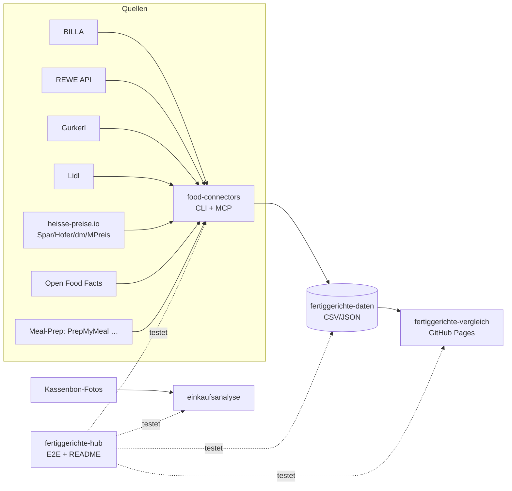

# 🥘 Fertiggerichte-Hub

Zentraler Index & Live-Status aller Fertiggerichte-Projekte (servas-ai). **Automatisch generiert:** 2026-10-17 05:03 UTC via `./run_all.sh` (stündlich).

**Connectors:** 29 ✅ / 2 ❌ / 7 📇 catalog-only · **Apps:** 3/3 live · **Produkte im Datensatz:** 3659

## Apps

| App | URL | Live | Tabs getestet | Konsolen-Fehler | Kaputte Bilder |
|---|---|---|---|---|---|
| Fertiggerichte-Vergleich | https://martin-hausleitner.github.io/fertiggerichte-vergleich/ | ✅ | 9 | 0 | 0 |
| Fertiggerichte-Vergleich (servas-ai Pages) | https://servas-ai.github.io/fertiggerichte-vergleich/ | ✅ | 9 | 0 | 0 |
| Einkaufsanalyse | https://servas-ai.github.io/einkaufsanalyse/ | ✅ | 8 | 0 | 0 |

## Repositories

| Repo | Zweck |
|---|---|
| [servas-ai/fertiggerichte-vergleich](https://github.com/servas-ai/fertiggerichte-vergleich) | Web-App (Vergleich, Netz 3D, Gesundheit, Hersteller …) |
| [servas-ai/food-connectors](https://github.com/servas-ai/food-connectors) | Connectors + CLI + MCP-Server |
| [servas-ai/fertiggerichte-daten](https://github.com/servas-ai/fertiggerichte-daten) | Offener Datensatz CSV/JSON |
| [servas-ai/einkaufsanalyse](https://github.com/servas-ai/einkaufsanalyse) | Einkaufsanalyse-Dashboard (Kassenbons) |

## Architektur



## Connector-Status (Live-Smoke-Test)

| | Connector | Store | Items | Latenz | Beispielprodukt (Beweis) | Zeitpunkt |
|---|---|---|---|---|---|---|
| ✅ | `alfies` | Alfies | 3 | 8.73 s | [Knorr Meisterkessel Gulaschsuppe](https://www.alfies.at/produkt/knorr-meisterkessel-gulaschsuppe-dose-500g) · 4.49 € | 2026-10-17T04:55:52Z |
| ✅ | `billa` | BILLA | 3 | 1.63 s | [MAGGI Fix für Gulasch](https://shop.billa.at/produkte/maggi-fix-fuer-gulasch-0056152) · 1.49 € | 2026-10-17T04:56:01Z |
| ✅ | `bofrost` | Online: bofrost* | 3 | 9.43 s | [Wiener Rindsgulasch](https://www.bofrost.at/shop/fleisch_44196/fleischzubereitungen_34987/wiener-rindsgulasch_03373.html) · 14.99 € | 2026-10-17T04:56:03Z |
| ✅ | `denns` | denn's BioMarkt | 1 | 4.97 s | [MyDeli Bio-Fleischsuppe](https://www.denns-biomarkt.at/angebote/) · 3.49 € | 2026-10-17T04:56:12Z |
| ✅ | `dm` | dm | 3 | 4.69 s | [babylove Menü Kartoffeltopf mit Rindergulasch ab d](https://www.dm.at/p/d/1602887/babylove-menue-kartoffeltopf-mit-rindergulasch-ab-dem-8-monat) · 1.15 € | 2026-10-17T04:56:18Z |
| ✅ | `dm-heisse` | dm | 3 | 2.91 s | HiPP Menü Spätzle mit Gulasch ab 8 Monaten, 220 g · 1.75 € | 2026-10-17T04:56:22Z |
| ✅ | `every` | Online: every. | 3 | 16.86 s | [Pumpkin Zucchini Risotto](https://every-foods.com/products/pumpkin-zucchini-risotto) · 8.99 € | 2026-10-17T04:56:26Z |
| ✅ | `fittogo` | Online: Fit2go | 3 | 8.84 s | [Auberginen-Chili con Carne mit Käse Überbacken](https://fittogo.at/products/auberginen-chili-con-carne-mit-kase-uberbacken) · 9.99 € | 2026-10-17T04:56:43Z |
| ✅ | `goldblatt` | Online: Goldblatt | 2 | 5.06 s | [Erdäpfel Gulasch](https://goldblatt.at/products/bio-erdapfel-gulasch) · 11.99 € | 2026-10-17T04:56:52Z |
| ✅ | `gourmetfein` | Online: Gourmetfein | 3 | 8.2 s | [Weißwurst 1,8kg](https://shop.gourmetfein.com/products/weisswurst-1-8kg) · 24.9 € | 2026-10-17T04:56:57Z |
| ✅ | `gurkerl` | Gurkerl.at | 3 | 1.36 s | [Rinder Gulaschfleisch am Stück](https://www.gurkerl.at/42171-rinder-gulaschfleisch-am-stueck) · 21.47 € | 2026-10-17T04:57:06Z |
| ✅ | `heisse-preise` | heisse-preise.io | 3 | 2.46 s | [Ager Hirschgulasch geschnitten](ager-hirschgulasch-geschnitten-00730647) · 11.99 € | 2026-10-17T04:57:07Z |
| ✅ | `hofer` | HOFER | 3 | 2.43 s | [GENUSS 100% AUS ÖSTERREICH Rindsgulasch 1kg](sortiment/GENUSS-100-AUS-OSTERREICH-Rindsgulasch-1kg) · 19.98 € | 2026-10-17T04:57:10Z |
| ✅ | `hofer-shop` | HOFER | 2 | 4.22 s | [Sonnhof Rindsgulasch](https://www.hofer.at/produkt/sonnhof-rindsgulasch-000000000000510738) · 6.5 € | 2026-10-17T04:57:14Z |
| ✅ | `issmich` | Online: iss mich! | 3 | 34.79 s | [Bio Rotweingulasch vom Freilandrind](https://www.issmich.at/Bio-Shop/Eintoepfe/Fleisch/15/Bio-Rotweingulasch-vom-Freilandrind) · 11.5 € | 2026-10-17T04:57:18Z |
| ✅ | `juit` | Online: Juit | 1 | 1.93 s | [Rindergulasch mit gegrillter Paprika](https://www.juit.com/de/gerichte/rindergulasch-mit-paprika) | 2026-10-17T04:57:53Z |
| ✅ | `kernbeisser` | Online: Kernbeißer | 3 | 22.76 s | [Maghreb-Hirse mit Artischocken](https://kernbeisser.at/produkt/maghreb-hirse-mit-artischocken/) · 9.0 € | 2026-10-17T04:57:55Z |
| ✅ | `livefresh` | Online: LiveFresh | 3 | 2.36 s | [Pasta Cheesy Spinat – Protein Bowl](https://livefresh.at/products/pasta-cheesy-spinat-400g) · 5.99 € | 2026-10-17T04:58:31Z |
| ✅ | `loewenanteil` | Online: Löwenanteil | 1 | 3.31 s | [Veganes Gulasch](https://www.loewenanteil.com/products/veganes-gulasch) · 9.99 € | 2026-10-17T04:58:33Z |
| ✅ | `mpreis` | MPREIS | 3 | 2.64 s | AIA Puten Gulasch · 6.5 € | 2026-10-17T04:58:37Z |
| ✅ | `mpreis-shop` | MPreis | 3 | 8.5 s | [Basis Gulasch](https://www.mpreis.at/shop/p/knorr-basis-gulasch-282001) · 1.39 € | 2026-10-17T04:58:40Z |
| ✅ | `myproduct` | Online: myProduct | 3 | 23.78 s | [Bio Szegediner Gulasch 460g - Fertiggericht von Ha](https://myproduct.at/bio-szegediner-gulasch-450ml-hartls-kulinarikum) · 12.79 € | 2026-10-17T04:58:49Z |
| ✅ | `nah-frisch` | Nah&Frisch | 3 | 239.97 s | [Inzersdorfer Fertiggerichte oder Suppen](https://www.nahundfrisch.at/de/aktuelles/angebote-der-woche) | 2026-10-17T04:59:13Z |
| ✅ | `penny` | PENNY | 3 | 5.7 s | [Rindsgulaschfleisch](https://www.penny.at/produkte/rindsgulaschfleisch-78544603) · 15.99 € | 2026-10-17T05:03:14Z |
| ✅ | `penny-shop` | PENNY | 3 | 9.67 s | [Rindsgulaschfleisch](https://www.penny.at/produkte/rindsgulaschfleisch-78544603) · 15.99 € | 2026-10-17T05:03:20Z |
| ✅ | `prepmymeal` | Online: PrepMyMeal | 3 | 9.04 s | [CH: Gemüse Lasagne](https://prepmymeal.at/products/ch-gemuse-lasagne-3) · 14.5 € | 2026-10-17T05:03:29Z |
| ✅ | `spar` | SPAR/INTERSPAR | 3 | 2.73 s | Baron de Sel Gourmet Gulasch Bio 55g · 4.99 € | 2026-10-17T05:03:39Z |
| ✅ | `spar-shop` | SPAR/INTERSPAR | 3 | 1.6 s | [TANN Rinds-Bratengulasch](https://www.interspar.at/shop/lebensmittel/tann-rinds-bratengulasch/p/835817) · 21.99 € | 2026-10-17T05:03:42Z |
| ✅ | `unimarkt` | Unimarkt | 3 | 2.7 s | [Felix Erdäpfelgulasch](/Felix-Erdaepfelgulasch-3692) · 5.39 € | 2026-10-17T05:03:44Z |
| 📇 | `adeg` | ADEG | 0 | 0.0 s |  | 2026-10-17T04:55:52Z |
| 📇 | `bio-kistl` | Biohof Achleitner / Bio-Kistl OÖ | 0 | 0.0 s |  | 2026-10-17T04:56:03Z |
| 📇 | `foodora-market` | foodora market (Dmart) | 0 | 0.0 s |  | 2026-10-17T04:56:52Z |
| ❌ | `lidl` | Lidl | 0 | 12.73 s | `HTTPError: HTTP Error 401: Unauthorized` | 2026-10-17T04:58:18Z |
| 📇 | `lieferando-shops` | Lieferando Shops | 0 | 0.0 s |  | 2026-10-17T04:58:31Z |
| 📇 | `mjam` | mjam (now foodora) | 0 | 0.0 s |  | 2026-10-17T04:58:37Z |
| ❌ | `off` | Open Food Facts | 0 | 0.68 s | `RobotsDisallowed: https://world.openfoodfacts.org/cgi/search.pl?search_terms=gulasch&count` | 2026-10-17T05:03:13Z |
| 📇 | `unimarkt-shop` | Unimarkt (UNIONLINE Shop) | 0 | 0.0 s |  | 2026-10-17T05:03:47Z |
| 📇 | `wokostswas` | wokostswas.at | 0 | 0.0 s |  | 2026-10-17T05:03:47Z |

### Bekannte Ausfälle (manuell gepflegt)

- `off` (Open Food Facts) ❌ seit 2026-10-16 (Hub-Lauf 22:59 UTC) dauerhaft, nicht mehr nur Upstream-503: OFF `robots.txt` verbietet für `User-agent: *` jetzt `/api`, `/cgi` und `/facets`, und der neue harte robots.txt-Gate in food-connectors (`0eaa455`) blockiert `cgi/search.pl` (Suche) und `api/v2/product` (EAN-Lookup) bewusst vor dem Request. `search.openfoodfacts.org` ist ebenfalls `Disallow: /`. Fix-Pfad (offen, food-connectors `adapters/off.py`): EAN-Lookup über die erlaubte Produktseite `/product/<ean>` (HTML), Suche über Open Prices / Datensatz-Dump statt Live-Suche. Kein Bypass des Gates.
- `lidl` ❌ HTTP 401 (bekannt, Lidl-API verlangt Auth; kein Login erlaubt).

## Datensatz

**3659 Produkte** · Tabellen: brand_tree 8, companies 148, establishments 4706, logos 304, nutrition 2820, online_mealprep 406, online_providers 3, prices 3268, producer_quality 4, producers 22, products 3659, stores 498

| Abdeckung | % |
|---|---|
| nutrition | 77.0 |
| price | 89.3 |
| photo | 93.9 |
| producer | 48.4 |
| brand | 90.9 |
| logos_total | 304 |

<details><summary>Produkte nach Kette</summary>

| Kette | Anzahl |
|---|---|
| Billa | 807 |
| Spar | 735 |
| Gurkerl | 536 |
| MPreis | 388 |
| Hofer | 231 |
| Alfies | 182 |
| bofrost | 144 |
| unbekannt (OFF) | 93 |
| HelloFresh | 93 |
| PrepMyMeal | 92 |
| Subway | 59 |
| Juit | 50 |
| NORDSEE | 39 |
| Lidl | 37 |
| dm | 35 |
| Fit to Go | 30 |
| Penny | 29 |
| Unimarkt | 29 |
| FitTaste | 18 |
| Denn's | 15 |
| LiveFresh | 10 |
| Nah&Frisch | 7 |

</details>

<details><summary>Produkte nach Fertigstufe/Lagerung</summary>

| Lagerung | Anzahl |
|---|---|
| Unklar (keine Lagerangabe) | 1223 |
| Tiefkühl (TK) | 1017 |
| Kühlregal (Menüschale/frisch) | 603 |
| Dose/Konserve | 422 |
| Trocken/Instant | 335 |
| Glas | 34 |
| Sous-vide (vakuum) | 14 |
| Beutel ungekühlt (Retort-Pouch) | 11 |

</details>

## Screenshots

### Fertiggerichte-Vergleich

| Tab | Desktop 1920 | Mobil 390 |
|---|---|---|
| home |  |  |
| Was kaufe ich heute? |  |  |
| Ernährungsplan |  |  |
| KI-Ansicht |  |  |
| Hofer Top 30 |  |  |
| Marken-Profil |  |  |
| Laden-Profil |  |  |
| Marken |  |  |
| Filialen in der Nähe |  |  |

### Fertiggerichte-Vergleich (servas-ai Pages)

| Tab | Desktop 1920 | Mobil 390 |
|---|---|---|
| home |  |  |
| Was kaufe ich heute? |  |  |
| Ernährungsplan |  |  |
| KI-Ansicht |  |  |
| Hofer Top 30 |  |  |
| Marken-Profil |  |  |
| Laden-Profil |  |  |
| Marken |  |  |
| Filialen in der Nähe |  |  |

### Einkaufsanalyse

| Tab | Desktop 1920 | Mobil 390 |
|---|---|---|
| home |  |  |
| Übersicht |  |  |
| Verlauf |  |  |
| Läden |  |  |
| Kategorien |  |  |
| Protein & Gesundheit |  |  |
| Kassenbons |  |  |
| Import |  |  |

## Changelog (letzte Commits)

**servas-ai/fertiggerichte-vergleich**

- `a905340` 2026-10-17 04:38 — data: hourly T04 2026-10-17 (pipeline fertig dcb4792): +24 visible rows – SPAR 23 (DESPAR pizzas ×3, Wagner/Alberto Margherita, SPAR Baguette Grande ×4, Ciabatta ×3, Korsika/Provence baguettes, S-BUDGET Apfel-/Topfenstrudel ×3, DESPAR Zuppa ai frutti di mare, SPAR Chicken Tandoori, Heinz Tomato Soup, Frank Juice soups ×3 – 2 with Gurkerl twin label), Gurkerl Wegschaider Grammeln Knödel (label); 2 Hofer rows removed (raw Sonnhof Rindsgulasch, duplicate Hot Dog, Daten-Squad T0409); 4 dead dennree images nulled. rows 3953→3975, rankable 153. Gates: prepush OK (64 views, 0 errors, 0 blank, 0 overflow, 2/10.9k broken imgs), top50 0, pytest 162/162. No deploy.
- `94e0cd2` 2026-10-17 04:21 — data: Sensecheck 25 (pipeline fertig): sold-out Shopify rows out of all lists (4; PMM Butter Chicken XL out of topPE, Goldblatt Alpine/Oriental out of topPLI/topHealth); rankableLight field (Löwenanteil 3 in topLight are light meals, eligible via pliLight); Hofer FAIRHOF Spareribs relisted 14,49 €; 211 Hofer rows note 'nicht mehr auf hofer.at gelistet'; 'Preis unbestätigt' 27 rows as price_status+flag+variant_note. rows 3953, rankable 156→153. Gates: prepush OK, top50 ok, pytest 162/162. No deploy.
- `96d4d5c` 2026-10-17 04:18 — fix(rank): Preis veraltet / evtl. ausgelistet nie in Rankings (isRankable + passesLightRank) – Heute-Top10 zeigte stale Zeilen
- `6352364` 2026-10-17 04:02 — data: Hofer sitemap 2026-10-17 (pipeline fertig): 1312 hofer.at products scanned, +10 current Hofer heat-up meals (Arnold Sørensen Thunfisch-Reis ×2, Primana XXL Lasagne 2 kg, Pizz'Ah Air Fryer Pizza ×3, Iglo XXL Fischstäbchen, Knorr Namdong Cup ×3; price/date hofer.at 2026-10-17, no nutrition published → not rankable); 212 old Hofer rows marked 'nicht mehr auf hofer.at gelistet' (visible, not rankable). rows 3943→3953, rankable 156, Hofer rankable 0. Gates: prepush OK, top50 ok, pytest 157/157. No deploy.
- `3af5485` 2026-10-17 03:57 — data: Sensecheck 24 (pipeline fertig 3651119): LiveFresh/PrepMyMeal sale prices → Normalpreis ranked + price_condition 'AKTION' (11 rows, Fajita Mexican 7,99 €); Löwenanteil 570 g = 2 portions per manufacturer (17 rows → light/snack, out of topPLI/topHealth); price_date inferred from billa.json/spar.json commit 2026-10-13 (284 rows, price_date_source=inferred_from_file_commit); tiered stale rule (supermarkets 30 d unbestätigt / 90 d stale, online 6 months): 569 stale, 26 unbestätigt. Hofer rankable 0 (no stale Hofer meal in hofer.at product sitemap). rows 3943, rankable 174→156. Gates: prepush OK, top50 ok, pytest 154/154. No deploy.
- `849f9f8` 2026-10-17 03:46 — data: Sensecheck 23 (pipeline fertig bba10b2): stale price rule (price_date < build−6 months or 'kein aktueller 2026-Preis'/ausgelistet) → not rankable, out of all top lists, note 'Preis veraltet / evtl. ausgelistet'. 472 rows marked, rankable 178→174; 665 rows without price_date not excluded. topPLI −SPAR Lasagne Bolognese, −Hofer CUCINA NOBILE Lasagne #675, +Löwenanteil Chipotle Chili, +bofrost Asia-Pfanne; topPE −SPAR Lasagne, +LiveFresh Fajita; topLight −Spar Iglo Hausmannskost Rindsgulasch, +Billa Iglo Rindsgulasch. Gates: prepush OK, top50 ok, pytest 148/148. No deploy.
- `f0e234b` 2026-10-17 03:41 — data: Sensecheck 22 (pipeline fertig ee3646f): iss mich! Pfand separate (deposit_eur 2,00 €, note 'zzgl. 2,00 € Pfand (rückerstattbar)', price/pPor/pli without Pfand – 35 rows, prices already net); Hofer label twins: branded-name row primary (CUCINA NOBILE Lasagne Bolognese #675, PRIMANA Serbische Bohnensuppe #706). rows 3943, rankable 178. Gates: prepush_gate OK, top50 ok, pytest 143/143. No deploy.
- `b19ab83` 2026-10-17 02:54 — data: Sensecheck 21 (pipeline fertig 033afee): BILLA Iglo Lasagne al Forno 350 g 3,49 → 4,99 € Einzelpreis (3,49 € = ab 2 Packungen; row URL is the 700 g pack); systematic: remaining BILLA promo prices → Einzelpreis (4 Diamanten Thunfisch ×4 0,99→2,99, iglo Holy Slice ×3 7,69→6,99, Carissa Klare Gemüsesuppe 7,99→8,99); BILLA promotions shown as price_condition 'AKTION: …' + price_condition_info (100 rows, NUR MIT APP kept). Verified live (robots gate, ≥1 s/host): SPAR Ofenfrische Thunfisch 4,49 €, Ristorante Vegetale 3,99 € (regular, no promo), iss mich! Bio Paprika Hendl 11,50 € (+2 € Pfand) – all correct; Spar Weinbeuschel 2 Portionen 800 g = 2 × 400 g, same recipe per 100 g (inzersdorfer.at) – correct, source note clarified. rows 3943, rankable 178. Gates: prepush_gate.sh OK (build, Playwright 0 errors/0 broken), top50 ok, pytest 140/140. No deploy.

**servas-ai/food-connectors**

- `49a5d0d` 2026-10-17 04:19 — Daten-Squad T0409: new live connector hofer-shop — hofer.at public sitemap_products.xml (1298 URLs) + server-rendered product pages (__NUXT_DATA__ devalue + JSON-LD; robots * disallows only /tools and /*?q= search, never used; polite 1 req/s; 403 raised, not worked around): Regalpreis (random-weight: per piece + €/kg), €/kg, size, 'Verfügbar seit', ingredients, storage/usage, allergens, official Aldi Scene7 packshot; no GTIN/nutrition published (never estimated). Strict meal filter (raw meat 'Rohes Fleisch'/'100% …fleisch', sauces, pasta, legumes, bakery, instant excluded; NFC-normalised names): 18 current heat-up meals 2026-10-17. CLI food fetch|search --store hofer-shop, MCP hofer_product/hofer_search; heisse 'hofer' note updated; 5 offline fixture tests (suite 109 passed / 3 skipped)
- `c2b408b` 2026-10-16 23:50 — Daten-Squad T2336: denns connector extended — (1) dennree brand catalog (own brand of the dennree group / denn's BioMarkt) from www.dennree.de category + product pages (robots '*' allows; /productreload?id= ajax matches Disallow /*?id=* → not used): name, net weight, denomination, ingredients, nutrition/100 g with Atwater check, packshot by denn's article no., 'BILD FOLGT' placeholder detected by md5; no price/GTIN published; (2) 'Neu im Sortiment' page-data (isInAustria, regular shelf price, €/kg, Sanity image); (3) in-store bistro lunch menu (Mittagsgerichte page-data per market, current + next week, price, diet flags; counter dishes, not products). CLI food fetch --store denns --category eigenmarke|neu, MCP denns_brand_catalog / denns_new_products / denns_lunch_menu; 6 offline fixture tests (suite 104 passed / 3 skipped)
- `0eaa455` 2026-10-16 22:02 — polite: hard robots.txt gate + 1 s/host for every HTTP path. RobotsDisallowed raised before the request (cached per host, UA group + '*', RFC 9309: robots 4xx = allow, 5xx/unreachable = disallow); http.get and the 4 direct urlopen sites (alfies, osm_stores, issmich, company/registries) use polite_urlopen; package import installs the gate for urllib/requests/httpx/curl subprocess. tests/test_polite.py (interspar product page blocked without network call, allowed URL, UA group, 4xx/5xx/unreachable, rate limit, install routing). pytest 98 passed, 3 skipped.
- `32c9237` 2026-10-16 21:26 — Daten-Squad T2111: new live connector myproduct (myproduct.at regional-producer marketplace, category Fertiggerichte): category dataLayer + product JSON-LD Offer + Magento attribute table (EAN check digit, Nettofüllmenge, producer address, ingredients, allergens, MHD, nutrition per 100 g when published, Atwater check); exclusion rules for fonds/sauces/spreads/dry mixes/soup powders/meat-substitute raw goods; CLI food fetch|search --store myproduct, MCP myproduct_product/myproduct_search; 5 offline fixture tests
- `a00ce43` 2026-10-16 20:48 — Daten-Squad T2038: new live connector open-prices (Open Food Facts Open Prices REST API, ODbL): food prices EAN [--country AT --since], MCP open_prices_lookup, datasets catalog entry; 2 offline fixture tests (suite 82 passed / 3 skipped)
- `ac16ed7` 2026-10-16 19:53 — bofrost: starters += Pizzettis, Rösti-Baguette, Gemüse-/Broccoli-Laibchen, Schinken-Käse-Röllchen (warm baked snacks; breaded cheese stays out); ready-meals DISH_SLUG += schlemmerfilet; tests
- `994f35c` 2026-10-16 18:33 — bofrost: opt-in course fetches — fetch(category="desserts") warm Mehlspeisen (Knödel, Kaiserschmarrn, Topfennockerl, Mohnnudeln, Strudel, Palatschinken; no Torten/Eis/raw dough) and fetch(category="starters") warm Vorspeisen (Frühlingsrollen, Teigtaschen, Flammkuchen, Kaspressknödel); extra.course; default ready-meal filter unchanged; test_course_url_filters
- `8777b7a` 2026-10-14 07:30 — Daten-Squad T0740: new live connector alfies (Alfies Wien/Graz online supermarket, Alfie's GmbH, Wien)

**servas-ai/fertiggerichte-daten**

- `e568293` 2026-10-17 04:44 — Daten-Squad T0440: companies owners 57→61/148, FN 67→69/148 — evi.gv.at partnership sections ('Unbeschränkt haftende/r Gesellschafter/in', 'Kommanditist/in') missed by the T1907 parser: Mars Austria GmbH & Co OG = Mars Beteiligungs-GmbH (FN 212371k) + Mars Holding GmbH (FN 212370i); Hofer KG = 2 natural persons (1 Komplementär, 1 Kommanditist, counted not named); Kernbeißer OG = 2 natural persons; FN from own legal notices confirmed on evi.gv.at (exact legal name): Recheis FN 47864p (LG Innsbruck; owner Recheis Holding Gesellschaft m.b.H. FN 47854z), Wech-Geflügel FN 118996w (LG Klagenfurt; owners Wech Beteiligungsverwaltung GmbH FN 284145k + Hermine Wech Privatstiftung FN 235135m, replaces informal 'Wech-Gruppe'); 1993/1994 Eintragungsdatum = FBG-1991 bulk window, not taken; Deflorian 'AT70258EG' not an FN; evidence raw/companies_evi_2026-10-17T0440.json
- `dd7c22a` 2026-10-17 04:19 — Daten-Squad T0409: Hofer via new live connector food-connectors hofer-shop (hofer.at sitemap_products.xml 1298 URLs + product pages, robots allow, polite) — +10 current heat-up meals (Arnold Sørensen Thunfisch-Reis ×2, Primana XXL Lasagne 2 kg, Pizz'Ah Air Fryer Pizza ×3, Iglo XXL Fischstäbchen, Knorr Namdong Noodles Cup ×3; same rows/product_ids as the app import fertig 6d33a96), live price 2026-10-17, 10/10 official packshots vision-gated, no nutrition/EAN published (none estimated); 7 existing rows re-confirmed live; removed Sonnhof 'Rindsgulasch (ca. 0,5 kg)' (raw diced beef per page: '100% Rindfleisch', 'Rohes Fleisch') and duplicate 'Hot Dog' (same SKU as Good Choice Hot Dog); 153 Hofer price rows not in the sitemap get note 'nicht mehr auf hofer.at gelistet'. products 3651→3659, photos 3428→3436, Hofer 223→231 (photos 132→140, live prices 27→35). Evidence raw/hofer_shop_2026-10-17T0409.json; app corrections staged fertig/hofer_corrections_T0409_stage.json
- `9b1a42e` 2026-10-17 01:04 — Daten-Squad T0039: DE VIES back (check-status Available) — 5 DE UIDs from legal notices now VIES-valid (ARCHE DE322242442, Ökoland Nord DE116156996, Rapunzel DE129088402, EgeSun DE455151638, Petersilchen DE124612378; DE discloses no name/address); Petersilchen GmbH now identified (HRB 11924 + valid UID) → legal entity 136→137/148; evidence raw/vies_de_2026-10-17T0039.json
- `c0bbc5b` 2026-10-17 00:14 — Daten-Squad T0003: Spar photo tail 729→732/735 via SPAR public search API (spar-shop): Inzersdorfer Rindsgulasch 800 g, Inzersdorfer Speckknödelsuppe, ehrenwort BIO Bangkok rotes Thai Curry 35g; dt_main.jpg GET 200, vision-gated; 3 Knorr rows rejected (SPAR names differ); photos 3425→3428/3651
- `2c7935c` 2026-10-16 23:50 — Daten-Squad T2336: denn's BioMarkt 5→15 products — +9 dennree brand-catalog ready meals (dennree = own brand of the dennree group / denn's BioMarkt; www.dennree.de category+product pages, DE brand site, AT availability per article not stated, marked in source): Al Forno Pizza Käse-Lauch 275 g / Spinat 350 g, Al Forno Flammkuchen Elsässer Art 260 g (TK), Vegane Falafel 200 g, Vegane Burger auf Seitanbasis 180 g, Vegane Gemüsebratlinge Champignon / Rote Bete 150 g, Vegetarische Knuspernuggets 180 g / Schnitzel 200 g — nutrition per 100 g as published (9/9 Atwater ok), ingredients, net weight, packshot by denn's article no. (7 HTTP 200 + vision-gated; 2 'BILD FOLGT' placeholders → no photo); no price/EAN published → none; +1 followfood Piccoli Tomate & Mozzarella 270 g from denns-biomarkt.at 'Neu im Sortiment' (AT, Regalpreis 6,29 €, 1 kg = 23,22 €, official packshot vision-gated; no EAN/nutrition published). Excluded: 8 dennree Tütensuppen (dry mixes), sugo/brühe/canned sides. products 3641→3651, photos 3417→3425, nutrition +9, prices +1; rows also in data/supplemental (kept by export.py); evidence raw/denns_2026-10-16T2336.json (incl. denn's Linz bistro lunch menus, not products); food-connectors c2b408b
- `b17335b` 2026-10-16 23:24 — Daten-Squad T2307: companies revenue 32→37/148 via North Data public company pages (Jahres-/Konzernabschluss data points, uncensored, estimate=false, register court+number = row, LEI where present) — Zott SE & Co. KG Konzern 1,28 Mrd. € GJ 2025, Allos Hof-Manufaktur 101 Mio. € GJ 2025, followfood 67,4 Mio. € GJ 2025, Euryza 50,2 Mio. € GJ 2024, Kikkoman Trading Europe 188,7 Mio. € GJ 2024/25; employees 47/148 unchanged ('Mitarbeiter' premium-censored on every page); iglo GmbH rejected (unit-inconsistent series); 40 North Data requests ≥10 s apart, all HTTP 200, no 429/captcha; DE VIES check-status still Unavailable (5 DE UIDs unverified, legal entity 136/148). Photo tail: +6 vision-gated official BILLA packshots by exact-EAN BILLA search — Billa 804→807 (BILLA immer gut Miso Suppe, Tom Kha Gai Tofu, Tom Kha Gai Huhn), MPreis 374→377 (Njami Chicken Bowl Curry/Mexicana, Wagner Big Sensation Salami & BBQ), total 3411→3417/3641; 11 MPreis rows stay without photo (shop placeholder, no exact-EAN official packshot elsewhere); evidence raw/companies_northdata_2026-10-16T2307.json
- `0ef5ec1` 2026-10-16 22:47 — Daten-Squad T2238: +5 vision-gated producer/brand logos for the myProduct.at producers (T2139) — Rapunzel (Commons File:Rapunzel_Naturkost.svg, Public domain, unmodified SVG), ARCHE Naturküche (arche-naturkueche.de header PNG), EgeSun company logo (egesun.de; not mapped to brand Vegan Pete), Sanchon (petersilchen.de brand PNG), Petersilchen company logo; logo rows 299/284→304/289; rettergut.de robots disallow, derit.nl/bioart.at/perfectearth.eu robots.txt unreachable (not fetched); Zwergenwiese/Vegan Pete/Hartl's no own asset; evidence raw/logos_squad_2026-10-16T2238.json
- `ab418e2` 2026-10-16 22:14 — Daten-Squad T2203: companies employees 46→47/148, revenue 31→32/148 — Rapunzel Naturkost GmbH & Co. KG from its own press page (rapunzel.de/ueber-uns/presse: 'Mitarbeitende: ca. 530', 'Umsatz 2024: 232 Mio. € netto'); 7 other T2139 company sites probed, no published figures; evidence raw/companies_facts_2026-10-16T2203.json

**servas-ai/einkaufsanalyse**

- `66934e3` 2026-10-13 01:10 — Einkaufsanalyse v1: shadcn Sidebar-Dashboard, Import, OCR, Beispieldaten

## Ausführen

```bash
pip install pytest playwright && playwright install chromium
./run_all.sh   # Tests + Report + Push (mit Lock, stündlich via cron)
```
