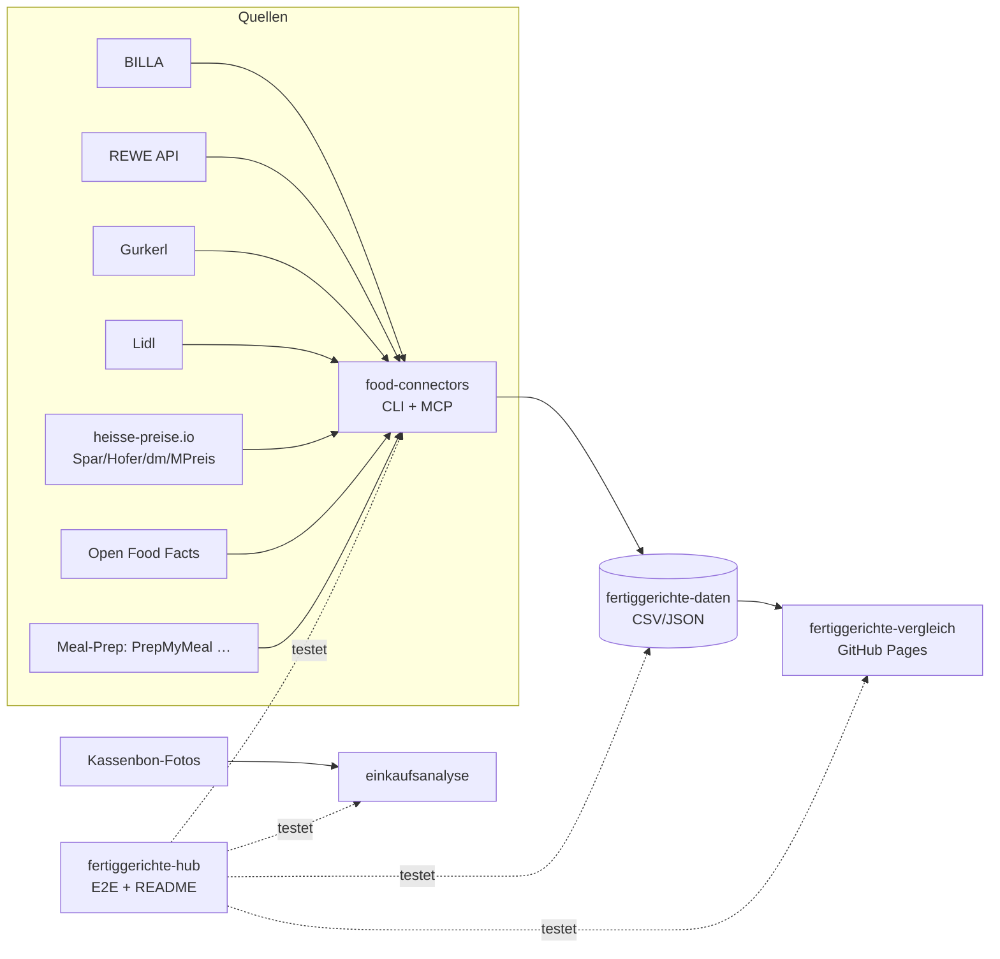

# 🥘 Fertiggerichte-Hub

Zentraler Index & Live-Status aller Fertiggerichte-Projekte (servas-ai). **Automatisch generiert:** 2026-10-17 03:36 UTC via `./run_all.sh` (stündlich).

**Connectors:** 28 ✅ / 2 ❌ / 7 📇 catalog-only · **Apps:** 3/3 live · **Produkte im Datensatz:** 3651

## Apps

| App | URL | Live | Tabs getestet | Konsolen-Fehler | Kaputte Bilder |
|---|---|---|---|---|---|
| Fertiggerichte-Vergleich | https://martin-hausleitner.github.io/fertiggerichte-vergleich/ | ✅ | 9 | 0 | 0 |
| Fertiggerichte-Vergleich (servas-ai Pages) | https://servas-ai.github.io/fertiggerichte-vergleich/ | ✅ | 9 | 0 | 0 |
| Einkaufsanalyse | https://servas-ai.github.io/einkaufsanalyse/ | ✅ | 8 | 0 | 0 |

## Repositories

| Repo | Zweck |
|---|---|
| [servas-ai/fertiggerichte-vergleich](https://github.com/servas-ai/fertiggerichte-vergleich) | Web-App (Vergleich, Netz 3D, Gesundheit, Hersteller …) |
| [servas-ai/food-connectors](https://github.com/servas-ai/food-connectors) | Connectors + CLI + MCP-Server |
| [servas-ai/fertiggerichte-daten](https://github.com/servas-ai/fertiggerichte-daten) | Offener Datensatz CSV/JSON |
| [servas-ai/einkaufsanalyse](https://github.com/servas-ai/einkaufsanalyse) | Einkaufsanalyse-Dashboard (Kassenbons) |

## Architektur



## Connector-Status (Live-Smoke-Test)

| | Connector | Store | Items | Latenz | Beispielprodukt (Beweis) | Zeitpunkt |
|---|---|---|---|---|---|---|
| ✅ | `alfies` | Alfies | 3 | 8.62 s | [Knorr Meisterkessel Gulaschsuppe](https://www.alfies.at/produkt/knorr-meisterkessel-gulaschsuppe-dose-500g) · 4.49 € | 2026-10-17T02:56:15Z |
| ✅ | `billa` | BILLA | 3 | 1.59 s | [MAGGI Fix für Gulasch](https://shop.billa.at/produkte/maggi-fix-fuer-gulasch-0056152) · 1.49 € | 2026-10-17T02:56:24Z |
| ✅ | `bofrost` | Online: bofrost* | 3 | 8.11 s | [Wiener Rindsgulasch](https://www.bofrost.at/shop/fleisch_44196/fleischzubereitungen_34987/wiener-rindsgulasch_03373.html) · 14.99 € | 2026-10-17T02:56:26Z |
| ✅ | `denns` | denn's BioMarkt | 1 | 4.85 s | [MyDeli Bio-Fleischsuppe](https://www.denns-biomarkt.at/angebote/) · 3.49 € | 2026-10-17T02:56:34Z |
| ✅ | `dm` | dm | 3 | 4.72 s | [babylove Menü Kartoffeltopf mit Rindergulasch ab d](https://www.dm.at/p/d/1602887/babylove-menue-kartoffeltopf-mit-rindergulasch-ab-dem-8-monat) · 1.15 € | 2026-10-17T02:56:39Z |
| ✅ | `dm-heisse` | dm | 3 | 2.78 s | HiPP Menü Spätzle mit Gulasch ab 8 Monaten, 220 g · 1.75 € | 2026-10-17T02:56:44Z |
| ✅ | `every` | Online: every. | 3 | 17.29 s | [Pumpkin Zucchini Risotto](https://every-foods.com/products/pumpkin-zucchini-risotto) · 8.99 € | 2026-10-17T02:56:47Z |
| ✅ | `fittogo` | Online: Fit2go | 3 | 8.91 s | [Auberginen-Chili con Carne mit Käse Überbacken](https://fittogo.at/products/auberginen-chili-con-carne-mit-kase-uberbacken) · 9.99 € | 2026-10-17T02:57:05Z |
| ✅ | `goldblatt` | Online: Goldblatt | 2 | 5.44 s | [Erdäpfel Gulasch](https://goldblatt.at/products/bio-erdapfel-gulasch) · 11.99 € | 2026-10-17T02:57:14Z |
| ✅ | `gourmetfein` | Online: Gourmetfein | 3 | 8.2 s | [Weißwurst 1,8kg](https://shop.gourmetfein.com/products/weisswurst-1-8kg) · 24.9 € | 2026-10-17T02:57:20Z |
| ✅ | `gurkerl` | Gurkerl.at | 3 | 1.46 s | [Rinder Gulaschfleisch am Stück](https://www.gurkerl.at/42171-rinder-gulaschfleisch-am-stueck) · 21.47 € | 2026-10-17T02:57:28Z |
| ✅ | `heisse-preise` | heisse-preise.io | 3 | 2.8 s | [Ager Hirschgulasch geschnitten](ager-hirschgulasch-geschnitten-00730647) · 11.99 € | 2026-10-17T02:57:29Z |
| ✅ | `hofer` | HOFER | 3 | 2.74 s | [GENUSS 100% AUS ÖSTERREICH Rindsgulasch 1kg](sortiment/GENUSS-100-AUS-OSTERREICH-Rindsgulasch-1kg) · 19.98 € | 2026-10-17T02:57:33Z |
| ✅ | `issmich` | Online: iss mich! | 3 | 38.43 s | [Bio Rotweingulasch vom Freilandrind](https://www.issmich.at/Bio-Shop/Eintoepfe/Fleisch/15/Bio-Rotweingulasch-vom-Freilandrind) · 11.5 € | 2026-10-17T03:34:56Z |
| ✅ | `juit` | Online: Juit | 1 | 1.84 s | [Rindergulasch mit gegrillter Paprika](https://www.juit.com/de/gerichte/rindergulasch-mit-paprika) | 2026-10-17T03:16:05Z |
| ✅ | `kernbeisser` | Online: Kernbeißer | 3 | 36.47 s | [Maghreb-Hirse mit Artischocken](https://kernbeisser.at/produkt/maghreb-hirse-mit-artischocken/) · 9.0 € | 2026-10-17T03:28:31Z |
| ✅ | `livefresh` | Online: LiveFresh | 3 | 2.25 s | [Pasta Cheesy Spinat – Protein Bowl](https://livefresh.at/products/pasta-cheesy-spinat-400g) · 5.99 € | 2026-10-17T03:29:21Z |
| ✅ | `loewenanteil` | Online: Löwenanteil | 1 | 3.02 s | [Veganes Gulasch](https://www.loewenanteil.com/products/veganes-gulasch) · 9.99 € | 2026-10-17T03:29:23Z |
| ✅ | `mpreis` | MPREIS | 3 | 2.95 s | AIA Puten Gulasch · 6.5 € | 2026-10-17T03:29:26Z |
| ✅ | `mpreis-shop` | MPreis | 3 | 8.9 s | [Basis Gulasch](https://www.mpreis.at/shop/p/knorr-basis-gulasch-282001) · 1.39 € | 2026-10-17T03:29:30Z |
| ✅ | `myproduct` | Online: myProduct | 3 | 33.19 s | [Bio Szegediner Gulasch 460g - Fertiggericht von Ha](https://myproduct.at/bio-szegediner-gulasch-450ml-hartls-kulinarikum) · 12.79 € | 2026-10-17T03:29:40Z |
| ✅ | `nah-frisch` | Nah&Frisch | 3 | 242.95 s | [Inzersdorfer Fertiggerichte oder Suppen](https://www.nahundfrisch.at/de/aktuelles/angebote-der-woche) | 2026-10-17T03:30:13Z |
| ✅ | `penny` | PENNY | 3 | 5.73 s | [Rindsgulaschfleisch](https://www.penny.at/produkte/rindsgulaschfleisch-78544603) · 15.99 € | 2026-10-17T03:35:34Z |
| ✅ | `penny-shop` | PENNY | 3 | 8.42 s | [Rindsgulaschfleisch](https://www.penny.at/produkte/rindsgulaschfleisch-78544603) · 15.99 € | 2026-10-17T03:35:40Z |
| ✅ | `prepmymeal` | Online: PrepMyMeal | 3 | 10.02 s | [CH: Gemüse Lasagne](https://prepmymeal.at/products/ch-gemuse-lasagne-3) · 14.5 € | 2026-10-17T03:35:48Z |
| ✅ | `spar` | SPAR/INTERSPAR | 3 | 2.81 s | Baron de Sel Gourmet Gulasch Bio 55g · 4.99 € | 2026-10-17T03:35:59Z |
| ✅ | `spar-shop` | SPAR/INTERSPAR | 3 | 1.43 s | [TANN Rinds-Bratengulasch](https://www.interspar.at/shop/lebensmittel/tann-rinds-bratengulasch/p/835817) · 21.99 € | 2026-10-17T03:36:03Z |
| ✅ | `unimarkt` | Unimarkt | 3 | 2.76 s | [Felix Erdäpfelgulasch](/Felix-Erdaepfelgulasch-3692) · 5.39 € | 2026-10-17T03:36:05Z |
| 📇 | `adeg` | ADEG | 0 | 0.0 s |  | 2026-10-17T02:56:15Z |
| 📇 | `bio-kistl` | Biohof Achleitner / Bio-Kistl OÖ | 0 | 0.0 s |  | 2026-10-17T02:56:25Z |
| 📇 | `foodora-market` | foodora market (Dmart) | 0 | 0.0 s |  | 2026-10-17T02:57:14Z |
| ❌ | `lidl` | Lidl | 0 | 12.99 s | `HTTPError: HTTP Error 401: Unauthorized` | 2026-10-17T03:29:08Z |
| 📇 | `lieferando-shops` | Lieferando Shops | 0 | 0.0 s |  | 2026-10-17T03:29:21Z |
| 📇 | `mjam` | mjam (now foodora) | 0 | 0.0 s |  | 2026-10-17T03:29:26Z |
| ❌ | `off` | Open Food Facts | 0 | 0.76 s | `RobotsDisallowed: https://world.openfoodfacts.org/cgi/search.pl?search_terms=gulasch&count` | 2026-10-17T03:34:16Z |
| 📇 | `unimarkt-shop` | Unimarkt (UNIONLINE Shop) | 0 | 0.0 s |  | 2026-10-17T03:36:09Z |
| 📇 | `wokostswas` | wokostswas.at | 0 | 0.0 s |  | 2026-10-17T03:36:09Z |

### Bekannte Ausfälle (manuell gepflegt)

- `off` (Open Food Facts) ❌ seit 2026-10-16 (Hub-Lauf 22:59 UTC) dauerhaft, nicht mehr nur Upstream-503: OFF `robots.txt` verbietet für `User-agent: *` jetzt `/api`, `/cgi` und `/facets`, und der neue harte robots.txt-Gate in food-connectors (`0eaa455`) blockiert `cgi/search.pl` (Suche) und `api/v2/product` (EAN-Lookup) bewusst vor dem Request. `search.openfoodfacts.org` ist ebenfalls `Disallow: /`. Fix-Pfad (offen, food-connectors `adapters/off.py`): EAN-Lookup über die erlaubte Produktseite `/product/<ean>` (HTML), Suche über Open Prices / Datensatz-Dump statt Live-Suche. Kein Bypass des Gates.
- `lidl` ❌ HTTP 401 (bekannt, Lidl-API verlangt Auth; kein Login erlaubt).

## Datensatz

**3651 Produkte** · Tabellen: brand_tree 8, companies 148, establishments 4706, logos 304, nutrition 2820, online_mealprep 406, online_providers 3, prices 3260, producer_quality 4, producers 22, products 3651, stores 498

| Abdeckung | % |
|---|---|
| nutrition | 77.2 |
| price | 89.3 |
| photo | 93.9 |
| producer | 48.5 |
| brand | 90.9 |
| logos_total | 304 |

<details><summary>Produkte nach Kette</summary>

| Kette | Anzahl |
|---|---|
| Billa | 807 |
| Spar | 735 |
| Gurkerl | 536 |
| MPreis | 388 |
| Hofer | 223 |
| Alfies | 182 |
| bofrost | 144 |
| unbekannt (OFF) | 93 |
| HelloFresh | 93 |
| PrepMyMeal | 92 |
| Subway | 59 |
| Juit | 50 |
| NORDSEE | 39 |
| Lidl | 37 |
| dm | 35 |
| Fit to Go | 30 |
| Penny | 29 |
| Unimarkt | 29 |
| FitTaste | 18 |
| Denn's | 15 |
| LiveFresh | 10 |
| Nah&Frisch | 7 |

</details>

<details><summary>Produkte nach Fertigstufe/Lagerung</summary>

| Lagerung | Anzahl |
|---|---|
| Unklar (keine Lagerangabe) | 1224 |
| Tiefkühl (TK) | 1012 |
| Kühlregal (Menüschale/frisch) | 602 |
| Dose/Konserve | 422 |
| Trocken/Instant | 332 |
| Glas | 34 |
| Sous-vide (vakuum) | 14 |
| Beutel ungekühlt (Retort-Pouch) | 11 |

</details>

## Screenshots

### Fertiggerichte-Vergleich

| Tab | Desktop 1920 | Mobil 390 |
|---|---|---|
| home |  |  |
| Was kaufe ich heute? |  |  |
| Ernährungsplan |  |  |
| KI-Ansicht |  |  |
| Hofer Top 30 |  |  |
| Marken-Profil |  |  |
| Laden-Profil |  |  |
| Marken |  |  |
| Filialen in der Nähe |  |  |

### Fertiggerichte-Vergleich (servas-ai Pages)

| Tab | Desktop 1920 | Mobil 390 |
|---|---|---|
| home |  |  |
| Was kaufe ich heute? |  |  |
| Ernährungsplan |  |  |
| KI-Ansicht |  |  |
| Hofer Top 30 |  |  |
| Marken-Profil |  |  |
| Laden-Profil |  |  |
| Marken |  |  |
| Filialen in der Nähe |  |  |

### Einkaufsanalyse

| Tab | Desktop 1920 | Mobil 390 |
|---|---|---|
| home |  |  |
| Übersicht |  |  |
| Verlauf |  |  |
| Läden |  |  |
| Kategorien |  |  |
| Protein & Gesundheit |  |  |
| Kassenbons |  |  |
| Import |  |  |

## Changelog (letzte Commits)

**servas-ai/fertiggerichte-vergleich**

- `f10b741` 2026-10-16 22:40 — UI: Online-Shop myProduct (Online/Kategorien, Farbe #be185d, Text-Logo SVG)
- `2fe7940` 2026-10-16 22:45 — data: Sensecheck 19 (pipeline fertig 4d27cfe): BILLA Bami Goreng 650 g = 2 portions (Billa label 302 kcal/19 g per portion) → light pool, out of topPLI/topPE; every. 51 rows delivers_4020 true→null (every. AGB §6 Abs.1: Lieferung nur Deutschland; shipping page says AT → contradictory, not ranked); Iglo Backteig Garnelen (Billa + Gurkerl) = component; myProduct Goldblatt jars merged into goldblatt.at rows (dupOf + alsoAt myProduct), Bio Kichererbsen Curry nutrition = Goldblatt 390 kcal/28.5 g. rows 3921, rankable 211→181. Gates: prepush_gate.sh OK (build ok, Playwright 32 tabs×1920/390 0 errors/0 blank/0 overflow, 0/10808 broken images, gaps applied, top50 regress 0), pipeline pytest 118/118. No deploy.
- `b0eab37` 2026-10-16 22:30 — data: hourly T22 — new online store myProduct.at (+37 heat-up meals/soups from regional producers: Little Lunch 9, Danke Bauer 4, Goldblatt 4, Followfood 4, Rettergut 3, Perfect Earth 3, Hartls Kulinarikum Linz 2, Ökoland 2, Zwergenwiese 2 …), delivers_4020 true (myproduct.at/lieferung, 7,90 €/10 kg AT). Nutrition: 11 myproduct.at, 6 identical EAN in dataset, 20 Open Food Facts product page by exact EAN; never estimated (27 without nutrition kept out). Multipacks priced per pack, portion = unit glass (multipack_unit). Pipeline fertig bd00502. rows 3885→3921, rankable 211. Gates: prepush_gate.sh OK (build ok, Playwright 32 tabs×1920/390 0 errors/0 blank/0 overflow, 0/10814 broken images, gaps applied, top50 regress 0), pipeline pytest 114/114. No deploy.
- `bf14026` 2026-10-16 22:18 — data: iglo Genießer-Pfanne per-portion fix (pipeline fertig a7dc722/b679a46): 650 g packs = 2 portions per iglo.at 'Pro Portion' (≈325 g; Tagliatelle Funghi/Ravioli 600 g → 300 g), incl. SPAR 'Iglo Französische Art Penne…' + MPreis 'Französische Pfanne' — 22 rows: portion 650→325, price/portion 7.69→3.85 €, kcal/portion halved (Billa Tortellini 656→328). Billa Tortellini/Französische Art/Paprika-Huhn + Spar Französische Art now light_meal (own ranking) → rankable 215→211, light pool 106→110; topPLI/topPE/topHealth/topLight unchanged. rows 3885. Sensecheck 18 re-verified on 64f6970: all points closed (Kernbeißer source = kernbeisser.at/agbs/ §7, no dedicated shipping page per sitemap; 0 rankable rows with delivers_4020 null/false). Gates: prepush_gate.sh OK (build ok, Playwright 32 tabs×1920/390 0 errors/0 blank/0 overflow, 0/10698 broken images, gaps applied, top50 regress 0), pipeline pytest 111/111. No deploy.
- `64f6970` 2026-10-16 22:01 — Merge remote-tracking branch 'origin/main' into HEAD
- `8986842` 2026-10-16 22:01 — publish_only.sh: disk gate - abort before worktree/build if / or /tmp has < MIN_DISK_GB (default 3) GB free
- `d2bc354` 2026-10-16 21:56 — data: merge hourly T21 (+9 SPAR heat-up rows) + 9 verified rows from the 21:11 run; +15 bofrost* rows (bofrost.at verified); every. Mushroom Gnocchi vegan; SPAR Tradizionale Diavola without the wrong Ristorante twin nutrition. rows 3885, rankable 215. Pipeline fertig 130350a. pytest 98/98, top50 ok, regress ok, gaps_overlay applied. No deploy.
- `00e9135` 2026-10-16 21:53 — MealKits: per-box delivery text from delivers_4020/delivery_note (false → note or 'Liefert nicht nach 4020 Linz', true → 'Online / Lieferung', null/undefined → grey 'Lieferung nach 4020 nicht geprüft'), tooltip via deliveryTitle

**servas-ai/food-connectors**

- `c2b408b` 2026-10-16 23:50 — Daten-Squad T2336: denns connector extended — (1) dennree brand catalog (own brand of the dennree group / denn's BioMarkt) from www.dennree.de category + product pages (robots '*' allows; /productreload?id= ajax matches Disallow /*?id=* → not used): name, net weight, denomination, ingredients, nutrition/100 g with Atwater check, packshot by denn's article no., 'BILD FOLGT' placeholder detected by md5; no price/GTIN published; (2) 'Neu im Sortiment' page-data (isInAustria, regular shelf price, €/kg, Sanity image); (3) in-store bistro lunch menu (Mittagsgerichte page-data per market, current + next week, price, diet flags; counter dishes, not products). CLI food fetch --store denns --category eigenmarke|neu, MCP denns_brand_catalog / denns_new_products / denns_lunch_menu; 6 offline fixture tests (suite 104 passed / 3 skipped)
- `0eaa455` 2026-10-16 22:02 — polite: hard robots.txt gate + 1 s/host for every HTTP path. RobotsDisallowed raised before the request (cached per host, UA group + '*', RFC 9309: robots 4xx = allow, 5xx/unreachable = disallow); http.get and the 4 direct urlopen sites (alfies, osm_stores, issmich, company/registries) use polite_urlopen; package import installs the gate for urllib/requests/httpx/curl subprocess. tests/test_polite.py (interspar product page blocked without network call, allowed URL, UA group, 4xx/5xx/unreachable, rate limit, install routing). pytest 98 passed, 3 skipped.
- `32c9237` 2026-10-16 21:26 — Daten-Squad T2111: new live connector myproduct (myproduct.at regional-producer marketplace, category Fertiggerichte): category dataLayer + product JSON-LD Offer + Magento attribute table (EAN check digit, Nettofüllmenge, producer address, ingredients, allergens, MHD, nutrition per 100 g when published, Atwater check); exclusion rules for fonds/sauces/spreads/dry mixes/soup powders/meat-substitute raw goods; CLI food fetch|search --store myproduct, MCP myproduct_product/myproduct_search; 5 offline fixture tests
- `a00ce43` 2026-10-16 20:48 — Daten-Squad T2038: new live connector open-prices (Open Food Facts Open Prices REST API, ODbL): food prices EAN [--country AT --since], MCP open_prices_lookup, datasets catalog entry; 2 offline fixture tests (suite 82 passed / 3 skipped)
- `ac16ed7` 2026-10-16 19:53 — bofrost: starters += Pizzettis, Rösti-Baguette, Gemüse-/Broccoli-Laibchen, Schinken-Käse-Röllchen (warm baked snacks; breaded cheese stays out); ready-meals DISH_SLUG += schlemmerfilet; tests
- `994f35c` 2026-10-16 18:33 — bofrost: opt-in course fetches — fetch(category="desserts") warm Mehlspeisen (Knödel, Kaiserschmarrn, Topfennockerl, Mohnnudeln, Strudel, Palatschinken; no Torten/Eis/raw dough) and fetch(category="starters") warm Vorspeisen (Frühlingsrollen, Teigtaschen, Flammkuchen, Kaspressknödel); extra.course; default ready-meal filter unchanged; test_course_url_filters
- `8777b7a` 2026-10-14 07:30 — Daten-Squad T0740: new live connector alfies (Alfies Wien/Graz online supermarket, Alfie's GmbH, Wien)
- `9650f94` 2026-10-14 06:57 — Daten-Squad T0636: new live connector issmich (iss mich! Wiener Bio-Eintöpfe & Suppen im WECK-Glas, iss mich! GmbH, Wien)

**servas-ai/fertiggerichte-daten**


**servas-ai/einkaufsanalyse**

- `66934e3` 2026-10-13 01:10 — Einkaufsanalyse v1: shadcn Sidebar-Dashboard, Import, OCR, Beispieldaten

## Ausführen

```bash
pip install pytest playwright && playwright install chromium
./run_all.sh   # Tests + Report + Push (mit Lock, stündlich via cron)
```
