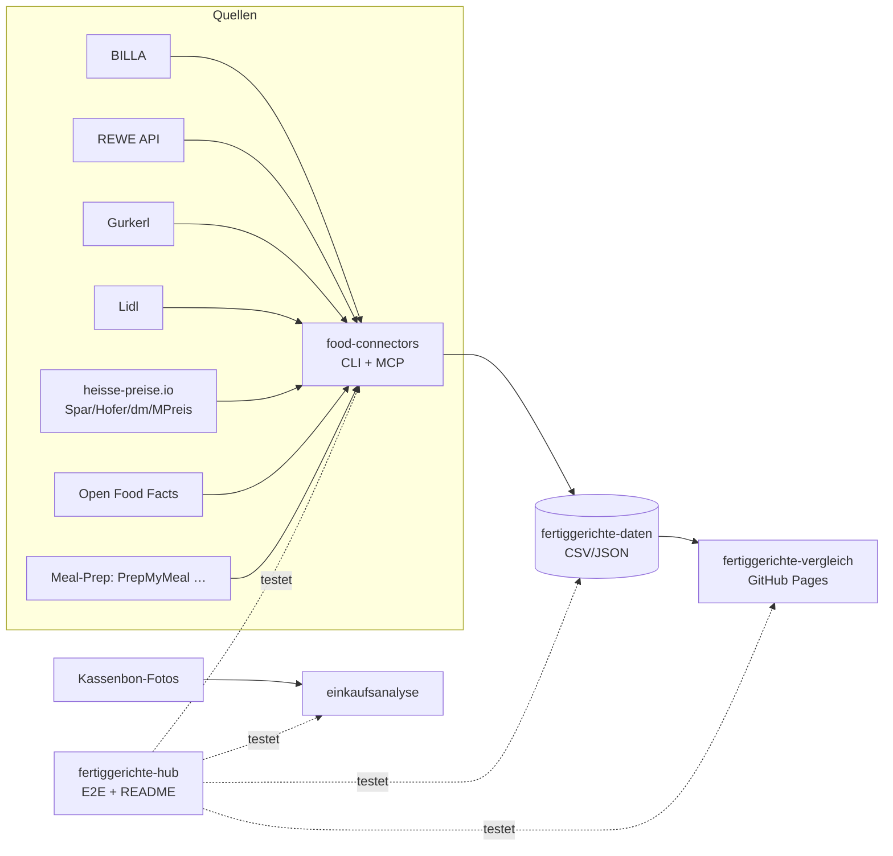

# 🥘 Fertiggerichte-Hub

Zentraler Index & Live-Status aller Fertiggerichte-Projekte (servas-ai). **Automatisch generiert:** 2026-10-14 07:05 UTC via `./run_all.sh` (stündlich).

**Connectors:** 26 ✅ / 2 ❌ / 7 📇 catalog-only · **Apps:** 3/3 live · **Produkte im Datensatz:** 3459

## Apps

| App | URL | Live | Tabs getestet | Konsolen-Fehler | Kaputte Bilder |
|---|---|---|---|---|---|
| Fertiggerichte-Vergleich | https://martin-hausleitner.github.io/fertiggerichte-vergleich/ | ✅ | 9 | 0 | 0 |
| Fertiggerichte-Vergleich (servas-ai Pages) | https://servas-ai.github.io/fertiggerichte-vergleich/ | ✅ | 9 | 0 | 0 |
| Einkaufsanalyse | https://servas-ai.github.io/einkaufsanalyse/ | ✅ | 8 | 0 | 0 |

## Repositories

| Repo | Zweck |
|---|---|
| [servas-ai/fertiggerichte-vergleich](https://github.com/servas-ai/fertiggerichte-vergleich) | Web-App (Vergleich, Netz 3D, Gesundheit, Hersteller …) |
| [servas-ai/food-connectors](https://github.com/servas-ai/food-connectors) | Connectors + CLI + MCP-Server |
| [servas-ai/fertiggerichte-daten](https://github.com/servas-ai/fertiggerichte-daten) | Offener Datensatz CSV/JSON |
| [servas-ai/einkaufsanalyse](https://github.com/servas-ai/einkaufsanalyse) | Einkaufsanalyse-Dashboard (Kassenbons) |

## Architektur



## Connector-Status (Live-Smoke-Test)

| | Connector | Store | Items | Latenz | Beispielprodukt (Beweis) | Zeitpunkt |
|---|---|---|---|---|---|---|
| ✅ | `billa` | BILLA | 3 | 0.49 s | [MAGGI Fix für Gulasch](https://shop.billa.at/produkte/maggi-fix-fuer-gulasch-0056152) · 1.49 € | 2026-10-14T06:58:53Z |
| ✅ | `bofrost` | Online: bofrost* | 3 | 8.22 s | [Wiener Rindsgulasch](https://www.bofrost.at/shop/fleisch_44196/fleischzubereitungen_34987/wiener-rindsgulasch_03373.html) · 14.99 € | 2026-10-14T06:58:54Z |
| ✅ | `denns` | denn's BioMarkt | 1 | 3.87 s | [MyDeli Bio-Fleischsuppe](https://www.denns-biomarkt.at/angebote/) · 3.49 € | 2026-10-14T06:59:02Z |
| ✅ | `dm` | dm | 3 | 3.95 s | [babylove Menü Kartoffeltopf mit Rindergulasch ab d](https://www.dm.at/p/d/1602887/babylove-menue-kartoffeltopf-mit-rindergulasch-ab-dem-8-monat) · 1.15 € | 2026-10-14T06:59:06Z |
| ✅ | `dm-heisse` | dm | 3 | 2.63 s | HiPP Menü Spätzle mit Gulasch ab 8 Monaten, 220 g · 1.75 € | 2026-10-14T06:59:10Z |
| ✅ | `every` | Online: every. | 3 | 13.67 s | [Pumpkin Zucchini Risotto](https://every-foods.com/products/pumpkin-zucchini-risotto) · 8.99 € | 2026-10-14T06:59:14Z |
| ✅ | `fittogo` | Online: Fit2go | 3 | 5.25 s | [Auberginen-Chili con Carne mit Käse Überbacken](https://fittogo.at/products/auberginen-chili-con-carne-mit-kase-uberbacken) · 9.99 € | 2026-10-14T06:59:28Z |
| ✅ | `goldblatt` | Online: Goldblatt | 2 | 4.08 s | [Erdäpfel Gulasch](https://goldblatt.at/products/bio-erdapfel-gulasch) · 11.99 € | 2026-10-14T06:59:33Z |
| ✅ | `gourmetfein` | Online: Gourmetfein | 3 | 2.57 s | [Weißwurst 1,8kg](https://shop.gourmetfein.com/products/weisswurst-1-8kg) · 24.9 € | 2026-10-14T06:59:37Z |
| ✅ | `gurkerl` | Gurkerl.at | 3 | 0.49 s | [AMA Kalb Rosé Austria Gulasch geschnitten](https://www.gurkerl.at/22932-ama-kalb-rose-austria-gulasch-geschnitten) · 16.1 € | 2026-10-14T06:59:40Z |
| ✅ | `heisse-preise` | heisse-preise.io | 3 | 2.79 s | [Ager Hirschgulasch geschnitten](ager-hirschgulasch-geschnitten-00730647) · 11.99 € | 2026-10-14T06:59:41Z |
| ✅ | `hofer` | HOFER | 3 | 2.68 s | [GENUSS 100% AUS ÖSTERREICH Rindsgulasch 1kg](sortiment/GENUSS-100-AUS-OSTERREICH-Rindsgulasch-1kg) · 19.98 € | 2026-10-14T06:59:45Z |
| ✅ | `issmich` | Online: iss mich! | 3 | 27.52 s | [Bio Rotweingulasch vom Freilandrind](https://www.issmich.at/Bio-Shop/Eintoepfe/Fleisch/15/Bio-Rotweingulasch-vom-Freilandrind) · 11.5 € | 2026-10-14T06:59:49Z |
| ✅ | `juit` | Online: Juit | 1 | 0.53 s | [Rindergulasch mit gegrillter Paprika](https://www.juit.com/de/gerichte/rindergulasch-mit-paprika) | 2026-10-14T07:00:17Z |
| ✅ | `kernbeisser` | Online: Kernbeißer | 3 | 18.2 s | [Maghreb-Hirse mit Artischocken](https://kernbeisser.at/produkt/maghreb-hirse-mit-artischocken/) · 9.0 € | 2026-10-14T07:00:17Z |
| ✅ | `livefresh` | Online: LiveFresh | 3 | 1.32 s | [Pasta Cheesy Spinat – Protein Bowl](https://livefresh.at/products/pasta-cheesy-spinat-400g) · 5.99 € | 2026-10-14T07:00:47Z |
| ✅ | `loewenanteil` | Online: Löwenanteil | 1 | 2.07 s | [Veganes Gulasch](https://www.loewenanteil.com/products/veganes-gulasch) · 9.99 € | 2026-10-14T07:00:48Z |
| ✅ | `mpreis` | MPREIS | 3 | 2.51 s | AIA Puten Gulasch · 6.5 € | 2026-10-14T07:00:51Z |
| ✅ | `mpreis-shop` | MPreis | 3 | 7.52 s | [Basis Gulasch](https://www.mpreis.at/shop/p/knorr-basis-gulasch-282001) · 1.39 € | 2026-10-14T07:00:55Z |
| ✅ | `nah-frisch` | Nah&Frisch | 3 | 230.96 s | [Inzersdorfer Fertiggerichte oder Suppen](https://www.nahundfrisch.at/de/aktuelles/angebote-der-woche) | 2026-10-14T07:01:02Z |
| ✅ | `penny` | PENNY | 2 | 4.53 s | [Schweinefleisch für Reisfleisch/Gulasch](https://www.penny.at/produkte/schweinefleisch-fuer-reisfleischgulasch-78544771) · 3.99 € | 2026-10-14T07:05:04Z |
| ✅ | `penny-shop` | PENNY | 2 | 7.71 s | [Schweinefleisch für Reisfleisch/Gulasch](https://www.penny.at/produkte/schweinefleisch-fuer-reisfleischgulasch-78544771) · 3.99 € | 2026-10-14T07:05:09Z |
| ✅ | `prepmymeal` | Online: PrepMyMeal | 3 | 5.83 s | [CH: Gemüse Lasagne](https://prepmymeal.at/products/ch-gemuse-lasagne-3) · 14.5 € | 2026-10-14T07:05:17Z |
| ✅ | `spar` | SPAR/INTERSPAR | 3 | 2.63 s | Baron de Sel Gourmet Gulasch Bio 55g · 4.99 € | 2026-10-14T07:05:23Z |
| ✅ | `spar-shop` | SPAR/INTERSPAR | 3 | 0.78 s | [TANN Rinds-Bratengulasch](https://www.interspar.at/shop/lebensmittel/tann-rinds-bratengulasch/p/835817) · 21.99 € | 2026-10-14T07:05:27Z |
| ✅ | `unimarkt` | Unimarkt | 3 | 2.6 s | [Felix Erdäpfelgulasch](/Felix-Erdaepfelgulasch-3692) · 5.39 € | 2026-10-14T07:05:28Z |
| 📇 | `adeg` | ADEG | 0 | 0.0 s |  | 2026-10-14T06:58:53Z |
| 📇 | `bio-kistl` | Biohof Achleitner / Bio-Kistl OÖ | 0 | 0.0 s |  | 2026-10-14T06:58:54Z |
| 📇 | `foodora-market` | foodora market (Dmart) | 0 | 0.0 s |  | 2026-10-14T06:59:33Z |
| ❌ | `lidl` | Lidl | 0 | 11.31 s | `HTTPError: HTTP Error 401: Unauthorized` | 2026-10-14T07:00:36Z |
| 📇 | `lieferando-shops` | Lieferando Shops | 0 | 0.0 s |  | 2026-10-14T07:00:47Z |
| 📇 | `mjam` | mjam (now foodora) | 0 | 0.0 s |  | 2026-10-14T07:00:51Z |
| ❌ | `off` | Open Food Facts | 0 | 11.12 s | `HTTPError: HTTP Error 503: Service Temporarily Unavailable` | 2026-10-14T07:04:53Z |
| 📇 | `unimarkt-shop` | Unimarkt (UNIONLINE Shop) | 0 | 0.0 s |  | 2026-10-14T07:05:32Z |
| 📇 | `wokostswas` | wokostswas.at | 0 | 0.0 s |  | 2026-10-14T07:05:32Z |

## Datensatz

**3459 Produkte** · Tabellen: brand_tree 8, companies 137, establishments 4706, logos 293, nutrition 2629, online_mealprep 406, online_providers 3, prices 3077, producer_quality 4, producers 22, products 3459, stores 498

| Abdeckung | % |
|---|---|
| nutrition | 76.0 |
| price | 89.0 |
| photo | 93.3 |
| producer | 50.9 |
| brand | 90.5 |
| logos_total | 293 |

<details><summary>Produkte nach Kette</summary>

| Kette | Anzahl |
|---|---|
| Billa | 807 |
| Spar | 735 |
| Gurkerl | 536 |
| MPreis | 388 |
| Hofer | 223 |
| bofrost | 144 |
| unbekannt (OFF) | 93 |
| HelloFresh | 93 |
| PrepMyMeal | 92 |
| Subway | 59 |
| Juit | 50 |
| NORDSEE | 39 |
| Lidl | 37 |
| dm | 35 |
| Fit to Go | 30 |
| Penny | 29 |
| Unimarkt | 29 |
| FitTaste | 18 |
| LiveFresh | 10 |
| Nah&Frisch | 7 |
| Denn's | 5 |

</details>

<details><summary>Produkte nach Fertigstufe/Lagerung</summary>

| Lagerung | Anzahl |
|---|---|
| Unklar (keine Lagerangabe) | 1215 |
| Tiefkühl (TK) | 903 |
| Kühlregal (Menüschale/frisch) | 556 |
| Dose/Konserve | 412 |
| Trocken/Instant | 314 |
| Glas | 34 |
| Sous-vide (vakuum) | 14 |
| Beutel ungekühlt (Retort-Pouch) | 11 |

</details>

## Screenshots

### Fertiggerichte-Vergleich

| Tab | Desktop 1920 | Mobil 390 |
|---|---|---|
| home |  |  |
| Was kaufe ich heute? |  |  |
| Ernährungsplan |  |  |
| KI-Ansicht |  |  |
| Hofer Top 30 |  |  |
| Marken-Profil |  |  |
| Laden-Profil |  |  |
| Marken |  |  |
| Filialen in der Nähe |  |  |

### Fertiggerichte-Vergleich (servas-ai Pages)

| Tab | Desktop 1920 | Mobil 390 |
|---|---|---|
| home |  |  |
| Was kaufe ich heute? |  |  |
| Ernährungsplan |  |  |
| KI-Ansicht |  |  |
| Hofer Top 30 |  |  |
| Marken-Profil |  |  |
| Laden-Profil |  |  |
| Marken |  |  |
| Filialen in der Nähe |  |  |

### Einkaufsanalyse

| Tab | Desktop 1920 | Mobil 390 |
|---|---|---|
| home |  |  |
| Übersicht |  |  |
| Verlauf |  |  |
| Läden |  |  |
| Kategorien |  |  |
| Protein & Gesundheit |  |  |
| Kassenbons |  |  |
| Import |  |  |

## Changelog (letzte Commits)

**servas-ai/fertiggerichte-vergleich**

- `7ae923c` 2026-10-14 06:49 — data: hourly T06 — rows 3491→3532: +41 verified Gurkerl rows (Komplettmahlzeit-Ergänzungen: Soy Delish Wrap; heat-up components: 24 fresh filled pasta Rana/Bertagni/Garofalo/La Pasteria/Mamma Emma/Pappudia/Alnatura, 4 sous-vide pre-cooked meat, 4 soup inserts, 5 Knödel/Püree, 3 vegan Cevapcici/Köttbullar/Bällchen); all with source nutrition, price, stock, EAN, photo; plain sous-vide pieces + plain Köttbullar = component (not rankable). Brand tree: Garofalo→Ebro Foods 52 %, Gabelkönig→AgroFresh/Klinger, Steirerhuhn→Lugitsch, GREENFORCE. Gates: pytest 46/46, top50 ok, build ok, Playwright 32 tabs×2 0 errors/blank/overflow, 0/9776 broken img. No deploy.
- `f630930` 2026-10-14 06:36 — data: M&S Breaded Haddock/Cod → component (sensecheck 11 follow-up)
- `d7d7f13` 2026-10-14 06:12 — Merge remote-tracking branch 'origin/main' into feature/online-goldblatt
- `62a5366` 2026-10-14 06:12 — Online store 'Goldblatt' (goldblatt.at, organic high-protein jar meals): ONLINE/Online/Kategorien lists, palette, STORE_LOGO logos/goldblatt.svg
- `d728d24` 2026-10-14 06:12 — data: Tonno dedupe + sensecheck 11 (fertig e1eb9d5) — rows 3483→3491 (+8 Goldblatt staged by Daten-Squad 87a8089); 209 Dr. Oetker pizza-line names canonical '… Pizza <Variant>' (MPreis 'Ristorante Tonno' = 'Ristorante Pizza Tonno', 1 per store), 15 EANs filled from same-brand+name+size twins (Billa Ristorante Tonno ← 4001724038993); 19 breaded/fried rows w/o side → component/stage prot (Polardorsch paniert, Crispy Chicken, Knusper Abenteuer, Fisch'n'Crunch …); Kernbeißer Frühstück-Buchweizen gang=frühstück not rankable, Thai-Naturreis no longer dessert; topLight w/o vorspeise; Hofer IGLO Lasagne 700 g = 2×350 g. pytest 44/44, check_top50 ok, regress_top50 0, embeddings 3491. No deploy.
- `1506454` 2026-10-14 05:44 — data: hourly T05 (fertig f318528, local) — rows 3445→3483: +32 verified (17 meals + 15 heat-up components; Gurkerl 23, BILLA 6, SPAR 3) + 6 Kernbeißer jar meals (Daten-Squad staging). Brand tree: Vivera/Vegetarian Butcher→JBS, 11er→A-11 Holding/C.O.R.P. Privatstiftung. Logos kernbeisser/loewenanteil copied to public/analysis. Full pipeline incl. sensecheck 10/10b code (2aab4df) + OFF/gaps overlays; supersedes 103fe58 export, which had lost overlays (~400 rows veg/nova/price_status unknown, 19 store rows demoted to 'unbekannt (OFF)'). Embeddings regenerated (3483). Gates: pytest 38/38, top50 ok, regress 0, build ok, Playwright 32 tabs×2 0 errors/blank/overflow, 0/9637 broken img. No deploy.
- `103fe58` 2026-10-14 05:17 — data: sensecheck 10 regen (fertig 2aab4df) — wet ready-meal pack labels + family-pack portions + vorspeise out of tops. Rows 3445→3455, rankable 316→335; bofrost rankable stays 12; rankable Trocken/Instant 8→0 (Knorr Meisterkessel→Dose, Inzersdorfer/Hink Beutel→Retort); Löwenanteil pack=Glas restored via classify; Iglo Lasagne 700 g & M&S Haddock 500 g → 2 portions; Polar-Dorsch twins still collapsed. Embeddings regenerated (3455). Gates: top50 ok, regress 0, tsc+vite build ok, pytest 37. fertig 1be99c3+2aab4df (local). No deploy.
- `749c247` 2026-10-14 05:16 — Online store 'Kernbeißer' (kernbeisser.at, vegan jar meals): ONLINE/Online/Kategorien lists, palette, STORE_LOGO logos/kernbeisser.png

**servas-ai/food-connectors**

- `9650f94` 2026-10-14 06:57 — Daten-Squad T0636: new live connector issmich (iss mich! Wiener Bio-Eintöpfe & Suppen im WECK-Glas, iss mich! GmbH, Wien)
- `cf54f79` 2026-10-14 06:08 — Daten-Squad T0605: new live connector goldblatt (Goldblatt High Protein Bio glass-jar ready meals, Golden Veggies GmbH, Bad Waltersdorf)
- `6597c0d` 2026-10-14 05:08 — Daten-Squad T0504: new live connector kernbeisser (Kernbeißer vegan Vollkorn-Fertiggerichte im Glas, Wien)
- `241e063` 2026-10-14 04:52 — Daten-Squad T0441: new live connector loewenanteil (Löwenanteil Bio glass-jar ready meals)
- `bab2e1d` 2026-10-14 03:58 — feat(every): live every. (every-foods.com) connector — frozen plant-based ready meals shipped to AT (DPD per shop shipping policy, 5,99 €, free from 8 meals) via public Shopify storefront JSON eat.every-foods.com/products.json (price EUR, SKU, availability, packshots) + product pages (Storyblok product blok: weight, nutrition per 100 g + pack, ingredients, preparation; bilingual DE/EN table parser, pack-column typo flag); ready meals = product_type Meal, price > 0, in DE product sitemap; robots-allowed, no login/cookies, 1 req/s; no GTIN → ean None; MCP every_product + every_search; offline tests with fixture (2026-10-14T0341)
- `402f219` 2026-10-14 03:20 — feat(fittogo): live fit2go.meals connector (frozen ready meals, AT-wide Express 4,99 €) via public product sitemap + product HTML — Hydrogen shop (/products.json 404); pack nutrition + Einwaage → per 100 g; price_eur = published 12er-box 9,99 €/Meal (Einzel-SKU 0,00 €); MCP fittogo_product + fittogo_search; offline tests with fixture; Gourmetfein noted as Wurst-only ready-meal dead end (2026-10-14T0307)
- `c4418a1` 2026-10-14 03:01 — feat(bofrost): live bofrost* Austria connector (frozen ready meals, home delivery across AT) via public sitemap + product pages — schema.org JSON-LD price/availability/images, pack line with €/kg, nutrition per 100 g, ingredients, Nutri-Score badge; robots-allowed paths only, no login/cookies, 1 req/s; no GTIN published → ean None; MCP bofrost_product + bofrost_search; offline tests with fixture (2026-10-14T0238)
- `f5654f9` 2026-10-14 02:11 — feat(juit): live Juit connector (frozen ready meals shipped to Austria) via the public storefront content bundle cdn.juit.gmbh/content-de.json — EAN, weight, portions, nutrition/100 g, ingredients, tags, packshot, sellable flag; prices behind login (401) stay null; MCP juit_dishes; offline tests with fixture (2026-10-14T0202)

**servas-ai/fertiggerichte-daten**

- `701ffe6` 2026-10-14 07:04 — Daten-Squad T0636: new online provider iss mich! (35 Wiener Bio-Eintöpfe & Suppen im WECK-Pfandglas, iss mich! GmbH, Wien)
- `8a7c203` 2026-10-14 06:09 — Daten-Squad T0605: new online provider Goldblatt (8 High Protein Bio glass-jar ready meals, Bad Waltersdorf, AT)
- `504f3f6` 2026-10-14 05:11 — Daten-Squad T0504: new online provider Kernbeißer (6 vegan Vollkorn glass-jar ready meals, Wien, AT-only)
- `3196aa7` 2026-10-14 04:52 — Daten-Squad T0441: new online provider Löwenanteil (17 Bio glass-jar ready meals)
- `a48f61f` 2026-10-14 04:16 — Daten-Squad T0404: Little Lunch verified DEAD END as online provider (own littlelunch.com shop closed 30.09.2025, product pages only link to DE retailers Amazon/Flink/Picnic/REWE/Rossmann, no price/GTIN; operator per Impressum Allos Hof-Manufaktur GmbH Bremen HRB 27982 HB) + logo long tail: +5 vision-gated official logos (Yuu'n Mee yuu-n-mee.at SVG, Allgroo allgroo.com, Bedford bedford.de recoloured, COSTA costa.de, Beyond Meat Commons PD); strict logo-less 53→46 brands / 84→64 products
- `b156046` 2026-10-14 03:59 — Daten-Squad T0341: new online provider every. (every-foods.com, Every. GmbH Berlin HRB 221768 B) — 50 frozen plant-based ready meals shipped to AT (DPD per eat.every-foods.com shipping policy; AGB DE-only conflict documented) with single price (median 8,99 €), weight, nutrition/100 g, ingredients, preparation and HEAD-200 packshot from public Shopify products.json + product pages (food-connectors every bab2e1d); 4 candidates without published nutrition dropped; online meal-prep rows 290→340; every-foods logo aliases; Every. GmbH address/management/register court from Impressum; Little Lunch/Dinnerly probe notes
- `8ada169` 2026-10-14 03:40 — data: refresh from app 538537d (bofrost* 144 + hourly T03 +22 + sensecheck 7)
- `6b24163` 2026-10-14 03:21 — Daten-Squad T0307: live fit2go.meals connector evidence + catalog refresh — 30 finished ready meals from fittogo.at public product sitemap + product HTML (pack nutrition, Einwaage, HEAD-200 packshots; price_eur = 12er-box 9,99 €/Meal); staged in fertig ftg_items/other.json (24→30: +Thai Red Curry, BBQ nutrition filled, URL fixes); verified AT meal-prep dead ends (Foodist→morenutrition, Kochzauber DNS fail, Mealprep.at parked, Gourmetfein = Wurst only, eismann.at→de)

**servas-ai/einkaufsanalyse**

- `66934e3` 2026-10-13 01:10 — Einkaufsanalyse v1: shadcn Sidebar-Dashboard, Import, OCR, Beispieldaten

## Ausführen

```bash
pip install pytest playwright && playwright install chromium
./run_all.sh   # Tests + Report + Push (mit Lock, stündlich via cron)
```
