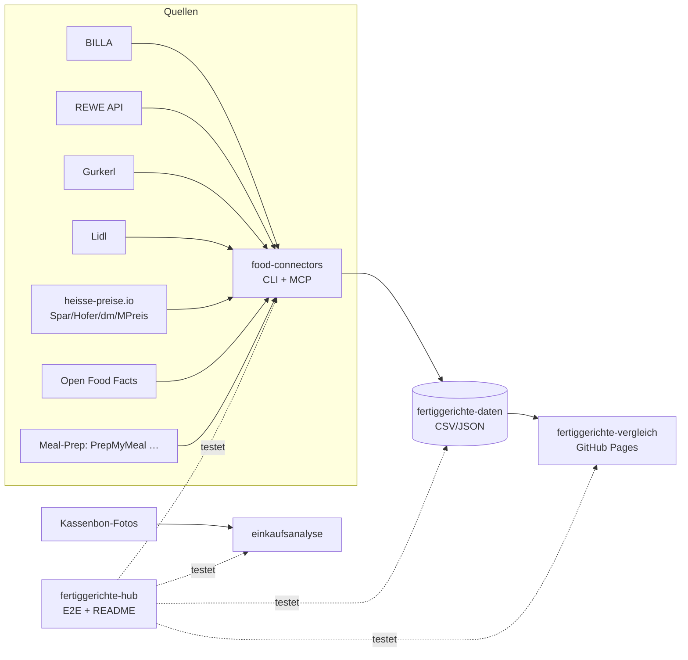
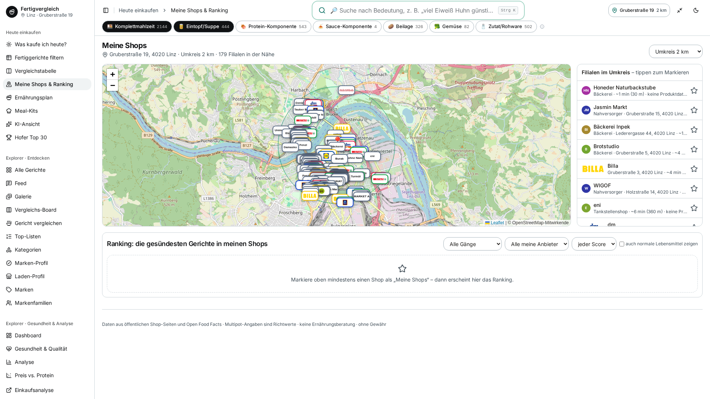
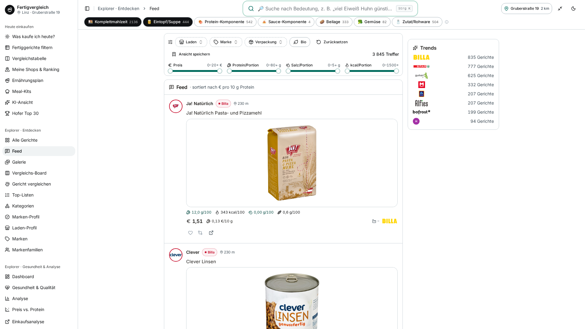
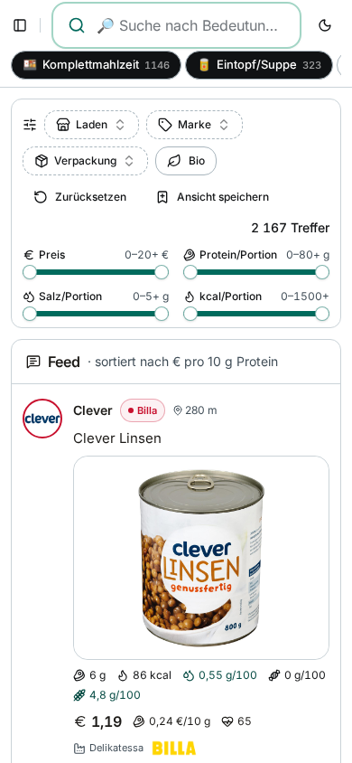
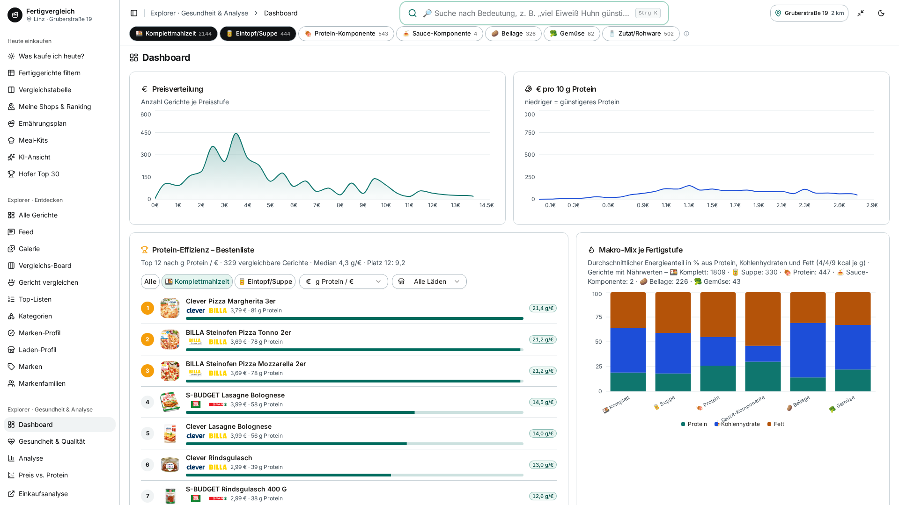
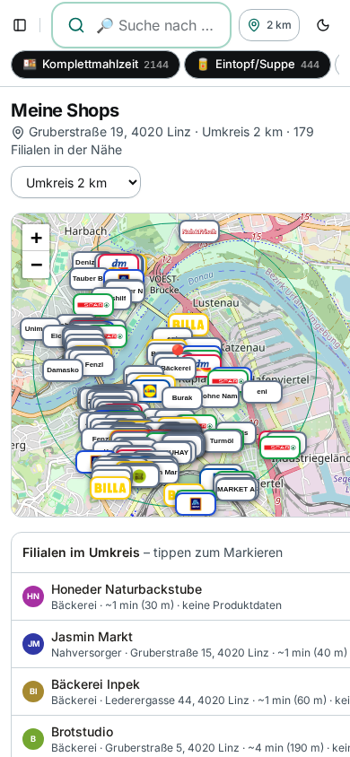
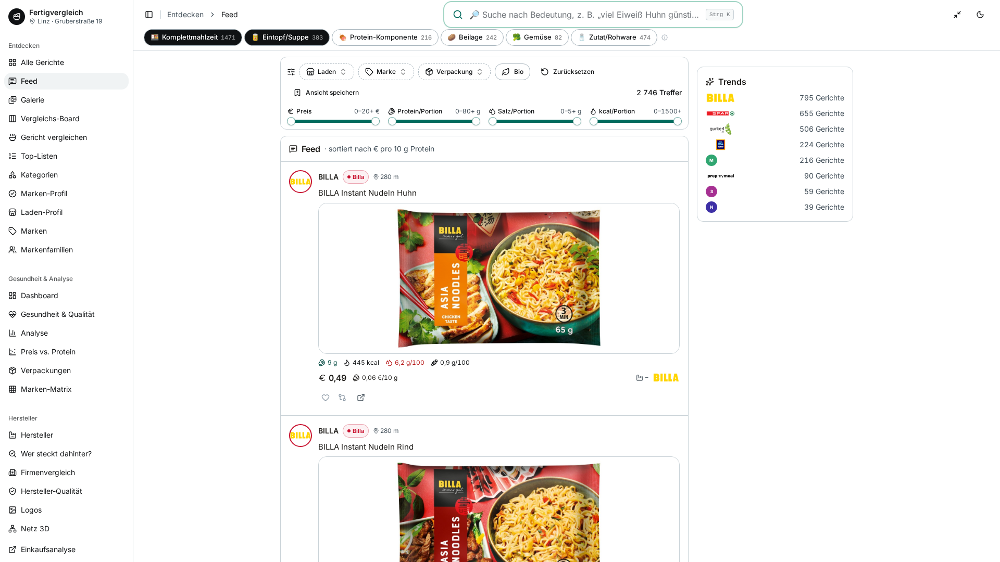
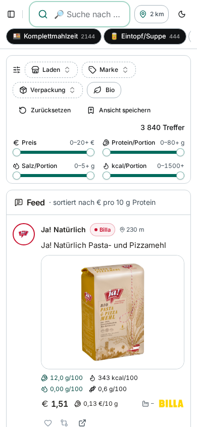
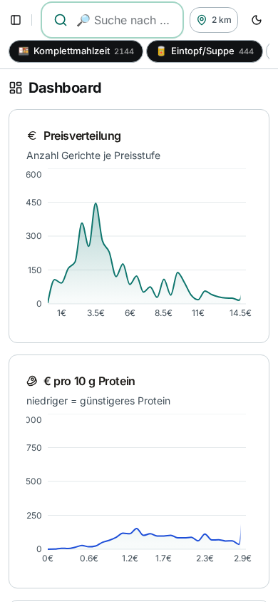

# 🥘 Fertiggerichte-Hub

Zentraler Index & Live-Status aller Fertiggerichte-Projekte (servas-ai). **Automatisch generiert:** 2026-10-25 15:10 UTC via `./run_all.sh` (stündlich).

**Connectors:** 58 ✅ / 9 ❌ / 7 📇 catalog-only · **Apps:** 3/3 live · **Produkte im Datensatz:** 3664

## Apps

| App | URL | Live | Tabs getestet | Konsolen-Fehler | Kaputte Bilder |
|---|---|---|---|---|---|
| Fertiggerichte-Vergleich | https://martin-hausleitner.github.io/fertiggerichte-vergleich/ | ✅ | 26 | 3 | 0 |
| Fertiggerichte-Vergleich (servas-ai Pages) | https://servas-ai.github.io/fertiggerichte-vergleich/ | ✅ | 26 | 1 | 0 |
| Einkaufsanalyse | https://servas-ai.github.io/einkaufsanalyse/ | ✅ | 8 | 0 | 0 |

## Repositories

| Repo | Zweck |
|---|---|
| [servas-ai/fertiggerichte-vergleich](https://github.com/servas-ai/fertiggerichte-vergleich) | Web-App (Vergleich, Netz 3D, Gesundheit, Hersteller …) |
| [servas-ai/food-connectors](https://github.com/servas-ai/food-connectors) | Connectors + CLI + MCP-Server |
| [servas-ai/fertiggerichte-daten](https://github.com/servas-ai/fertiggerichte-daten) | Offener Datensatz CSV/JSON |
| [servas-ai/einkaufsanalyse](https://github.com/servas-ai/einkaufsanalyse) | Einkaufsanalyse-Dashboard (Kassenbons) |

## Architektur



## Connector-Status (Live-Smoke-Test)

| | Connector | Store | Items | Latenz | Beispielprodukt (Beweis) | Zeitpunkt |
|---|---|---|---|---|---|---|
| ✅ | `adamah` | Online: ADAMAH BioHof | 3 | 3.16 s | [Rindsgulasch im Weckglas](https://www.adamah.at/Produktdetailseite/RindsgulaschimWeckglas_42093) · 11.9 € | 2026-10-25T14:57:22Z |
| ✅ | `alfies` | Alfies | 3 | 7.06 s | [Knorr Meisterkessel Gulaschsuppe](https://www.alfies.at/produkt/knorr-meisterkessel-gulaschsuppe-dose-500g-1) · 4.49 € | 2026-10-25T14:57:25Z |
| ✅ | `bauernladen` | Online: Bauernladen.at | 3 | 7.96 s | [Gulaschsuppe](https://bauernladen.at/produkte/fairkocht/gulaschsuppe-27262) · 15.5 € | 2026-10-25T14:57:32Z |
| ✅ | `bernos` | Online: Bernos Tauernwild | 2 | 5.48 s | [Hirschgulasch](https://www.bernos.at/produkt/hirschgulasch/) · 9.0 € | 2026-10-25T14:57:41Z |
| ✅ | `billa` | BILLA | 3 | 1.29 s | [MAGGI Fix für Gulasch](https://shop.billa.at/produkte/maggi-fix-fuer-gulasch-0056152) · 1.49 € | 2026-10-25T14:57:46Z |
| ✅ | `biohof-achleitner` | Online: Biohof Achleitner | 3 | 4.87 s | [Hausg'mocht Rindsgulasch](https://www.biohof.at/Hausgmocht-Rindsgulasch-4755) · 8.7 € | 2026-10-25T14:57:48Z |
| ✅ | `bofrost` | Online: bofrost* | 3 | 8.39 s | [Wiener Rindsgulasch](https://www.bofrost.at/shop/fleisch_44196/fleischzubereitungen_34987/wiener-rindsgulasch_03373.html) · 14.99 € | 2026-10-25T14:57:53Z |
| ✅ | `buchberger` | Online: Fleischerei Buchberger | 2 | 13.71 s | [Hausgemachte Gulasch-Suppe im Glas 450 ml](https://www.buchberger.shop/buchberger-hausgemachte-gulasch-suppe-im-glas-450-ml) · 7.5 € | 2026-10-25T14:58:01Z |
| ✅ | `bullinarium` | Online: Bullinarium (Hallers Bull Beef) | 1 | 10.72 s | [Bull Beef Gulasch 350g](https://www.bullinarium.com/online-shop/produkt/c/fix-fertig/p/bull-beef-gulasch-350g/) · 11.76 € | 2026-10-25T14:58:15Z |
| ✅ | `deflorian` | Online: Deflorian | 2 | 1.9 s | [Rindsgulasch](https://deflorian.tirol/products/rindsgulasch) · 13.1 € | 2026-10-25T14:58:26Z |
| ✅ | `dengg` | Online: Dengg Krapfen- und Knödelmanufaktur | 3 | 28.17 s | [Spinatknödel 4 Stk.](https://www.dengg.info/spinatknoedel-4-stk--62241021-de.html) · 5.7 € | 2026-10-25T14:58:28Z |
| ✅ | `denns` | denn's BioMarkt | 1 | 3.81 s | [NaBio Bio-Eintopf oder -Suppe](https://www.denns-biomarkt.at/angebote/) · 2.49 € | 2026-10-25T14:58:56Z |
| ✅ | `diechtl` | Online: Fleischerei Diechtl | 1 | 4.51 s | [Rindsgulasch im Glas](https://www.diechtl-shop.at/rindsgulasch-im-glas) · 8.99 € | 2026-10-25T14:59:00Z |
| ✅ | `dm` | dm | 3 | 4.46 s | [babylove Menü Kartoffeltopf mit Rindergulasch ab d](https://www.dm.at/p/d/1602887/babylove-menue-kartoffeltopf-mit-rindergulasch-ab-dem-8-monat) · 1.15 € | 2026-10-25T14:59:05Z |
| ✅ | `draxler` | Online: Draxler Geflügel-Wild | 3 | 6.06 s | [Rehragout](https://www.xn--geflgel-draxler-2vb.at/produkt/rehragout/) · 10.0 € | 2026-10-25T14:59:10Z |
| ✅ | `egle` | Online: Egle | 3 | 11.32 s | [BIO Rinder-Gulasch, 400 g](https://www.egleshop.at/BIO-Rinder-Gulasch-400-g) · 7.49 € | 2026-10-25T14:59:16Z |
| ✅ | `every` | Online: every. | 3 | 16.71 s | [Turkish Lentil Soup](https://every-foods.com/products/turkish-lentil-soup) · 8.99 € | 2026-10-25T14:59:28Z |
| ✅ | `fichtenbauer` | Online: Fleischerei Fichtenbauer | 1 | 26.19 s | [Rindsgulasch essfertig](https://www.fleischerei-fichtenbauer.at/shop/rindsgulasch-essfertig) · 6.9 € | 2026-10-25T14:59:45Z |
| ✅ | `fittogo` | Online: Fit2go | 3 | 8.82 s | [Auberginen-Chili con Carne mit Käse Überbacken](https://fittogo.at/products/auberginen-chili-con-carne-mit-kase-uberbacken) · 9.99 € | 2026-10-25T15:00:11Z |
| ✅ | `flottelotte` | Online: Flotte Lotte | 3 | 12.51 s | [Kartoffel Gulasch](https://flottelottezwettl.at/Kartoffel-Gulasch) · 6.5 € | 2026-10-25T15:00:20Z |
| ✅ | `gerbl` | Online: Gerbl im Glas | 3 | 24.36 s | [Gulaschsuppe](https://shop.gerbl.at/ecommerce/product?product_id=796882&category_id=150129) · 9.0 € | 2026-10-25T15:00:33Z |
| ✅ | `goldblatt` | Online: Goldblatt | 2 | 4.64 s | [Erdäpfel Gulasch](https://goldblatt.at/products/bio-erdapfel-gulasch) · 11.99 € | 2026-10-25T15:00:57Z |
| ✅ | `gourmet-daheim` | Online: GOURMET Daheim (Mahlzeit Linz) | 3 | 12.33 s | [Kartoffelgulasch mit Waldviertler Wurst](https://www.mahlzeit.co.at/wp-content/uploads/2026/03/Preisliste_Bestellschein_GDH_2026_inkl_MwSt_Mahlzeit_web.pdf) · 8.5 € | 2026-10-25T15:01:02Z |
| ✅ | `gourmetfein` | Online: Gourmetfein | 3 | 8.18 s | [Weißwurst 1,8kg](https://shop.gourmetfein.com/products/weisswurst-1-8kg) · 24.9 € | 2026-10-25T15:01:15Z |
| ✅ | `gurkerl` | Gurkerl.at | 3 | 1.25 s | [Gissinger Erdäpfelgulasch](https://www.gurkerl.at/21854-gissinger-erdaepfelgulasch) · 10.02 € | 2026-10-25T15:01:23Z |
| ✅ | `hofer-shop` | HOFER | 2 | 3.96 s | [Sonnhof Rindsgulasch](https://www.hofer.at/produkt/sonnhof-rindsgulasch-000000000000510738) · 9.49 € | 2026-10-25T15:01:25Z |
| ✅ | `issmich` | Online: iss mich! | 3 | 28.53 s | [Bio Rotweingulasch vom Freilandrind](https://www.issmich.at/Bio-Shop/Eintoepfe/Fleisch/15/Bio-Rotweingulasch-vom-Freilandrind) · 11.5 € | 2026-10-25T15:01:30Z |
| ✅ | `jenichl` | Online: Genussbauernhof Jenichl | 2 | 2.06 s | [Gulasch im Glas](https://www.genussbauernhof-jenichl.at/shop#!/Gulasch-im-Glas/p/241886285) · 5.5 € | 2026-10-25T15:01:58Z |
| ✅ | `juit` | Online: Juit | 1 | 1.39 s | [Rindergulasch mit gegrillter Paprika](https://www.juit.com/de/gerichte/rindergulasch-mit-paprika) | 2026-10-25T15:02:00Z |
| ✅ | `kernbeisser` | Online: Kernbeißer | 3 | 33.95 s | [Maghreb-Hirse mit Artischocken](https://kernbeisser.at/produkt/maghreb-hirse-mit-artischocken/) · 9.0 € | 2026-10-25T15:02:02Z |
| ✅ | `kumitzberg` | Online: Kumitzberg | 3 | 6.61 s | [Tirolerknödel](https://kumitzberg.at/products/tirolerknodel) · 9.8 € | 2026-10-25T15:02:36Z |
| ✅ | `leitgeb` | Online: Leitgeb's Kärntnernudel | 2 | 7.78 s | [Italienischer Nudelteller](https://kaerntnernudel.co.at/produkt/italienischer-nudelteller/) · 11.2 € | 2026-10-25T15:02:43Z |
| ✅ | `livefresh` | Online: LiveFresh | 3 | 2.5 s | [Pasta Cheesy Spinat – Protein Bowl](https://livefresh.at/products/pasta-cheesy-spinat-400g) · 5.99 € | 2026-10-25T15:03:03Z |
| ✅ | `loewenanteil` | Online: Löwenanteil | 1 | 3.23 s | [Veganes Gulasch](https://www.loewenanteil.com/products/veganes-gulasch) · 9.99 € | 2026-10-25T15:03:05Z |
| ✅ | `lomoalto` | Online: Lomo Alto | 1 | 1.73 s | [BIO Rindergulasch im Glas 400g](https://lomoalto.at/products/rindergulasch-im-glas-400g) · 12.4 € | 2026-10-25T15:03:09Z |
| ✅ | `moakt` | Online: Moakt.at (Weiz) | 2 | 36.67 s | [Rinder-Gulaschsuppe essfertig 400g](https://moakt.at/r-gulaschsuppe-essfertig-400g-pro-1glas) · 7.5 € | 2026-10-25T15:03:11Z |
| ✅ | `mpreis-shop` | MPreis | 3 | 6.27 s | [Basis Gulasch](https://www.mpreis.at/shop/p/knorr-basis-gulasch-282001) · 0.69 € | 2026-10-25T15:03:48Z |
| ✅ | `myproduct` | Online: myProduct | 3 | 23.43 s | [Bio Szegediner Gulasch 460g - Fertiggericht von Ha](https://myproduct.at/bio-szegediner-gulasch-450ml-hartls-kulinarikum) · 12.79 € | 2026-10-25T15:03:55Z |
| ✅ | `nah-frisch` | Nah&Frisch | 2 | 186.6 s | [Knorr . Bitte zu Tisch Suppen](https://www.nahundfrisch.at/de/aktuelles/angebote-der-woche) | 2026-10-25T15:04:18Z |
| ✅ | `noglu` | Online: NoGlu (glutenfreie Knödel) | 2 | 4.53 s | [Glutenfreie Speckknödel, 4 Stück (500 g)](https://www.noglu.at/product/glutenfreie-speckknoedel/) · 9.0 € | 2026-10-25T15:07:25Z |
| ✅ | `nudlkudlmudl` | Online: Martina's Nudlkudlmudl | 3 | 4.34 s | [BAERLAUCHNUDELN Frühlingsboten SAISONALES SCHMANKE](https://www.nudlkudlmudl.com/onlineshop/) · 12.9 € | 2026-10-25T15:07:30Z |
| ✅ | `penny` | PENNY | 3 | 5.57 s | [Gulasch- od. Bratensaft](https://www.penny.at/produkte/gulasch-od-bratensaft-7818089) · 1.39 € | 2026-10-25T15:07:35Z |
| ✅ | `penny-shop` | PENNY | 3 | 7.14 s | [Gulasch- od. Bratensaft](https://www.penny.at/produkte/gulasch-od-bratensaft-7818089) · 1.39 € | 2026-10-25T15:07:41Z |
| ✅ | `prepmymeal` | Online: PrepMyMeal | 3 | 10.67 s | [CH: Gemüse Lasagne](https://prepmymeal.at/products/ch-gemuse-lasagne-3) · 14.5 € | 2026-10-25T15:07:48Z |
| ✅ | `purergenuss` | Online: Purer Genuss (Schüsseltrieb) | 1 | 10.8 s | [Wildsuppe mit Fleisch und Gemüse](https://www.purer-genuss.at/product/wildsuppe-mit-fleisch-und-gemuese/) · 6.99 € | 2026-10-25T15:07:59Z |
| ✅ | `regionalles` | Online: RegionAlles Joglland | 2 | 1.7 s | [Holdi's Gulasch im Glas](https://www.regionalles.com/products/gulasch-im-glas) · 8.4 € | 2026-10-25T15:08:10Z |
| ✅ | `ruckzuck` | Online: Ruck Zuck Laden (Dunzinger's) | 3 | 20.42 s | [Gulaschsaft](https://www.ruckzuck-laden.at/shop/Gulaschsaft-p731601508) · 6.4 € | 2026-10-25T15:08:12Z |
| ✅ | `scheffknecht` | Online: Ariane Scheffknecht | 2 | 27.15 s | [Gerstensuppe mit Selchfleisch](https://www.ariane-scheffknecht.at/product-page/gerstensuppe) · 13.5 € | 2026-10-25T15:08:32Z |
| ✅ | `schmankerl` | Online: Schmankerl Österreich | 1 | 1.75 s | [Gulaschsuppe](https://schmankerl-oesterreich.at/products/gulaschsuppe) · 7.9 € | 2026-10-25T15:08:59Z |
| ✅ | `spar-shop` | SPAR/INTERSPAR | 3 | 1.71 s | [TANN Rinds-Bratengulasch](https://www.interspar.at/shop/lebensmittel/tann-rinds-bratengulasch/p/835817) · 21.99 € | 2026-10-25T15:09:02Z |
| ✅ | `steiramarkt` | Online: Steira Markt | 2 | 12.85 s | [Gulaschsuppe im Glas 400g](https://www.steiramarkt.at/produkt/gulaschsuppe-im-glas-400g/) · 7.0 € | 2026-10-25T15:09:04Z |
| ✅ | `subway-at` | Subway | 3 | 34.05 s | [Italian B.M.T.®](https://www.subway.com/de-AT/MenuNutrition/Menu/Product?ProductId=5257&MenuCategoryId=238) | 2026-10-25T15:09:17Z |
| ✅ | `suppito` | Online: SUPPITO | 2 | 3.53 s | [Rindsgulasch à la Suppito scharf](https://www.suppito.at/produkt/rindsgulasch-a-la-suppito/) · 12.1 € | 2026-10-25T15:09:52Z |
| ✅ | `thaller` | Online: Fleischhauerei Thaller | 1 | 10.33 s | [Rindsgulasch im Glas](https://fleischhauerei-thaller.at/produkt/rindsgulasch-im-glas/) · 7.5 € | 2026-10-25T15:09:55Z |
| ✅ | `voeslauermanufaktur` | Online: voeslauermanufaktur | 2 | 6.76 s | [Erdäpfelgulasch](https://www.voeslauermanufaktur.at/shop/feinkost-im-glas/hauptgerichte/) · 9.9 € | 2026-10-25T15:10:07Z |
| ✅ | `wagyuhof` | Online: Wagyuhof | 1 | 2.3 s | [Wagyu Gulasch](https://wagyuhof.com/products/wagyu-gulasch) · 13.2 € | 2026-10-25T15:10:14Z |
| ✅ | `wiesbauer_gourmet` | Online: Wiesbauer Gourmet | 2 | 7.12 s | [Feines Hirschgulasch aus Österreich 300 g](https://www.wiesbauer-gourmet.at/produkt/feines-hirschgulasch-300-g) · 9.9 € | 2026-10-25T15:10:16Z |
| ✅ | `zoart` | Online: Sous Vide Fertiggerichte (zoart) | 1 | 9.49 s | [Gulaschglück](https://www.sous-vide-fertiggerichte.at/produkt/gulaschglueck/) · 13.5 € | 2026-10-25T15:10:23Z |
| 📇 | `adeg` | ADEG | 0 | 0.0 s |  | 2026-10-25T14:57:25Z |
| 📇 | `bio-kistl` | Biohof Achleitner / Bio-Kistl OÖ | 0 | 0.0 s |  | 2026-10-25T14:57:48Z |
| ❌ | `dm-heisse` | dm | 0 | 0.48 s | `RobotsDisallowed: https://heisse-preise.io/data/latest-canonical.json` | 2026-10-25T14:59:10Z |
| 📇 | `foodora-market` | foodora market (Dmart) | 0 | 0.0 s |  | 2026-10-25T15:00:33Z |
| ❌ | `heisse-preise` | heisse-preise.io | 0 | 0.48 s | `RobotsDisallowed: https://heisse-preise.io/data/latest-canonical.json` | 2026-10-25T15:01:24Z |
| ❌ | `hofer` | HOFER | 0 | 0.37 s | `RobotsDisallowed: https://heisse-preise.io/data/latest-canonical.json` | 2026-10-25T15:01:25Z |
| ❌ | `lidl` | Lidl | 0 | 11.72 s | `HTTPError: HTTP Error 401: Unauthorized` | 2026-10-25T15:02:51Z |
| 📇 | `lieferando-shops` | Lieferando Shops | 0 | 0.0 s |  | 2026-10-25T15:03:03Z |
| 📇 | `mjam` | mjam (now foodora) | 0 | 0.0 s |  | 2026-10-25T15:03:11Z |
| ❌ | `mpreis` | MPREIS | 0 | 0.47 s | `RobotsDisallowed: https://heisse-preise.io/data/latest-canonical.json` | 2026-10-25T15:03:48Z |
| ❌ | `off` | Open Food Facts | 0 | 0.55 s | `RobotsDisallowed: https://world.openfoodfacts.org/cgi/search.pl?search_terms=gulasch&count` | 2026-10-25T15:07:34Z |
| ❌ | `spar` | SPAR/INTERSPAR | 0 | 0.48 s | `RobotsDisallowed: https://heisse-preise.io/data/latest-canonical.json` | 2026-10-25T15:09:01Z |
| ❌ | `sperchenedergut` | Online: Sperchenedergut | 0 | 0.45 s | `RobotsDisallowed: https://sperchenedergut.at/wp-json/wc/store/v1/products?per_page=100` | 2026-10-25T15:09:04Z |
| ❌ | `unimarkt` | Unimarkt | 0 | 0.47 s | `RobotsDisallowed: https://heisse-preise.io/data/latest-canonical.json` | 2026-10-25T15:10:06Z |
| 📇 | `unimarkt-shop` | Unimarkt (UNIONLINE Shop) | 0 | 0.0 s |  | 2026-10-25T15:10:07Z |
| 📇 | `wokostswas` | wokostswas.at | 0 | 0.0 s |  | 2026-10-25T15:10:23Z |

### Bekannte Ausfälle (manuell gepflegt)

- `off` (Open Food Facts) ❌ seit 2026-10-16 (Hub-Lauf 22:59 UTC) dauerhaft, nicht mehr nur Upstream-503: OFF `robots.txt` verbietet für `User-agent: *` jetzt `/api`, `/cgi` und `/facets`, und der neue harte robots.txt-Gate in food-connectors (`0eaa455`) blockiert `cgi/search.pl` (Suche) und `api/v2/product` (EAN-Lookup) bewusst vor dem Request. `search.openfoodfacts.org` ist ebenfalls `Disallow: /`. Fix-Pfad (offen, food-connectors `adapters/off.py`): EAN-Lookup über die erlaubte Produktseite `/product/<ean>` (HTML), Suche über Open Prices / Datensatz-Dump statt Live-Suche. Kein Bypass des Gates.
- `lidl` ❌ HTTP 401 (bekannt, Lidl-API verlangt Auth; kein Login erlaubt).
- `heisse-preise`, `dm-heisse`, `hofer`, `mpreis`, `spar`, `unimarkt` ❌ seit Hub-Lauf 2026-10-17 20:07 UTC: Upstream-Ausfall bei heisse-preise.io. `https://heisse-preise.io/robots.txt` liefert HTTP 500 (nginx), und der robots.txt-Gate in food-connectors (`food_connectors/polite.py`) behandelt 5xx gemäß RFC 9309 korrekt als „alles verboten“, darum wird `data/latest-canonical.json` vor dem Request geblockt. Kein Code-Fehler, kein Bypass; erholt sich automatisch, sobald robots.txt wieder 200/4xx liefert.
- `sperchenedergut` ❌ seit Hub-Lauf 2026-10-24 22:07 UTC: Upstream-Ausfall beim Hoster (Host Europe). `https://sperchenedergut.at/robots.txt` liefert HTTP 502, der robots.txt-Gate behandelt 5xx gemäß RFC 9309 als „alles verboten“ und blockt die WooCommerce Store API vor dem Request. Kein Code-Fehler, kein Bypass; erholt sich automatisch, sobald die Seite wieder erreichbar ist.

## Datensatz

**3664 Produkte** · Tabellen: brand_tree 8, companies 162, establishments 4706, logos 318, nutrition 2825, online_mealprep 406, online_providers 3, prices 3270, producer_quality 4, producers 22, products 3664, stores 498

| Abdeckung | % |
|---|---|
| nutrition | 77.1 |
| price | 89.2 |
| photo | 94.5 |
| producer | 48.4 |
| brand | 90.9 |
| logos_total | 318 |

<details><summary>Produkte nach Kette</summary>

| Kette | Anzahl |
|---|---|
| Billa | 807 |
| Spar | 735 |
| Gurkerl | 536 |
| MPreis | 388 |
| Hofer | 231 |
| Alfies | 182 |
| bofrost | 144 |
| unbekannt (OFF) | 93 |
| HelloFresh | 93 |
| PrepMyMeal | 92 |
| Subway | 59 |
| Juit | 50 |
| NORDSEE | 39 |
| Lidl | 37 |
| dm | 35 |
| Fit to Go | 32 |
| Penny | 29 |
| Unimarkt | 29 |
| FitTaste | 18 |
| Denn's | 15 |
| Nah&Frisch | 10 |
| LiveFresh | 10 |

</details>

<details><summary>Produkte nach Fertigstufe/Lagerung</summary>

| Lagerung | Anzahl |
|---|---|
| Unklar (keine Lagerangabe) | 1223 |
| Tiefkühl (TK) | 1020 |
| Kühlregal (Menüschale/frisch) | 603 |
| Dose/Konserve | 422 |
| Trocken/Instant | 337 |
| Glas | 34 |
| Sous-vide (vakuum) | 14 |
| Beutel ungekühlt (Retort-Pouch) | 11 |

</details>

## Screenshots

### Fertiggerichte-Vergleich

| Tab | Desktop 1920 | Mobil 390 |
|---|---|---|
| home |  |  |
| Was kaufe ich heute? |  |  |
| Fertiggerichte filtern |  |  |
| Meine Shops & Ranking |  |  |
| Ernährungsplan |  |  |
| KI-Ansicht |  |  |
| Hofer Top 30 |  |  |
| Feed |  |  |
| Gericht vergleichen |  |  |
| Top-Listen |  |  |
| Kategorien |  |  |
| Marken-Profil |  |  |
| Laden-Profil |  |  |
| Marken |  |  |
| Markenfamilien |  |  |
| Dashboard |  |  |
| Verpackungen |  |  |
| Wer steckt dahinter? |  |  |
| Hersteller-Qualität |  |  |
| Netz 3D |  |  |
| Läden & Werke |  |  |
| Filialen in der Nähe |  |  |
| Online-Anbieter |  |  |
| Kombi-Ideen |  |  |
| Fit to Go vs. Supermarkt |  |  |
| Multipot-Pro Garzeiten |  |  |

### Fertiggerichte-Vergleich (servas-ai Pages)

| Tab | Desktop 1920 | Mobil 390 |
|---|---|---|
| home |  |  |
| Was kaufe ich heute? |  |  |
| Fertiggerichte filtern |  |  |
| Meine Shops & Ranking |  |  |
| Ernährungsplan |  |  |
| KI-Ansicht |  |  |
| Hofer Top 30 |  |  |
| Feed |  |  |
| Gericht vergleichen |  |  |
| Top-Listen |  |  |
| Kategorien |  |  |
| Marken-Profil |  |  |
| Laden-Profil |  |  |
| Marken |  |  |
| Markenfamilien |  |  |
| Dashboard |  |  |
| Verpackungen |  |  |
| Wer steckt dahinter? |  |  |
| Hersteller-Qualität |  |  |
| Netz 3D |  |  |
| Läden & Werke |  |  |
| Filialen in der Nähe |  |  |
| Online-Anbieter |  |  |
| Kombi-Ideen |  |  |
| Fit to Go vs. Supermarkt |  |  |
| Multipot-Pro Garzeiten |  |  |

### Einkaufsanalyse

| Tab | Desktop 1920 | Mobil 390 |
|---|---|---|
| home |  |  |
| Übersicht |  |  |
| Verlauf |  |  |
| Läden |  |  |
| Kategorien |  |  |
| Protein & Gesundheit |  |  |
| Kassenbons |  |  |
| Import |  |  |

## Changelog (letzte Commits)

**servas-ai/fertiggerichte-vergleich**

- `8bc5701` 2026-10-25 12:50 — fix(sc79): P1.2 AnalyseExt v2 analysis JSON schema normalization & BrandLogo fallback + test_sc33_ui P1.1/P3.1 assertions
- `2783af9` 2026-10-25 12:41 — SC79 P1.1, P1.2 & P3.1: update data.json (4147f1af8324) and analysis JSONs
- `67dacb7` 2026-10-25 12:33 — feat(sc79): P1.2-UI Packaging/AnalyseExt resolveTop, P2.1a PriceKpis rowPli+Leicht & rowP100k, P2.1b Top withPli across all modes, P2.3a Planner PliBadge + SC79 unit/e2e tests
- `a1acc84` 2026-10-25 12:29 — fix(sc79): P2.2 Health-Scatter Tooltip rowP100k – Protein/100 kcal auch für rankableLight-Gerichte (dm, Little Lunch)
- `3aecca6` 2026-10-25 12:11 — feat(sc79): P2.1b Top cheap isRowRankable, P2.2 Health-Scatter & HealthRadar rowP100k, P2.3a Planner isRowRankable, P2.3b Netz3D rowPli – 156 rankableLight-Mahlzeiten (dm, Little Lunch) in Top/Gesundheit/Planer/Netz + test_sc79_ui
- `0ab48d4` 2026-10-25 11:51 — feat(sc78): P1.1 Kategorien/Grid/Explorer/healthyCheap, P1.2 Linz alsoText/Detail, P2.1 KombiBuilder portions & Kombi byId + SC78 unit/e2e tests
- `e672540` 2026-10-25 11:47 — data(sc78): export data.json (381633b31413, 207/156) for SC78 P1.2, P2.1 & P3.1
- `fcf5904` 2026-10-25 11:44 — feat(sc78): P1.1 (Teil 1) isRowRankable/rowPli/rowP100k in Analyse, Charts, Brands, HeatMatrix – 156 rankableLight-Mahlzeiten (dm, Löwenanteil, Little Lunch …) erscheinen in Heatmaps, Boxplots, Scatter & Marken-Karten

**servas-ai/food-connectors**

- `09680ec` 2026-10-25 14:12 — bofrost: off_gtin() — GTIN from Open Food Facts pack barcodes (article no. embedded 0PPPP69AAAAAC, GS1-validated) only when article no. + net weight match and kcal/protein/fat/carbs per 100 g within ±5%; offline fixture test (236 pass, 3 skipped); reproduces daten a1f5420 6/144
- `e786140` 2026-10-25 13:50 — wiesbauer_gourmet: GTIN from product-page JSON-LD (jsonld_gtin/page_gtin, opt-in fetch(with_gtin=True), GS1-validated, 19/20 meals 2026-10-25); offline fixture test (235 pass)
- `c9b24a3` 2026-10-25 13:09 — gourmet-daheim: fallback dish photos (127 arts) from the official Speisekarte 2026 PDF, repo-hosted in fertiggerichte-daten; 234 tests pass
- `4dcd4bf` 2026-10-25 12:44 — every: GTIN via shopify_gtin per-product JSON (50/50 meals, 2026-10-25)
- `4030f6c` 2026-10-25 12:23 — shopify_gtin: read GS1-valid variant barcodes from public /products/<handle>.json (empty in products.json) for deflorian, kumitzberg, goldblatt, loewenanteil; drop barcodes shared by several products (placeholder pattern); fix 'no GTIN published' docstrings; 3 offline tests (233 pass)
- `7f25e3b` 2026-10-25 11:16 — schmankerl: live Schmankerl Österreich connector (Pamela Plüschke – Salzburg Spezialitäten, Feldkirchen; Shopify reseller, chilled shipping AT/DE/IT/EU) — 9 chilled Innviertel Knödel, Kaspressknödel, Fleischstrudel and canned Gulaschsuppe, MCP tools, 4 offline tests
- `4dcc495` 2026-10-25 10:55 — egle: live Egle connector (Wilhelm Egle GmbH, Feldkirch; AT-only Shopware shop) — 31 shelf-stable BIO canned/jarred ready meals & soups with nutrition, MCP tools, 3 offline tests
- `c471820` 2026-10-25 10:05 — noglu: live NoGlu glutenfreie Knödel-Manufaktur connector (Andreas Rossmeier, Hall in Tirol) — 4 gluten-/lactose-free frozen Knödel ready meals with nutrition, MCP tools, 3 offline tests

**servas-ai/fertiggerichte-daten**

- `ba14ca9` 2026-10-25 14:43 — T1437: nutrition backfill 24 myProduct multipack rows by identical GTIN (5 dm + 1 Gurkerl retail rows, 18 Open Food Facts; Atwater ±15% check; 4 skipped for OFF name/size mismatch) + Leitgeb's GTIN 4/29 from identical Gurkerl articles (name + 450 g + nutrition); Deflorian 21, Hartl's 17, Wiesbauer 7, SUPPITO 7, Kumitzberg 2 GTINs have no OFF nutrition (404)
- `a1f5420` 2026-10-25 14:12 — T1402: GTIN backfill bofrost* 6/144 via Open Food Facts — pack barcode embeds bofrost article no. (0PPPP69AAAAAC) = bofrost.at article no., name + net weight equal, nutrition ±5% (4 identical/within 4%, 2 OFF without nutrition); 29 article-matched candidates skipped (nutrition/weight mismatch or OFF weight missing); GOURMET Daheim 0/141 (OFF has only 36 GMS GOURMET retail codes, no match)
- `aebbe62` 2026-10-25 13:50 — T1339: GTIN backfill 27 rows — Wiesbauer Gourmet 19/20 from product-page JSON-LD gtin, Egle 8/31 via Open Food Facts (own GS1 prefix 4262468; 2 nutrition-identical, 2 photo-confirmed, unique names); WooCommerce Leitgeb/Steira Markt/Draxler publish no GTIN (Store API global_unique_id null)
- `7422341` 2026-10-25 13:08 — T1305: GOURMET Daheim photos 8→127/141 — 119 official dish photos from the Mahlzeit Linz Speisekarte 2026 PDF, matched by order number position (127/127 unique), vision gate passed, stored under images/gourmet_daheim/
- `99cde6b` 2026-10-25 12:44 — T1241: GTIN backfill 57 rows — every. 50/50 from Shopify per-product JSON, SUPPITO 7 via identical Gurkerl product+weight (Kürbis 500/510 g mismatches skipped); Gurkerl publishes no SUPPITO nutrition
- `eaa7126` 2026-10-25 12:21 — T1207: GTIN backfill 76 rows from Shopify per-product JSON (Löwenanteil 17, Deflorian 25, PrepMyMeal 13, Goldblatt 8, LiveFresh 7, Kumitzberg 5, Schmankerl 1) + 7 nutrition fills via identical GTIN (Deflorian 6 via MPreis/OFF, Schmankerl FELIX Gulaschsuppe); Wagyuhof placeholder barcodes + Deflorian shared Erdbeer/Zwetschken barcode skipped
- `840f701` 2026-10-25 11:18 — T1108: Schmankerl Österreich (Pamela Plüschke – Salzburg Spezialitäten, Feldkirchen) — 9 chilled Knödel/Strudel/Suppe rows 7,90–16,90 €, ingredients 9/9, photos 9/9, online meal-prep 1041→1050, company schmankerl-oesterreich
- `587ab31` 2026-10-25 10:57 — Egle (Wilhelm Egle GmbH, Feldkirch; AT-only shop): +31 shelf-stable BIO canned/jarred ready meals & soups with nutrition; company egle (USt-IdNr. DE130855821 VIES valid, HRB 6630 AG Memmingen, no AT FN, no LEI); online meal-prep 1010→1041

**servas-ai/einkaufsanalyse**

- `66934e3` 2026-10-13 01:10 — Einkaufsanalyse v1: shadcn Sidebar-Dashboard, Import, OCR, Beispieldaten

## Ausführen

```bash
pip install pytest playwright && playwright install chromium
./run_all.sh   # Tests + Report + Push (mit Lock, stündlich via cron)
```
