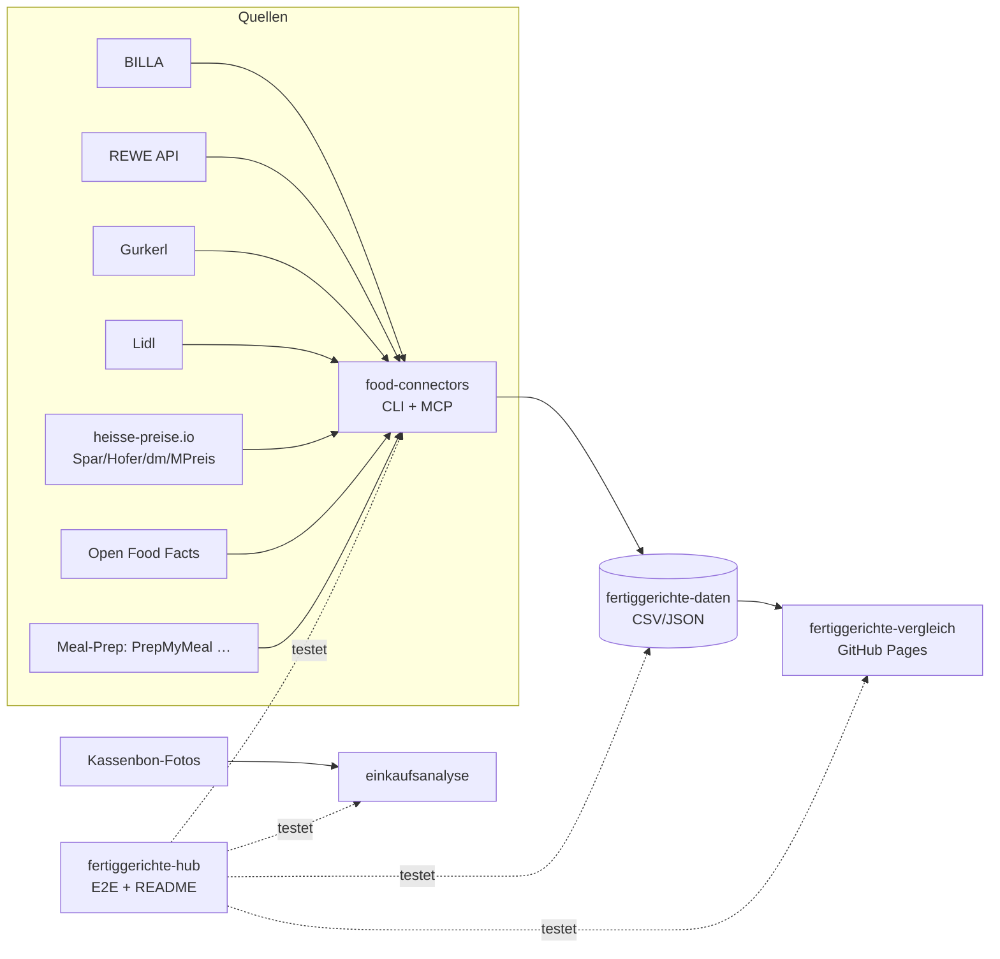

# 🥘 Fertiggerichte-Hub

Zentraler Index & Live-Status aller Fertiggerichte-Projekte (servas-ai). **Automatisch generiert:** 2026-10-14 00:54 UTC via `./run_all.sh` (stündlich).

**Connectors:** 19 ✅ / 1 ❌ / 8 📇 catalog-only · **Apps:** 3/3 live · **Produkte im Datensatz:** 3075

## Apps

| App | URL | Live | Tabs getestet | Konsolen-Fehler | Kaputte Bilder |
|---|---|---|---|---|---|
| Fertiggerichte-Vergleich | https://martin-hausleitner.github.io/fertiggerichte-vergleich/ | ✅ | 9 | 0 | 0 |
| Fertiggerichte-Vergleich (servas-ai Pages) | https://servas-ai.github.io/fertiggerichte-vergleich/ | ✅ | 9 | 1 | 3 |
| Einkaufsanalyse | https://servas-ai.github.io/einkaufsanalyse/ | ✅ | 8 | 0 | 0 |

## Repositories

| Repo | Zweck |
|---|---|
| [servas-ai/fertiggerichte-vergleich](https://github.com/servas-ai/fertiggerichte-vergleich) | Web-App (Vergleich, Netz 3D, Gesundheit, Hersteller …) |
| [servas-ai/food-connectors](https://github.com/servas-ai/food-connectors) | Connectors + CLI + MCP-Server |
| [servas-ai/fertiggerichte-daten](https://github.com/servas-ai/fertiggerichte-daten) | Offener Datensatz CSV/JSON |
| [servas-ai/einkaufsanalyse](https://github.com/servas-ai/einkaufsanalyse) | Einkaufsanalyse-Dashboard (Kassenbons) |

## Architektur



## Connector-Status (Live-Smoke-Test)

| | Connector | Store | Items | Latenz | Beispielprodukt (Beweis) | Zeitpunkt |
|---|---|---|---|---|---|---|
| ✅ | `billa` | BILLA | 3 | 0.55 s | [MAGGI Fix für Gulasch](https://shop.billa.at/produkte/maggi-fix-fuer-gulasch-0056152) · 1.49 € | 2026-10-14T00:49:30Z |
| ✅ | `denns` | denn's BioMarkt | 1 | 4.11 s | [MyDeli Bio-Fleischsuppe](https://www.denns-biomarkt.at/angebote/) · 3.49 € | 2026-10-14T00:49:31Z |
| ✅ | `dm` | dm | 3 | 3.76 s | [babylove Menü Kartoffeltopf mit Rindergulasch ab d](https://www.dm.at/p/d/1602887/babylove-menue-kartoffeltopf-mit-rindergulasch-ab-dem-8-monat) · 1.15 € | 2026-10-14T00:49:35Z |
| ✅ | `dm-heisse` | dm | 3 | 2.75 s | HiPP Menü Spätzle mit Gulasch ab 8 Monaten, 220 g · 1.75 € | 2026-10-14T00:49:39Z |
| ✅ | `gourmetfein` | Online: Gourmetfein | 3 | 2.45 s | [Weißwurst 1,8kg](https://shop.gourmetfein.com/products/weisswurst-1-8kg) · 24.9 € | 2026-10-14T00:49:43Z |
| ✅ | `gurkerl` | Gurkerl.at | 3 | 0.41 s | [AMA Kalb Rosé Austria Gulasch geschnitten](https://www.gurkerl.at/22932-ama-kalb-rose-austria-gulasch-geschnitten) · 16.1 € | 2026-10-14T00:49:46Z |
| ✅ | `heisse-preise` | heisse-preise.io | 3 | 2.68 s | [Ager Hirschgulasch geschnitten](ager-hirschgulasch-geschnitten-00730647) · 11.99 € | 2026-10-14T00:49:46Z |
| ✅ | `hofer` | HOFER | 3 | 2.68 s | [GENUSS 100% AUS ÖSTERREICH Rindsgulasch 1kg](sortiment/GENUSS-100-AUS-OSTERREICH-Rindsgulasch-1kg) · 19.98 € | 2026-10-14T00:49:51Z |
| ✅ | `livefresh` | Online: LiveFresh | 3 | 1.25 s | [Pasta Cheesy Spinat – Protein Bowl](https://livefresh.at/products/pasta-cheesy-spinat-400g) · 5.99 € | 2026-10-14T00:50:06Z |
| ✅ | `mpreis` | MPREIS | 3 | 2.62 s | AIA Puten Gulasch · 6.5 € | 2026-10-14T00:50:07Z |
| ✅ | `mpreis-shop` | MPreis | 3 | 7.63 s | [Basis Gulasch](https://www.mpreis.at/shop/p/knorr-basis-gulasch-282001) · 1.39 € | 2026-10-14T00:50:11Z |
| ✅ | `nah-frisch` | Nah&Frisch | 3 | 219.33 s | [Inzersdorfer Fertiggerichte oder Suppen](https://www.nahundfrisch.at/de/aktuelles/angebote-der-woche) | 2026-10-14T00:50:19Z |
| ✅ | `off` | Open Food Facts | 3 | 7.53 s | [Gulasch (Rind)](https://world.openfoodfacts.org/product/4099200121543) | 2026-10-14T00:53:59Z |
| ✅ | `penny` | PENNY | 2 | 3.57 s | [Schweinefleisch für Reisfleisch/Gulasch](https://www.penny.at/produkte/schweinefleisch-fuer-reisfleischgulasch-78544771) · 3.99 € | 2026-10-14T00:54:06Z |
| ✅ | `penny-shop` | PENNY | 2 | 7.55 s | [Schweinefleisch für Reisfleisch/Gulasch](https://www.penny.at/produkte/schweinefleisch-fuer-reisfleischgulasch-78544771) · 3.99 € | 2026-10-14T00:54:10Z |
| ✅ | `prepmymeal` | Online: PrepMyMeal | 3 | 2.99 s | [CH: Gemüse Lasagne](https://prepmymeal.at/products/ch-gemuse-lasagne-3) · 14.5 € | 2026-10-14T00:54:18Z |
| ✅ | `spar` | SPAR/INTERSPAR | 3 | 2.87 s | Baron de Sel Gourmet Gulasch Bio 55g · 4.99 € | 2026-10-14T00:54:21Z |
| ✅ | `spar-shop` | SPAR/INTERSPAR | 3 | 0.78 s | [TANN Rinds-Bratengulasch](https://www.interspar.at/shop/lebensmittel/tann-rinds-bratengulasch/p/835817) · 21.99 € | 2026-10-14T00:54:25Z |
| ✅ | `unimarkt` | Unimarkt | 3 | 2.7 s | [Felix Erdäpfelgulasch](/Felix-Erdaepfelgulasch-3692) · 5.39 € | 2026-10-14T00:54:26Z |
| 📇 | `adeg` | ADEG | 0 | 0.0 s |  | 2026-10-14T00:49:30Z |
| 📇 | `bio-kistl` | Biohof Achleitner / Bio-Kistl OÖ | 0 | 0.0 s |  | 2026-10-14T00:49:31Z |
| 📇 | `fittogo` | Fit to Go | 0 | 0.0 s |  | 2026-10-14T00:49:43Z |
| 📇 | `foodora-market` | foodora market (Dmart) | 0 | 0.0 s |  | 2026-10-14T00:49:43Z |
| ❌ | `lidl` | Lidl | 0 | 11.22 s | `HTTPError: HTTP Error 401: Unauthorized` | 2026-10-14T00:49:55Z |
| 📇 | `lieferando-shops` | Lieferando Shops | 0 | 0.0 s |  | 2026-10-14T00:50:06Z |
| 📇 | `mjam` | mjam (now foodora) | 0 | 0.0 s |  | 2026-10-14T00:50:07Z |
| 📇 | `unimarkt-shop` | Unimarkt (UNIONLINE Shop) | 0 | 0.0 s |  | 2026-10-14T00:54:30Z |
| 📇 | `wokostswas` | wokostswas.at | 0 | 0.0 s |  | 2026-10-14T00:54:30Z |

## Datensatz

**3075 Produkte** · Tabellen: brand_tree 8, companies 133, establishments 4706, logos 259, nutrition 2232, online_mealprep 96, online_providers 3, prices 2734, producer_quality 4, producers 22, products 3075, stores 498

| Abdeckung | % |
|---|---|
| nutrition | 72.6 |
| price | 88.9 |
| photo | 92.2 |
| producer | 45.8 |
| brand | 89.3 |
| logos_total | 259 |

<details><summary>Produkte nach Kette</summary>

| Kette | Anzahl |
|---|---|
| Billa | 780 |
| Spar | 660 |
| Gurkerl | 521 |
| MPreis | 310 |
| Hofer | 224 |
| unbekannt (OFF) | 192 |
| PrepMyMeal | 90 |
| Subway | 59 |
| NORDSEE | 39 |
| Lidl | 37 |
| dm | 35 |
| Penny | 30 |
| Fit to Go | 29 |
| Unimarkt | 29 |
| FitTaste | 18 |
| LiveFresh | 10 |
| Nah&Frisch | 7 |
| Denn's | 5 |

</details>

<details><summary>Produkte nach Fertigstufe/Lagerung</summary>

| Lagerung | Anzahl |
|---|---|
| Unklar (keine Lagerangabe) | 1013 |
| Tiefkühl (TK) | 736 |
| Kühlregal (Menüschale/frisch) | 542 |
| Dose/Konserve | 400 |
| Trocken/Instant | 325 |
| Glas | 34 |
| Sous-vide (vakuum) | 14 |
| Beutel ungekühlt (Retort-Pouch) | 11 |

</details>

## Screenshots

### Fertiggerichte-Vergleich

| Tab | Desktop 1920 | Mobil 390 |
|---|---|---|
| home |  |  |
| Was kaufe ich heute? |  |  |
| Ernährungsplan |  |  |
| KI-Ansicht |  |  |
| Hofer Top 30 |  |  |
| Marken-Profil |  |  |
| Laden-Profil |  |  |
| Marken |  |  |
| Filialen in der Nähe |  |  |

### Fertiggerichte-Vergleich (servas-ai Pages)

| Tab | Desktop 1920 | Mobil 390 |
|---|---|---|
| home |  |  |
| Was kaufe ich heute? |  |  |
| Ernährungsplan |  |  |
| KI-Ansicht |  |  |
| Hofer Top 30 |  |  |
| Marken-Profil |  |  |
| Laden-Profil |  |  |
| Marken |  |  |
| Filialen in der Nähe |  |  |

### Einkaufsanalyse

| Tab | Desktop 1920 | Mobil 390 |
|---|---|---|
| home |  |  |
| Übersicht |  |  |
| Verlauf |  |  |
| Läden |  |  |
| Kategorien |  |  |
| Protein & Gesundheit |  |  |
| Kassenbons |  |  |
| Import |  |  |

## Changelog (letzte Commits)

**servas-ai/fertiggerichte-vergleich**

- `aca36a3` 2026-10-14 00:41 — deploy: sensecheck5 (HiPP brand → baby_food, same-store GTIN dupOf) + hourly T23 (+24 rows, 3045)
- `9f630d4` 2026-10-14 00:37 — data: sensecheck 5 — dm HiPP Spätzle mit Gulasch → baby_food (brand field), 4 same-store Hofer GTIN twins get dupOf; 3045 rows; pytest 11/11 + top50 gate ok
- `6c871e1` 2026-10-14 00:32 — Sensecheck 5: isBabyFood also checks segment baby_food, meal_class baby and baby brands (HiPP etc.); tsc green
- `8172d4a` 2026-10-13 23:40 — hourly T23 data: +24 rows (3021→3045) — MPreis 14 (Alnatura Bowls, Costa Ofenfisch/Garnelenpfanne, Iglo Crispy Chicken/Ofengarnelen, Ben's Express Risotto, Chicken Fries/Frites, Pierre Baguette warm baguettes), BILLA 7 (Yuu'n Mee/BILLA Garnelen in Sauce, Hubers Wings/Mac'n'Cheese Balls, Schär Chicken Fingers), Gurkerl 3 (Iglo Hühnerflügerl, Ben's Street Food Noodles, M&S Banoffee Pie); brand tree +Bell Food Group/apetito/Stritzinger/Pierre Baguette/Dr. Schär; WerDahinter: click a country bar to filter the Konzern-Baum (+Slowakei etc. in country names). Gates: build OK, Playwright 64 tabs x 2 viewports 0 errors/0 blank/0 overflow, 0/8531 broken images, data gate PASS
- `33b27c1` 2026-10-13 23:15 — Nutrition-source badge (Nährwerte: OFF-Namensabgleich) in detail + cards; zero-as-missing fixes (Planner, Detail, KombiBuilder) with != null
- `98a4a00` 2026-10-13 23:14 — Merge remote-tracking branch 'origin/main'
- `632854d` 2026-10-13 23:10 — data: Hofer 4 OFF name-matches (GC Lasagne Bolognese 1kg, Kartoffel Gnocchi 500g, Wrap Hühnerfiletstreifen 170g, Wrap Thunfisch 170g), nutrition_source='OFF name-match'
- `f96073d` 2026-10-13 23:07 — Merge branch 'feature/my-shops'

**servas-ai/food-connectors**

- `46014e3` 2026-10-13 21:14 — feat(penny-shop): live PENNY AT connector via penny.at's public online-assortment JSON (REWE product-discovery listing + /products/<sku>; robots Sitemap-only, no login/cookies) — regular + standard price, promo text/validity, €/unit, pack, category path, origin, official image; MCP penny_product + penny_search; offline tests with fixtures (2026-10-13T21)
- `91f223b` 2026-10-13 20:53 — feat(nah-frisch): live Nah&Frisch AT connector via the public 'Angebote der Woche' page (robots Allow; tiles from /media, /images+/storage never requested) — KW tabs with validity, official offer tiles, optional tesseract OCR for brand/name/pack/price/badge (extra.ocr, raw text kept); MCP nahfrisch_offers; offline tests with fixtures; ADEG documented as Issuu-flipbook dead end (2026-10-13T20b)
- `c7a16c0` 2026-10-13 20:10 — feat(denns): live denn's BioMarkt AT connector via the public weekly offer feed (Gatsby page-data, robots Allow) — article no., brand, pack, Aktionspreis + Normalpreis, €/kg, validity, vegan flags, official image; MCP denns_offers; live adapters now override catalog-only stubs; offline tests (2026-10-13T20)
- `509f6f6` 2026-10-13 19:48 — fix(spar-shop): code-internal is a SPAR-internal 88… code, not a GTIN → extra.spar_code_internal, ean=None; docs (2026-10-13T19b)
- `1b4bbfc` 2026-10-13 19:47 — feat(spar-shop): live SPAR/INTERSPAR connector via SPAR's public product search API (exact article-number lookup: price, regular price, €/kg, GTIN, stock, image); MCP spar_product; weight products flagged per-100g; tests (2026-10-13T19b)
- `086a6e3` 2026-10-13 18:25 — fix(mpreis): drop shop placeholder image (/assets/noImage_detail-*.webp, site-relative → 404 downstream); only absolute http image URLs kept; tests (2026-10-13T17)
- `3500939` 2026-10-13 17:28 — fix(impressum): VAT regex accepts grouped-digit UIDs ('ATU 43 20 34 03', 'NL 853 640 804 B 01') seen on penny.at/heiploeg.com legal notices; test (2026-10-13T17)
- `aa3d626` 2026-10-13 15:23 — feat(billa/penny): storage class (frozen/chilled from badge, parent category, -18°C statement) + category path in enrich; keep Normalpreis (price.standard) next to promo price; more TK stems (Mohnnudeln, Apfelstrudel, Fischstäbchen, Erdäpfeltascherl); gurkerl fetch adds TK Fischstäbchen/Schlemmerfilet categories; tests (2026-10-13T14)

**servas-ai/fertiggerichte-daten**

- `d252699` 2026-10-14 00:41 — Daten-Squad T0006: +4 vision-gated brand logos (Delikatessa, Rettenswert, Wolfensberger & Pomella, Schulzi´s Knödel)
- `eec2a2a` 2026-10-13 23:44 — Daten-Squad T2340: +6 vision-gated Eigenmarke/brand logos (Vemondo, Nature's Gold, Yum Yum, Kania, M MPreis-Eigenmarke, Leitgeb's)
- `349a65d` 2026-10-13 23:21 — Daten-Squad T23: +7 vision-gated Eigenmarke/brand logos + EAN overlay export
- `23e08bd` 2026-10-13 22:47 — logos: HelloFresh official CDN SVG (93 products) + OFF GTIN match evidence
- `cbcce45` 2026-10-13 21:42 — raw: hourly T20 (+21 meals MPreis/Gurkerl, recovered) + T21 (+28 meals: SPAR 20 via spar-shop + identical-product twin label data, MPreis 7, Gurkerl 1) evidence, SPAR twin matches, data QA gates
- `e08067f` 2026-10-13 21:21 — PENNY AT live via new food-connectors penny-shop (penny.at public online-assortment JSON, 453 items): Penny products 22→30 (+8 ready meals: Podravka Rindergulasch 4.99, Ich bin Österreich Wiener Schnitzel 4.99, Dr. Oetker Ristorante 2er 3.49, Gabelkönig Semmelknödel-Rolle 2.79, Maggi Magic Asia 0.99, Taste of Asia Knuspergarnelen 3.29, Heinz Baked Beans 2.99, Iglo Fischstäbchen 2.99), live prices 7→15, photos 17→25; multi-buy guard: Iglo Ofenbackfisch 3.49 'bei 2 Packungen' → single-pack Normalpreis 6.99, Baked Beans 1.99 'bei 3 Dosen' → 2.99; 12 OFF/Chef-Menü rows not in online assortment unchanged; no nutrition for multi-variant offers; overlay /workspace/fertig/penny_live_overlay.json applied in score.py; evidence raw/penny_2026-10-13T21.json. Re-export also carries concurrent pipeline rows (mealkits_src +93 OFF, Gurkerl/MPreis +21): products 2957→3079, prices 2603→2725
- `de8576e` 2026-10-13 20:53 — Nah&Frisch AT: first 7 products (0→7) via new food-connectors nah-frisch (public 'Angebote der Woche' offer tiles KW41/42, tesseract OCR + visual verification): iglo Pikante Knödel Fleischknödel 400 g 3.99 €, Knorr Kaiserteller Grießnockerl-/Knoblauchcremesuppe 1.39 €, Inzersdorfer Rindsgulasch/Gulaschsuppe/Gefüllte Paprika/Weinbeuschel 400 g ('25% billiger', no absolute price); 7/7 official tile photos; nutrition/EAN only from identical-product twins (BILLA/MPreis/Gurkerl); products 2950→2957, prices 2600→2603, nutrition 2115→2122; evidence raw/nahfrisch_2026-10-13T20b.json
- `c84fd75` 2026-10-13 20:22 — denn's BioMarkt AT: first 5 products (0→5) via new food-connectors denns (public AT offer feed: MyDeli Bio-Fleischsuppe, SOTO Fingerfood, followfood Airfryer Fish Nuggets — Normalpreis + Aktionspreis/validity) + 2 OFF denn's-tagged Natur Compagnie soups (nutrition, no price); products 2945→2950; evidence raw/denns_2026-10-13T20.json

**servas-ai/einkaufsanalyse**

- `66934e3` 2026-10-13 01:10 — Einkaufsanalyse v1: shadcn Sidebar-Dashboard, Import, OCR, Beispieldaten

## Ausführen

```bash
pip install pytest playwright && playwright install chromium
./run_all.sh   # Tests + Report + Push (mit Lock, stündlich via cron)
```
