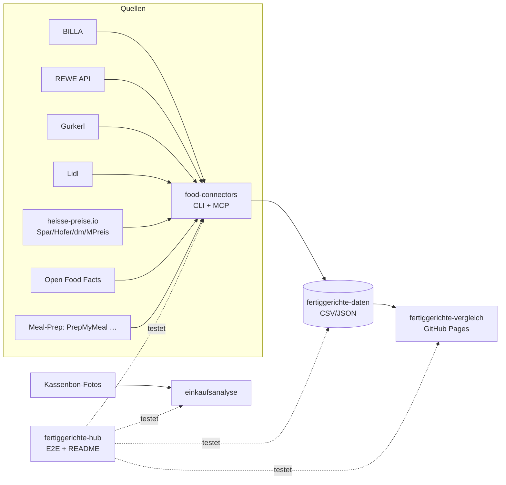

# 🥘 Fertiggerichte-Hub

Zentraler Index & Live-Status aller Fertiggerichte-Projekte (servas-ai). **Automatisch generiert:** 2026-10-16 21:06 UTC via `./run_all.sh` (stündlich).

**Connectors:** 28 ✅ / 1 ❌ / 7 📇 catalog-only · **Apps:** 3/3 live · **Produkte im Datensatz:** 3641

## Apps

| App | URL | Live | Tabs getestet | Konsolen-Fehler | Kaputte Bilder |
|---|---|---|---|---|---|
| Fertiggerichte-Vergleich | https://martin-hausleitner.github.io/fertiggerichte-vergleich/ | ✅ | 9 | 0 | 0 |
| Fertiggerichte-Vergleich (servas-ai Pages) | https://servas-ai.github.io/fertiggerichte-vergleich/ | ✅ | 9 | 2 | 0 |
| Einkaufsanalyse | https://servas-ai.github.io/einkaufsanalyse/ | ✅ | 8 | 0 | 0 |

## Repositories

| Repo | Zweck |
|---|---|
| [servas-ai/fertiggerichte-vergleich](https://github.com/servas-ai/fertiggerichte-vergleich) | Web-App (Vergleich, Netz 3D, Gesundheit, Hersteller …) |
| [servas-ai/food-connectors](https://github.com/servas-ai/food-connectors) | Connectors + CLI + MCP-Server |
| [servas-ai/fertiggerichte-daten](https://github.com/servas-ai/fertiggerichte-daten) | Offener Datensatz CSV/JSON |
| [servas-ai/einkaufsanalyse](https://github.com/servas-ai/einkaufsanalyse) | Einkaufsanalyse-Dashboard (Kassenbons) |

## Architektur



## Connector-Status (Live-Smoke-Test)

| | Connector | Store | Items | Latenz | Beispielprodukt (Beweis) | Zeitpunkt |
|---|---|---|---|---|---|---|
| ✅ | `alfies` | Alfies | 3 | 6.23 s | [Knorr Meisterkessel Gulaschsuppe](https://www.alfies.at/produkt/knorr-meisterkessel-gulaschsuppe-dose-500g) · 4.49 € | 2026-10-16T20:58:17Z |
| ✅ | `billa` | BILLA | 3 | 0.5 s | [MAGGI Fix für Gulasch](https://shop.billa.at/produkte/maggi-fix-fuer-gulasch-0056152) · 1.49 € | 2026-10-16T20:58:23Z |
| ✅ | `bofrost` | Online: bofrost* | 3 | 7.66 s | [Wiener Rindsgulasch](https://www.bofrost.at/shop/fleisch_44196/fleischzubereitungen_34987/wiener-rindsgulasch_03373.html) · 14.99 € | 2026-10-16T20:58:24Z |
| ✅ | `denns` | denn's BioMarkt | 1 | 4.06 s | [MyDeli Bio-Fleischsuppe](https://www.denns-biomarkt.at/angebote/) · 3.49 € | 2026-10-16T20:58:31Z |
| ✅ | `dm` | dm | 3 | 3.74 s | [babylove Menü Kartoffeltopf mit Rindergulasch ab d](https://www.dm.at/p/d/1602887/babylove-menue-kartoffeltopf-mit-rindergulasch-ab-dem-8-monat) · 1.15 € | 2026-10-16T20:58:36Z |
| ✅ | `dm-heisse` | dm | 3 | 3.03 s | HiPP Menü Spätzle mit Gulasch ab 8 Monaten, 220 g · 1.75 € | 2026-10-16T20:58:39Z |
| ✅ | `every` | Online: every. | 3 | 13.4 s | [Pumpkin Zucchini Risotto](https://every-foods.com/products/pumpkin-zucchini-risotto) · 8.99 € | 2026-10-16T20:58:44Z |
| ✅ | `fittogo` | Online: Fit2go | 3 | 4.81 s | [Auberginen-Chili con Carne mit Käse Überbacken](https://fittogo.at/products/auberginen-chili-con-carne-mit-kase-uberbacken) · 9.99 € | 2026-10-16T20:58:57Z |
| ✅ | `goldblatt` | Online: Goldblatt | 2 | 3.41 s | [Erdäpfel Gulasch](https://goldblatt.at/products/bio-erdapfel-gulasch) · 11.99 € | 2026-10-16T20:59:02Z |
| ✅ | `gourmetfein` | Online: Gourmetfein | 3 | 2.84 s | [Weißwurst 1,8kg](https://shop.gourmetfein.com/products/weisswurst-1-8kg) · 24.9 € | 2026-10-16T20:59:06Z |
| ✅ | `gurkerl` | Gurkerl.at | 3 | 0.37 s | [AMA Kalb Rosé Austria Gulasch geschnitten](https://www.gurkerl.at/22932-ama-kalb-rose-austria-gulasch-geschnitten) · 19.22 € | 2026-10-16T20:59:09Z |
| ✅ | `heisse-preise` | heisse-preise.io | 3 | 3.4 s | [Ager Hirschgulasch geschnitten](ager-hirschgulasch-geschnitten-00730647) · 11.99 € | 2026-10-16T20:59:09Z |
| ✅ | `hofer` | HOFER | 3 | 2.87 s | [GENUSS 100% AUS ÖSTERREICH Rindsgulasch 1kg](sortiment/GENUSS-100-AUS-OSTERREICH-Rindsgulasch-1kg) · 19.98 € | 2026-10-16T20:59:14Z |
| ✅ | `issmich` | Online: iss mich! | 3 | 30.4 s | [Bio Rotweingulasch vom Freilandrind](https://www.issmich.at/Bio-Shop/Eintoepfe/Fleisch/15/Bio-Rotweingulasch-vom-Freilandrind) · 11.5 € | 2026-10-16T20:59:18Z |
| ✅ | `juit` | Online: Juit | 1 | 0.87 s | [Rindergulasch mit gegrillter Paprika](https://www.juit.com/de/gerichte/rindergulasch-mit-paprika) | 2026-10-16T20:59:49Z |
| ✅ | `kernbeisser` | Online: Kernbeißer | 3 | 19.52 s | [Maghreb-Hirse mit Artischocken](https://kernbeisser.at/produkt/maghreb-hirse-mit-artischocken/) · 9.0 € | 2026-10-16T20:59:50Z |
| ✅ | `livefresh` | Online: LiveFresh | 3 | 0.9 s | [Pasta Cheesy Spinat – Protein Bowl](https://livefresh.at/products/pasta-cheesy-spinat-400g) · 5.99 € | 2026-10-16T21:00:21Z |
| ✅ | `loewenanteil` | Online: Löwenanteil | 1 | 2.14 s | [Veganes Gulasch](https://www.loewenanteil.com/products/veganes-gulasch) · 9.99 € | 2026-10-16T21:00:22Z |
| ✅ | `mpreis` | MPREIS | 3 | 3.27 s | AIA Puten Gulasch · 6.5 € | 2026-10-16T21:00:24Z |
| ✅ | `mpreis-shop` | MPreis | 3 | 7.38 s | [Basis Gulasch](https://www.mpreis.at/shop/p/knorr-basis-gulasch-282001) · 1.39 € | 2026-10-16T21:00:29Z |
| ✅ | `nah-frisch` | Nah&Frisch | 3 | 254.69 s | [Inzersdorfer Fertiggerichte oder Suppen](https://www.nahundfrisch.at/de/aktuelles/angebote-der-woche) | 2026-10-16T21:00:37Z |
| ✅ | `off` | Open Food Facts | 3 | 67.11 s | [Gulasch (Rind)](https://world.openfoodfacts.org/product/4099200121543) | 2026-10-16T21:04:51Z |
| ✅ | `penny` | PENNY | 3 | 2.81 s | [Rindsgulaschfleisch](https://www.penny.at/produkte/rindsgulaschfleisch-78544603) · 15.99 € | 2026-10-16T21:05:59Z |
| ✅ | `penny-shop` | PENNY | 3 | 8.04 s | [Rindsgulaschfleisch](https://www.penny.at/produkte/rindsgulaschfleisch-78544603) · 15.99 € | 2026-10-16T21:06:02Z |
| ✅ | `prepmymeal` | Online: PrepMyMeal | 3 | 5.13 s | [CH: Gemüse Lasagne](https://prepmymeal.at/products/ch-gemuse-lasagne-3) · 14.5 € | 2026-10-16T21:06:10Z |
| ✅ | `spar` | SPAR/INTERSPAR | 3 | 3.57 s | Baron de Sel Gourmet Gulasch Bio 55g · 4.99 € | 2026-10-16T21:06:15Z |
| ✅ | `spar-shop` | SPAR/INTERSPAR | 3 | 0.46 s | [TANN Rinds-Bratengulasch](https://www.interspar.at/shop/lebensmittel/tann-rinds-bratengulasch/p/835817) · 21.99 € | 2026-10-16T21:06:20Z |
| ✅ | `unimarkt` | Unimarkt | 3 | 3.17 s | [Felix Erdäpfelgulasch](/Felix-Erdaepfelgulasch-3692) · 5.39 € | 2026-10-16T21:06:21Z |
| 📇 | `adeg` | ADEG | 0 | 0.0 s |  | 2026-10-16T20:58:17Z |
| 📇 | `bio-kistl` | Biohof Achleitner / Bio-Kistl OÖ | 0 | 0.0 s |  | 2026-10-16T20:58:24Z |
| 📇 | `foodora-market` | foodora market (Dmart) | 0 | 0.0 s |  | 2026-10-16T20:59:02Z |
| ❌ | `lidl` | Lidl | 0 | 11.5 s | `HTTPError: HTTP Error 401: Unauthorized` | 2026-10-16T21:00:09Z |
| 📇 | `lieferando-shops` | Lieferando Shops | 0 | 0.0 s |  | 2026-10-16T21:00:21Z |
| 📇 | `mjam` | mjam (now foodora) | 0 | 0.0 s |  | 2026-10-16T21:00:24Z |
| 📇 | `unimarkt-shop` | Unimarkt (UNIONLINE Shop) | 0 | 0.0 s |  | 2026-10-16T21:06:25Z |
| 📇 | `wokostswas` | wokostswas.at | 0 | 0.0 s |  | 2026-10-16T21:06:25Z |

## Datensatz

**3641 Produkte** · Tabellen: brand_tree 8, companies 138, establishments 4706, logos 298, nutrition 2811, online_mealprep 406, online_providers 3, prices 3259, producer_quality 4, producers 22, products 3641, stores 498

| Abdeckung | % |
|---|---|
| nutrition | 77.2 |
| price | 89.5 |
| photo | 93.6 |
| producer | 48.4 |
| brand | 90.9 |
| logos_total | 298 |

<details><summary>Produkte nach Kette</summary>

| Kette | Anzahl |
|---|---|
| Billa | 807 |
| Spar | 735 |
| Gurkerl | 536 |
| MPreis | 388 |
| Hofer | 223 |
| Alfies | 182 |
| bofrost | 144 |
| unbekannt (OFF) | 93 |
| HelloFresh | 93 |
| PrepMyMeal | 92 |
| Subway | 59 |
| Juit | 50 |
| NORDSEE | 39 |
| Lidl | 37 |
| dm | 35 |
| Fit to Go | 30 |
| Penny | 29 |
| Unimarkt | 29 |
| FitTaste | 18 |
| LiveFresh | 10 |
| Nah&Frisch | 7 |
| Denn's | 5 |

</details>

<details><summary>Produkte nach Fertigstufe/Lagerung</summary>

| Lagerung | Anzahl |
|---|---|
| Unklar (keine Lagerangabe) | 1222 |
| Tiefkühl (TK) | 1009 |
| Kühlregal (Menüschale/frisch) | 597 |
| Dose/Konserve | 422 |
| Trocken/Instant | 332 |
| Glas | 34 |
| Sous-vide (vakuum) | 14 |
| Beutel ungekühlt (Retort-Pouch) | 11 |

</details>

## Screenshots

### Fertiggerichte-Vergleich

| Tab | Desktop 1920 | Mobil 390 |
|---|---|---|
| home |  |  |
| Was kaufe ich heute? |  |  |
| Ernährungsplan |  |  |
| KI-Ansicht |  |  |
| Hofer Top 30 |  |  |
| Marken-Profil |  |  |
| Laden-Profil |  |  |
| Marken |  |  |
| Filialen in der Nähe |  |  |

### Fertiggerichte-Vergleich (servas-ai Pages)

| Tab | Desktop 1920 | Mobil 390 |
|---|---|---|
| home |  |  |
| Was kaufe ich heute? |  |  |
| Ernährungsplan |  |  |
| KI-Ansicht |  |  |
| Hofer Top 30 |  |  |
| Marken-Profil |  |  |
| Laden-Profil |  |  |
| Marken |  |  |
| Filialen in der Nähe |  |  |

### Einkaufsanalyse

| Tab | Desktop 1920 | Mobil 390 |
|---|---|---|
| home |  |  |
| Übersicht |  |  |
| Verlauf |  |  |
| Läden |  |  |
| Kategorien |  |  |
| Protein & Gesundheit |  |  |
| Kassenbons |  |  |
| Import |  |  |

## Changelog (letzte Commits)

**servas-ai/fertiggerichte-vergleich**

- `6914e97` 2026-10-16 20:55 — Merge origin/main 4944a58 (HCB generic availability text); delivery text per spec: false → delivery_note or 'Liefert nicht nach 4020 Linz – nicht in Rankings', true → 'Online / Lieferung' (Linz chain per OSM: 'Kette führt es'), null → default; 4020 filter uses delivers_4020
- `4944a58` 2026-10-16 20:50 — ui: sensecheck 17 point 3 — availability text driven generically by delivers_4020 (shops.deliveryText/deliveryTitle) instead of hardcoded Gurkerl: delivers_4020=false → 'nicht lieferbar nach 4020 Linz' for Alfies too (tooltip = rank_excluded_reason + delivery_source, red); true + OSM Linz-store evidence → 'Kette führt es'; true otherwise → 'Liefert nach 4020' (tooltip with source); unknown → 'Online / Lieferung' / 'Kette führt es'. Tabelle 'nur Liefert nach 4020' filter uses the same text (stationary chains with delivers_4020=true from pipeline 31c2e1d don't leak in); MeineShops badge uses it too. KNOWN_DELIVERY Alfies source = https://alfies.shop/de/at/faq (checked 2026-10-16). Row type +delivers_4020/delivery_note/delivery_source/rank_excluded_reason. Data unchanged: rows 3853, rankable 241. Browser check (playwright, dist): Alfies getvoila Butter Chicken + Gurkerl rows 'nicht lieferbar nach 4020 Linz', HelloFresh 'Liefert nach 4020', Billa (delivers_4020=true via OSM since 99b7428) 'Kette führt es', 0 page errors. pytest 88/88, top50 ok, regress ok, gaps gate ok, build ok. No deploy.
- `9070bc0` 2026-10-16 20:51 — Merge remote-tracking branch 'origin/main' into fix/delivery-text
- `99b7428` 2026-10-16 20:46 — data: delivers_4020 + delivery_source/delivery_checked filled for verified shops (Linz stores via OSM; PrepMyMeal/Fit to Go/FitTaste/Kernbeißer/Goldblatt/iss mich! via official shipping pages 2026-10-16); MPreis/bofrost/Juit/every./Löwenanteil unverified, left empty. rows 3853, rankable 241. Pipeline fertig 31c2e1d. No deploy.
- `2373d61` 2026-10-16 20:45 — Delivery text from row data (deliveryText): delivers_4020=false → delivery_note or 'Liefert nicht nach 4020 Linz – nicht in Rankings'; true → 'Online / Lieferung'; null → previous default. Used in Tabelle availOf + MeineShops (fixes Alfies showing 'Online / Lieferung')
- `f83cece` 2026-10-16 20:32 — data: sensecheck 17 — no 4020 stand-ins in any top list (Wagner Backfrische Mozzarella #1878 topPE, Iglo Kürbis Quinoa #2474 topLight, Iglo Holy Slice, Inzersdorfer Hühnercurry, Rana Pfannen Gnocchi …); all Alfies/Gurkerl rows delivery_note liefert nicht nach 4020; Alfies source official FAQ (checked 2026-10-16); TANN Rindsbolognese component. Pipeline fertig 936f0d9. pytest 87/87, top50 ok, regress ok, gaps_overlay applied. No deploy.
- `0a05641` 2026-10-16 19:52 — data: sensecheck 16 point 2 — Alfies (Wien/Graz) and Gurkerl (Wien/NÖ/Eisenstadt) do not deliver to 4020 Linz: their online-only rows stay visible (delivers_4020=false, delivery_source, rank_excluded_reason, flag 'Liefert nicht nach 4020 Linz – nicht in Rankings') but are no longer ranked; same product in a Linz chain ranks there (24 rows, e.g. Iglo Lasagne al Forno, Rana Teriyaki → Billa), 5 Gurkerl rows kept as stand-in because the Linz twin cannot rank (delivery_note). rankable 339 → 243; topHealth −11 Gurkerl/Alfies (M&S Beef Madras, PICARD ×3, Balanced Food, GAON Jokbal Kochbox …) → every./Löwenanteil/LiveFresh/bofrost/Billa; topPLI −7, topPE −4, topLight −1. data.delivery4020 (sources, Linz chains, stats). rows 3829. Pipeline fertig 57e5f9d. pytest 83/83, top50 ok, regress ok, gaps gate ok, build ok. No deploy.
- `9b0c8aa` 2026-10-16 19:51 — data: sensecheck 16 point 3 — cross-store twins without shared GTIN collapse in the top lists (pipeline twins.fuzzy_twin: same brand + size ±2 % + all name tokens matched): 'Rana Teriyaki Style Noodels mit Huhn' (Gurkerl) no longer takes a 2nd slot next to Billa's '…Hühnchen' in topHealth/topPLI (alsoAt Alfies, Gurkerl); stable gaps_overlay restore (Kräftige Hühnersuppe/Eierschwammerl Suppe keep Spar + SPAR category). rows 3829, rankable 339. Pipeline fertig b9c0fd1. pytest 82/82, top50 ok, regress ok, gaps gate ok, build ok. No deploy.

**servas-ai/food-connectors**

- `a00ce43` 2026-10-16 20:48 — Daten-Squad T2038: new live connector open-prices (Open Food Facts Open Prices REST API, ODbL): food prices EAN [--country AT --since], MCP open_prices_lookup, datasets catalog entry; 2 offline fixture tests (suite 82 passed / 3 skipped)
- `ac16ed7` 2026-10-16 19:53 — bofrost: starters += Pizzettis, Rösti-Baguette, Gemüse-/Broccoli-Laibchen, Schinken-Käse-Röllchen (warm baked snacks; breaded cheese stays out); ready-meals DISH_SLUG += schlemmerfilet; tests
- `994f35c` 2026-10-16 18:33 — bofrost: opt-in course fetches — fetch(category="desserts") warm Mehlspeisen (Knödel, Kaiserschmarrn, Topfennockerl, Mohnnudeln, Strudel, Palatschinken; no Torten/Eis/raw dough) and fetch(category="starters") warm Vorspeisen (Frühlingsrollen, Teigtaschen, Flammkuchen, Kaspressknödel); extra.course; default ready-meal filter unchanged; test_course_url_filters
- `8777b7a` 2026-10-14 07:30 — Daten-Squad T0740: new live connector alfies (Alfies Wien/Graz online supermarket, Alfie's GmbH, Wien)
- `9650f94` 2026-10-14 06:57 — Daten-Squad T0636: new live connector issmich (iss mich! Wiener Bio-Eintöpfe & Suppen im WECK-Glas, iss mich! GmbH, Wien)
- `cf54f79` 2026-10-14 06:08 — Daten-Squad T0605: new live connector goldblatt (Goldblatt High Protein Bio glass-jar ready meals, Golden Veggies GmbH, Bad Waltersdorf)
- `6597c0d` 2026-10-14 05:08 — Daten-Squad T0504: new live connector kernbeisser (Kernbeißer vegan Vollkorn-Fertiggerichte im Glas, Wien)
- `241e063` 2026-10-14 04:52 — Daten-Squad T0441: new live connector loewenanteil (Löwenanteil Bio glass-jar ready meals)

**servas-ai/fertiggerichte-daten**

- `e5e010f` 2026-10-16 20:49 — Daten-Squad T2038: Open Prices (Open Food Facts) probed for all 240 dataset EANs without a live 2026 price — 7 with any observation, 0 usable (AT hits are 2024/Jan-2025 Mödling receipts, Lidl hits are Berlin DE, 1 without location); no price changed; external_datasets +open-prices (11→12); evidence raw/open_prices_2026-10-16T2038.json
- `88c65f9` 2026-10-16 20:15 — Daten-Squad T1938: company employees 17→46/138, revenue 16→31/138, founded 88→106/138 (company-owned pages on the verified website: 27 employees, 12 revenue, 15 founded — e.g. FRoSTA AG IR key figures, Alnatura Daten & Fakten, Lidl/dm/Hofer/SPAR/REWE/PENNY own figures; de.wikipedia infobox of identifier-matched items: Rügenwalder Konzern 2023, Maresi; Wikidata P571 via P856: AIA 1968, Hamker 1907; Lidl founded via de.wikipedia; Hofer revenue from labelled Die Presse advertorial; every value re-fetched and phrase-verified, group/brand scope labelled; conflicts recorded not overwritten: followfood 2007 vs 2001, Revo 2020 vs 2021, efko 1976 vs 1973, NÖM 645 vs 534 Mio. both kept)
- `5bf43ba` 2026-10-16 19:18 — Daten-Squad T1907: record founded-source breakdown in evidence (GLEIF 45, Firmenbuch ≥1996 18, Wikidata 2; corrects 47/16 split in 200c17d message)
- `200c17d` 2026-10-16 19:17 — Daten-Squad T1907: company founding date 23→88/138 (GLEIF legal-entity creationDate 47, Firmenbuch Eintragungsdatum ≥1996 via evi.gv.at 16, Wikidata P571 by identifier 2 — Billa 1953, Rügenwalder 1834), shareholders 20→55/138 (evi.gv.at Gesellschafter: legal entities named, natural persons only counted), share capital/business line/register status for 59 AT rows (JSON), Billa employees ca. 20.000 (2021, Wikidata); 2 GLEIF-vs-Firmenbuch date conflicts (Mars Austria OG, Danone Österreich) and 8 FBG-1991 transfer dates not taken
- `ce128bf` 2026-10-16 19:02 — Daten-Squad T1835: company master data from own legal notices — official website 81→102/138 (legal-notice page carries the row's verified LEI/FN/HRB/register no.; Ehrmann = group site at identical seat, noted), registered address 117→134/138 (17 DE rows; DE VIES returns none; Lotao skipped: notice names Bio-Zentrale Naturprodukte GmbH), VAT id 70→86/138 (16 printed on the company's own notice + VIES valid: AT/IT name match 1.0, DE only with legal name + register no. on page); rejected Glatz (group entity ≠ Glatz GmbH); felix/berglandmilch/dm JS-only, nestle.at 403 not bypassed
- `8df8189` 2026-10-16 18:22 — Daten-Squad T1805: companies legal entity 125→129/138 (LEI or VIES UID) — Mochi Production GmbH ATU76763147/FN 554188h (shoppu.mochi.at Impressum, VIES), St. Hildegard-Posch GmbH ATU61930557/FN 266429h (Hildegard Grünkraft Impressum, VIES), FRA NUI ESPAÑA S.L. LEI 959800UR1864J6SPSH33 + ESB40502403 (VIES name match), GASTROTECH s.r.o. CZ06661645 (ARES + VIES); non-EU register IDs: Planted Foods AG CHE-398.606.506 (Swiss UID register), Gü → GU INDULGENT FOODS LIMITED 07104090 (Companies House); FN-only: Knödelwerkstatt GmbH FN 508483w, Kasnudl GmbH = FN 425910p (now Invaro GmbH), Alimentastic Food Innovation GmbH = FN 615538d (corrects T1706 successor mapping); Bauck GmbH HRB 205474; Delikatessa/Peter Hiel/MPREIS-Partner documented dead ends
- `2260dfc` 2026-10-16 17:43 — Daten-Squad T1736: drop unverified legal-name alias from the 11er logo row (only brand names kept)
- `686eab7` 2026-10-16 17:41 — Daten-Squad T1736: logo long tail — +4 vision-gated brand logos (11er/elfer 11er.at SVG, Ajinomoto Commons PD wordmark incl. 'Ajinomoto Oyakata' rows, getvoila getvoila.com SVG recoloured dark, Mamma Emma mammaemma.it SVG) + aliases Followfood/Frank Juice/Die Knödelwerkstatt onto existing file-backed rows; Followfish alias rejected (old wordmark); strict logo-less 61→54 brands / 100→75 products

**servas-ai/einkaufsanalyse**

- `66934e3` 2026-10-13 01:10 — Einkaufsanalyse v1: shadcn Sidebar-Dashboard, Import, OCR, Beispieldaten

## Ausführen

```bash
pip install pytest playwright && playwright install chromium
./run_all.sh   # Tests + Report + Push (mit Lock, stündlich via cron)
```
