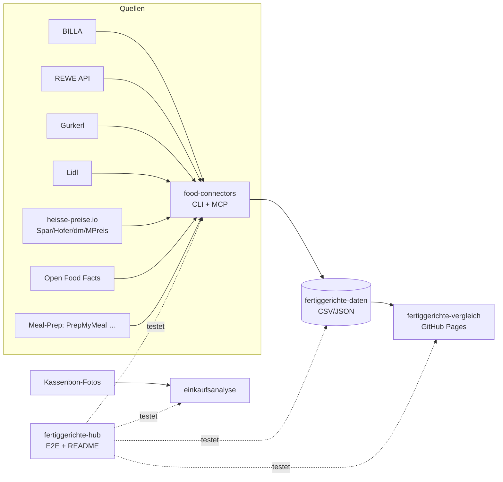

# 🥘 Fertiggerichte-Hub

Zentraler Index & Live-Status aller Fertiggerichte-Projekte (servas-ai). **Automatisch generiert:** 2026-10-25 03:05 UTC via `./run_all.sh` (stündlich).

**Connectors:** 42 ✅ / 9 ❌ / 7 📇 catalog-only · **Apps:** 3/3 live · **Produkte im Datensatz:** 3664

## Apps

| App | URL | Live | Tabs getestet | Konsolen-Fehler | Kaputte Bilder |
|---|---|---|---|---|---|
| Fertiggerichte-Vergleich | https://martin-hausleitner.github.io/fertiggerichte-vergleich/ | ✅ | 20 | 19 | 0 |
| Fertiggerichte-Vergleich (servas-ai Pages) | https://servas-ai.github.io/fertiggerichte-vergleich/ | ✅ | 20 | 0 | 0 |
| Einkaufsanalyse | https://servas-ai.github.io/einkaufsanalyse/ | ✅ | 8 | 0 | 0 |

## Repositories

| Repo | Zweck |
|---|---|
| [servas-ai/fertiggerichte-vergleich](https://github.com/servas-ai/fertiggerichte-vergleich) | Web-App (Vergleich, Netz 3D, Gesundheit, Hersteller …) |
| [servas-ai/food-connectors](https://github.com/servas-ai/food-connectors) | Connectors + CLI + MCP-Server |
| [servas-ai/fertiggerichte-daten](https://github.com/servas-ai/fertiggerichte-daten) | Offener Datensatz CSV/JSON |
| [servas-ai/einkaufsanalyse](https://github.com/servas-ai/einkaufsanalyse) | Einkaufsanalyse-Dashboard (Kassenbons) |

## Architektur



## Connector-Status (Live-Smoke-Test)

| | Connector | Store | Items | Latenz | Beispielprodukt (Beweis) | Zeitpunkt |
|---|---|---|---|---|---|---|
| ✅ | `adamah` | Online: ADAMAH BioHof | 3 | 3.2 s | [Rindsgulasch im Weckglas](https://www.adamah.at/Produktdetailseite/RindsgulaschimWeckglas_42093) · 11.9 € | 2026-10-25T02:55:07Z |
| ✅ | `alfies` | Alfies | 3 | 6.92 s | [Knorr Meisterkessel Gulaschsuppe](https://www.alfies.at/produkt/knorr-meisterkessel-gulaschsuppe-dose-500g-1) · 4.49 € | 2026-10-25T02:55:11Z |
| ✅ | `bauernladen` | Online: Bauernladen.at | 3 | 7.95 s | [Kartoffelgulasch](https://bauernladen.at/produkte/fairkocht/kartoffelgulasch-27268) · 9.5 € | 2026-10-25T02:55:18Z |
| ✅ | `billa` | BILLA | 3 | 1.41 s | [MAGGI Fix für Gulasch](https://shop.billa.at/produkte/maggi-fix-fuer-gulasch-0056152) · 1.49 € | 2026-10-25T02:55:26Z |
| ✅ | `biohof-achleitner` | Online: Biohof Achleitner | 3 | 4.68 s | [Hausg'mocht Rindsgulasch](https://www.biohof.at/Hausgmocht-Rindsgulasch-4755) · 8.7 € | 2026-10-25T02:55:27Z |
| ✅ | `bofrost` | Online: bofrost* | 3 | 8.85 s | [Wiener Rindsgulasch](https://www.bofrost.at/shop/fleisch_44196/fleischzubereitungen_34987/wiener-rindsgulasch_03373.html) · 14.99 € | 2026-10-25T02:55:32Z |
| ✅ | `buchberger` | Online: Fleischerei Buchberger | 2 | 12.9 s | [Hausgemachte Gulasch-Suppe im Glas 450 ml](https://www.buchberger.shop/buchberger-hausgemachte-gulasch-suppe-im-glas-450-ml) · 7.5 € | 2026-10-25T02:55:41Z |
| ✅ | `deflorian` | Online: Deflorian | 2 | 1.41 s | [Rindsgulasch](https://deflorian.tirol/products/rindsgulasch) · 13.1 € | 2026-10-25T02:55:54Z |
| ✅ | `denns` | denn's BioMarkt | 1 | 3.8 s | [NaBio Bio-Eintopf oder -Suppe](https://www.denns-biomarkt.at/angebote/) · 2.49 € | 2026-10-25T02:55:56Z |
| ✅ | `diechtl` | Online: Fleischerei Diechtl | 1 | 4.64 s | [Rindsgulasch im Glas](https://www.diechtl-shop.at/rindsgulasch-im-glas) · 8.99 € | 2026-10-25T02:56:00Z |
| ✅ | `dm` | dm | 3 | 4.49 s | [babylove Menü Kartoffeltopf mit Rindergulasch ab d](https://www.dm.at/p/d/1602887/babylove-menue-kartoffeltopf-mit-rindergulasch-ab-dem-8-monat) · 1.15 € | 2026-10-25T02:56:05Z |
| ✅ | `draxler` | Online: Draxler Geflügel-Wild | 3 | 5.88 s | [Rehragout](https://www.xn--geflgel-draxler-2vb.at/produkt/rehragout/) · 10.0 € | 2026-10-25T02:56:10Z |
| ✅ | `every` | Online: every. | 3 | 15.81 s | [Turkish Lentil Soup](https://every-foods.com/products/turkish-lentil-soup) · 8.99 € | 2026-10-25T02:56:16Z |
| ✅ | `fichtenbauer` | Online: Fleischerei Fichtenbauer | 1 | 15.22 s | [Rindsgulasch essfertig](https://www.fleischerei-fichtenbauer.at/shop/rindsgulasch-essfertig) · 6.9 € | 2026-10-25T02:56:32Z |
| ✅ | `fittogo` | Online: Fit2go | 3 | 8.73 s | [Auberginen-Chili con Carne mit Käse Überbacken](https://fittogo.at/products/auberginen-chili-con-carne-mit-kase-uberbacken) · 9.99 € | 2026-10-25T02:56:47Z |
| ✅ | `gerbl` | Online: Gerbl im Glas | 3 | 24.59 s | [Gulaschsuppe](https://shop.gerbl.at/ecommerce/product?product_id=796882&category_id=150129) · 9.0 € | 2026-10-25T02:56:56Z |
| ✅ | `goldblatt` | Online: Goldblatt | 2 | 4.74 s | [Erdäpfel Gulasch](https://goldblatt.at/products/bio-erdapfel-gulasch) · 11.99 € | 2026-10-25T02:57:21Z |
| ✅ | `gourmet-daheim` | Online: GOURMET Daheim (Mahlzeit Linz) | 3 | 11.4 s | [Kartoffelgulasch mit Waldviertler Wurst](https://www.mahlzeit.co.at/wp-content/uploads/2026/03/Preisliste_Bestellschein_GDH_2026_inkl_MwSt_Mahlzeit_web.pdf) · 8.5 € | 2026-10-25T02:57:26Z |
| ✅ | `gourmetfein` | Online: Gourmetfein | 3 | 8.25 s | [Weißwurst 1,8kg](https://shop.gourmetfein.com/products/weisswurst-1-8kg) · 24.9 € | 2026-10-25T02:57:37Z |
| ✅ | `gurkerl` | Gurkerl.at | 3 | 1.3 s | [Gissinger Erdäpfelgulasch](https://www.gurkerl.at/21854-gissinger-erdaepfelgulasch) · 10.02 € | 2026-10-25T02:57:46Z |
| ✅ | `hofer-shop` | HOFER | 2 | 3.91 s | [Sonnhof Rindsgulasch](https://www.hofer.at/produkt/sonnhof-rindsgulasch-000000000000510738) · 9.49 € | 2026-10-25T02:57:48Z |
| ✅ | `issmich` | Online: iss mich! | 3 | 28.76 s | [Bio Rotweingulasch vom Freilandrind](https://www.issmich.at/Bio-Shop/Eintoepfe/Fleisch/15/Bio-Rotweingulasch-vom-Freilandrind) · 11.5 € | 2026-10-25T02:57:52Z |
| ✅ | `juit` | Online: Juit | 1 | 1.62 s | [Rindergulasch mit gegrillter Paprika](https://www.juit.com/de/gerichte/rindergulasch-mit-paprika) | 2026-10-25T02:58:21Z |
| ✅ | `kernbeisser` | Online: Kernbeißer | 3 | 30.32 s | [Maghreb-Hirse mit Artischocken](https://kernbeisser.at/produkt/maghreb-hirse-mit-artischocken/) · 9.0 € | 2026-10-25T02:58:23Z |
| ✅ | `livefresh` | Online: LiveFresh | 3 | 2.44 s | [Pasta Cheesy Spinat – Protein Bowl](https://livefresh.at/products/pasta-cheesy-spinat-400g) · 5.99 € | 2026-10-25T02:59:05Z |
| ✅ | `loewenanteil` | Online: Löwenanteil | 1 | 3.5 s | [Veganes Gulasch](https://www.loewenanteil.com/products/veganes-gulasch) · 9.99 € | 2026-10-25T02:59:08Z |
| ✅ | `lomoalto` | Online: Lomo Alto | 1 | 1.37 s | [BIO Rindergulasch im Glas 400g](https://lomoalto.at/products/rindergulasch-im-glas-400g) · 12.4 € | 2026-10-25T02:59:11Z |
| ✅ | `mpreis-shop` | MPreis | 3 | 6.2 s | [Basis Gulasch](https://www.mpreis.at/shop/p/knorr-basis-gulasch-282001) · 0.69 € | 2026-10-25T02:59:14Z |
| ✅ | `myproduct` | Online: myProduct | 3 | 22.68 s | [Bio Szegediner Gulasch 460g - Fertiggericht von Ha](https://myproduct.at/bio-szegediner-gulasch-450ml-hartls-kulinarikum) · 12.79 € | 2026-10-25T02:59:20Z |
| ✅ | `nah-frisch` | Nah&Frisch | 2 | 179.35 s | [Knorr . Bitte zu Tisch Suppen](https://www.nahundfrisch.at/de/aktuelles/angebote-der-woche) | 2026-10-25T02:59:43Z |
| ✅ | `penny` | PENNY | 3 | 5.53 s | [Gulasch- od. Bratensaft](https://www.penny.at/produkte/gulasch-od-bratensaft-7818089) · 1.39 € | 2026-10-25T03:02:43Z |
| ✅ | `penny-shop` | PENNY | 3 | 6.93 s | [Gulasch- od. Bratensaft](https://www.penny.at/produkte/gulasch-od-bratensaft-7818089) · 1.39 € | 2026-10-25T03:02:49Z |
| ✅ | `prepmymeal` | Online: PrepMyMeal | 3 | 11.4 s | [CH: Gemüse Lasagne](https://prepmymeal.at/products/ch-gemuse-lasagne-3) · 14.5 € | 2026-10-25T03:02:56Z |
| ✅ | `ruckzuck` | Online: Ruck Zuck Laden (Dunzinger's) | 3 | 20.38 s | [Gulaschsaft](https://www.ruckzuck-laden.at/shop/Gulaschsaft-p731601508) · 6.4 € | 2026-10-25T03:03:07Z |
| ✅ | `spar-shop` | SPAR/INTERSPAR | 3 | 1.55 s | [TANN Rinds-Bratengulasch](https://www.interspar.at/shop/lebensmittel/tann-rinds-bratengulasch/p/835817) · 21.99 € | 2026-10-25T03:03:28Z |
| ✅ | `steiramarkt` | Online: Steira Markt | 2 | 14.01 s | [Gulaschsuppe im Glas 400g](https://www.steiramarkt.at/produkt/gulaschsuppe-im-glas-400g/) · 7.0 € | 2026-10-25T03:03:31Z |
| ✅ | `subway-at` | Subway | 3 | 33.31 s | [Italian B.M.T.®](https://www.subway.com/de-AT/MenuNutrition/Menu/Product?ProductId=5257&MenuCategoryId=238) | 2026-10-25T03:03:45Z |
| ✅ | `suppito` | Online: SUPPITO | 2 | 3.0 s | [Rindsgulasch à la Suppito scharf](https://www.suppito.at/produkt/rindsgulasch-a-la-suppito/) · 12.1 € | 2026-10-25T03:04:18Z |
| ✅ | `thaller` | Online: Fleischhauerei Thaller | 1 | 48.55 s | [Rindsgulasch im Glas](https://fleischhauerei-thaller.at/produkt/rindsgulasch-im-glas/) · 7.5 € | 2026-10-25T03:04:21Z |
| ✅ | `voeslauermanufaktur` | Online: voeslauermanufaktur | 2 | 6.56 s | [Erdäpfelgulasch](https://www.voeslauermanufaktur.at/shop/feinkost-im-glas/hauptgerichte/) · 9.9 € | 2026-10-25T03:05:11Z |
| ✅ | `wagyuhof` | Online: Wagyuhof | 1 | 2.51 s | [Wagyu Gulasch](https://wagyuhof.com/products/wagyu-gulasch) · 13.2 € | 2026-10-25T03:05:17Z |
| ✅ | `wiesbauer_gourmet` | Online: Wiesbauer Gourmet | 2 | 8.92 s | [Feines Hirschgulasch aus Österreich 300 g](https://www.wiesbauer-gourmet.at/produkt/feines-hirschgulasch-300-g) · 9.9 € | 2026-10-25T03:05:20Z |
| 📇 | `adeg` | ADEG | 0 | 0.0 s |  | 2026-10-25T02:55:11Z |
| 📇 | `bio-kistl` | Biohof Achleitner / Bio-Kistl OÖ | 0 | 0.0 s |  | 2026-10-25T02:55:27Z |
| ❌ | `dm-heisse` | dm | 0 | 0.37 s | `RobotsDisallowed: https://heisse-preise.io/data/latest-canonical.json` | 2026-10-25T02:56:09Z |
| 📇 | `foodora-market` | foodora market (Dmart) | 0 | 0.0 s |  | 2026-10-25T02:56:56Z |
| ❌ | `heisse-preise` | heisse-preise.io | 0 | 0.37 s | `RobotsDisallowed: https://heisse-preise.io/data/latest-canonical.json` | 2026-10-25T02:57:47Z |
| ❌ | `hofer` | HOFER | 0 | 0.37 s | `RobotsDisallowed: https://heisse-preise.io/data/latest-canonical.json` | 2026-10-25T02:57:47Z |
| ❌ | `lidl` | Lidl | 0 | 11.76 s | `HTTPError: HTTP Error 401: Unauthorized` | 2026-10-25T02:58:53Z |
| 📇 | `lieferando-shops` | Lieferando Shops | 0 | 0.0 s |  | 2026-10-25T02:59:05Z |
| 📇 | `mjam` | mjam (now foodora) | 0 | 0.0 s |  | 2026-10-25T02:59:13Z |
| ❌ | `mpreis` | MPREIS | 0 | 0.54 s | `RobotsDisallowed: https://heisse-preise.io/data/latest-canonical.json` | 2026-10-25T02:59:13Z |
| ❌ | `off` | Open Food Facts | 0 | 0.44 s | `RobotsDisallowed: https://world.openfoodfacts.org/cgi/search.pl?search_terms=gulasch&count` | 2026-10-25T03:02:42Z |
| ❌ | `spar` | SPAR/INTERSPAR | 0 | 0.54 s | `RobotsDisallowed: https://heisse-preise.io/data/latest-canonical.json` | 2026-10-25T03:03:28Z |
| ❌ | `sperchenedergut` | Online: Sperchenedergut | 0 | 0.55 s | `RobotsDisallowed: https://sperchenedergut.at/wp-json/wc/store/v1/products?per_page=100` | 2026-10-25T03:03:30Z |
| ❌ | `unimarkt` | Unimarkt | 0 | 0.37 s | `RobotsDisallowed: https://heisse-preise.io/data/latest-canonical.json` | 2026-10-25T03:05:10Z |
| 📇 | `unimarkt-shop` | Unimarkt (UNIONLINE Shop) | 0 | 0.0 s |  | 2026-10-25T03:05:11Z |
| 📇 | `wokostswas` | wokostswas.at | 0 | 0.0 s |  | 2026-10-25T03:05:29Z |

### Bekannte Ausfälle (manuell gepflegt)

- `off` (Open Food Facts) ❌ seit 2026-10-16 (Hub-Lauf 22:59 UTC) dauerhaft, nicht mehr nur Upstream-503: OFF `robots.txt` verbietet für `User-agent: *` jetzt `/api`, `/cgi` und `/facets`, und der neue harte robots.txt-Gate in food-connectors (`0eaa455`) blockiert `cgi/search.pl` (Suche) und `api/v2/product` (EAN-Lookup) bewusst vor dem Request. `search.openfoodfacts.org` ist ebenfalls `Disallow: /`. Fix-Pfad (offen, food-connectors `adapters/off.py`): EAN-Lookup über die erlaubte Produktseite `/product/<ean>` (HTML), Suche über Open Prices / Datensatz-Dump statt Live-Suche. Kein Bypass des Gates.
- `lidl` ❌ HTTP 401 (bekannt, Lidl-API verlangt Auth; kein Login erlaubt).
- `heisse-preise`, `dm-heisse`, `hofer`, `mpreis`, `spar`, `unimarkt` ❌ seit Hub-Lauf 2026-10-17 20:07 UTC: Upstream-Ausfall bei heisse-preise.io. `https://heisse-preise.io/robots.txt` liefert HTTP 500 (nginx), und der robots.txt-Gate in food-connectors (`food_connectors/polite.py`) behandelt 5xx gemäß RFC 9309 korrekt als „alles verboten“, darum wird `data/latest-canonical.json` vor dem Request geblockt. Kein Code-Fehler, kein Bypass; erholt sich automatisch, sobald robots.txt wieder 200/4xx liefert.
- `sperchenedergut` ❌ seit Hub-Lauf 2026-10-24 22:07 UTC: Upstream-Ausfall beim Hoster (Host Europe). `https://sperchenedergut.at/robots.txt` liefert HTTP 502, der robots.txt-Gate behandelt 5xx gemäß RFC 9309 als „alles verboten“ und blockt die WooCommerce Store API vor dem Request. Kein Code-Fehler, kein Bypass; erholt sich automatisch, sobald die Seite wieder erreichbar ist.

## Datensatz

**3664 Produkte** · Tabellen: brand_tree 8, companies 162, establishments 4706, logos 318, nutrition 2825, online_mealprep 406, online_providers 3, prices 3270, producer_quality 4, producers 22, products 3664, stores 498

| Abdeckung | % |
|---|---|
| nutrition | 77.1 |
| price | 89.2 |
| photo | 94.5 |
| producer | 48.4 |
| brand | 90.9 |
| logos_total | 318 |

<details><summary>Produkte nach Kette</summary>

| Kette | Anzahl |
|---|---|
| Billa | 807 |
| Spar | 735 |
| Gurkerl | 536 |
| MPreis | 388 |
| Hofer | 231 |
| Alfies | 182 |
| bofrost | 144 |
| unbekannt (OFF) | 93 |
| HelloFresh | 93 |
| PrepMyMeal | 92 |
| Subway | 59 |
| Juit | 50 |
| NORDSEE | 39 |
| Lidl | 37 |
| dm | 35 |
| Fit to Go | 32 |
| Penny | 29 |
| Unimarkt | 29 |
| FitTaste | 18 |
| Denn's | 15 |
| Nah&Frisch | 10 |
| LiveFresh | 10 |

</details>

<details><summary>Produkte nach Fertigstufe/Lagerung</summary>

| Lagerung | Anzahl |
|---|---|
| Unklar (keine Lagerangabe) | 1223 |
| Tiefkühl (TK) | 1020 |
| Kühlregal (Menüschale/frisch) | 603 |
| Dose/Konserve | 422 |
| Trocken/Instant | 337 |
| Glas | 34 |
| Sous-vide (vakuum) | 14 |
| Beutel ungekühlt (Retort-Pouch) | 11 |

</details>

## Screenshots

### Fertiggerichte-Vergleich

| Tab | Desktop 1920 | Mobil 390 |
|---|---|---|
| home |  |  |
| Was kaufe ich heute? |  |  |
| Fertiggerichte filtern |  |  |
| Ernährungsplan |  |  |
| KI-Ansicht |  |  |
| Hofer Top 30 |  |  |
| Gericht vergleichen |  |  |
| Kategorien |  |  |
| Marken-Profil |  |  |
| Laden-Profil |  |  |
| Marken |  |  |
| Markenfamilien |  |  |
| Wer steckt dahinter? |  |  |
| Hersteller-Qualität |  |  |
| Läden & Werke |  |  |
| Filialen in der Nähe |  |  |
| Online-Anbieter |  |  |
| Kombi-Ideen |  |  |
| Fit to Go vs. Supermarkt |  |  |
| Multipot-Pro Garzeiten |  |  |

### Fertiggerichte-Vergleich (servas-ai Pages)

| Tab | Desktop 1920 | Mobil 390 |
|---|---|---|
| home |  |  |
| Was kaufe ich heute? |  |  |
| Fertiggerichte filtern |  |  |
| Ernährungsplan |  |  |
| KI-Ansicht |  |  |
| Hofer Top 30 |  |  |
| Gericht vergleichen |  |  |
| Kategorien |  |  |
| Marken-Profil |  |  |
| Laden-Profil |  |  |
| Marken |  |  |
| Markenfamilien |  |  |
| Wer steckt dahinter? |  |  |
| Hersteller-Qualität |  |  |
| Läden & Werke |  |  |
| Filialen in der Nähe |  |  |
| Online-Anbieter |  |  |
| Kombi-Ideen |  |  |
| Fit to Go vs. Supermarkt |  |  |
| Multipot-Pro Garzeiten |  |  |

### Einkaufsanalyse

| Tab | Desktop 1920 | Mobil 390 |
|---|---|---|
| home |  |  |
| Übersicht |  |  |
| Verlauf |  |  |
| Läden |  |  |
| Kategorien |  |  |
| Protein & Gesundheit |  |  |
| Kassenbons |  |  |
| Import |  |  |

## Changelog (letzte Commits)

**servas-ai/fertiggerichte-vergleich**

- `1e56caa` 2026-10-25 02:45 — fix(sc65-p2.1): ScoreWaterfall zeigt Zucker-Malus (sugar in PARTS + Info-Tooltip), Einzelbalken summieren sich auf total
- `9da81dc` 2026-10-25 02:12 — fix(sc65): sync ScoreWaterfall breakdown with score_parts/score, refine NONMEAL (#2885,#1492,#1785), and add goto-online E2E assertion
- `7f72692` 2026-10-25 02:07 — fix(sc64-p1.1,p1.2): useHashState feuert hashchange (Banner-Button → Online wechselt wirklich den Tab); passesLightRank vertraut explizitem Pipeline-rankableLight ab 240 kcal/11 g (Dead-Zone-Rettung, d252972a9be9)
- `20df8b9` 2026-10-25 02:01 — data(sc64): export dataVersion d252972a9be9 (180 rankable, 121 rankableLight)
- `e5bebdf` 2026-10-25 01:46 — fix(sc63-p1.1,p3.1): Tankstellenshops (Viva Billa) zählen nicht als offene Filiale – closedMode greift sonntags/abends, Badge 'Tankstellenshop, eingeschränktes Sortiment'; Banner-Button → Online-Anbieter für Linz
- `a10736f` 2026-10-25 01:29 — feat(sc62-p3.1): Heute zeigt Top 10/Leichte Mahlzeiten auch wenn alle Filialen im Radius geschlossen sind (Banner 'nächster Einkauf, aktuell geschlossen')
- `770c425` 2026-10-25 01:22 — SC63 data.json export (dataVersion c934224654b7, rankable 186, rankableLight 110)
- `daa9ad4` 2026-10-25 01:20 — fix(sc63-p1a): sync meal.ts (PLAIN_VEG_MEAL, NOT_CONDIMENT, passesRankMin/passesLightRank) & Online.tsx ready-meal default filter

**servas-ai/food-connectors**

- `f77bda5` 2026-10-25 02:37 — thaller: new live connector — Fleischhauerei Thaller webshop (Eduard Thaller, Markt Hartmannsdorf Stmk, UID ATU74028946 VIES valid, no FN/LEI): public WooCommerce Store API (one request; robots allow) → 'Speisen im Glas' minus broth (Rindssuppe) and raw Leberkäse → 1 chilled jar meal Rindsgulasch im Glas 350 g 7,50 € (21,43 €/kg) with stock, ingredients, shelf life 60 d at 2–4 °C, packshots; no nutrition/GTIN; Post AT 18,90 €/10,90 €, free from 250 €; CLI + MCP thaller_product/_search; +3 offline tests
- `c6242b5` 2026-10-25 02:10 — fichtenbauer: new live connector — Land-Fleischerei Fichtenbauer webshop (Land-Fleischerei Fichtenbauer GmbH, Amaliendorf/Gmünd Waldviertel NÖ, FN 523618b, UID ATU74965969 VIES valid): public Contao HTML shop listing + product microdata (3 s spacing, rate-verification page never bypassed) → 3 jar meals 400 g (Rindsgulasch 6,90 €, Beuschel 6,50 €, Wildragout 9,90 €) with €/kg, ingredients, packshots; sauce and smoked cold cuts excluded; no nutrition/GTIN; AT shipping 10 €, free from 99 €; CLI + MCP fichtenbauer_product/_search; +3 offline tests
- `ad29d9e` 2026-10-25 01:10 — diechtl: new live connector — Fleischerei Diechtl webshop (Fleischerei Diechtl Erich Ernst e.U., Bad Mitterndorf Stmk, FN 338325m, UID ATU41616104 VIES valid): public Shopware HTML 'Feinkost im Glas' (ItemList + Product JSON-LD, robots allow except /*?) → 1 jar meal (Rindsgulasch im Glas 390 g, 8,99 €, 23,05 €/kg) with availability, ingredients/allergens transcribed from the shop's label packshot (guarded by image name), photo; Gulaschsaft/Bolognese (sauces) and Rinderbrühe excluded; no nutrition/GTIN; Kühlpaket AT 6,90 €, free from 70 €; CLI + MCP diechtl_product/_search; +3 offline tests
- `0471a3f` 2026-10-25 00:39 — buchberger: new live connector — Fleischerei Buchberger webshop (Buchberger GmbH & Co KG, Pöllau Stmk, FN 14170p, UID ATU29190201 VIES valid): public HTML 'Essen im Glas' → 5 jar meals 450 ml (Gulasch-Suppe, Rindsgulasch, Putencurry, Kalbs-/Hirschragout; 7,50–13,50 €) with price, €/100 ml, ingredients/allergens, MHD, nutrition as printed with Atwater flag, packshots; sauces excluded; Kühlversand free from 120 €; CLI + MCP buchberger_product/_search; +3 offline tests
- `c961c3f` 2026-10-25 00:12 — deflorian: new live connector — Deflorian Tiefkühlspezialitäten webshop (Deflorian Tiefkühlspezialitäten GmbH, Gnadenwald Tirol, UID ATU64259769 VIES valid): public Shopify products.json + product-page ingredients → 27 frozen ready meals (Schlutzkrapfen, Knödel, Kaskrapfen, Rindsgulasch, Hühnercurry, Rindsbraten, soups, fruit dumplings; 3,70–19,80 €) with pack variants, weight, €/100 g, availability, allergens, photos; AT-wide frozen shipping 14,99 € / free from 40 €; no nutrition/GTIN on the shop; CLI + MCP deflorian_product/_search; +3 offline tests
- `44d413a` 2026-10-24 23:13 — lomoalto: new live connector — Lomo Alto webshop (LOMO ALTO OG, Pfarrkirchen OÖ, UID ATU77712619 VIES valid): public Shopify products.json → 3 Bio heat-up jar meals 400 g (Rindergulasch 12,40 €, Rotweinragout 11,90 €, Chili con Carne 9,90 €) with price, €/100 g, stock, packshots; ingredients, nutrition per 100 g and EAN-13 transcribed from the shop's own label images (guarded by label URL); AT-only delivery, fee in checkout; CLI + MCP lomoalto_product/_search; +3 offline tests
- `405c65c` 2026-10-24 22:41 — voeslauermanufaktur: new live connector — voeslauermanufaktur Jimdo webshop (Inh. Isabella Schnabel, Einzelunternehmen, Bad Vöslau NÖ; no FN/UID published → not VIES-verifiable): server-rendered shop pages Hauptgerichte + Suppen with schema.org microdata (2 requests, Crawl-Delay 5 honoured, /j/ never fetched) → 13 pasteurised heat-up jar meals 6,50–12,90 € (6 mains, 7 soups) with net weight 345–430 g, €/100 g, availability, ingredients, vegan badge, photos (vision gate drops a reused photo); excludes clear Rindssupperl and side/Sugo pages; AT delivery, free from 180 €; no nutrition/GTIN; CLI + MCP voeslauermanufaktur_product/_search; +3 offline tests
- `a246a2c` 2026-10-24 22:13 — suppito: new live connector — SUPPITO webshop (Dr. Andrea Scholdan GmbH, Wien, ATU77606002 VIES valid): public WooCommerce Store API → 18 jar soups and Eintöpfe 9,10–12,10 € with net weight + €/100 g (Germanized), stock, ingredients, vegan/vegetarisch/glutenfrei tags, photos (vision gate drops a reused photo); excludes sauces, Brodo, dressing, porridges; AT chilled Post 10 €/box, min. 70 €; no nutrition/GTIN; CLI + MCP suppito_product/_search; +3 offline tests

**servas-ai/fertiggerichte-daten**

- `b501539` 2026-10-25 02:37 — Thaller: new online store Fleischhauerei Thaller (Eduard Thaller, Markt Hartmannsdorf Stmk, UID ATU74028946 VIES valid, no FN/LEI) with 1 jar meal Rindsgulasch im Glas 350 g 7,50 € (jar packshot vision PASS, ingredients, no nutrition/GTIN; Post AT 18,90 €, free from 250 €); online meal-prep 848→849; company + logo staged; Metzker Wien closed (delivery only 1160–1180 Wien) (T0233)
- `bc7bc7d` 2026-10-25 02:11 — Fichtenbauer: new online store Land-Fleischerei Fichtenbauer (Amaliendorf/Gmünd NÖ, FN 523618b, UID ATU74965969 VIES valid, no LEI) with 3 jar meals 400 g (Rindsgulasch 6,90 €, Beuschel 6,50 €, Wildragout 9,90 €; photos 3/3, ingredients, no nutrition/GTIN; AT shipping 10 €, free from 99 €); online meal-prep 845→848; company + logo staged (T0205)
- `4cb72dd` 2026-10-25 01:37 — T0133: evidence for format chains — Billa Plus covered via Billa (shop.billa.at shared assortment, REWE 2021 press release), Eurospar/Interspar via Spar (spar-shop index = interspar.at catalogue; per-market availability only on spar.at Cloudflare 403, not bypassed; pos-visible ids unmapped), ADEG no product source (REWE private labels already under Billa, 322 rows); Fleischerei Bergmann closed (no shipping terms; Bergmann GmbH FN 170260h, ATU55671605 VIES valid)
- `5f91023` 2026-10-25 01:10 — T0103: new online store Fleischerei Diechtl (diechtl-shop.at; Fleischerei Diechtl Erich Ernst e.U., Bad Mitterndorf Stmk, FN 338325m, UID ATU41616104 VIES valid, no LEI) — +1 jar meal Rindsgulasch im Glas 390 g 8,99 € via food-connectors diechtl; online meal-prep 844→845; ingredients/allergens transcribed from the shop's label packshot, no nutrition/GTIN (not estimated), photo vision 1/1; Kühlpaket AT 6,90 €, free from 70 €; Gulaschsaft/Bolognese/Rinderbrühe excluded; company row diechtl; logos staged for buchberger (header mark cropped from Rib-Eye-Boys combo) and diechtl (vision PASS); validate.py OK
- `592bbb8` 2026-10-25 00:41 — T0035: new online store Fleischerei Buchberger (buchberger.shop; Buchberger GmbH & Co KG, Pöllau Stmk, FN 14170p, UID ATU29190201 VIES valid) — +5 jar meals 450 ml 7,50–13,50 € via food-connectors buchberger; online meal-prep 839→844; nutrition as printed 3/5 (2 Atwater-flagged), photos vision 5/5, no GTIN; company row buchberger; sauces excluded; validate.py OK
- `10f590d` 2026-10-25 00:14 — T0006: new online store Deflorian (producer webshop deflorian.tirol; Deflorian Tiefkühlspezialitäten GmbH, Gnadenwald Tirol, UID ATU64259769 VIES valid) — +27 frozen ready meals 3,70–19,80 € (10 Schlutzkrapfen incl. Tiroler Tris, 6 Knödel, 2 Kaskrapfen, Rindsgulasch, Hühnercurry, Rindsbraten, 2 soups, 3 fruit dumplings) via food-connectors deflorian; online meal-prep 812→839; ingredients/allergens from product pages, photos vision 27/27, no nutrition/GTIN published (not estimated); AT-wide frozen shipping 14,99 € / free from 40 €; company deflorian-srl +chain; WRK Speisenzusteller closed (Impressum forbids database use without permission); validate.py OK
- `a7bc9bc` 2026-10-24 23:14 — T2309 Lomo Alto: +3 Bio jar meals 400 g with nutrition per 100 g + EAN from the shop's label images (online meal-prep 809→812), company lomo-alto (UID ATU77712619 VIES valid, no FN/LEI), logo staged (vision PASS); Fichtenbauer closed (bot challenge, not bypassed)
- `4653dde` 2026-10-24 22:43 — T2236: new online store voeslauermanufaktur (Inh. Isabella Schnabel, Einzelunternehmen, Bad Vöslau NÖ; no FN/UID published → VIES n/a) — +13 pasteurised heat-up jar meals 6,50–12,90 € (6 mains, 7 soups; 345–430 g, €/100 g) via food-connectors voeslauermanufaktur; online meal-prep 796→809; no nutrition/GTIN published (not estimated), photos vision 11/13 (mit-Speck dup photo dropped); AT delivery free from 180 €; validate.py OK

**servas-ai/einkaufsanalyse**

- `66934e3` 2026-10-13 01:10 — Einkaufsanalyse v1: shadcn Sidebar-Dashboard, Import, OCR, Beispieldaten

## Ausführen

```bash
pip install pytest playwright && playwright install chromium
./run_all.sh   # Tests + Report + Push (mit Lock, stündlich via cron)
```
