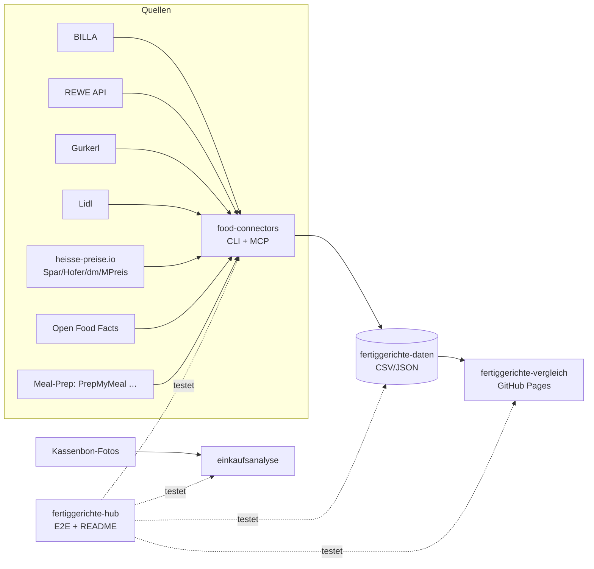

# 🥘 Fertiggerichte-Hub

Zentraler Index & Live-Status aller Fertiggerichte-Projekte (servas-ai). **Automatisch generiert:** 2026-10-24 18:16 UTC via `./run_all.sh` (stündlich).

**Connectors:** 31 ✅ / 8 ❌ / 7 📇 catalog-only · **Apps:** 3/3 live · **Produkte im Datensatz:** 3664

## Apps

| App | URL | Live | Tabs getestet | Konsolen-Fehler | Kaputte Bilder |
|---|---|---|---|---|---|
| Fertiggerichte-Vergleich | https://martin-hausleitner.github.io/fertiggerichte-vergleich/ | ✅ | 17 | 0 | 0 |
| Fertiggerichte-Vergleich (servas-ai Pages) | https://servas-ai.github.io/fertiggerichte-vergleich/ | ✅ | 17 | 0 | 0 |
| Einkaufsanalyse | https://servas-ai.github.io/einkaufsanalyse/ | ✅ | 8 | 0 | 0 |

## Repositories

| Repo | Zweck |
|---|---|
| [servas-ai/fertiggerichte-vergleich](https://github.com/servas-ai/fertiggerichte-vergleich) | Web-App (Vergleich, Netz 3D, Gesundheit, Hersteller …) |
| [servas-ai/food-connectors](https://github.com/servas-ai/food-connectors) | Connectors + CLI + MCP-Server |
| [servas-ai/fertiggerichte-daten](https://github.com/servas-ai/fertiggerichte-daten) | Offener Datensatz CSV/JSON |
| [servas-ai/einkaufsanalyse](https://github.com/servas-ai/einkaufsanalyse) | Einkaufsanalyse-Dashboard (Kassenbons) |

## Architektur



## Connector-Status (Live-Smoke-Test)

| | Connector | Store | Items | Latenz | Beispielprodukt (Beweis) | Zeitpunkt |
|---|---|---|---|---|---|---|
| ✅ | `adamah` | Online: ADAMAH BioHof | 3 | 3.16 s | [Rindsgulasch im Weckglas](https://www.adamah.at/Produktdetailseite/RindsgulaschimWeckglas_42093) · 11.9 € | 2026-10-24T18:08:07Z |
| ✅ | `alfies` | Alfies | 3 | 7.3 s | [Knorr Meisterkessel Gulaschsuppe](https://www.alfies.at/produkt/knorr-meisterkessel-gulaschsuppe-dose-500g-1) · 4.49 € | 2026-10-24T18:08:11Z |
| ✅ | `bauernladen` | Online: Bauernladen.at | 3 | 8.1 s | [Kalbsgulasch](https://bauernladen.at/produkte/fairkocht/kalbsgulasch-27286) · 17.9 € | 2026-10-24T18:08:18Z |
| ✅ | `billa` | BILLA | 3 | 1.19 s | [MAGGI Fix für Gulasch](https://shop.billa.at/produkte/maggi-fix-fuer-gulasch-0056152) · 1.49 € | 2026-10-24T18:08:27Z |
| ✅ | `biohof-achleitner` | Online: Biohof Achleitner | 3 | 4.74 s | [Hausg'mocht Rindsgulasch](https://www.biohof.at/Hausgmocht-Rindsgulasch-4755) · 8.7 € | 2026-10-24T18:08:28Z |
| ✅ | `bofrost` | Online: bofrost* | 3 | 9.19 s | [Wiener Rindsgulasch](https://www.bofrost.at/shop/fleisch_44196/fleischzubereitungen_34987/wiener-rindsgulasch_03373.html) · 14.99 € | 2026-10-24T18:08:33Z |
| ✅ | `denns` | denn's BioMarkt | 1 | 3.8 s | [NaBio Bio-Eintopf oder -Suppe](https://www.denns-biomarkt.at/angebote/) · 2.49 € | 2026-10-24T18:08:42Z |
| ✅ | `dm` | dm | 3 | 4.69 s | [babylove Menü Kartoffeltopf mit Rindergulasch ab d](https://www.dm.at/p/d/1602887/babylove-menue-kartoffeltopf-mit-rindergulasch-ab-dem-8-monat) · 1.15 € | 2026-10-24T18:08:46Z |
| ✅ | `every` | Online: every. | 3 | 15.28 s | [Turkish Lentil Soup](https://every-foods.com/products/turkish-lentil-soup) · 8.99 € | 2026-10-24T18:08:52Z |
| ✅ | `fittogo` | Online: Fit2go | 3 | 8.74 s | [Auberginen-Chili con Carne mit Käse Überbacken](https://fittogo.at/products/auberginen-chili-con-carne-mit-kase-uberbacken) · 9.99 € | 2026-10-24T18:09:07Z |
| ✅ | `gerbl` | Online: Gerbl im Glas | 3 | 24.41 s | [Gulaschsuppe](https://shop.gerbl.at/ecommerce/product?product_id=796882&category_id=150129) · 9.0 € | 2026-10-24T18:09:16Z |
| ✅ | `goldblatt` | Online: Goldblatt | 2 | 5.18 s | [Erdäpfel Gulasch](https://goldblatt.at/products/bio-erdapfel-gulasch) · 11.99 € | 2026-10-24T18:09:41Z |
| ✅ | `gourmet-daheim` | Online: GOURMET Daheim (Mahlzeit Linz) | 3 | 17.59 s | [Kartoffelgulasch mit Waldviertler Wurst](https://www.mahlzeit.co.at/wp-content/uploads/2026/03/Preisliste_Bestellschein_GDH_2026_inkl_MwSt_Mahlzeit_web.pdf) · 8.5 € | 2026-10-24T18:09:46Z |
| ✅ | `gourmetfein` | Online: Gourmetfein | 3 | 8.33 s | [Weißwurst 1,8kg](https://shop.gourmetfein.com/products/weisswurst-1-8kg) · 24.9 € | 2026-10-24T18:10:04Z |
| ✅ | `gurkerl` | Gurkerl.at | 3 | 1.37 s | [Gissinger Erdäpfelgulasch](https://www.gurkerl.at/21854-gissinger-erdaepfelgulasch) · 10.02 € | 2026-10-24T18:10:13Z |
| ✅ | `hofer-shop` | HOFER | 2 | 3.78 s | [Sonnhof Rindsgulasch](https://www.hofer.at/produkt/sonnhof-rindsgulasch-000000000000510738) · 9.49 € | 2026-10-24T18:10:15Z |
| ✅ | `issmich` | Online: iss mich! | 3 | 28.77 s | [Bio Rotweingulasch vom Freilandrind](https://www.issmich.at/Bio-Shop/Eintoepfe/Fleisch/15/Bio-Rotweingulasch-vom-Freilandrind) · 11.5 € | 2026-10-24T18:10:19Z |
| ✅ | `juit` | Online: Juit | 1 | 1.41 s | [Rindergulasch mit gegrillter Paprika](https://www.juit.com/de/gerichte/rindergulasch-mit-paprika) | 2026-10-24T18:10:48Z |
| ✅ | `kernbeisser` | Online: Kernbeißer | 3 | 20.5 s | [Maghreb-Hirse mit Artischocken](https://kernbeisser.at/produkt/maghreb-hirse-mit-artischocken/) · 9.0 € | 2026-10-24T18:10:50Z |
| ✅ | `livefresh` | Online: LiveFresh | 3 | 2.5 s | [Pasta Cheesy Spinat – Protein Bowl](https://livefresh.at/products/pasta-cheesy-spinat-400g) · 5.99 € | 2026-10-24T18:11:23Z |
| ✅ | `loewenanteil` | Online: Löwenanteil | 1 | 3.21 s | [Veganes Gulasch](https://www.loewenanteil.com/products/veganes-gulasch) · 9.99 € | 2026-10-24T18:11:26Z |
| ✅ | `mpreis-shop` | MPreis | 3 | 7.35 s | [Basis Gulasch](https://www.mpreis.at/shop/p/knorr-basis-gulasch-282001) · 0.69 € | 2026-10-24T18:11:30Z |
| ✅ | `myproduct` | Online: myProduct | 3 | 17.67 s | [Bio Szegediner Gulasch 460g - Fertiggericht von Ha](https://myproduct.at/bio-szegediner-gulasch-450ml-hartls-kulinarikum) · 12.79 € | 2026-10-24T18:11:37Z |
| ✅ | `nah-frisch` | Nah&Frisch | 2 | 187.96 s | [Knorr . Bitte zu Tisch Suppen](https://www.nahundfrisch.at/de/aktuelles/angebote-der-woche) | 2026-10-24T18:11:55Z |
| ✅ | `penny` | PENNY | 3 | 6.15 s | [Gulasch- od. Bratensaft](https://www.penny.at/produkte/gulasch-od-bratensaft-7818089) · 1.39 € | 2026-10-24T18:15:04Z |
| ✅ | `penny-shop` | PENNY | 3 | 8.49 s | [Gulasch- od. Bratensaft](https://www.penny.at/produkte/gulasch-od-bratensaft-7818089) · 1.39 € | 2026-10-24T18:15:10Z |
| ✅ | `prepmymeal` | Online: PrepMyMeal | 3 | 9.7 s | [CH: Gemüse Lasagne](https://prepmymeal.at/products/ch-gemuse-lasagne-3) · 14.5 € | 2026-10-24T18:15:19Z |
| ✅ | `ruckzuck` | Online: Ruck Zuck Laden (Dunzinger's) | 3 | 19.4 s | [Gulaschsaft](https://www.ruckzuck-laden.at/shop/Gulaschsaft-p731601508) · 6.4 € | 2026-10-24T18:15:29Z |
| ✅ | `spar-shop` | SPAR/INTERSPAR | 3 | 1.52 s | [TANN Rinds-Bratengulasch](https://www.interspar.at/shop/lebensmittel/tann-rinds-bratengulasch/p/835817) · 21.99 € | 2026-10-24T18:15:49Z |
| ✅ | `sperchenedergut` | Online: Sperchenedergut | 1 | 24.26 s | [Gulaschsuppe vom Bio-Angusrind](https://sperchenedergut.at/produkt/gulaschsuppe-vom-angusrind/) · 9.5 € | 2026-10-24T18:15:51Z |
| ✅ | `subway-at` | Subway | 3 | 34.01 s | [Italian B.M.T.®](https://www.subway.com/de-AT/MenuNutrition/Menu/Product?ProductId=5257&MenuCategoryId=238) | 2026-10-24T18:16:15Z |
| 📇 | `adeg` | ADEG | 0 | 0.0 s |  | 2026-10-24T18:08:11Z |
| 📇 | `bio-kistl` | Biohof Achleitner / Bio-Kistl OÖ | 0 | 0.0 s |  | 2026-10-24T18:08:28Z |
| ❌ | `dm-heisse` | dm | 0 | 0.64 s | `RobotsDisallowed: https://heisse-preise.io/data/latest-canonical.json` | 2026-10-24T18:08:51Z |
| 📇 | `foodora-market` | foodora market (Dmart) | 0 | 0.0 s |  | 2026-10-24T18:09:16Z |
| ❌ | `heisse-preise` | heisse-preise.io | 0 | 0.49 s | `RobotsDisallowed: https://heisse-preise.io/data/latest-canonical.json` | 2026-10-24T18:10:14Z |
| ❌ | `hofer` | HOFER | 0 | 0.48 s | `RobotsDisallowed: https://heisse-preise.io/data/latest-canonical.json` | 2026-10-24T18:10:15Z |
| ❌ | `lidl` | Lidl | 0 | 12.27 s | `HTTPError: HTTP Error 401: Unauthorized` | 2026-10-24T18:11:11Z |
| 📇 | `lieferando-shops` | Lieferando Shops | 0 | 0.0 s |  | 2026-10-24T18:11:23Z |
| 📇 | `mjam` | mjam (now foodora) | 0 | 0.0 s |  | 2026-10-24T18:11:29Z |
| ❌ | `mpreis` | MPREIS | 0 | 0.54 s | `RobotsDisallowed: https://heisse-preise.io/data/latest-canonical.json` | 2026-10-24T18:11:29Z |
| ❌ | `off` | Open Food Facts | 0 | 0.37 s | `RobotsDisallowed: https://world.openfoodfacts.org/cgi/search.pl?search_terms=gulasch&count` | 2026-10-24T18:15:03Z |
| ❌ | `spar` | SPAR/INTERSPAR | 0 | 0.59 s | `RobotsDisallowed: https://heisse-preise.io/data/latest-canonical.json` | 2026-10-24T18:15:48Z |
| ❌ | `unimarkt` | Unimarkt | 0 | 0.48 s | `RobotsDisallowed: https://heisse-preise.io/data/latest-canonical.json` | 2026-10-24T18:16:49Z |
| 📇 | `unimarkt-shop` | Unimarkt (UNIONLINE Shop) | 0 | 0.0 s |  | 2026-10-24T18:16:50Z |
| 📇 | `wokostswas` | wokostswas.at | 0 | 0.0 s |  | 2026-10-24T18:16:50Z |

### Bekannte Ausfälle (manuell gepflegt)

- `off` (Open Food Facts) ❌ seit 2026-10-16 (Hub-Lauf 22:59 UTC) dauerhaft, nicht mehr nur Upstream-503: OFF `robots.txt` verbietet für `User-agent: *` jetzt `/api`, `/cgi` und `/facets`, und der neue harte robots.txt-Gate in food-connectors (`0eaa455`) blockiert `cgi/search.pl` (Suche) und `api/v2/product` (EAN-Lookup) bewusst vor dem Request. `search.openfoodfacts.org` ist ebenfalls `Disallow: /`. Fix-Pfad (offen, food-connectors `adapters/off.py`): EAN-Lookup über die erlaubte Produktseite `/product/<ean>` (HTML), Suche über Open Prices / Datensatz-Dump statt Live-Suche. Kein Bypass des Gates.
- `lidl` ❌ HTTP 401 (bekannt, Lidl-API verlangt Auth; kein Login erlaubt).
- `heisse-preise`, `dm-heisse`, `hofer`, `mpreis`, `spar`, `unimarkt` ❌ seit Hub-Lauf 2026-10-17 20:07 UTC: Upstream-Ausfall bei heisse-preise.io. `https://heisse-preise.io/robots.txt` liefert HTTP 500 (nginx), und der robots.txt-Gate in food-connectors (`food_connectors/polite.py`) behandelt 5xx gemäß RFC 9309 korrekt als „alles verboten“, darum wird `data/latest-canonical.json` vor dem Request geblockt. Kein Code-Fehler, kein Bypass; erholt sich automatisch, sobald robots.txt wieder 200/4xx liefert.

## Datensatz

**3664 Produkte** · Tabellen: brand_tree 8, companies 160, establishments 4706, logos 316, nutrition 2825, online_mealprep 406, online_providers 3, prices 3270, producer_quality 4, producers 22, products 3664, stores 498

| Abdeckung | % |
|---|---|
| nutrition | 77.1 |
| price | 89.2 |
| photo | 94.5 |
| producer | 48.4 |
| brand | 90.9 |
| logos_total | 316 |

<details><summary>Produkte nach Kette</summary>

| Kette | Anzahl |
|---|---|
| Billa | 807 |
| Spar | 735 |
| Gurkerl | 536 |
| MPreis | 388 |
| Hofer | 231 |
| Alfies | 182 |
| bofrost | 144 |
| unbekannt (OFF) | 93 |
| HelloFresh | 93 |
| PrepMyMeal | 92 |
| Subway | 59 |
| Juit | 50 |
| NORDSEE | 39 |
| Lidl | 37 |
| dm | 35 |
| Fit to Go | 32 |
| Penny | 29 |
| Unimarkt | 29 |
| FitTaste | 18 |
| Denn's | 15 |
| Nah&Frisch | 10 |
| LiveFresh | 10 |

</details>

<details><summary>Produkte nach Fertigstufe/Lagerung</summary>

| Lagerung | Anzahl |
|---|---|
| Unklar (keine Lagerangabe) | 1223 |
| Tiefkühl (TK) | 1020 |
| Kühlregal (Menüschale/frisch) | 603 |
| Dose/Konserve | 422 |
| Trocken/Instant | 337 |
| Glas | 34 |
| Sous-vide (vakuum) | 14 |
| Beutel ungekühlt (Retort-Pouch) | 11 |

</details>

## Screenshots

### Fertiggerichte-Vergleich

| Tab | Desktop 1920 | Mobil 390 |
|---|---|---|
| home |  |  |
| Was kaufe ich heute? |  |  |
| Fertiggerichte filtern |  |  |
| Ernährungsplan |  |  |
| KI-Ansicht |  |  |
| Hofer Top 30 |  |  |
| Gericht vergleichen |  |  |
| Kategorien |  |  |
| Marken-Profil |  |  |
| Laden-Profil |  |  |
| Marken |  |  |
| Markenfamilien |  |  |
| Hersteller-Qualität |  |  |
| Läden & Werke |  |  |
| Filialen in der Nähe |  |  |
| Online-Anbieter |  |  |
| Multipot-Pro Garzeiten |  |  |

### Fertiggerichte-Vergleich (servas-ai Pages)

| Tab | Desktop 1920 | Mobil 390 |
|---|---|---|
| home |  |  |
| Was kaufe ich heute? |  |  |
| Fertiggerichte filtern |  |  |
| Ernährungsplan |  |  |
| KI-Ansicht |  |  |
| Hofer Top 30 |  |  |
| Gericht vergleichen |  |  |
| Kategorien |  |  |
| Marken-Profil |  |  |
| Laden-Profil |  |  |
| Marken |  |  |
| Markenfamilien |  |  |
| Hersteller-Qualität |  |  |
| Läden & Werke |  |  |
| Filialen in der Nähe |  |  |
| Online-Anbieter |  |  |
| Multipot-Pro Garzeiten |  |  |

### Einkaufsanalyse

| Tab | Desktop 1920 | Mobil 390 |
|---|---|---|
| home |  |  |
| Übersicht |  |  |
| Verlauf |  |  |
| Läden |  |  |
| Kategorien |  |  |
| Protein & Gesundheit |  |  |
| Kassenbons |  |  |
| Import |  |  |

## Changelog (letzte Commits)

**servas-ai/fertiggerichte-vergleich**

- `2484311` 2026-10-18 17:09 — data: Sensecheck 48 nutrition gap - Dean & David Teriyaki / Black Rice Protein Chicken Bowl (#2753, #2756) and Cevapcici #455 get the shop.billa.at label (pipeline fertig 55e89ee, local): rows 4049, dataVersion b6c978af0ace -> d79e6d508db1
- `4adce47` 2026-10-18 16:46 — data: Sensecheck 48 BILLA Kärntner Kasnudeln #558 satfat 2.0 -> 0.3 g/100 g (label; parser took the polyunsaturated line) (pipeline fertig ef98bf0, local): rows 4049, dataVersion 8e64539828f6 -> b6c978af0ace
- `5f30193` 2026-10-18 16:35 — data: Sensecheck 48 MPreis Käsnudeln #2774 <-> BILLA Kasnudeln #558 linked as same product (alsoAt both ways), #2774 label portion 200 g (pipeline fertig 51c450f, local): rows 4049, dataVersion 07bd2e089c23 -> 8e64539828f6
- `33b9df8` 2026-10-18 16:30 — data: online availability snapshot refreshed 2026-10-18T16:28:44Z (pipeline fertig a9d38f1, local): rows 4049, dataVersion 65ba832648f7 -> 07bd2e089c23
- `bb1be64` 2026-10-18 15:59 — Merge pull request #2 from Martin-Hausleitner/publish-push-window
- `4b05713` 2026-10-18 15:55 — publish_only.sh: wait until :50 before each push if UTC minute is 42-49
- `39c7266` 2026-10-18 15:01 — data: Sensecheck 47 (4) La Mia Familia #1970 and 146 more pizza/snack lines get the 'Pizza/Snack' chip (pipeline fertig 11e1322, local): rows 4049, dataVersion 063a9c6b5c79 -> 65ba832648f7
- `b635ea4` 2026-10-18 14:57 — data: Sensecheck 47 (3) no outdated 'Großpackung' flag on portioned packs, e.g. Clever Pizza Salami 3er #546 (pipeline fertig 7341323, local): rows 4049, dataVersion 0fab7d68d24c -> 063a9c6b5c79

**servas-ai/food-connectors**

- `761b841` 2026-10-24 17:38 — sperchenedergut: README CLI usage
- `2f7bb2d` 2026-10-24 17:38 — sperchenedergut: new live connector — Bio-Angus farm Sperchenedergut (Monika und Karl Mayer, Aspach OÖ, ATU76061208 VIES valid): public WooCommerce Store API → 3 heat-up jar meals 330 ml at 9,50 € incl. MwSt. (Gulaschsuppe, Beuschel, Chili con Carne) with stock + jar packshots; excludes Rinderfond/Bolognese sauce/Leberknödel and Geschenkbox duplicates; Post-Kühlversand 9,90 €, free from 150 €; no nutrition/GTIN published; CLI + MCP sperchenedergut_product/sperchenedergut_search; +3 offline tests
- `24492f1` 2026-10-18 04:59 — bauernladen: new live connector — Bauernladen.at farm-direct marketplace (Fundula Medien GmbH, vormals MN Anzeigenservice GmbH, Wien, FN 304617t, ATU64133538 VIES valid), category 'Schnelle Küche': server-rendered listing → product JSON-LD (price incl. MwSt., availability, images, seller) + pack size + producer address + producer AT delivery terms + Bio/Vegan/Kühl flags; robots allow, polite 1 req/s; no GTIN, nutrition only as unreferenced free text (not mapped); CLI + MCP bauernladen_product/bauernladen_search; +5 offline tests (140 passed)
- `1b57e85` 2026-10-18 04:16 — ruckzuck: new live connector — Ruck Zuck Laden / Dunzinger's Ruck Zuck Glasl (ruckzuck-laden.at, Schimpl OG, Hirschbach im Mühlkreis OÖ, FN 306047w, ATU64017307 VIES valid): WP store sitemap → public Ecwid storefront JSON (same unauthenticated call as the shop widget; robots allow; polite 1 req/s); 7 shelf-stable jar meals 7,40–9,70 € incl. 10 % MwSt. with ingredients, capital-marked allergens, vegan flag, jar packshot with printed dish label (serving illustration only in extra); ships AT 15 € / free from 100 €; no GTIN/nutrition published; CLI + MCP ruckzuck_product/ruckzuck_search; +4 offline tests (135 passed)
- `5174ba5` 2026-10-18 02:44 — gerbl: new live connector — Gerbl im Glas (shop.gerbl.at, Fleischhauerei Gerbl GmbH, Vöcklamarkt OÖ): category page (product_id links + vanity slug /rindsgulasch) → product pages (price incl. MwSt., 450 ml jar, ingredients, allergens, shelf life, official jar photo; HEAD 404 on gallery files → GET-verified); 19 pasteurised jar meals shipped within AT incl. Linz (9,90 € EMS); no GTIN/nutrition published; CLI + MCP gerbl_product/gerbl_search; +4 offline tests (131 passed)
- `96b59f4` 2026-10-18 01:44 — fittogo: take the hero packshot (first  in the --photo frame) before og:image/png fallback — new pages have no og:image and the png fallback returned the cross-sell grid photo of another meal (30.png Thai Red Curry) for Cheesy Taco Bowl + Topfennockerl; 30 existing meals re-checked live, image unchanged; +1 offline test with fixture
- `4dab3a4` 2026-10-18 01:14 — gourmet-daheim: dish photos by exact article number from Mahlzeit's public WP media library (/wp-json/wp/v2/media, robots allow-all, no auth): only '<7-digit art no>_….jpg' files mapped, '_cropped' derivatives skipped, pages until empty/400 (WP returns <per_page on full pages); live smoke 5 photos (2301928, 2302287, 2302564, 2310057, 2311070); +1 offline test
- `504f654` 2026-10-18 00:25 — gourmet-daheim: new live connector — GOURMET Daheim frozen à-la-carte menus delivered in all of Upper Austria incl. Linz by Mahlzeit Vertriebs GmbH (Linz): official price-list PDF (mahlzeit.co.at, valid from 2026-03-16, EUR incl. MwSt., net weight) joined on the 7-digit article number with the official allergen/nutrition PDF (gourmet-daheim.at/downloads; per 100 g nutrition, allergens, flags D/L/GF/LF/SF/VEG); 162 articles → 141 ready meals (cakes/compote excluded); no GTIN/photos published; CLI + MCP gourmet_daheim_product/search; +3 offline tests (125 passed)

**servas-ai/fertiggerichte-daten**

- `d18fa19` 2026-10-24 18:15 — Daten-Squad T1811: +3 Bauernladen.at-only Dunzinger's Ruck Zuck jar meals (Rehragout, Hirschragout vom heimischen Wild 370 g 9,50 €; BBQ Kokos Eintopf VEGAN 330 ml 8,40 €) not sold in the own shop ruckzuck-laden.at; no photo (shared Gulasch image / flyer composite → vision gate FAIL), no nutrition/GTIN; sitemap re-check of 14 254 Bauernladen offers found no further ready meals outside 'Schnelle Küche'. Online meal-prep 720→723. validate.py OK
- `d897e4e` 2026-10-24 17:39 — Sperchenedergut (Aspach OÖ): 3 Bio-Angus jar meals, company (UID ATU76061208 VIES valid), logo — online meal-prep 717→720
- `f83b7c8` 2026-10-24 17:06 — Daten-Squad T1703: +3 vision-gated producer logos for the Bauernladen.at producers — FAIRKOCHT (fairkocht.at header PNG, 19 meals), Christöphl Manufaktur (christoephl.at header SVG, 5), Genusss-Manufaktur Bruckner (nudelmanufaktur.at footer PNG, low-res, 2); logo rows 312→315; Hackl (hoster WAF block, not bypassed) and Venatio (no HTTP response) open. Files staged in scripts/logo_work_T1703. validate.py OK
- `01d312f` 2026-10-18 05:16 — Daten-Squad T0506: company rows for the Bauernladen.at producers (T0439 open item 2) — companies 154→159: +fairkocht gmbh FN 531976v/ATU75453279 (Andelsbuch, 19 meals), +Christöphl Manufaktur GmbH FN 414202x/ATU68596628 (Raaba-Grambach; 100 % parent MACH Genussprodukte GmbH FN 568278d), +"GENUSSS-MANUFAKTUR" Bruckner KG FN 428315a/ATU69302248 (Wien), +Hackls Happy Turkey GmbH FN 550716b/ATU76907224 (Atzelsdorf), +Venatio Wildspezialitäten (Einzelunternehmen lt. Impressum, no FN/UID → impressum-only); existing Roman Fenz e.U. (Danke Bauer) +chain Bauernladen.at, products 4→7. All FN from the producers' own Impressum, confirmed on evi.gv.at (status Eingetragen, Eintragungsdatum, Stammkapital, Geschäftszweig; natural-person shareholders counted not named) and VIES (valid, name+address match). No GLEIF records except Fenz. vom Sandriegel: no legal identity published → no row. online_mealprep: manufacturer field of 30 Bauernladen rows now carries legal name + FN. Evidence raw/companies_bauernladen_2026-10-18T0506.json. validate.py OK
- `53cee5f` 2026-10-18 04:59 — Daten-Squad T0439: new online marketplace Bauernladen.at (farm-direct, category 'Schnelle Küche'; each producer ships within AT incl. Linz) — +40 jar/heat-up ready meals from 7 Austrian producers (FAIRKOCHT Andelsbuch 19, Venatio Pellendorf 7, Christöphl Manufaktur Wildon 5, vom Sandriegel 3, Danke Bauer Villach 3, Genusss-Manufaktur Bruckner Wien 2, Hackls Happy Turkey 1) with price incl. MwSt., pack size + €/kg, producer address, producer shipping fee/threshold, Bio/vegan/storage flags; 37/40 vision-gated photos (jar packshots with printed dish name; Venatio styled serving photos), 3 rejected as likely AI illustrations. No GTIN / per-100 g nutrition published (3 free-text Nährwerte without reference kept in evidence only). Excluded 39: Dunzinger's 15 (already indexed via own shop), broths/sauces/sugo/sides/Knödel/desserts/boxes/powder/cold cuts, Galloway-Hof (100 km radius only). Companies 153→154: +Fundula Medien GmbH (vormals MN Anzeigenservice GmbH) FN 304617t HG Wien, ATU64133538 VIES valid, evi.gv.at 1 natural-person shareholder. Logo rows 311→312: Bauernladen chalkboard logo (vision PASS; staged in scripts/logo_work_T0439). online_mealprep 677→717. food-connectors 24492f1. Evidence raw/bauernladen_2026-10-18T0439.json. validate.py OK
- `2c2eda6` 2026-10-18 04:18 — Daten-Squad T0409: new online store Ruck Zuck Laden / Dunzinger's Ruck Zuck Glasl (ruckzuck-laden.at, Schimpl OG, Hirschbach im Mühlkreis OÖ; ships within AT incl. Linz, 15 €, free from 100 €) — +7 shelf-stable jar ready meals (Gulasch vom Rind 8,90, Rinder-Ragout 9,70, Curry mit Huhn 9,70, Chili con Carne 8,40, würziges Curry 8,40 vegan, Gemüse-Linsen-Eintopf 8,40 vegan, Erdäpfelgulasch 315 ml 7,40 vegan) with price incl. 10 % MwSt., ingredients, capital-marked allergens, 7/7 jar packshots with printed dish label (GET-verified, vision-gated); main serving images rejected as product photos (photorealistic illustrations, e.g. Chili shows cheese/carrot cubes not in the recipe). No nutrition/GTIN published → empty, not rankable. Excluded: 2 broths, 2 sauces, Rotkraut, Gulaschsaft, 3 Kekse, Hallo Baby Box. Companies 152→153: +Schimpl OG FN 306047w (LG Linz; evi.gv.at eingetragen 08.03.2008, OG, 2 partners), ATU64017307 VIES valid name+address, no GLEIF record. Logo rows 310→311: Dunzinger's pot logo from the site header (cropped, vision PASS; staged in scripts/logo_work_T0409). online_mealprep 670→677. food-connectors 1b57e85. Evidence raw/ruckzuck_2026-10-18T0409.json. validate.py OK
- `d38291f` 2026-10-18 03:48 — Daten-Squad T0311: probe only (box load 150–290, ~1 GB RAM) — new OÖ candidate Ruck Zuck Laden / Dunzinger's Ruck Zuck Glasl (ruckzuck-laden.at, Schimpl OG, Hirschbach im Mühlkreis; Impressum FN 306047w / ATU 64017307, not yet cross-checked): 17 Ecwid products from the public storefront JSON (ids via WP sitemap), 7 candidate jar meals 7,40–9,70 € with ingredients/allergens (no nutrition; SKUs pass EAN-13 check but not labelled GTIN → not used); excluded sauces, broth, side dish, baby gift box, Kekse. Nothing merged: shipping to Linz + photo vision gate + evi/VIES pending. Dead ends: Ed. Kaisers Wirtshausküche (no prices, B2B e-mail orders; snacks.co.at TLS EOF, not bypassed), Gasthaus Ziegler (no online shop). Evidence raw/ruckzuck_probe_2026-10-18T0311.json
- `2c866b0` 2026-10-18 02:44 — Daten-Squad T0236: new online store Gerbl im Glas (shop.gerbl.at, Fleischhauerei Gerbl GmbH, Vöcklamarkt OÖ; ships within Austria incl. Linz, 9,90 € EMS, dispatch Tuesdays) — +19 pasteurised glass-jar ready meals GIG01–GIG19 (Rindsgulasch, Kalbs-/Schweinsbeuschel, Gulaschsuppe, Rindsroulade, Zwiebelrostbraten, Gefüllte Paprika, Kichererbsencurry (vegetarisch) …), 9,00 € per ~450 ml jar (Rindssuppe 6,00 €), ingredients, allergens, shelf life (chilled 2–6 °C, ~12 weeks), 19/19 official jar packshots (GET-verified, vision-gated: lid/label number + dish name match). No nutrition/GTIN published → empty, not rankable; jar volume in ml → size_g empty. Excluded: Leberstreichwurst, 2 Geschenkskörbe. Companies 151→152: +Fleischhauerei Gerbl GmbH FN 612319w (LG Wels, evi.gv.at: eingetragen 19.09.2023, EUR 35 000, GF + Alleingesellschafter natural person), ATU79858539 VIES valid name+address; no GLEIF record. Logo rows 309→310: +Gerbl shop header logo (140x135, low-res, vision PASS; file staged in scripts/logo_work_T0236 until the fertig uid freeze lifts). online_mealprep 651→670. food-connectors 5174ba5. Evidence raw/gerbl_2026-10-18T0236.json. validate.py OK

**servas-ai/einkaufsanalyse**

- `66934e3` 2026-10-13 01:10 — Einkaufsanalyse v1: shadcn Sidebar-Dashboard, Import, OCR, Beispieldaten

## Ausführen

```bash
pip install pytest playwright && playwright install chromium
./run_all.sh   # Tests + Report + Push (mit Lock, stündlich via cron)
```
