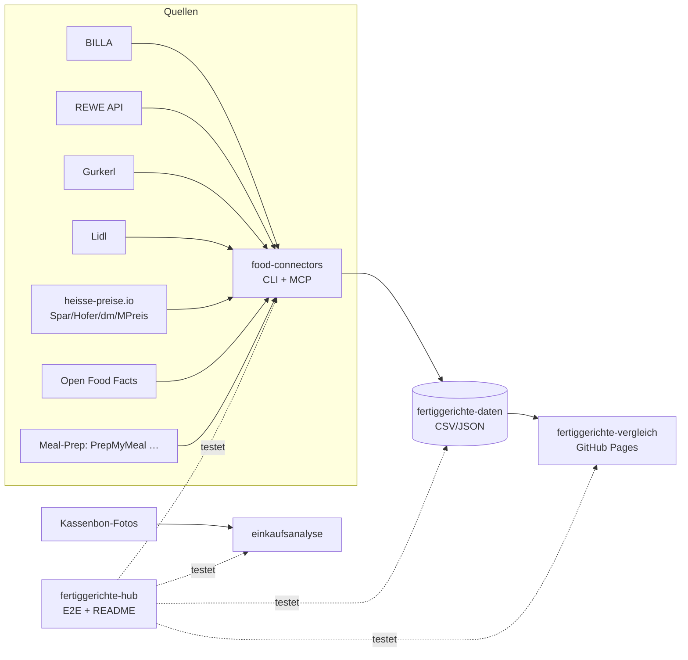

# 🥘 Fertiggerichte-Hub

Zentraler Index & Live-Status aller Fertiggerichte-Projekte (servas-ai). **Automatisch generiert:** 2026-10-16 20:03 UTC via `./run_all.sh` (stündlich).

**Connectors:** 27 ✅ / 2 ❌ / 7 📇 catalog-only · **Apps:** 3/3 live · **Produkte im Datensatz:** 3641

## Apps

| App | URL | Live | Tabs getestet | Konsolen-Fehler | Kaputte Bilder |
|---|---|---|---|---|---|
| Fertiggerichte-Vergleich | https://martin-hausleitner.github.io/fertiggerichte-vergleich/ | ✅ | 9 | 0 | 0 |
| Fertiggerichte-Vergleich (servas-ai Pages) | https://servas-ai.github.io/fertiggerichte-vergleich/ | ✅ | 9 | 0 | 0 |
| Einkaufsanalyse | https://servas-ai.github.io/einkaufsanalyse/ | ✅ | 8 | 0 | 0 |

## Repositories

| Repo | Zweck |
|---|---|
| [servas-ai/fertiggerichte-vergleich](https://github.com/servas-ai/fertiggerichte-vergleich) | Web-App (Vergleich, Netz 3D, Gesundheit, Hersteller …) |
| [servas-ai/food-connectors](https://github.com/servas-ai/food-connectors) | Connectors + CLI + MCP-Server |
| [servas-ai/fertiggerichte-daten](https://github.com/servas-ai/fertiggerichte-daten) | Offener Datensatz CSV/JSON |
| [servas-ai/einkaufsanalyse](https://github.com/servas-ai/einkaufsanalyse) | Einkaufsanalyse-Dashboard (Kassenbons) |

## Architektur



## Connector-Status (Live-Smoke-Test)

| | Connector | Store | Items | Latenz | Beispielprodukt (Beweis) | Zeitpunkt |
|---|---|---|---|---|---|---|
| ✅ | `alfies` | Alfies | 3 | 6.24 s | [Knorr Meisterkessel Gulaschsuppe](https://www.alfies.at/produkt/knorr-meisterkessel-gulaschsuppe-dose-500g) · 4.49 € | 2026-10-16T19:56:40Z |
| ✅ | `billa` | BILLA | 3 | 0.52 s | [MAGGI Fix für Gulasch](https://shop.billa.at/produkte/maggi-fix-fuer-gulasch-0056152) · 1.49 € | 2026-10-16T19:56:46Z |
| ✅ | `bofrost` | Online: bofrost* | 3 | 5.7 s | [Wiener Rindsgulasch](https://www.bofrost.at/shop/fleisch_44196/fleischzubereitungen_34987/wiener-rindsgulasch_03373.html) · 14.99 € | 2026-10-16T19:56:47Z |
| ✅ | `denns` | denn's BioMarkt | 1 | 3.79 s | [MyDeli Bio-Fleischsuppe](https://www.denns-biomarkt.at/angebote/) · 3.49 € | 2026-10-16T19:56:53Z |
| ✅ | `dm` | dm | 3 | 3.71 s | [babylove Menü Kartoffeltopf mit Rindergulasch ab d](https://www.dm.at/p/d/1602887/babylove-menue-kartoffeltopf-mit-rindergulasch-ab-dem-8-monat) · 1.15 € | 2026-10-16T19:56:56Z |
| ✅ | `dm-heisse` | dm | 3 | 3.36 s | HiPP Menü Spätzle mit Gulasch ab 8 Monaten, 220 g · 1.75 € | 2026-10-16T19:57:00Z |
| ✅ | `every` | Online: every. | 3 | 14.33 s | [Pumpkin Zucchini Risotto](https://every-foods.com/products/pumpkin-zucchini-risotto) · 8.99 € | 2026-10-16T19:57:05Z |
| ✅ | `fittogo` | Online: Fit2go | 3 | 4.93 s | [Auberginen-Chili con Carne mit Käse Überbacken](https://fittogo.at/products/auberginen-chili-con-carne-mit-kase-uberbacken) · 9.99 € | 2026-10-16T19:57:19Z |
| ✅ | `goldblatt` | Online: Goldblatt | 2 | 4.12 s | [Erdäpfel Gulasch](https://goldblatt.at/products/bio-erdapfel-gulasch) · 11.99 € | 2026-10-16T19:57:24Z |
| ✅ | `gourmetfein` | Online: Gourmetfein | 3 | 3.01 s | [Weißwurst 1,8kg](https://shop.gourmetfein.com/products/weisswurst-1-8kg) · 24.9 € | 2026-10-16T19:57:28Z |
| ✅ | `gurkerl` | Gurkerl.at | 3 | 0.58 s | [AMA Kalb Rosé Austria Gulasch geschnitten](https://www.gurkerl.at/22932-ama-kalb-rose-austria-gulasch-geschnitten) · 19.22 € | 2026-10-16T19:57:32Z |
| ✅ | `heisse-preise` | heisse-preise.io | 3 | 3.26 s | [Ager Hirschgulasch geschnitten](ager-hirschgulasch-geschnitten-00730647) · 11.99 € | 2026-10-16T19:57:32Z |
| ✅ | `hofer` | HOFER | 3 | 2.81 s | [GENUSS 100% AUS ÖSTERREICH Rindsgulasch 1kg](sortiment/GENUSS-100-AUS-OSTERREICH-Rindsgulasch-1kg) · 19.98 € | 2026-10-16T19:57:36Z |
| ✅ | `issmich` | Online: iss mich! | 3 | 33.85 s | [Bio Rotweingulasch vom Freilandrind](https://www.issmich.at/Bio-Shop/Eintoepfe/Fleisch/15/Bio-Rotweingulasch-vom-Freilandrind) · 11.5 € | 2026-10-16T19:57:40Z |
| ✅ | `juit` | Online: Juit | 1 | 0.78 s | [Rindergulasch mit gegrillter Paprika](https://www.juit.com/de/gerichte/rindergulasch-mit-paprika) | 2026-10-16T19:58:14Z |
| ✅ | `kernbeisser` | Online: Kernbeißer | 3 | 18.61 s | [Maghreb-Hirse mit Artischocken](https://kernbeisser.at/produkt/maghreb-hirse-mit-artischocken/) · 9.0 € | 2026-10-16T19:58:15Z |
| ✅ | `livefresh` | Online: LiveFresh | 3 | 0.72 s | [Pasta Cheesy Spinat – Protein Bowl](https://livefresh.at/products/pasta-cheesy-spinat-400g) · 5.99 € | 2026-10-16T19:58:46Z |
| ✅ | `loewenanteil` | Online: Löwenanteil | 1 | 2.15 s | [Veganes Gulasch](https://www.loewenanteil.com/products/veganes-gulasch) · 9.99 € | 2026-10-16T19:58:47Z |
| ✅ | `mpreis` | MPREIS | 3 | 3.46 s | AIA Puten Gulasch · 6.5 € | 2026-10-16T19:58:49Z |
| ✅ | `mpreis-shop` | MPreis | 3 | 7.04 s | [Basis Gulasch](https://www.mpreis.at/shop/p/knorr-basis-gulasch-282001) · 1.39 € | 2026-10-16T19:58:53Z |
| ✅ | `nah-frisch` | Nah&Frisch | 3 | 254.01 s | [Inzersdorfer Fertiggerichte oder Suppen](https://www.nahundfrisch.at/de/aktuelles/angebote-der-woche) | 2026-10-16T19:59:01Z |
| ✅ | `penny` | PENNY | 3 | 4.16 s | [Rindsgulaschfleisch](https://www.penny.at/produkte/rindsgulaschfleisch-78544603) · 15.99 € | 2026-10-16T20:03:26Z |
| ✅ | `penny-shop` | PENNY | 3 | 7.68 s | [Rindsgulaschfleisch](https://www.penny.at/produkte/rindsgulaschfleisch-78544603) · 15.99 € | 2026-10-16T20:03:30Z |
| ✅ | `prepmymeal` | Online: PrepMyMeal | 3 | 2.75 s | [CH: Gemüse Lasagne](https://prepmymeal.at/products/ch-gemuse-lasagne-3) · 14.5 € | 2026-10-16T20:03:38Z |
| ✅ | `spar` | SPAR/INTERSPAR | 3 | 2.98 s | Baron de Sel Gourmet Gulasch Bio 55g · 4.99 € | 2026-10-16T20:03:41Z |
| ✅ | `spar-shop` | SPAR/INTERSPAR | 3 | 0.6 s | [TANN Rinds-Bratengulasch](https://www.interspar.at/shop/lebensmittel/tann-rinds-bratengulasch/p/835817) · 21.99 € | 2026-10-16T20:03:45Z |
| ✅ | `unimarkt` | Unimarkt | 3 | 2.66 s | [Felix Erdäpfelgulasch](/Felix-Erdaepfelgulasch-3692) · 5.39 € | 2026-10-16T20:03:46Z |
| 📇 | `adeg` | ADEG | 0 | 0.0 s |  | 2026-10-16T19:56:40Z |
| 📇 | `bio-kistl` | Biohof Achleitner / Bio-Kistl OÖ | 0 | 0.0 s |  | 2026-10-16T19:56:47Z |
| 📇 | `foodora-market` | foodora market (Dmart) | 0 | 0.0 s |  | 2026-10-16T19:57:24Z |
| ❌ | `lidl` | Lidl | 0 | 11.87 s | `HTTPError: HTTP Error 401: Unauthorized` | 2026-10-16T19:58:34Z |
| 📇 | `lieferando-shops` | Lieferando Shops | 0 | 0.0 s |  | 2026-10-16T19:58:46Z |
| 📇 | `mjam` | mjam (now foodora) | 0 | 0.0 s |  | 2026-10-16T19:58:49Z |
| ❌ | `off` | Open Food Facts | 0 | 11.46 s | `HTTPError: HTTP Error 503: Service Temporarily Unavailable` | 2026-10-16T20:03:15Z |
| 📇 | `unimarkt-shop` | Unimarkt (UNIONLINE Shop) | 0 | 0.0 s |  | 2026-10-16T20:03:49Z |
| 📇 | `wokostswas` | wokostswas.at | 0 | 0.0 s |  | 2026-10-16T20:03:49Z |

## Datensatz

**3641 Produkte** · Tabellen: brand_tree 8, companies 138, establishments 4706, logos 298, nutrition 2811, online_mealprep 406, online_providers 3, prices 3259, producer_quality 4, producers 22, products 3641, stores 498

| Abdeckung | % |
|---|---|
| nutrition | 77.2 |
| price | 89.5 |
| photo | 93.6 |
| producer | 48.4 |
| brand | 90.9 |
| logos_total | 298 |

<details><summary>Produkte nach Kette</summary>

| Kette | Anzahl |
|---|---|
| Billa | 807 |
| Spar | 735 |
| Gurkerl | 536 |
| MPreis | 388 |
| Hofer | 223 |
| Alfies | 182 |
| bofrost | 144 |
| unbekannt (OFF) | 93 |
| HelloFresh | 93 |
| PrepMyMeal | 92 |
| Subway | 59 |
| Juit | 50 |
| NORDSEE | 39 |
| Lidl | 37 |
| dm | 35 |
| Fit to Go | 30 |
| Penny | 29 |
| Unimarkt | 29 |
| FitTaste | 18 |
| LiveFresh | 10 |
| Nah&Frisch | 7 |
| Denn's | 5 |

</details>

<details><summary>Produkte nach Fertigstufe/Lagerung</summary>

| Lagerung | Anzahl |
|---|---|
| Unklar (keine Lagerangabe) | 1222 |
| Tiefkühl (TK) | 1009 |
| Kühlregal (Menüschale/frisch) | 597 |
| Dose/Konserve | 422 |
| Trocken/Instant | 332 |
| Glas | 34 |
| Sous-vide (vakuum) | 14 |
| Beutel ungekühlt (Retort-Pouch) | 11 |

</details>

## Screenshots

### Fertiggerichte-Vergleich

| Tab | Desktop 1920 | Mobil 390 |
|---|---|---|
| home |  |  |
| Was kaufe ich heute? |  |  |
| Ernährungsplan |  |  |
| KI-Ansicht |  |  |
| Hofer Top 30 |  |  |
| Marken-Profil |  |  |
| Laden-Profil |  |  |
| Marken |  |  |
| Filialen in der Nähe |  |  |

### Fertiggerichte-Vergleich (servas-ai Pages)

| Tab | Desktop 1920 | Mobil 390 |
|---|---|---|
| home |  |  |
| Was kaufe ich heute? |  |  |
| Ernährungsplan |  |  |
| KI-Ansicht |  |  |
| Hofer Top 30 |  |  |
| Marken-Profil |  |  |
| Laden-Profil |  |  |
| Marken |  |  |
| Filialen in der Nähe |  |  |

### Einkaufsanalyse

| Tab | Desktop 1920 | Mobil 390 |
|---|---|---|
| home |  |  |
| Übersicht |  |  |
| Verlauf |  |  |
| Läden |  |  |
| Kategorien |  |  |
| Protein & Gesundheit |  |  |
| Kassenbons |  |  |
| Import |  |  |

## Changelog (letzte Commits)

**servas-ai/fertiggerichte-vergleich**

- `0a05641` 2026-10-16 19:52 — data: sensecheck 16 point 2 — Alfies (Wien/Graz) and Gurkerl (Wien/NÖ/Eisenstadt) do not deliver to 4020 Linz: their online-only rows stay visible (delivers_4020=false, delivery_source, rank_excluded_reason, flag 'Liefert nicht nach 4020 Linz – nicht in Rankings') but are no longer ranked; same product in a Linz chain ranks there (24 rows, e.g. Iglo Lasagne al Forno, Rana Teriyaki → Billa), 5 Gurkerl rows kept as stand-in because the Linz twin cannot rank (delivery_note). rankable 339 → 243; topHealth −11 Gurkerl/Alfies (M&S Beef Madras, PICARD ×3, Balanced Food, GAON Jokbal Kochbox …) → every./Löwenanteil/LiveFresh/bofrost/Billa; topPLI −7, topPE −4, topLight −1. data.delivery4020 (sources, Linz chains, stats). rows 3829. Pipeline fertig 57e5f9d. pytest 83/83, top50 ok, regress ok, gaps gate ok, build ok. No deploy.
- `9b0c8aa` 2026-10-16 19:51 — data: sensecheck 16 point 3 — cross-store twins without shared GTIN collapse in the top lists (pipeline twins.fuzzy_twin: same brand + size ±2 % + all name tokens matched): 'Rana Teriyaki Style Noodels mit Huhn' (Gurkerl) no longer takes a 2nd slot next to Billa's '…Hühnchen' in topHealth/topPLI (alsoAt Alfies, Gurkerl); stable gaps_overlay restore (Kräftige Hühnersuppe/Eierschwammerl Suppe keep Spar + SPAR category). rows 3829, rankable 339. Pipeline fertig b9c0fd1. pytest 82/82, top50 ok, regress ok, gaps gate ok, build ok. No deploy.
- `859ba5b` 2026-10-16 19:47 — data: sensecheck 16 points 1+4 — SPAR category coverage 136 → 619 of 746 Spar rows (resumable fetch fixed, public search-spar index): 127 more Spar rows ready_meal → grocery (Packerlsuppen, Fonds & Bouillons, Teigwaren/Gnocchi/Spätzle, Knödel-Fertigmischungen, Reis, Gewürze e.g. Kiano Curryblätter), 3 Eisknödel/Erdbeer-Topfen-Knödel → dessert; score_v2 nutrition_basis=dry from SPAR dry category for 70 rows (Packerlsuppen/Fix/Reis/Gewürze). None of them was rankable: rows 3829, rankable 339, topPLI/topPE/topHealth/topLight unchanged. Pipeline fertig 7d3b37a. pytest 80/80, top50 ok, regress ok, gaps gate ok, build ok. No deploy.
- `990c5c9` 2026-10-16 19:01 — data: sensecheck 15 — SPAR category guard (Spar rows reclassified: Natur*pur Steinpilz-/Tomaten-Risotto, Carnaroli, Gusto Naturale Trüffel, SPAR PREMIUM Risotto, Natur*pur Packerlsuppen → dry grocery; Holle/Hipp Gemüserisotto → baby_food; Kelomat Suppenlöffel nonfood; Suppengrün/Suppenhendl grocery); badge 'Preis-Sieger, Gesundheit mittel' 0 → 29 rows (top 10 % protein/EUR ≥7,49 g/€, score 30–44, badgeRule); shipping known for Fit to Go/FitTaste/Löwenanteil/bofrost (shipPor/pPorEff, data.shipping with source_url+checked; Alfies unknown). rows 3829, rankable 339 (unchanged). Pipeline fertig cb08173. pytest 77/77, top50 ok, regress ok, gaps gate ok, build ok. No deploy.
- `3631061` 2026-10-16 19:01 — gate (sensecheck 15 point 5): scripts/check_gaps_applied.mjs fails when public/data.json was exported without gaps_overlay --apply (same thresholds as fertig test_sensecheck14); wired into prepush_gate.sh (+ GATE_FAST=1 data-only mode) and scripts/git-pre-push hook for pushes of main
- `8b480a2` 2026-10-16 18:35 — data: hourly T17+T18 2026-10-16 — +59 verified heat-up items (T17: 34 Gurkerl/MPreis search leftovers + Alfies getvoila/Rana/Radatz/Knödelwerkstatt/Every/Ben Fatto/Freda/Dean&David; T18: 25 bofrost* warm Nachspeisen + Vorspeisen: Kaiserschmarrn, Marillen-/Erdbeer-/Mini-Germknödel, Topfennockerl, Mohnnudeln, Apfel-/Topfenstrudel, Palatschinken, Frühlingsrollen, Asia-Teigtaschen, Flammkuchen, Kaspressknödel) from public product pages; Flammkuchen no longer dessert; + 4 brand logos (ajinomoto, elfer-11er, getvoila, mamma-emma, Daten-Squad T1736). rows 3770→3829, rankable 337→339. Pipeline fertig hourly/t18-2026-10-16. pytest 73/73, top50 ok, build ok, Playwright 40 tabs×2 viewports 0 errors, 0/11006 broken images. No deploy.
- `44f4d16` 2026-10-16 17:56 — Merge remote-tracking branch 'origin/main' into feature/variant-cap
- `62d713f` 2026-10-16 17:56 — price_condition badge shows price_condition_info source (tooltip: host + checked date; https-only link)

**servas-ai/food-connectors**

- `ac16ed7` 2026-10-16 19:53 — bofrost: starters += Pizzettis, Rösti-Baguette, Gemüse-/Broccoli-Laibchen, Schinken-Käse-Röllchen (warm baked snacks; breaded cheese stays out); ready-meals DISH_SLUG += schlemmerfilet; tests
- `994f35c` 2026-10-16 18:33 — bofrost: opt-in course fetches — fetch(category="desserts") warm Mehlspeisen (Knödel, Kaiserschmarrn, Topfennockerl, Mohnnudeln, Strudel, Palatschinken; no Torten/Eis/raw dough) and fetch(category="starters") warm Vorspeisen (Frühlingsrollen, Teigtaschen, Flammkuchen, Kaspressknödel); extra.course; default ready-meal filter unchanged; test_course_url_filters
- `8777b7a` 2026-10-14 07:30 — Daten-Squad T0740: new live connector alfies (Alfies Wien/Graz online supermarket, Alfie's GmbH, Wien)
- `9650f94` 2026-10-14 06:57 — Daten-Squad T0636: new live connector issmich (iss mich! Wiener Bio-Eintöpfe & Suppen im WECK-Glas, iss mich! GmbH, Wien)
- `cf54f79` 2026-10-14 06:08 — Daten-Squad T0605: new live connector goldblatt (Goldblatt High Protein Bio glass-jar ready meals, Golden Veggies GmbH, Bad Waltersdorf)
- `6597c0d` 2026-10-14 05:08 — Daten-Squad T0504: new live connector kernbeisser (Kernbeißer vegan Vollkorn-Fertiggerichte im Glas, Wien)
- `241e063` 2026-10-14 04:52 — Daten-Squad T0441: new live connector loewenanteil (Löwenanteil Bio glass-jar ready meals)
- `bab2e1d` 2026-10-14 03:58 — feat(every): live every. (every-foods.com) connector — frozen plant-based ready meals shipped to AT (DPD per shop shipping policy, 5,99 €, free from 8 meals) via public Shopify storefront JSON eat.every-foods.com/products.json (price EUR, SKU, availability, packshots) + product pages (Storyblok product blok: weight, nutrition per 100 g + pack, ingredients, preparation; bilingual DE/EN table parser, pack-column typo flag); ready meals = product_type Meal, price > 0, in DE product sitemap; robots-allowed, no login/cookies, 1 req/s; no GTIN → ean None; MCP every_product + every_search; offline tests with fixture (2026-10-14T0341)

**servas-ai/fertiggerichte-daten**

- `5bf43ba` 2026-10-16 19:18 — Daten-Squad T1907: record founded-source breakdown in evidence (GLEIF 45, Firmenbuch ≥1996 18, Wikidata 2; corrects 47/16 split in 200c17d message)
- `200c17d` 2026-10-16 19:17 — Daten-Squad T1907: company founding date 23→88/138 (GLEIF legal-entity creationDate 47, Firmenbuch Eintragungsdatum ≥1996 via evi.gv.at 16, Wikidata P571 by identifier 2 — Billa 1953, Rügenwalder 1834), shareholders 20→55/138 (evi.gv.at Gesellschafter: legal entities named, natural persons only counted), share capital/business line/register status for 59 AT rows (JSON), Billa employees ca. 20.000 (2021, Wikidata); 2 GLEIF-vs-Firmenbuch date conflicts (Mars Austria OG, Danone Österreich) and 8 FBG-1991 transfer dates not taken
- `ce128bf` 2026-10-16 19:02 — Daten-Squad T1835: company master data from own legal notices — official website 81→102/138 (legal-notice page carries the row's verified LEI/FN/HRB/register no.; Ehrmann = group site at identical seat, noted), registered address 117→134/138 (17 DE rows; DE VIES returns none; Lotao skipped: notice names Bio-Zentrale Naturprodukte GmbH), VAT id 70→86/138 (16 printed on the company's own notice + VIES valid: AT/IT name match 1.0, DE only with legal name + register no. on page); rejected Glatz (group entity ≠ Glatz GmbH); felix/berglandmilch/dm JS-only, nestle.at 403 not bypassed
- `8df8189` 2026-10-16 18:22 — Daten-Squad T1805: companies legal entity 125→129/138 (LEI or VIES UID) — Mochi Production GmbH ATU76763147/FN 554188h (shoppu.mochi.at Impressum, VIES), St. Hildegard-Posch GmbH ATU61930557/FN 266429h (Hildegard Grünkraft Impressum, VIES), FRA NUI ESPAÑA S.L. LEI 959800UR1864J6SPSH33 + ESB40502403 (VIES name match), GASTROTECH s.r.o. CZ06661645 (ARES + VIES); non-EU register IDs: Planted Foods AG CHE-398.606.506 (Swiss UID register), Gü → GU INDULGENT FOODS LIMITED 07104090 (Companies House); FN-only: Knödelwerkstatt GmbH FN 508483w, Kasnudl GmbH = FN 425910p (now Invaro GmbH), Alimentastic Food Innovation GmbH = FN 615538d (corrects T1706 successor mapping); Bauck GmbH HRB 205474; Delikatessa/Peter Hiel/MPREIS-Partner documented dead ends
- `2260dfc` 2026-10-16 17:43 — Daten-Squad T1736: drop unverified legal-name alias from the 11er logo row (only brand names kept)
- `686eab7` 2026-10-16 17:41 — Daten-Squad T1736: logo long tail — +4 vision-gated brand logos (11er/elfer 11er.at SVG, Ajinomoto Commons PD wordmark incl. 'Ajinomoto Oyakata' rows, getvoila getvoila.com SVG recoloured dark, Mamma Emma mammaemma.it SVG) + aliases Followfood/Frank Juice/Die Knödelwerkstatt onto existing file-backed rows; Followfish alias rejected (old wordmark); strict logo-less 61→54 brands / 100→75 products
- `37a4feb` 2026-10-16 17:17 — Daten-Squad T1706: Alfies restock — +4 ready meals restocked at T0809 (Feel Food Chili sin Carne, Followfood Pizza BIG Mediterrana, Humza Frühlingsrollen, Mama Noodles Beef; 182 kept); T1706 re-probe of all 5 warehouses: remaining 111 still out of stock everywhere 57 h later → treated as delisted
- `348294c` 2026-10-16 17:17 — Daten-Squad T1706: legal entity identified for Stadtküche (Knödelhütte GmbH FN 675365i, ATU83103945 VIES valid via kasnudl.at Impressum) and Unimarkt (GLEIF 529900X5GBP4KNVUYQ35, FN 25076b); Alimentastic GmbH legal name/address/court from Impressum (UID VIES-invalid, not marked verified); rejected 4 look-alike matches with evidence

**servas-ai/einkaufsanalyse**

- `66934e3` 2026-10-13 01:10 — Einkaufsanalyse v1: shadcn Sidebar-Dashboard, Import, OCR, Beispieldaten

## Ausführen

```bash
pip install pytest playwright && playwright install chromium
./run_all.sh   # Tests + Report + Push (mit Lock, stündlich via cron)
```
