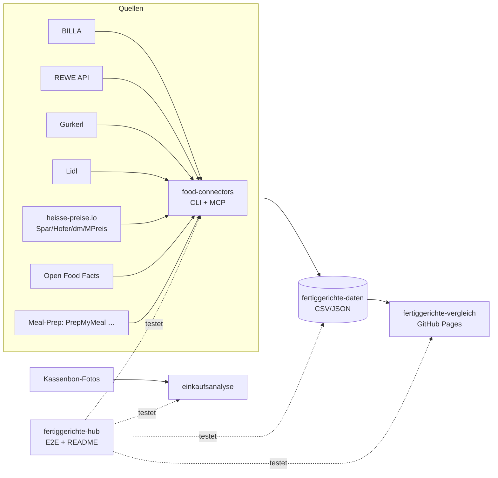

# 🥘 Fertiggerichte-Hub

Zentraler Index & Live-Status aller Fertiggerichte-Projekte (servas-ai). **Automatisch generiert:** 2026-10-14 00:32 UTC via `./run_all.sh` (stündlich).

**Connectors:** 6 ✅ / 4 ❌ / 6 📇 catalog-only · **Apps:** 3/3 live · **Produkte im Datensatz:** ?

## Apps

| App | URL | Live | Tabs getestet | Konsolen-Fehler | Kaputte Bilder |
|---|---|---|---|---|---|
| Fertiggerichte-Vergleich | https://martin-hausleitner.github.io/fertiggerichte-vergleich/ | ✅ | 30 | 0 | 0 |
| Fertiggerichte-Vergleich (servas-ai Pages) | https://servas-ai.github.io/fertiggerichte-vergleich/ | ✅ | 30 | 0 | 0 |
| Einkaufsanalyse | https://servas-ai.github.io/einkaufsanalyse/ | ✅ | 8 | 0 | 0 |

## Repositories

| Repo | Zweck |
|---|---|
| [servas-ai/fertiggerichte-vergleich](https://github.com/servas-ai/fertiggerichte-vergleich) | Web-App (Vergleich, Netz 3D, Gesundheit, Hersteller …) |
| [servas-ai/food-connectors](https://github.com/servas-ai/food-connectors) | Connectors + CLI + MCP-Server |
| [servas-ai/fertiggerichte-daten](https://github.com/servas-ai/fertiggerichte-daten) | Offener Datensatz CSV/JSON |
| [servas-ai/einkaufsanalyse](https://github.com/servas-ai/einkaufsanalyse) | Einkaufsanalyse-Dashboard (Kassenbons) |

## Architektur



## Connector-Status (Live-Smoke-Test)

| | Connector | Store | Items | Latenz | Beispielprodukt (Beweis) | Zeitpunkt |
|---|---|---|---|---|---|---|
| ✅ | `billa` | BILLA | 3 | 0.39 s | [MAGGI Fix für Gulasch](https://shop.billa.at/produkte/maggi-fix-fuer-gulasch-0056152) · 1.49 € | 2026-10-13T23:56:17Z |
| ✅ | `denns` | denn's BioMarkt | 1 | 4.11 s | [MyDeli Bio-Fleischsuppe](https://www.denns-biomarkt.at/angebote/) · 3.49 € | 2026-10-13T23:56:18Z |
| ✅ | `dm` | dm | 3 | 3.77 s | [babylove Menü Kartoffeltopf mit Rindergulasch ab d](https://www.dm.at/p/d/1602887/babylove-menue-kartoffeltopf-mit-rindergulasch-ab-dem-8-monat) · 1.15 € | 2026-10-13T23:56:22Z |
| ✅ | `gourmetfein` | Online: Gourmetfein | 3 | 2.82 s | [Weißwurst 1,8kg](https://shop.gourmetfein.com/products/weisswurst-1-8kg) · 24.9 € | 2026-10-14T00:06:38Z |
| ✅ | `gurkerl` | Gurkerl.at | 3 | 0.54 s | [AMA Kalb Rosé Austria Gulasch geschnitten](https://www.gurkerl.at/22932-ama-kalb-rose-austria-gulasch-geschnitten) · 16.1 € | 2026-10-14T00:06:41Z |
| ✅ | `livefresh` | Online: LiveFresh | 3 | 1.47 s | [Pasta Cheesy Spinat – Protein Bowl](https://livefresh.at/products/pasta-cheesy-spinat-400g) · 5.99 € | 2026-10-14T00:29:48Z |
| 📇 | `adeg` | ADEG | 0 | 0.0 s |  | 2026-10-13T23:56:17Z |
| 📇 | `bio-kistl` | Biohof Achleitner / Bio-Kistl OÖ | 0 | 0.0 s |  | 2026-10-13T23:56:18Z |
| ❌ | `dm-heisse` |  | 0 | 300 s | `timeout 300s` |  |
| 📇 | `fittogo` | Fit to Go | 0 | 0.0 s |  | 2026-10-14T00:06:38Z |
| 📇 | `foodora-market` | foodora market (Dmart) | 0 | 0.0 s |  | 2026-10-14T00:06:38Z |
| ❌ | `heisse-preise` |  | 0 |  s | `smoke exited rc=-9 without output: ` |  |
| ❌ | `hofer` |  | 0 | 300 s | `timeout 300s` |  |
| ❌ | `lidl` | Lidl | 0 | 11.34 s | `HTTPError: HTTP Error 401: Unauthorized` | 2026-10-14T00:29:37Z |
| 📇 | `lieferando-shops` | Lieferando Shops | 0 | 0.0 s |  | 2026-10-14T00:29:48Z |
| 📇 | `mjam` | mjam (now foodora) | 0 | 0.0 s |  | 2026-10-14T00:29:50Z |

## Datensatz

**? Produkte** · Tabellen: 

| Abdeckung | % |
|---|---|

<details><summary>Produkte nach Kette</summary>

| Kette | Anzahl |
|---|---|

</details>

<details><summary>Produkte nach Fertigstufe/Lagerung</summary>

| Lagerung | Anzahl |
|---|---|

</details>

## Screenshots

### Fertiggerichte-Vergleich

| Tab | Desktop 1920 | Mobil 390 |
|---|---|---|
| home |  |  |
| Feed |  |  |
| Galerie |  |  |
| Vergleichs-Board |  |  |
| Gericht vergleichen |  |  |
| Top-Listen |  |  |
| Kategorien |  |  |
| Marken-Profil |  |  |
| Laden-Profil |  |  |
| Marken |  |  |
| Markenfamilien |  |  |
| Dashboard |  |  |
| Gesundheit & Qualität |  |  |
| Analyse |  |  |
| Preis vs. Protein |  |  |
| Verpackungen |  |  |
| Marken-Matrix |  |  |
| Hersteller |  |  |
| Wer steckt dahinter? |  |  |
| Firmenvergleich |  |  |
| Hersteller-Qualität |  |  |
| Logos |  |  |
| Netz 3D |  |  |
| Läden & Werke |  |  |
| Filialen in der Nähe |  |  |
| Online-Anbieter |  |  |
| Wochenplaner |  |  |
| Kombi-Ideen |  |  |
| Fit to Go vs. Supermarkt |  |  |
| Multipot-Pro Garzeiten |  |  |

### Fertiggerichte-Vergleich (servas-ai Pages)

| Tab | Desktop 1920 | Mobil 390 |
|---|---|---|
| home |  |  |
| Feed |  |  |
| Galerie |  |  |
| Vergleichs-Board |  |  |
| Gericht vergleichen |  |  |
| Top-Listen |  |  |
| Kategorien |  |  |
| Marken-Profil |  |  |
| Laden-Profil |  |  |
| Marken |  |  |
| Markenfamilien |  |  |
| Dashboard |  |  |
| Gesundheit & Qualität |  |  |
| Analyse |  |  |
| Preis vs. Protein |  |  |
| Verpackungen |  |  |
| Marken-Matrix |  |  |
| Hersteller |  |  |
| Wer steckt dahinter? |  |  |
| Firmenvergleich |  |  |
| Hersteller-Qualität |  |  |
| Logos |  |  |
| Netz 3D |  |  |
| Läden & Werke |  |  |
| Filialen in der Nähe |  |  |
| Online-Anbieter |  |  |
| Wochenplaner |  |  |
| Kombi-Ideen |  |  |
| Fit to Go vs. Supermarkt |  |  |
| Multipot-Pro Garzeiten |  |  |

### Einkaufsanalyse

| Tab | Desktop 1920 | Mobil 390 |
|---|---|---|
| home |  |  |
| Übersicht |  |  |
| Verlauf |  |  |
| Läden |  |  |
| Kategorien |  |  |
| Protein & Gesundheit |  |  |
| Kassenbons |  |  |
| Import |  |  |

## Changelog (letzte Commits)

**servas-ai/fertiggerichte-vergleich**

- `632854d` 2026-10-13 23:10 — data: Hofer 4 OFF name-matches (GC Lasagne Bolognese 1kg, Kartoffel Gnocchi 500g, Wrap Hühnerfiletstreifen 170g, Wrap Thunfisch 170g), nutrition_source='OFF name-match'
- `356b554` 2026-10-13 23:06 — data: baby meal_class exclusion + OFF/near ranking dedupe
- `781581b` 2026-10-13 22:57 — hourly T22: +40 verified meals (MPreis 20: Iglo Nuggets/Fischstäbchen/Gebackene Champignons, Alpenhain/Jeden Tag Back-Camembert, Garden Gourmet Vegane Schnitzel, Wagner Piccolinis/Steinofen via identical-product twins, Dozz Gazpacho via OFF-EAN; BILLA 11: Iglo Dorsch/Scholle/Polar-Dorsch/Fisch'n'Crunch/Ofengarnelen, Nordsee Knuspergarnelen, Dr. Oetker Suprema Tonno; Gurkerl 9: Iglo Backhendlstreifen/Nuggets, Bedford, Die Pflanzerei Wiener Mitzl, Yuu'n Mee, Alpenhain Back-Gouda), brand tree +Bedford→Mutsaers, Die Pflanzerei, Yuu'n Mee, DOZZ→Food Vision, Garden Gourmet→Nestlé; Wer-steckt-dahinter 'Woher kommen die Konzerne?' Länder-Chart + Top-8-Konzern-Anteile
- `9f9f191` 2026-10-13 22:53 — rankings: separate light_meal topLight (300–400 kcal), collapse cross-store dupes in top lists, drop exact Hofer Kasnudeln twin
- `17b625a` 2026-10-13 22:51 — logos: HelloFresh CDN SVG (93 products) T22
- `91d4266` 2026-10-13 22:16 — data: OFF-only rows matched by exact GTIN to Gurkerl/MPreis/dm live (+18 store/price), 8 OFF duplicates dropped
- `b3648a2` 2026-10-13 21:17 — data(squad T21): PENNY live via new food-connectors penny-shop (penny.at public online-assortment JSON): Penny 22→30 products, live prices 7→15, photos 17→25; Ofenbackfisch multi-buy 3.49 'bei 2 Packungen' corrected to single-pack 6.99
- `f2b2057` 2026-10-13 21:05 — data(linz): linz_providers.json +PrepMyMeal/LiveFresh (359 rows, 244 ready_meal)

**servas-ai/food-connectors**

- `46014e3` 2026-10-13 21:14 — feat(penny-shop): live PENNY AT connector via penny.at's public online-assortment JSON (REWE product-discovery listing + /products/<sku>; robots Sitemap-only, no login/cookies) — regular + standard price, promo text/validity, €/unit, pack, category path, origin, official image; MCP penny_product + penny_search; offline tests with fixtures (2026-10-13T21)
- `91f223b` 2026-10-13 20:53 — feat(nah-frisch): live Nah&Frisch AT connector via the public 'Angebote der Woche' page (robots Allow; tiles from /media, /images+/storage never requested) — KW tabs with validity, official offer tiles, optional tesseract OCR for brand/name/pack/price/badge (extra.ocr, raw text kept); MCP nahfrisch_offers; offline tests with fixtures; ADEG documented as Issuu-flipbook dead end (2026-10-13T20b)
- `c7a16c0` 2026-10-13 20:10 — feat(denns): live denn's BioMarkt AT connector via the public weekly offer feed (Gatsby page-data, robots Allow) — article no., brand, pack, Aktionspreis + Normalpreis, €/kg, validity, vegan flags, official image; MCP denns_offers; live adapters now override catalog-only stubs; offline tests (2026-10-13T20)
- `509f6f6` 2026-10-13 19:48 — fix(spar-shop): code-internal is a SPAR-internal 88… code, not a GTIN → extra.spar_code_internal, ean=None; docs (2026-10-13T19b)
- `1b4bbfc` 2026-10-13 19:47 — feat(spar-shop): live SPAR/INTERSPAR connector via SPAR's public product search API (exact article-number lookup: price, regular price, €/kg, GTIN, stock, image); MCP spar_product; weight products flagged per-100g; tests (2026-10-13T19b)
- `086a6e3` 2026-10-13 18:25 — fix(mpreis): drop shop placeholder image (/assets/noImage_detail-*.webp, site-relative → 404 downstream); only absolute http image URLs kept; tests (2026-10-13T17)
- `3500939` 2026-10-13 17:28 — fix(impressum): VAT regex accepts grouped-digit UIDs ('ATU 43 20 34 03', 'NL 853 640 804 B 01') seen on penny.at/heiploeg.com legal notices; test (2026-10-13T17)
- `aa3d626` 2026-10-13 15:23 — feat(billa/penny): storage class (frozen/chilled from badge, parent category, -18°C statement) + category path in enrich; keep Normalpreis (price.standard) next to promo price; more TK stems (Mohnnudeln, Apfelstrudel, Fischstäbchen, Erdäpfeltascherl); gurkerl fetch adds TK Fischstäbchen/Schlemmerfilet categories; tests (2026-10-13T14)

**servas-ai/fertiggerichte-daten**

- `eec2a2a` 2026-10-13 23:44 — Daten-Squad T2340: +6 vision-gated Eigenmarke/brand logos (Vemondo, Nature's Gold, Yum Yum, Kania, M MPreis-Eigenmarke, Leitgeb's)
- `349a65d` 2026-10-13 23:21 — Daten-Squad T23: +7 vision-gated Eigenmarke/brand logos + EAN overlay export
- `23e08bd` 2026-10-13 22:47 — logos: HelloFresh official CDN SVG (93 products) + OFF GTIN match evidence
- `cbcce45` 2026-10-13 21:42 — raw: hourly T20 (+21 meals MPreis/Gurkerl, recovered) + T21 (+28 meals: SPAR 20 via spar-shop + identical-product twin label data, MPreis 7, Gurkerl 1) evidence, SPAR twin matches, data QA gates
- `e08067f` 2026-10-13 21:21 — PENNY AT live via new food-connectors penny-shop (penny.at public online-assortment JSON, 453 items): Penny products 22→30 (+8 ready meals: Podravka Rindergulasch 4.99, Ich bin Österreich Wiener Schnitzel 4.99, Dr. Oetker Ristorante 2er 3.49, Gabelkönig Semmelknödel-Rolle 2.79, Maggi Magic Asia 0.99, Taste of Asia Knuspergarnelen 3.29, Heinz Baked Beans 2.99, Iglo Fischstäbchen 2.99), live prices 7→15, photos 17→25; multi-buy guard: Iglo Ofenbackfisch 3.49 'bei 2 Packungen' → single-pack Normalpreis 6.99, Baked Beans 1.99 'bei 3 Dosen' → 2.99; 12 OFF/Chef-Menü rows not in online assortment unchanged; no nutrition for multi-variant offers; overlay /workspace/fertig/penny_live_overlay.json applied in score.py; evidence raw/penny_2026-10-13T21.json. Re-export also carries concurrent pipeline rows (mealkits_src +93 OFF, Gurkerl/MPreis +21): products 2957→3079, prices 2603→2725
- `de8576e` 2026-10-13 20:53 — Nah&Frisch AT: first 7 products (0→7) via new food-connectors nah-frisch (public 'Angebote der Woche' offer tiles KW41/42, tesseract OCR + visual verification): iglo Pikante Knödel Fleischknödel 400 g 3.99 €, Knorr Kaiserteller Grießnockerl-/Knoblauchcremesuppe 1.39 €, Inzersdorfer Rindsgulasch/Gulaschsuppe/Gefüllte Paprika/Weinbeuschel 400 g ('25% billiger', no absolute price); 7/7 official tile photos; nutrition/EAN only from identical-product twins (BILLA/MPreis/Gurkerl); products 2950→2957, prices 2600→2603, nutrition 2115→2122; evidence raw/nahfrisch_2026-10-13T20b.json
- `c84fd75` 2026-10-13 20:22 — denn's BioMarkt AT: first 5 products (0→5) via new food-connectors denns (public AT offer feed: MyDeli Bio-Fleischsuppe, SOTO Fingerfood, followfood Airfryer Fish Nuggets — Normalpreis + Aktionspreis/validity) + 2 OFF denn's-tagged Natur Compagnie soups (nutrition, no price); products 2945→2950; evidence raw/denns_2026-10-13T20.json
- `1403505` 2026-10-13 20:00 — prices: SPAR live 2026 via new food-connectors spar-shop (SPAR public search API, exact article number): Spar live 493→612, 'Preis 2025' 150→31 (122 articles confirmed listed, 1 real price change Iglo Lasagne skipped on pack-size mismatch 350→700 g, 17 article numbers no longer listed, 11 counter/weight products unchanged); re-export products 2915→2945; evidence raw/spar_live_2026-10-13T19.json

**servas-ai/einkaufsanalyse**

- `66934e3` 2026-10-13 01:10 — Einkaufsanalyse v1: shadcn Sidebar-Dashboard, Import, OCR, Beispieldaten

## Ausführen

```bash
pip install pytest playwright && playwright install chromium
./run_all.sh   # Tests + Report + Push (mit Lock, stündlich via cron)
```
